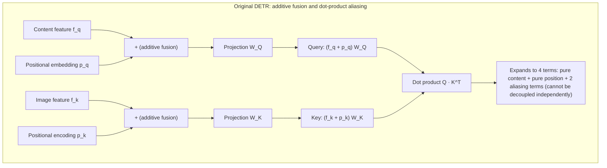
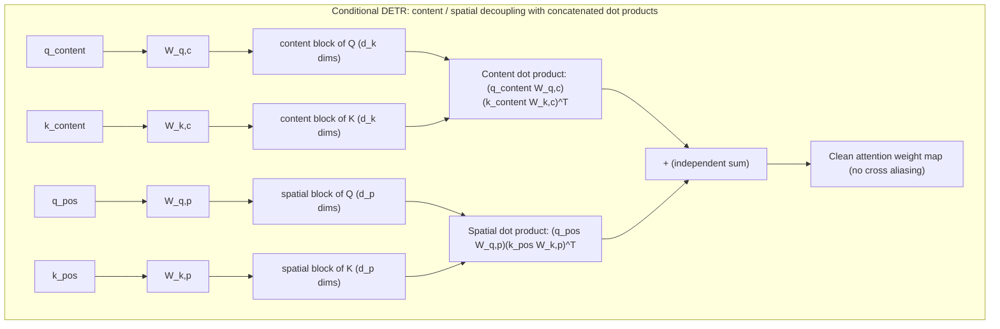
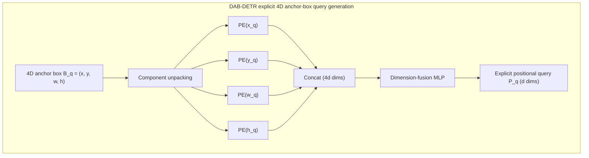
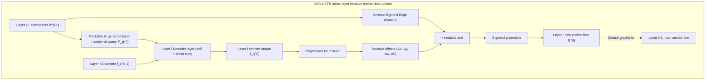

The [Deformable DETR](./deformable-detr) article covered the first of two parallel research tracks attacking the slow convergence of the original DETR: replacing the low-level feature-reading operator with local sparse sampling. This article focuses on the second track — eliminating the spatial semantic ambiguity of the Object Query itself while retaining **single-scale features and standard dense cross-attention**: **Query Spatialization**.

Along this line of evolution, two landmark works form a clear and rigorous direct progression:

1. **Conditional DETR (2021):** starting from the algebraic form of attention computation, it removes the cross-aliasing between content and position through concatenation-based decoupling, and builds a content-modulated 2D conditional spatial query.
2. **DAB-DETR (2022):** extending and deepening the conditional decoupling idea, it upgrades the scale-free 2D point prior to an explicit 4D dynamic anchor box, and introduces scale-normalized temperature modulation and a cross-layer cascaded update mechanism.

Begin with the fundamental pathology of the original queries at the algebraic and geometric levels.

## Spatial Representation Defects of the Original Object Query

### Feature Aliasing Caused by Additive Fusion

In the cross-attention mechanism of the original DETR decoder, both $Q$ and $K$ are formed by directly adding two components: the "content embedding" and the "positional embedding".

Let the input content feature of decoder layer $l$ be $f_q \in \mathbb{R}^d$, with the corresponding learnable query positional embedding $p_q \in \mathbb{R}^d$; let the encoder's output image feature be $f_k \in \mathbb{R}^d$, with its 2D sinusoidal positional encoding $p_k \in \mathbb{R}^d$. In cross-attention, $Q$ and $K$ are computed by adding the pairs and projecting through the linear matrices $W_Q, W_K \in \mathbb{R}^{d \times d}$:

$$
Q = (f_q + p_q) W_Q, \quad K = (f_k + p_k) W_K
$$

To expose the computational nature of the addressing process, expand the unscaled dot-product attention term (dropping the linear projection matrices for simplicity):

$$
Q K^T = (f_q + p_q)(f_k + p_k)^T = \underbrace{f_q f_k^T}_{\text{content-content}} + \underbrace{f_q p_k^T}_{\text{content-position}} + \underbrace{p_q f_k^T}_{\text{position-content}} + \underbrace{p_q p_k^T}_{\text{position-position}}
$$

Each of the four terms in the expansion carries a different interaction:

1. **$f_q f_k^T$ (content–content):** matches objects by semantic class, answering "what class does the target belong to".
2. **$p_q p_k^T$ (position–position):** locates objects by spatial position, answering "in which geometric region of the image does the target lie".
3. **$f_q p_k^T$ and $p_q f_k^T$ (cross-aliasing terms):** this pair of cross terms multiplies semantic features directly against coordinate encodings.

In physical terms, there is no universal linear dot-product correspondence between the absolute coordinates of image pixels and the semantic class of an object. The cross terms can neither provide a pure geometric constraint nor a clear semantic matching signal during training; instead they cause **matching ambiguity**: when backpropagation computes gradients, the error signal cannot cleanly distinguish a classification error from a spatial localization offset, and the model needs many training iterations to gradually suppress the interference from the cross terms.



:::info[Question]
Why does directly adding token embeddings and positional encodings work well for Transformers in NLP, while the same addition causes severe aliasing in DETR?

In NLP, word embeddings represent discrete symbol semantics, and 1D absolute positional encodings represent discrete sequence order. The grammatical structure of a sentence typically tolerates complex interaction between "word meaning" and "position" (for example, certain prepositions occur only at specific syntactic positions).

But in object detection, a continuous 2D vision task, **spatial geometry and semantic class are strongly orthogonal**: a "cat" can appear in the top-left corner, the exact center, or the bottom-right of the image; its class semantics are geometrically independent of its absolute pixel coordinates $(x, y)$. Additive fusion forces $f_q$ and $p_k$ to take a dot product in the same vector space, forcing the network to fit "the inner product of cat semantic features with coordinates $(120, 300)$". This breaks the translation invariance of spatial geometric transformations and enlarges the optimization search space.
:::

### Lack of a Geometric Physical Basis in Query Vectors

Because the positional queries $p_q$ of the original DETR are a set of continuous vectors randomly initialized at the start of training and do not correspond to concrete geometric coordinates, the model cannot form local spatial attention through $p_q p_k^T$ in the early stages. At the same time, the content embeddings $f_q$ have not yet gathered concrete instance features early on.

The combination of these two conditions causes the attention weights of each decoder layer to exhibit a nearly uniform, globally diffuse distribution during early training. Each query slot must scan every pixel of the whole image, then rely — very slowly — on the supervision signal of bipartite matching during backpropagation to converge its attention onto specific image regions.

Experiments in Conditional DETR show that the original DETR needs roughly 40 epochs of training before the cross-attention weight distribution begins to show clear spatial focus on object edges and extremum regions. This long addressing contraction process is a key cause of the original model's slow convergence under dense attention.

## Conditional DETR

### Conditional Cross-Attention Mechanism

Against the dot-product aliasing of additive fusion, Conditional DETR (Meng et al., 2021) restructures cross-attention at the algebraic level. Rather than adding content and position vectors before projecting, the authors propose **concatenating** them along the channel dimension, completely stripping out the cross-aliasing terms.

Let the content query be $q_{\text{content}} \in \mathbb{R}^d$ and the conditional spatial query be $q_{\text{pos}} \in \mathbb{R}^d$; the encoder output provides one $K$ per image location, with content embedding $k_{\text{content}} \in \mathbb{R}^d$ and spatial positional encoding $k_{\text{pos}} \in \mathbb{R}^d$. Cross-attention $Q$ and $K$ are built as block-concatenated forms:

$$
Q = \begin{bmatrix} q_{\text{content}} W_{q,c} \\ q_{\text{pos}} W_{q,p} \end{bmatrix}, \quad K = \begin{bmatrix} k_{\text{content}} W_{k,c} \\ k_{\text{pos}} W_{k,p} \end{bmatrix}
$$

where $W_{q,c}, W_{k,c} \in \mathbb{R}^{d \times d_k}$ are the content projection matrices and $W_{q,p}, W_{k,p} \in \mathbb{R}^{d \times d_p}$ the spatial position projection matrices.

The unscaled dot product is thereby strictly decomposed into the sum of two independent inner products:

$$
Q K^T = \underbrace{(q_{\text{content}} W_{q,c})(k_{\text{content}} W_{k,c})^T}_{\text{content branch: semantic matching}} + \underbrace{(q_{\text{pos}} W_{q,p})(k_{\text{pos}} W_{k,p})^T}_{\text{spatial branch: geometric localization}}
$$



By the additivity of block-vector dot products, the decoupled formula naturally excludes the two meaningless aliasing terms $q_{\text{content}} k_{\text{pos}}^T$ and $q_{\text{pos}} k_{\text{content}}^T$. The content branch exclusively computes class and semantic similarity, the spatial branch exclusively computes geometric proximity, and gradients from the two paths do not interfere with each other during backpropagation.

### How the Spatial Query Is Constructed

After decoupling, the key question is: **how should $q_{\text{pos}}$ be constructed?**

Before constructing it, pin down the physical identity of this symbol. $q_{\text{pos}}$ is a $d$-dimensional vector held by each query slot, and it is used in exactly one place — the inner product with the image positional encoding $k_{\text{pos}}$, i.e. the spatial addressing term in the decoupled formula above. It is therefore not a coordinate but **a spatial probe whose shape is defined by an inner-product surface**: where this inner product rises on the canvas, how wide the rise is, and in which direction it trails off constitute the query's spatial field of view. The probe itself carries no readable coordinates; its entire geometric meaning lives in its interaction with the fixed basis $\text{PE}(p)$ on the $K$ side.

For an abstract $d$-dimensional vector to define such a surface on the canvas, the only route is to share its algebraic structure with the $K$ side. This means Conditional DETR's construction can be compressed into two sentences: the reference point $s$ determines the center of the surface, and a scaling factor $\lambda_q$ determines its shape. The two-step construction below turns these two sentences into a computable form.

In the original DETR, $p_q$ is a set of globally fixed learnable vectors independent of image content (an `nn.Embedding` in code). Conditional DETR argues that a $q_{\text{pos}}$ should not be an isolated static coordinate; it must be generated dynamically under the geometric constraint of a target reference point, combined with the instance features decoded from the current image — the paper calls this the **conditional spatial query**.

Generation proceeds in two steps:

1. **Generate the sinusoidal basis of the reference point:** use the query slot's unprocessed features before any image is bound to predict a 2D center reference point of the target on the canvas, convert it into a sinusoidal positional encoding, and use it as the base geometric basis;
2. **Content-driven adaptive deformation:** the decoder combines the instance content extracted so far to predict a set of frequency-domain scaling factors, modulating the basis element-wise to stretch and translate the originally symmetric central response onto the object's extremum points, producing the final $q_{\text{pos}}$.

#### Reference Point Generation and Sinusoidal Encoding

In the original DETR, the input positional query of decoder layer $l$ directly reuses the static parameter vector $p_q \in \mathbb{R}^d$, and the network cannot explicitly know which concrete pixel on the canvas this vector corresponds to.

Conditional DETR changes this setting: each query slot holds an initial learnable vector $o_q \in \mathbb{R}^d$ not bound to any image (the raw Object Query feature). Before entering the decoder, the network first projects $o_q$ through a small feed-forward network into 2D unnormalized coordinates, constrained into the image canvas by a Sigmoid:

$$
s = (x_s, y_s) = \text{sigmoid}\big(\text{MLP}(o_q)\big) \in [0, 1]^2
$$

This 2D coordinate $s = (x_s, y_s)$ is the **reference point** bound to the query. The network then computes the standard 2D sinusoidal positional encoding of it, yielding the reference point's base geometric embedding:

$$
p_s = \text{PE}(s) = \left[ \text{PE}(x_s) \,\|\, \text{PE}(y_s) \right] \in \mathbb{R}^d
$$

$p_s$ is the reference point's base geometric basis in the frequency domain. It does not directly serve as the final $q_{\text{pos}}$ in the cross-attention dot product; it acts as an unmodulated geometric template, combined in the next step with the instance content features decoded by the current layer.

#### Adaptive Coordinate Transformation Driven by Content Features

A spatial distribution centered on the reference point is not enough. In object detection, a bounding box is delimited by the object's four boundaries (top, bottom, left, right); the attention mechanism must not only attend to the object's center but also have each attention head localize one of the object's **extremum points** (the top, bottom, left, and right edges).

The center reference point $s=(x_s, y_s)$ is only a zeroth-order 2D coordinate: it has position but carries no scale or aspect-ratio information at all. From $s$ alone the network cannot tell whether the target is a tall thin person or a long flat vehicle. To let attention extend from the center to the object's true boundaries, it must rely on the object features decoded so far.

Therefore, **the $q_{\text{pos}}$ that finally enters the cross-attention spatial branch is not a static vector but the product of a dynamic transformation of the reference-point basis $p_s$, conditioned on the content hidden state $f$**:

$$
q_{\text{pos}} = T p_s = \lambda_q \odot p_s, \quad \text{where } T = \text{diag}(\lambda_q), \; \lambda_q = \text{FFN}(f) \in \mathbb{R}^d
$$

In this transformation, the content feature $f$ acts as the conditional generator: a small feed-forward network outputs the diagonal transformation weights $\lambda_q$, which modulate the sinusoidal basis $p_s$ element-wise via the Hadamard product $\odot$, producing the final $q_{\text{pos}}$.


Why output $q_{\text{pos}}$ through a diagonal transformation rather than mapping it directly with a dense fully connected network?

- **Preserving frequency orthogonality:** the geometric information of a sinusoidal encoding is distributed over a fixed set of frequency bases. A diagonal matrix only scales the amplitude of each frequency channel and never mixes frequencies across channels, fully preserving the orthogonality of the frequency-domain basis.
- **Producing a $q_{\text{pos}}$ with per-head geometric division of labor:** the reference-point encoding $p_s$ is shared exactly across all heads, locking onto the object's approximate center. But each attention head must localize a different boundary, so in practice the network outputs a dedicated spatial query component for the $i$-th attention head:
  $$
  q_{\text{pos}}^{(i)} = \lambda_q^{(i)} \odot p_s, \quad i = 1, \dots, h
  $$
  Trigonometric identities show that assigning different amplitude weights to different frequency channels is mathematically equivalent to reshaping the frequency-domain response curve. Through this transformation, the output $q_{\text{pos}}$ is no longer a single peak symmetric around $(x_s, y_s)$ on each head; it is translated and stretched directionally, becoming a spatial probe precisely aimed at the object's top, bottom, left, or right extremum points.

### Localization Properties of Spatial Attention

After constructing $q_{\text{pos}}$ and taking its dot product with the image positional encoding $k_{\text{pos}}$ in cross-attention, why does the spatial branch converge faster than the original DETR? The credit goes mainly to the local Gaussian-decay prior provided by the sinusoidal basis and to the decoupled localization of boundary extremum points by multi-head attention.

#### Decay Property of Sinusoidal Positional Encoding Inner Products

Why can a sinusoidal positional encoding serve as a local spatial addressing basis? Compare the algebraic form of the spatial inner-product term in the original DETR and in Conditional DETR.

Recall the unscaled positional dot-product term of the original DETR:

$$
\text{Attn}_{\text{pos}}^{\text{DETR}} = p_q p_k^T = p_q \cdot \text{PE}(x, y)^T
$$

There is an essential **basis mismatch** here: the image positional encoding $p_k = \text{PE}(x, y)$ is a deterministic sine–cosine continuous basis, while the query side $p_q$ is a free parameter with no algebraic structure at all. Early in training, the weights of $p_q$ follow a random Gaussian distribution; its dot products with the sinusoidal vectors cannot form any response peak with geometric regularity and produce only a nearly uniform cluttered response over the whole image, so attention wanders blindly across the canvas.

Conditional DETR, by contrast, forces the query-side positional encoding onto the same sine–cosine basis. For a pixel at $p = (x, y)$ and a reference point $s = (x_s, y_s)$, taking the $x$ component as an example, the per-channel inner product of the two sine–cosine encodings satisfies the trigonometric identity:

$$
\text{Attn}_{\text{pos}}^{\text{Cond}} = \text{PE}(x) \cdot \text{PE}(x_s) = \sum_{i=0}^{d/4 - 1} \left[ \sin\left(\frac{x}{\tau_i}\right)\sin\left(\frac{x_s}{\tau_i}\right) + \cos\left(\frac{x}{\tau_i}\right)\cos\left(\frac{x_s}{\tau_i}\right) \right] = \sum_{i=0}^{d/4 - 1} \cos\left(\frac{x - x_s}{\tau_i}\right)
$$

where $\tau_i = T^{4i/d}$ are the preset wavelength bases of the different channels ($T=10000$).

By the superposition properties of trigonometric functions:

1. **At the reference-point center ($\Delta x = x - x_s = 0$):** the cosine term of every continuous frequency component equals $\cos(0) = 1$; the phases interfere constructively in step and the dot product reaches its global maximum;
2. **Far from the reference point ($|\Delta x| > 0$):** as the spatial displacement $|\Delta x|$ grows, the phase differences across the wavelength bases $\tau_i$ pull apart rapidly, the cosine terms oscillate between positive and negative, producing destructive interference, and the sum of the inner products quickly falls to near 0.

This algebraic property makes the sinusoidal-encoding inner product naturally exhibit a **unimodal band-pass (Gaussian-like peak)** shape in geometric space. As long as the $Q$ side uses the same sinusoidal basis as the $K$ side, attention automatically possesses a local geometric prior centered on the reference point from its initial state, without the tens-of-epochs whole-image search contraction of the original DETR.

#### Geometric Focus of Multi-Head Attention

$q_{\text{pos}}$ fundamentally changes the response shape of the spatial branch.

When $q_{\text{pos}}$ takes dot products with the positional encodings $k_{\text{pos}}$ of all image pixels, the diagonally modulated attention heads form high-response bands with clear geometric directionality around the reference point:

- the head responsible for the left boundary forms a vertical high-response band at $x < x_s$;
- the head responsible for the right boundary forms a vertical high-response band at $x > x_s$;
- the heads for the top/bottom boundaries form horizontal high-response bands at $y < y_s$ and $y > y_s$ respectively;
- the head responsible for content classification keeps its response near the central region.


At this point, Conditional DETR closes the feature-extraction loop within a single decoder layer:

```text
Query input (content f + reference point s)
  ├── Content branch: f computes semantic similarity with image content k_content (answers "what")
  ├── Spatial branch: f drives λ_q to modulate the reference point p_s, computing geometric alignment with image positions k_pos (answers "where, and where the boundaries are")
  └── Concatenated sum: produces clean cross-attention weights, aggregates Value features, and outputs the updated content vector
```

Experimental data show that after only 50 epochs of training, the spatial branch of Conditional DETR already localizes the four edges of the target clearly, while the original DETR still has several unfocused boundaries at 50 epochs and needs 500 epochs to reach a similar level. Algebraic decoupling and conditional transformation massively compress the addressing search space — the root cause of the significant convergence speedup.

### Limitations of the 2D Reference Point

Conditional DETR proved that "removing cross aliasing + introducing a local spatial prior" is the right direction for accelerating convergence. But in terms of physical modeling rigor, it left two deep bottlenecks, which form the direct motivation for the next step:

1. **Scale-ignorance and field-of-view mismatch:**
   the 2D reference point $s = (x_s, y_s)$ can only represent the object's center position on the canvas and carries no size prior whatsoever (width $w$ and height $h$). Yet the theoretical decay bandwidth of the band-pass filter formed by sinusoidal-encoding inner products is fixed by the preset temperature basis $T = 10000$.
   Facing a large truck occupying half the image or a distant bird a few pixels wide, the 2D reference point yields exactly the same decay rate for the initial spatial attention. Although Conditional DETR attempts to let content features fine-tune the effective bandwidth through a FFN-predicted diagonal factor $\lambda_q$, this is an implicit compensation in parameter space and extremely hard to control stably. The direct consequence is that in shallow decoder layers the attention weights easily diverge into background regions far from the target whenever the field of view mismatches the true object size (the visualization later in this article confirms this).
2. **No explicit sedimentation of spatial state and a broken cross-layer update:**
   in the original DETR and Conditional DETR, what passes between layers is only the abstract content hidden vector $f_q$. Although each decoder layer's prediction head outputs a bounding box based on the current features and computes an auxiliary loss, this set of geometric predictions is never passed to the next layer as explicit state.
   When the next decoder layer generates $q_{\text{pos}}$, it must still "re-derive from scratch" the new geometric modulation based on the previous layer's content vector; the position and boundary information already localized by the previous layer cannot be accumulated and inherited at the geometric-physical level.

These two limitations point clearly to the direction of evolution: **if the Object Query carried not only the center coordinates but also the width and height explicitly; if it modulated the bandwidth not only within a single layer but was also progressively refined layer by layer as a physical state during cross-layer transfer — would the addressing contraction accelerate even further?**

This is precisely the core question of DAB-DETR.

## DAB-DETR

### 4D Dynamic Anchor Box Design

DAB-DETR (Liu et al., 2022) fully inherits the theoretical framework built by Conditional DETR — "concatenated dot-product decoupling" and "conditional queries generated from spatial priors" — but at the underlying level advances the physical state of the Object Query from a 2D point prior to an **explicit 4D dynamic anchor box**:

It completely discards the abstract learnable position vectors and explicitly reshapes each Object Query as a quadruple with clear geometric dimensions:

$$
B_q = (x_q, y_q, w_q, h_q) \in [0, 1]^4
$$

where $(x_q, y_q)$ is the target's normalized center coordinate and $(w_q, h_q)$ the target's normalized width and height.

The necessity of this step can be read directly from the scatter distribution at initialization. If the query is carried only by 2D center coordinates $(x_q, y_q)$, 300 queries degrade into 300 size-less isolated points spread roughly uniformly in the plane, with no way to tell "who is responsible for large objects and who for small ones". Once the queries are restated as 4D anchor boxes, the same 300 queries carry distinct widths and heights at initialization, naturally spreading into a set of candidate boxes covering targets of different scales.


Although the 4D anchor box $B_q$ has intuitive geometric meaning in physical space, the Transformer's self-attention and cross-attention operators can only perform dot products and linear transformations in a continuous channel feature space ($\mathbb{R}^d$). The core engineering question of the design is therefore: **how to wire this human-readable physical geometry quadruple losslessly into the decoder's computation graph?**

DAB-DETR inherits and deepens Conditional DETR's dual-track idea while fundamentally reshaping the underlying representation of the Object Query, completely stripping away the black-box hidden vectors in which the original DETR jumbled content and position together:

- **Content query:** $C_q \in \mathbb{R}^d$, initialized to all zeros. It carries no undecoupled position or class bias; it is a pure feature-aggregation container dedicated, across decoder layers, to absorbing instance semantics from the image (answering "what");
- **Positional query:** $P_q \in \mathbb{R}^d$, no free learnable vector parameters are introduced; its sole mathematical source is the explicit geometric anchor box $B_q$ (answering "where, and how large").

To map the 4D geometric coordinates into high-frequency positional probes that can take inner products with image features, DAB-DETR computes sinusoidal positional encodings separately for the four continuous scalars $x_q, y_q, w_q, h_q$, concatenates them along the channel dimension, and projects through a small MLP to channel dimension $d$:

$$
P_q = \text{MLP}\left(\left[ \text{PE}(x_q) \,\|\, \text{PE}(y_q) \,\|\, \text{PE}(w_q) \,\|\, \text{PE}(h_q) \right]\right) \in \mathbb{R}^d
$$



### Scale Modulation: Introducing Width/Height Geometric Priors

In Conditional DETR the authors already recognized that "targets of different sizes need attention fields of different widths". The adopted approach was to let the content hidden vector $f_q$ pass through a black-box feed-forward network to predict the diagonal transformation factor $\lambda_q = \text{FFN}(f_q)$.

This design has a fatal logical flaw: **it treats scale as a latent estimation of the content features**. In shallow decoder layers, the content features $f_q$ have not yet gathered enough foreground semantics, so the scaling factors inferred from them are highly unstable. Once the FFN prediction goes wrong, the spatial bandwidth of the attention weights drifts severely, and shallow attention can even diverge into background regions far from the target.

The key correction of DAB-DETR is **establishing the explicit parameter status of scale $(w_q, h_q)$**: like the center point, an object's width and height are natural geometric attributes that should enter the attention computation directly as explicit geometric parameters rather than being re-guessed by a black-box network.

With explicit width and height in hand, DAB-DETR discards the complex FFN mapping and instead controls the spatial decay bandwidth of attention deterministically through **temperature modulation of the sinusoidal positional encoding**.

#### Mathematical Derivation of Scale Modulation

Recall the standard 1D sinusoidal encoding formula:

$$
\text{PE}(x, 2i) = \sin\left(\frac{x}{T^{2i/d}}\right), \quad \text{PE}(x, 2i+1) = \cos\left(\frac{x}{T^{2i/d}}\right)
$$

where $T$ is the base temperature parameter (default $T = 10000$). With a fixed temperature $T$, the Gaussian decay bandwidth of the positional dot product is constant.

To adapt the attention bandwidth to object size, DAB-DETR introduces the target's width $w_q$ and height $h_q$ as scaling factors into the temperature modulation of the positional encoding:

$$
\begin{aligned}
\text{PE}_{\text{modulated}}(x_q, 2i) &= \sin\left(\frac{x_q}{(T / \sigma_x)^{2i/d}}\right), \quad \text{where } \sigma_x = \frac{w_{\text{ref}}}{w_q} \\
\text{PE}_{\text{modulated}}(y_q, 2i) &= \sin\left(\frac{y_q}{(T / \sigma_y)^{2i/d}}\right), \quad \text{where } \sigma_y = \frac{h_{\text{ref}}}{h_q}
\end{aligned}
$$

where $w_{\text{ref}}, h_{\text{ref}}$ are reference-scale constants (usually set to 1).

Expanding the dot product between the modulated positional query and the image pixel position $x_k$:

$$
\text{PE}_{\text{modulated}}(x_q) \cdot \text{PE}_{\text{modulated}}(x_k) = \sum_{i=0}^{d/2 - 1} \cos\left(\frac{x_k - x_q}{(T / \sigma_x)^{2i/d}}\right) = \sum_{i=0}^{d/2 - 1} \cos\left( \frac{x_k - x_q}{w_q} \cdot \frac{w_{\text{ref}}}{T^{2i/d}} \right)
$$

The derivation shows that dividing the temperature by $\sigma_x$ is mathematically strictly equivalent to **normalizing the relative displacement of spatial coordinates by the object width $w_q$**:

$$
\Delta x_{\text{effective}} = \frac{x_k - x_q}{w_q}, \quad \Delta y_{\text{effective}} = \frac{y_k - y_q}{h_q}
$$

This normalization directly changes the geometric decay shape of spatial attention:

When the anchor-box scale is small ($w_q, h_q$ small), the compressed denominator amplifies the effective relative displacement sharply with pixel distance, the spatial dot product decays quickly with distance, and the attention weights form steep, sharp peaks around the center — locking precisely onto tiny targets and suppressing surrounding background noise. Conversely, when the anchor-box scale is large, the slowly varying relative displacement slows the dot-product decay, and the attention weights spread smoothly over a larger area, fully covering the overall contour and context of large objects.

This mechanism gives the decoder a physical "zoom" capability: tighten the field of view to focus on detail for small objects; widen it to embrace the global picture for large objects.

### Iterative Layer-Wise Update of the 4D Anchor Box

In the designs of the previous two sections the anchor box remains a static input: initialized before entering the decoder, then held fixed layer by layer, with every layer generating positional queries and modulating the attention bandwidth from the same set of numbers. This means both the addressing center and the zoom scale rest on the same premise — that the initial anchor box is already roughly aligned with the target. But the initial anchor boxes are just a set of learnable biases independent of the input image, and early in training they are often far from the true target positions. If the geometric state is frozen across layers, layer 1's localization error is inherited verbatim by every subsequent layer: however strong the zoom capability, it zooms onto the wrong region.

The root of this problem traces back to the inter-layer dataflow of the original DETR. The original DETR attaches a shared prediction head after every decoder layer to compute auxiliary losses, but only the content hidden vector $f_q$ passes between layers. The bounding box output by the previous layer's prediction head participates only in that layer's loss and is never passed to the next layer as a geometric prior. Although DAB-DETR reshapes queries into explicit anchor boxes, stopping at the designs of the previous two sections would leave the anchor box's inter-layer role no different from the original position vectors — lacking cross-layer geometric state updates, subsequent decoder layers' positional queries would remain stuck at their initial state, unable to use the position and size information already learned by the previous layer to adjust the current layer's addressing region.

DAB-DETR introduces the **iterative box update** mechanism, making the anchor box itself the explicit geometric state passed across layers. Each decoder layer regenerates its positional queries from the anchor box corrected by the previous layer, achieving coarse-to-fine progressive spatial addressing.


For the numerical implementation of the geometric update, DAB-DETR adopts the **logit-space residual accumulation** proposed by Deformable DETR: $\text{InverseSigmoid}$ maps the normalized coordinates into the unbounded real space $\mathbb{R}$, adds the unconstrained offsets $(\Delta x, \Delta y, \Delta w, \Delta h) = \text{MLP}(f_q^{(l)})$ predicted by the current layer's regression head, then maps back into $(0, 1)$ via $\text{Sigmoid}$. This mapping removes the out-of-range risk of direct addition while preserving smooth gradients over the entire real domain.

At the same time, when the new anchor box $B_q^{(l)}$ computed at layer $l$ is passed to layer $l+1$ to generate positional queries, a **gradient detach** must be applied. This guarantees that layer $l$'s regression head only estimates the single-step relative residual between the current geometric box and the ground truth, preventing deep and shallow losses from competing over multiple gradient hops on the same regression branch.

The geometric improvement brought by layer-wise updates can be read directly from the evolution of the predicted boxes. For the same brown bear, the prediction box at decoder layer 1 only wraps the face, with width and height clearly too small. After progressive correction across the 6 decoder layers, the same query's prediction box hugs the target's boundaries.


Compared with Conditional DETR's single-shot localization, this layer-wise convergence of DAB-DETR has an additional benefit: the explicit box state lets each decoder layer's attention read its own current prediction error, automatically contracting sampling and attention onto the boundaries not yet aligned.




:::info[Question]
Is DETR picking the anchor box back up a concession to, or a regression toward, traditional detectors such as YOLO?

On the surface, DAB-DETR reshaping the Query into the quadruple $(x, y, w, h)$ and learning relative offsets closely resembles the anchor boxes of classic detectors (Faster R-CNN, YOLOv2–v5). But at the underlying mechanism level, the two differ fundamentally in geometric attributes, feature extraction, and optimization logic:

1. **Dense enumeration vs sparse global:** YOLO densely lays tens of thousands of preset-size candidate boxes on every grid cell of each scale's feature map; DAB-DETR keeps only a very small number (e.g. 300) of learnable anchor boxes across the whole image, with no spatial tiling.
2. **Grid binding vs free movement:** YOLO's anchor centers are strictly bound to specific spatial grid cells, with each detection head predicting local offsets independently; DAB-DETR's anchor boxes are independent physical entities fully free of the pixel grid, translating and scaling freely across Transformer decoder layers via residual accumulation in a coarse-to-fine cross-layer iteration.
3. **Hard cropping vs soft zoom:** YOLO relies on convolutions with local receptive fields near the grid, or hard-crops in-box features via RoIAlign; DAB-DETR's anchor boxes serve only as parameter inputs, directly controlling the decay bandwidth of whole-image attention through scale-normalized temperature modulation (wide field for large boxes, narrow for small ones) — still global soft addressing.
4. **Overlapping spatial assignment + NMS vs Hungarian bipartite matching:** YOLO matches samples with prior IoU rules, creating many-to-one redundancy that requires heuristic NMS to filter overlapping boxes; DAB-DETR still strictly follows the set-prediction paradigm, relying on one-to-one Hungarian matching for end-to-end training, with no NMS at all.

What the original DETR opposed was never the objective geometric fact that "a bounding box contains a center, width, and height"; it opposed "dense hand-crafted hyperparameters" and "heuristic NMS". The original attempted to stuff the geometric bias implicitly into black-box vectors at the cost of 500-epoch convergence; DAB-DETR parameterizes the geometric inductive bias explicitly while fully preserving the purity of end-to-end direct set prediction. This is not historical regression but a spiral ascent to a higher dimension.
:::

## Orthogonal Combination with Sparse Sampling and the Evolution Lineage

### Performance Comparison: What Spatialization Adds to Convergence and Accuracy

The gains from spatialization manifest mainly in two dimensions, convergence speed and the accuracy ceiling (detailed cross-architecture measurements in the appendix):

1. **Pure spatialization speedup in the single-scale regime:** under the constraint of using only C5 single-scale features, Conditional DETR and DAB-DETR match or exceed, in only 50 epochs, the accuracy the original DETR reaches in 500 epochs (42.2 vs 42.0 AP) — a 10× reduction in training cost.
2. **Synergy from orthogonal combination:** when DAB-DETR's 4D anchor boxes are combined with Deformable DETR's multi-scale sparse sampling (DAB-Deformable-DETR), the model reaches 46.9 AP at 50 epochs, with small-object $\text{AP}_{\text{s}}$ improving from the original 20.5 to 30.1.

### Combining the 4D Anchor Box with Deformable Attention

Viewed at the system-architecture level, DAB-DETR and Deformable DETR address bottlenecks on entirely different dimensions:

- **Deformable DETR changes the feature-reading operator:** it replaces the global dense cross-attention of $\mathcal{O}(L^2)$ complexity with a locally continuous sampling deformable attention operator, solving the multi-scale feature throughput problem;
- **DAB-DETR changes the state representation of the Object Query:** it reshapes physically meaningless abstract hidden vectors into explicit 4D dynamic anchor boxes $(x, y, w, h)$ with clear geometric dimensions, solving cold-start addressing and scale blindness.

Because the operator implementation and the query representation are mutually independent, the two are fully orthogonal in engineering. Combining explicit 4D anchor boxes with multi-scale deformable attention (i.e. DAB-Deformable-DETR) couples them through three geometric interfaces:

1. **Sampling reference-point alignment:** the anchor box's normalized center coordinates $(x_q, y_q)$ directly serve as the deformable attention operator's sampling reference points on the multi-scale feature maps, with no need for the decoder to predict reference points from hidden vectors;
2. **Scale-adaptive scaling of sampling offsets:** in the original Deformable DETR, the sampling-point spatial offsets $\Delta p$ predicted by the linear head are scale-neutral. In DAB-Deformable-DETR, the predicted offsets are multiplied element-wise by the current anchor box's width and height $(w_q, h_q)$:

$$
p_{\text{sample}} = (x_q, y_q) + \Delta p \odot (w_q, h_q)
$$

   This scaling lets large anchor boxes automatically gather multi-scale context over a larger receptive field, while small anchor boxes focus their limited sampling budget tightly on the target's local region — restoring the scale-adaptive "zoom" capability at the level of the local sparse operator;
3. **Cross-layer cascaded logit residual accumulation:** the relative geometric offsets predicted by each layer's head are accumulated in logit space to update the 4D anchor box. The updated box not only serves as the next layer's more precise sampling reference points and scaling basis but also blocks gradients during cross-layer transfer, maintaining single-step optimization stability.

This combination removes deformable attention's original defect of "no explicit box constraint between reference points and content features", lifting detection accuracy on COCO directly to 46.9 AP (with the small-object metric improving most markedly), and establishes the standard paradigm for subsequent top-tier end-to-end architectures such as DINO and RT-DETR.

### The Query-Spatialization Lineage and Summary

Reviewing the evolution from the original DETR through Conditional DETR to DAB-DETR, the changes land at different system levels:

| Dimension | Original DETR (2020) | Conditional DETR (2021) | DAB-DETR (2022) |
| :--- | :--- | :--- | :--- |
| **Mathematical form of the query** | Implicit continuous vector $p_q \in \mathbb{R}^d$ | Implicit vector $o_q$ + dynamic $q_{\text{pos}}$ | Explicit 4D anchor box $(x, y, w, h)$ + content vector $C_q$ |
| **Spatial geometric prior** | None (random initialization, whole-image wandering) | 2D point prior $(x, y)$ | 4D geometric region prior $(x, y, w, h)$ |
| **Cross-attention computation** | Additive-fusion dot product (with aliasing terms) | Concatenated dot product (content/spatial decoupled) | Scale-modulated sinusoidal dot product |
| **Scale awareness** | None | None (point prior carries no scale) | Explicit scale-normalized temperature modulation |
| **Spatial information retention** | Implicit learnable parameters | Per-layer single-shot conditional vectors | Explicit geometric state updated and passed layer by layer |

- **Conditional DETR** changes the **computation structure of a single attention**. Through algebraic restructuring it removes the aliasing terms, letting spatial information participate in addressing as a conditional constraint.
- **DAB-DETR** changes the **fundamental state representation of the query**. It restates the Object Query from a black-box vector into an interpretable, observable physical entity carrying scale.

From the technical evolution perspective, query spatialization followed a clear, rigorous path of physical concretization that ultimately converged with the sparse reading operator:

```text
Original DETR (2020)              Conditional DETR (2021)             DAB-DETR (2022)
[ implicit vector p_q ]      ──►   [ 2D reference point (x, y) ]   ──►   [ 4D dynamic anchor box (x, y, w, h) ]
additive aliasing, unbiased           concatenated decoupling,              scale-normalized temperature
whole-image wandering                 unimodal band-pass extremum           modulation + cross-layer
                                      localization                          cascaded refinement
                                                                              │
                                                                              ▼ orthogonal combination with sparse sampling
                                                                      DAB-Deformable-DETR (2022)
                                                                      [ 4D anchor box + multi-scale deformable attention ]
```

This thread advanced the Object Query step by step from an abstract vector lacking physical meaning to an entity with four-dimensional geometric scale, completing the most critical infrastructure for the rest of the lineage:

1. **Providing a physical carrier for denoising training:** only when queries become real 4D geometric boxes $(x, y, w, h)$ can training apply explicit Gaussian displacement and scale perturbations to them, giving rise to DN-DETR's denoising task;
2. **Opening the geometric interface for two-stage schemes:** in the later DINO, high-confidence candidate boxes filtered by the encoder can be assigned directly and seamlessly to the decoder as initial 4D anchor boxes, closing the loop of end-to-end two-stage initialization;
3. **Completing the confluence of the two evolution tracks:** DAB-DETR verified the full orthogonality of query spatialization and Deformable DETR's sparse-sampling operator; their combination (DAB-Deformable-DETR) became the standard form of subsequent modern detectors such as DINO and RT-DETR.

### Open Problem: Discrete Oscillation of Bipartite Matching

After the transformations of Conditional DETR and DAB-DETR, the decoder possesses highly concentrated spatial perception in its very first iteration, and convergence on COCO shrinks from the original 500 epochs to roughly 50.

However, the **unresolved contradiction** left by spatialization must be stated plainly: although the addressing search range has shrunk from the whole image to the surroundings of a specific anchor box, **"which query slot matches which ground-truth object in the image"** is still decided dynamically at every training step by the Hungarian bipartite matching algorithm. Consequently, early in training, before network weights are sufficiently converged, tiny perturbations in prediction scores cause violent oscillations in the matching result (the same ground-truth object is assigned to slot $i$ at step $t$ and suddenly reassigned to slot $j$ at step $t+1$). Because the matching target keeps jumping in discrete space, even queries with clear spatial anchor boxes still see their gradient update directions repeatedly fight each other.

How can the discrete jumps of bipartite matching in early training be eliminated? The next article dissects [DN-DETR: query denoising and early-stage matching stabilization](./dn-detr) in depth.

## Summary

This article systematically dissects the evolution logic and mathematical mechanisms of query spatialization:

1. **Root of aliasing:** the original DETR's additive positional encoding produces cross-aliasing terms between content and position in the dot product, breaking translation invariance and triggering long whole-image attention wandering;
2. **Conditional DETR's algebraic decoupling:** concatenated dot products fully separate content from spatial addressing, and the previous layer's decoded features predict diagonal transformation factors so that different attention heads adaptively lock onto the target's boundary extremum points;
3. **DAB-DETR's 4D dynamic anchor box:** formalizes the Query as an explicit geometric quadruple $(x, y, w, h)$ and uses width and height to adjust the sinusoidal encoding temperature, mathematically achieving strict scale normalization of spatial displacement;
4. **Cascaded geometric updates:** differentiable residual accumulation in logit space plus inter-layer gradient detachment achieve coarse-to-fine layer-by-layer geometric refinement;
5. **Bridging past and future:** the 4D anchor box completes the physical concretization of the Query, but the early-stage oscillation of Hungarian matching in discrete space remains unresolved, giving rise to denoising training (DN-DETR).

## Appendix: Spatialization vs Baseline Benchmarks

The table below summarizes performance on the COCO 2017 validation set for the original DETR, Conditional DETR, DAB-DETR, and Deformable DETR (all with ResNet-50 backbones):

| Architecture | Feature levels | Spatial prior | Epochs | AP | $\text{AP}_{50}$ | $\text{AP}_{\text{s}}$ | $\text{AP}_{\text{l}}$ |
| :--- | :--- | :--- | :--- | :--- | :--- | :--- | :--- |
| **DETR (original)** | C5 (single-scale) | Implicit parameter vector | 500 | 42.0 | 62.4 | 20.5 | 61.1 |
| **DETR (original, short)** | C5 (single-scale) | Implicit parameter vector | 50 | 34.9 | 55.4 | 14.4 | 52.6 |
| **Conditional DETR** | C5 (single-scale) | 2D conditional reference point | 50 | 40.9 | 61.8 | 20.8 | 61.8 |
| **DAB-DETR** | C5 (single-scale) | 4D dynamic anchor box | 50 | 42.2 | 63.1 | 21.5 | 62.6 |
| **Deformable DETR** | C3–C6 (multi-scale) | 2D sparse sampling points | 50 | 43.8 | 62.6 | 26.4 | 58.0 |
| **DAB-Deformable-DETR** | C3–C6 (multi-scale) | 4D dynamic anchor box + sparse sampling | 50 | 46.9 | 66.0 | 30.1 | 64.3 |

---

Next: [DN-DETR: Query Denoising and Early-Stage Matching Stabilization](./dn-detr)
