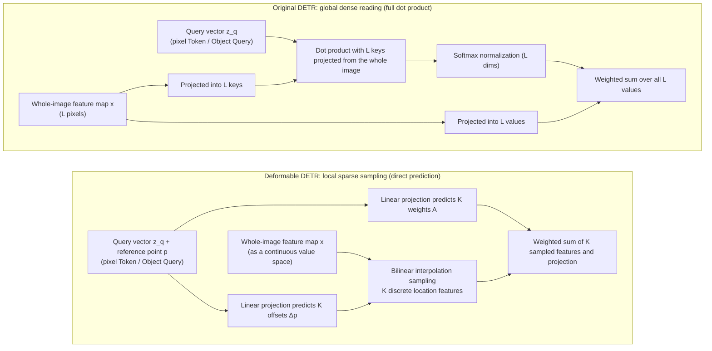
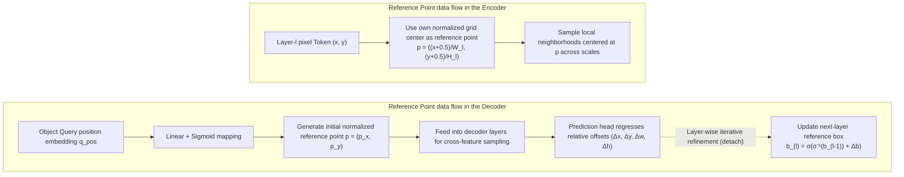

# Deformable DETR: Sparse Sampling and Multi-Scale Attention

In the previous two articles, we broke down the two core pillars of the original DETR: [DETR v1: Architecture and Forward Pass](./detr-v1-architecture-forward-pass) established a fixed-length container prediction architecture based on Object Queries and a Transformer encoder-decoder, and [DETR v1: Bipartite Matching and Set Loss](./detr-v1-bipartite-matching-set-loss) eliminated the dependency of conventional detectors on NMS through the Hungarian algorithm and set loss.

However, the original DETR left two severe bottlenecks that limited its practical application: **high-resolution multi-scale features cannot be computed ($\mathcal{O}(L^2)$ complexity leads to extremely poor small-object detection)** and **training convergence is extremely slow (500 epochs required on COCO)**.

Facing the dual predicament of slow convergence and restricted feature access, the research community subsequently evolved two fundamentally different routes forward:

- **Sparsifying the feature-reading operator (this article):** holds that the global dense dot product is too heavy and lacks local geometric bias, and proposes replacing dense attention with a local **sparse sampling operator** centered on reference points, reducing computational complexity while directly unlocking multi-scale features;
- **Spatializing the geometry of object queries (next article):** insists on staying within the standard dense attention framework, arguing that the bottleneck lies in Object Queries lacking physical geometric meaning and in the additive aliasing of content and position, and proposes making the latent vectors **explicit spatial geometric entities**.

Many accounts summarize Deformable DETR (Zhu et al., 2020) as simply "bringing the idea of deformable convolution into the Transformer to speed up training". This overlooks its true position in the detection Transformer lineage: **Deformable DETR was the first work to systematically restructure how queries read image tokens** — transforming the dense global dot product between each query and all pixels of the image into multi-scale sparse sampling within a limited neighborhood around a **Reference Point**.

This article focuses on the first route, dissecting the mathematical construction of the Deformable Attention module, the multi-scale feature-reading mechanism, the dual implementation of reference points in the Encoder and Decoder, and how it became the shared low-level infrastructure of subsequent mainstream models such as DINO and RT-DETR.

## The Computational Bottleneck of Original Dense Attention

To understand why the feature-reading mechanism had to be restructured, we need to revisit the computational and optimization difficulties caused by global attention in the original DETR.

### The Complexity Deficit of Dense Attention

In the image encoder, the sequence length is $L$. Computing the pairwise attention matrix across all tokens costs $\mathcal{O}(L^2 \cdot d)$ in both time and memory.

This quadratic complexity remains tolerable in image classification or NLP tasks (for example, ViT-Base on a $224 \times 224$ image produces only 196 patch tokens), but in object detection it meets an irreconcilable contradiction: **object detection inherently depends on high-resolution feature maps to capture small objects**. Taking an image at the classic resolution of $800 \times 1333$:

- The C5 feature map, downsampled 32x, is roughly $25 \times 42$, with $L \approx 1050$ tokens;
- The C4 feature map, downsampled 16x, is roughly $50 \times 84$, with $L \approx 4200$;
- The C3 feature map, downsampled 8x, is roughly $100 \times 168$, with $L \approx 16800$.

In physical terms, a $16 \times 16$-pixel small object maps to less than half a pixel on the C5 feature map, and its spatial detail and semantics are essentially lost through the backbone's stage-wise downsampling. Detecting small objects effectively requires connecting C3 and C4 features.

However, feeding multi-scale feature maps containing C3, C4, and C5 (total token count $N_{\text{pix}} > 22000$) directly into standard self-attention produces a single attention matrix of $22000 \times 22000$ per image per layer. That one float32 attention map alone consumes nearly 2 GB of memory; accounting for 8 attention heads and 6 stacked encoder layers, the activation memory for stashing attention weights during backpropagation alone reaches nearly a hundred GB, far beyond the capacity of mainstream hardware. For this reason, the original DETR was forced into the compromise of **using only the single-scale C5 feature**.

### Slow Convergence Caused by Missing Local Spatial Priors

Many accounts attribute the slow training of the original DETR (500 epochs on COCO) simply to "attention being dispersed across the whole image at initialization". But this is only the surface: the original DETR builds on a fully pre-trained ResNet backbone whose output features already carry local semantics, yet convergence remains extremely slow after attaching 6 Transformer layers. The deeper root cause is the **loss of explicit spatial geometric priors** and the resulting optimization-dynamics predicament:

1. **Missing local inductive bias and gradient dilution on the Encoder side:**
   Conventional CNN kernels inherently lock in a local grid topology; standard self-attention flattens the 2D image into a one-dimensional unordered sequence, discarding the spatial-neighborhood prior between pixels. In early training, linear projection layers are randomly initialized, so attention spreads uniformly over thousands of tokens, and the weight allocated to any single position is only about $\mathcal{O}(1/L)$. The effective regions that truly contain object semantics often span only a few dozen pixels, while the vast majority is background. In backpropagation through the whole-image Softmax, spurious gradients from the massive background tokens severely dilute the foreground signal, yielding an extremely low gradient signal-to-noise ratio, with optimization wandering for a long time in flat high-dimensional saddle regions. The encoder must go through lengthy data-driven iterations to relearn the discarded spatial-neighborhood relations.
2. **Global blind search and bipartite-matching oscillation on the Decoder side:**
   The more fatal bottleneck occurs in the decoder's cross-attention. Because the initial Object Query is an abstract vector with no physical coordinate anchor, it performs an unbiased global search across the entire image. In early-to-mid optimization, the same Query predicts bounding boxes that drift violently in position across successive training steps. Since DETR's supervision signal depends strictly on the Hungarian algorithm's global one-to-one bipartite matching, slight jitter in a Query's output can cause it to be matched to object A in one step, object B in the next, and then assigned to background (known as matching oscillation / Label Bouncing). The repeated jumping of matched targets makes the gradient directions backpropagated to the Query weights conflict with each other, preventing attention weights from settling stably.

The original DETR places the detection task under the extreme freedom of unbiased whole-image search, and the price is long iteration cycles for the network to discover the local continuity of the physical world on its own. Dense computation priced out multi-scale features, and global blind search triggered optimization oscillation — the interplay of the two forms the underlying cause of the original DETR's slow convergence and poor small-object performance.

## Single-Scale Deformable Attention

Against this contradiction, Deformable DETR designed a general **Deformable Attention operator** that replaces both the encoder's multi-head self-attention and the decoder's cross-attention. Its core change: **completely abandon the addressing scheme of projecting image pixels into Keys and computing pairwise dot products over the whole image; instead, let the Query vector predict, around a specified reference point, the relative coordinate offsets of a small set of key sampling points along with aggregation weights.**

Concretely, the global retrieval driven by the attention matrix ($Q K^T$) in the original DETR is completely restructured: the feature map is treated directly as a continuously sampleable feature canvas. The operator carries a different entity role at each end of the architecture:

- **On the encoder side (replacing self-attention):** the Query here is each **pixel token** on the feature map, and the reference point is bound directly to the pixel's own grid-center coordinates. Instead of computing dot-product similarity against every other pixel of the whole image (the former Keys), the pixel uses itself as the anchor and emits sampling probes into a limited neighborhood to extract multi-scale features.
- **On the decoder side (replacing cross-attention):** the Query here is the detection task's **Object Query**, and the reference point is the predicted geometric center of the target derived from the Query's position embedding. Instead of performing an unbiased global dot-product sweep over all image pixels (the former Keys), the Object Query focuses solely on extracting key local features around its own reference point.
*(Note: the self-attention among the 300 Object Queries inside the decoder retains the standard dot product, because the Query count is small and global negotiation is needed to eliminate duplicate predictions.)*




### Operator Definition of Single-Scale Deformable Attention

Before formalizing deformable attention, we clarify how the operator's input triple $(z_q, p, x)$ is instantiated at each end of the architecture:

- **Query vector $z_q \in \mathbb{R}^d$:** in the encoder it is the content feature of a pixel itself; in the decoder it is the content feature of the current Object Query after self-attention interaction.
- **2D continuous reference point $p = (p_x, p_y) \in [0, 1]^2$:** in the encoder it is directly the pixel's own normalized grid-center coordinate; in the decoder it is predicted from the Object Query's position embedding.
- **Input feature map $x \in \mathbb{R}^{C \times H \times W}$:** it plays the role of the continuous **source of Values**. The network no longer generates a Key matrix for it and no longer computes $Q K^T$ dot products; features are read directly through coordinate sampling.

Note that the reference point is not produced by the attention computation; it is given directly as an input outside the attention. In other words, "where to look" is split into two layers: where to anchor is determined outside the operator by the reference point; where specifically to reach near the anchor is predicted by the query content. Where reference points come from, and why they are arranged this way, is dissected later when we discuss the data-flow differences between encoder and decoder.

For a deformable attention module with $M$ attention heads, each head samples a fixed number of $K$ points around the reference point (typically $K = 4$ by default). The mathematical expression is:

$$
\text{DeformAttn}(z_q, p, x) = \sum_{m=1}^M W_m \left[ \sum_{k=1}^K A_{m, q, k} \cdot W'_m \, x\big(\phi(p) + \Delta p_{m, q, k}\big) \right]
$$

This formula describes a complete data flow from "determining positions" to "extracting features" to "multi-head aggregation". The mechanism and physical meaning of each part:

1. **Determining sampling coordinates ($\phi(p) + \Delta p_{m, q, k}$):**
   - $p \in [0, 1]^2$ is the normalized reference-point coordinate bound to the Query; the mapping $\phi(p) = (p_x W, p_y H)$ converts it back to an absolute pixel position on the feature map, serving as the anchor for local search.
   - $\Delta p_{m, q, k} \in \mathbb{R}^2$ is a 2D offset predicted directly by linear projection of the Query feature $z_q$. Added together, the Query precisely determines the landing point of the $k$-th sample under the $m$-th head around the reference point.
2. **Continuous feature sampling ($x(\dots)$):**
   - Because the predicted offsets are continuous real numbers, the sampling coordinates usually fall between discrete pixels. The network uses bilinear interpolation to sample the feature vector at continuous positions from the feature map $x$.
   - This step plays the role of extracting Values in attention; the differentiability of bilinear interpolation ensures gradients can backpropagate, directly optimizing the sampling offsets.
3. **Single-head sparse aggregation ($\sum_{k=1}^K A_{m, q, k} \cdot W'_m (\dots)$):**
   - $W'_m \in \mathbb{R}^{d_v \times d}$ ($d_v = d / M$) projects the sampled features into the current head's channel subspace.
   - $A_{m, q, k} \in [0, 1]$ is the attention weight predicted by the Query through a linear layer and Softmax (satisfying $\sum_{k=1}^K A_{m, q, k} = 1$); it replaces the traditional dot-product attention map, letting the Query decide autonomously how much attention each of the $K$ sampling points receives, filtering background and focusing on key structures.
4. **Multi-head channel fusion ($\sum_{m=1}^M W_m [\dots]$):**
   - Different heads $m$ predict independent offsets and weights, capturing different local edges and parts of the object.
   - The output projection matrix $W_m \in \mathbb{R}^{d \times d_v}$ projects the local features gathered by all heads back and sums them into the $d$-dimensional space, completing the final feature fusion.

In this new mechanism, the paradigm of attention undergoes a fundamental inversion. In standard attention, "where to look" is computed as dot products between the Query and all Keys — a passive global matching process. In deformable attention, the network simply discards the Keys and does no dot products at all. "Where to look" (sampling coordinates) and "how much to look" (aggregation weights) are both predicted directly by the Query itself. Concretely, the Query first uses the reference point $p$ as anchor and regresses $K$ 2D offsets through one linear projection, scattering $K$ concrete sampling coordinates on the feature map; then a second linear projection and Softmax produce the aggregation weights for those $K$ points. Since the predicted coordinates are usually floats, the network invokes bilinear interpolation to extract feature values precisely in continuous space, and finally blends the output by weight. The whole process flows in one stroke: input a Query, output a few coordinates and weights, then directly "grab" data from the feature map — no similarity comparison across whole-image pixels whatsoever.

Behind this "point-and-grab" mechanism lies an extremely important physical assumption: **visual objects are locally continuous entities in space**. Since the object to detect is a cat or a car, its features necessarily concentrate in some local region rather than scattering across the whole image; therefore the network only needs to search within a small range near the reference point. Through training, the linear layer generating the offsets gradually learns "which specific structures near the reference point a given Query should attend to". As the reward for this locality assumption, deformable attention completely severs the binding between computational cost and the global feature-map resolution $L$. The addressing range shrinks from the global $L$ pixels to a fixed $K$ sampling points. No matter how the input resolution doubles or how large the feature maps grow, each Query's feature-reading cost is pinned firmly at $O(K)$.

:::info[Question]
**If the global Keys are discarded and no dot product is computed at all, can this still be called "attention"?**

Yes. Because the essence of attention was never the specific operation of "Q and K dot product", but **query-driven, differentiable information retrieval** — given a query, decide where to read and how much, then blend the retrieved Values by weight. Standard attention computes relevance through a global dot product because it assumes any two elements in Q and K may be related — a "prior-free" extreme freedom. Deformable attention injects the physical common sense that "visual objects are spatially locally continuous" into the network as a prior: it presumes meaningful information necessarily concentrates near the reference point. **It puts "shackles" on attention through physical priors, yet retains the soul of dynamic addressing.**

However, injecting a physical prior does not turn it into a rigid convolution. Convolution's prior is rigid (locked to a fixed $3 \times 3$ grid), while deformable attention's prior is elastic. It sets the broad direction of "search only near the reference point", but which specific $K$ "tentacles" (sampling coordinates) to extend, and how much attention each tentacle gets (aggregation weights), are still **dynamically predicted** by the Query from context.
:::

## Multi-Scale Deformable Attention

Single-scale sampling solves the cost of a single feature map, but object detection also needs to span scales. Deformable DETR naturally generalizes this mechanism to a set of multi-scale feature maps $\{x^l\}_{l=1}^L$ ($L$ is the number of scale levels, distinct from the $L$ denoting the total token count earlier), covering the four feature-map levels downsampled 8x, 16x, 32x, and 64x.

Note the origin of this set of feature maps: Deformable DETR draws C3, C4, and C5 directly from the backbone, unifies channels to 256 dimensions with $1 \times 1$ convolutions, and appends an extra stride-2 convolution on C5 to obtain the fourth level (stride 64). There is no FPN-style top-down fusion and no lateral connections — each level is fully independent before entering the encoder, and each token additionally carries a learnable Level Embedding marking "which level I belong to", letting aggregation sense the scale origin of features.

Regarding spatial geometry, although the sampled float coordinates explicitly carry local geometric structure, in the actual implementation **the Query vector still retains absolute positional encoding (Sine-Cosine PE)**. The Query's content feature is added to the positional encoding before being fed into the linear projection layers that predict offsets and weights. This is because the linear layer needs absolute spatial position combined with local semantics to make reasonable offset predictions about the direction of object boundaries.

In multi-scale deformable attention, each query samples $K$ points per attention head on every feature-map level. The input multi-scale set $\{x^l\}_{l=1}^L$ acts as a continuous multi-scale Value field. The core formula is:

$$
\text{MSDeformAttn}(z_q, \hat{p}, \{x^l\}_{l=1}^L) = \sum_{m=1}^M W_m \left[ \sum_{l=1}^L \sum_{k=1}^K A_{m, l, q, k} \cdot W'_m \, x^l\big(\phi_l(\hat{p}) + \Delta p_{m, l, q, k}\big) \right]
$$

Two key design decisions deserve attention:

### Cross-Scale Normalization of Attention Weights

The attention weight tensor has size $M \times L \times K$. Softmax normalization is performed over the joint dimension of all levels $L$ and all sampling points $K$:

$$
\sum_{l=1}^L \sum_{k=1}^K A_{m, l, q, k} = 1, \quad \forall m \in \{1, \dots, M\}
$$

This means the network is not only learning which spatial position to attend to within a single scale, but also **dynamically learning from which scale level the current query should primarily extract features**. If an object is small, the weight allocated to low-level high-resolution feature maps (such as C3) naturally dominates.

This joint normalization constraint can be seen as an "attention budget": each head holds exactly 1.0 of total weight and must spend it fully across the $L \times K$ (level, sampling point) slots. Levels compete in a zero-sum fashion — one point more for a coarse level means one point less for a fine level, forcing the network to make trade-offs. Imagine the alternative: if Softmax normalized each level independently, then whether the query tracks a $8 \times 8$-pixel small object or a backdrop filling the canvas, the coarsest stride-64 level would unconditionally receive a fixed share of weight, forcibly mixed into the aggregation. Joint normalization turns "which level to look at" from an implicit behavior hardwired into the architecture into an explicit decision directly optimizable by gradients.

### Coordinate Alignment Across Multi-Scale Feature Maps

The input reference-point coordinate $\hat{p} \in [0, 1]^2$ is a whole-image normalized coordinate. When mapped to the $l$-th feature map, it is multiplied by that level's specific height and width:

$$
\phi_l(\hat{p}) = (\hat{p}_x \cdot W_l, \; \hat{p}_y \cdot H_l)
$$

The semantics of the offsets require attention to the level subscript in the formula. $\Delta p_{m, l, q, k}$ is output for all levels at once by a single linear layer (output dimension $M \times L \times K \times 2$), but each level's offsets are expressed in that level's own pixel units, added directly to $\phi_l(\hat{p})$. This means "offset by 3 pixels" corresponds to only 24 pixels of physical distance in the original image at the stride-8 level, but 192 pixels at the stride-64 level — the same numeric value naturally covers different physical extents at different levels, matching the object scales each level is responsible for.

### Complexity Comparison

Let the total number of pixel tokens across multi-scale feature maps be $N_{\text{pix}} = \sum_{l=1}^L H_l W_l$, and the number of decoder Object Queries be $N_q$ (typically $N_q = 300 \ll N_{\text{pix}}$). Since the general complexity of multi-scale deformable attention is $\mathcal{O}(N_{\text{query}} \cdot M \cdot L \cdot K \cdot d)$, substituting the concrete entities at each end transforms the computational cost qualitatively:

| Module and computational paradigm | Time complexity | Activation memory | Directly supports C3–C5 multi-scale? |
| :--- | :--- | :--- | :--- |
| **Original DETR encoder (standard self-attention)** | $\mathcal{O}(N_{\text{pix}}^2 \cdot d)$ | $\mathcal{O}(N_{\text{pix}}^2)$ | No (full dot product over 22000+ pixels exhausts memory) |
| **Deformable encoder (with $N_{\text{query}} = N_{\text{pix}}$)** | $\mathcal{O}(N_{\text{pix}} \cdot M \cdot L \cdot K \cdot d)$ | $\mathcal{O}(N_{\text{pix}} \cdot M \cdot L \cdot K)$ | **Yes (cost is strictly linear in total feature-map resolution)** |
| **Original DETR decoder (standard cross-attention)** | $\mathcal{O}(N_q \cdot N_{\text{pix}} \cdot d)$ | $\mathcal{O}(N_q \cdot N_{\text{pix}})$ | Barely, but grows sharply and linearly with feature-map resolution |
| **Deformable decoder (with $N_{\text{query}} = N_q$)** | $\mathcal{O}(N_q \cdot M \cdot L \cdot K \cdot d)$ | $\mathcal{O}(N_q \cdot M \cdot L \cdot K)$ | **Yes (computational cost fully decoupled from total feature-map resolution $N_{\text{pix}}$)** |

In the practical configuration, the hyperparameters are usually $M = 8, L = 4, K = 4$, so each query samples only $8 \times 4 \times 4 = 128$ points per interaction. In the encoder, computational complexity drops from quadratic in feature-map size $\mathcal{O}(N_{\text{pix}}^2)$ to linear $\mathcal{O}(N_{\text{pix}})$; in the decoder, the cost of feature sampling decouples from image size entirely, depending only on the Query count $N_q$.

### Sampling-Point Configuration and Tensor Flow

To track the computational path of deformable attention precisely in an engineering implementation, the following table organizes the dimension flow of core tensors for the standard parameters of a **decoder interaction** (Batch Size = $B$, Query count $N_q = 300$, hidden dimension $d = 256$, heads $M = 8$, multi-scale levels $L = 4$, sampling points per level per head $K = 4$; in the encoder the flow logic is identical, with $N_q$ replaced by the total feature-map token count $N_{\text{pix}} \approx 22000$):

| Variable | Physical semantics | Tensor shape | Shape notes |
| :--- | :--- | :--- | :--- |
| $z_q$ | Input Query features | `[B, N_q, 256]` | Query slots awaiting feature sampling |
| $\hat{p}$ | Normalized reference-point coordinates | `[B, N_q, 2]` | Center coordinates $(p_x, p_y) \in [0, 1]^2$ |
| $\Delta p$ | Predicted continuous sampling offsets | `[B, N_q, 8, 4, 4, 2]` | Direct output of a linear layer: `[B, N_q, M, L, K, 2]` |
| $A$ | Predicted joint aggregation weights | `[B, N_q, 8, 16]` | Linear layer output with Softmax over the joint dimension $L \times K = 16$ |
| $x_{\text{sampled}}$ | Features sampled via bilinear interpolation | `[B, N_q, 8, 16, 32]` | Per-head channels $d_v = 256 / 8 = 32$, extracted from 4 feature-map levels |
| $z_{\text{out}}$ | Multi-head weighted sum and output projection | `[B, N_q, 256]` | Weighted sum over the 16 sampling points, regrouped into 8 heads, then Linear mapping |

Regardless of how large the image feature maps are, every Query predicts, through lightweight linear layers only, $8 \times 4 \times 4 \times 2 = 256$ offset scalars and $8 \times 16 = 128$ weight scalars, then calls an efficient CUDA bilinear sampling operator on the GPU to pull the tensors directly. This completely breaks the memory barrier of conventional attention having to materialize the huge $N_q \times N_{\text{pix}}$ matrix.

## The Reference Point Mechanism

Many technical accounts lump the deformable attention in the Encoder and Decoder together as "sampling near a reference point", masking the essential differences between the two in data flow and geometric semantics.

In Deformable DETR, **reference points in the encoder are static grid coordinates, while reference points in the decoder are dynamic geometric states**.



### Reference Points in the Encoder

In the encoder, every input token is both a query and the carrier of its own spatial position.

- **Origin of the reference point:** for a pixel token at coordinate $(x, y)$ on the $l$-th feature map, its reference point is its own physically normalized center:

  $$p = \left(\frac{x + 0.5}{W_l}, \; \frac{y + 0.5}{H_l}\right)$$
- **Operating mechanism:** acting as a query, the pixel uses its own coordinates as the baseline, emitting sampling probes into the local neighborhoods of all scale-level feature maps and absorbing surrounding features.
- **No cross dot product within encoder layers:** the encoder is stacked purely of multi-scale deformable self-attention layers, replacing the heavy dense self-attention of the original DETR and performing fast spatial and semantic feature fusion across multi-scale features.

### Initial Reference Point Generation in the Decoder

In the decoder, Object Queries are prediction containers for a variable number of objects and initially correspond to no concrete physical pixel in the image.

- **Origin of the reference point:** the decoder's reference points are predicted directly from the query's position embedding (Query Position Embedding) through a linear transformation and a Sigmoid activation:

  $$p = \sigma(\text{Linear}(Q_{\text{pos}})) \in [0, 1]^2$$
- **Operating mechanism:** initially, each Object Query's reference point is regressed from randomly initialized position embeddings, distributed roughly near the image center (the regression layer's bias is initialized to zero, and Sigmoid's output of 0.5 at zero corresponds exactly to the image center); in the cross-attention sublayer, the Query probes the local features near its own $p$ in the image;
- **The self-attention sublayer remains dense:** the Self-Attention inside the decoder still uses the standard attention mechanism (because the Query count $N = 300$ is small, complexity is only $\mathcal{O}(N^2)$), letting slots perceive each other and negotiate division of labor to eliminate duplicate predictions.

### Design Trade-offs Behind the Reference Point Origins

The previous two subsections explained how reference points are produced in the encoder and decoder, but not the more fundamental question: why this particular arrangement? Nor are these the only two origins — the two-stage variant (Two-Stage, an extension where encoder features first generate candidate boxes that are then handed to the decoder for refinement, detailed later) provides a third. Comparing the three origins reveals that they all answer the same question: who decides the query's "where to look".

Start with the encoder. Taking the reference point as the pixel's own coordinates is not a designer's preference but dictated by the encoder's responsibility: the encoder must refine the multi-scale feature maps "in place" — as many tokens come in, as many go out, and every output position corresponds to the same input position. Under this constraint, anchoring at its own center is nearly the only natural choice. Deformable attention thereby becomes a dynamic local filtering operator anchored at the pixel itself with content-predicted offsets, structurally in the same lineage as deformable convolution. Imagine instead if the reference point were predicted from content: the position correspondence between input and output would break, and the encoder could no longer output a dense feature map isomorphic to its input. The paper also notes that when $L = 1$, $K = 1$, and $W'_m$ is the identity matrix, multi-scale deformable attention degenerates into deformable convolution.

The decoder is different: the decision is handed to a learnable embedding. A natural question is why not follow anchor-based detectors and lay a uniform initial anchor grid for the 300 queries? Because DETR's core idea is set prediction. In this design, queries are a set of mutually symmetric, interchangeable containers; "which region of the image which query is responsible for" should be determined progressively by training and bipartite matching, not hard-coded into the architecture. A fixed grid precisely pre-partitions each query's jurisdiction, regressing to the anchor-based paradigm. Letting queries regress coordinates from their own position embeddings preserves the symmetry of the containers while letting "where to look" and "what to predict" be jointly optimized in the same learnable space, with Sigmoid guaranteeing coordinates always fall within $[0, 1]$.

The two-stage variant goes one step further, handing the decision to the image content itself: each pixel token output by the encoder directly predicts a bounding box with a score, and the top-scoring candidate boxes serve as the decoder's initial reference points. Placing the three origins side by side makes the difference clear: the encoder relies on the spatial position given by the architecture, the decoder relies on a learned, image-independent prior, and the two-stage variant relies on the current image's features. The information deciding "where to look" becomes progressively more concrete: from position, to prior, to content.

### Iterative Bounding Box Refinement Across Layers

Since every Query in the decoder is associated with an explicit reference point, can that reference point be progressively calibrated as decoding deepens? Deformable DETR thus proposes the **Iterative Bounding Box Refinement** mechanism.

In the original DETR, every decoder layer's prediction head makes independent predictions starting from absolute coordinates. In Deformable DETR, the prediction head outputs **relative offsets with respect to the current layer's reference box**.

Let the reference box input to the $l$-th decoder layer be $\hat{b}^{(l-1)} = (\hat{x}, \hat{y}, \hat{w}, \hat{h})$ (for the first layer, the center $(\hat{x}, \hat{y})$ is the initial reference point $p$, with width and height initialized to a prior default). The $l$-th layer's prediction branch outputs the relative correction $(\Delta x, \Delta y, \Delta w, \Delta h) = \text{MLP}(h^{(l)})$, and the reference box used by the next decoder layer updates as:
$$

\begin{aligned}
\hat{x}^{(l)} = \sigma\left(\sigma^{-1}(\hat{x}^{(l-1)}) + \Delta x\right) \\
\hat{y}^{(l)} = \sigma\left(\sigma^{-1}(\hat{y}^{(l-1)}) + \Delta y\right) \\
\hat{w}^{(l)} = \sigma\left(\sigma^{-1}(\hat{w}^{(l-1)}) + \Delta w\right) \\
\hat{h}^{(l)} = \sigma\left(\sigma^{-1}(\hat{h}^{(l-1)}) + \Delta h\right)
\end{aligned}

$$

where $\sigma^{-1}(\cdot)$ is the logit function (inverse Sigmoid).

Through the inverse-Sigmoid and Sigmoid transforms, the network guarantees that box coordinates remain strictly confined to the physical interval $[0, 1]$ after updates at any layer. Its essence in the data flow deserves clarification: **the bounding box here is not a network parameter but an intermediate activation projected from the current hidden feature $h^{(l)}$ in the forward pass. It serves both as the per-layer stage output of the detection for that object and is reused as the spatial sampling anchor for the next layer's deformable attention.**

The official implementation contains an easily overlooked detail: the reference box computed at each layer is passed to the next layer as the sampling anchor and accumulation base only after `detach()` (cutting the gradient). Since the box itself is merely an intermediate tensor, the endpoint of backpropagation remains the network parameters (decoder attention weights and regression-head MLP weights); the real effect of `detach()` is **cutting the derivative chain through which a later layer's detection loss flows back to earlier layers' parameters**. Under this setting, each layer's prediction-head weights are driven only by that layer's detection loss and fit only the current single-step residual; later layers cannot pass supervision signals across layers back to earlier regression heads. This layer-wise isolation was widely inherited by subsequent designs that refine reference geometry layer by layer, until DINO proposed Look Forward Twice and reopened this cross-layer parameter supervision path, covered in the sixth article of this series.

### Mechanism Comparison with Feature Pyramid Networks (FPN)

In classic convolutional detectors (such as Faster R-CNN and RetinaNet), multi-scale feature processing is handled by the **Feature Pyramid Network (FPN)**. Many people intuitively equate Deformable DETR's multi-scale handling with some Transformer version of FPN. As described above, however, its multi-scale features undergo no pyramid-style fusion before entering the encoder — C3 through C6 are simply fed in side by side, and all cross-level interaction happens inside the deformable attention operator — so this understanding conflates two paradigms of data interaction.

The essential difference between FPN and Deformable DETR lies in the control flow of feature aggregation:

| Dimension | Conventional FPN / PANet | Deformable DETR multi-scale mechanism |
| :--- | :--- | :--- |
| **Topology** | Fixed grid-style top-down or bottom-up pyramid connections | Topology-free **fully connected attention aggregation** |
| **Feature alignment** | Rigid $2 \times$ bilinear upsampling + $1 \times 1$ convolution channel-wise addition | Bilinear interpolation sampling with continuous float offsets |
| **Cross-level interaction** | Information passed only between adjacent resolutions (P5 $\rightarrow$ P4 $\rightarrow$ P3) | Any token or query can **cross C3 through C6 in a single step** to extract features |
| **Weight selection** | Fixed summation or concatenation; all channels and positions share the same fusion logic | **Softmax-normalized attention weights adaptively allocate** cross-scale and cross-space attention |

In other words, FPN is a **fixed macroscopic feature-routing architecture**, while multi-scale deformable attention is a **data-driven microscopic feature-reading operator**. It not only fuses multi-scale information but, at every feature read, lets the query itself decide "which level to look at" and "which point to look at".

## Evaluating Computational Complexity and Convergence

On COCO, Deformable DETR reaches and surpasses the original DETR's 500-epoch performance with only 50 epochs — a full 10x improvement in convergence speed.

This breakthrough does not come merely from saving compute; it results from the combination of **reduced computational complexity** and **a contracted optimization search space**:

1. **Efficient computational path unlocks high-resolution dividends:**
   The linear complexity $\mathcal{O}(N_{\text{pix}})$ lets the model readily connect high-resolution features including C3 (stride 8). In the original DETR, small-object features were almost entirely lost in the C5 single-scale downsampling; the introduction of multi-scale features directly remedies this weakness, producing a qualitative jump in the small-object metric $\text{AP}_{\text{s}}$.
2. **Local priors drastically shrink the initial addressing space:**
   The original DETR must, through gradient descent, discover object boundaries from scratch in the whole-image $L \times L$ dot-product space. Deformable DETR introduces the explicit prior of "reference point + local offsets", forcing the initial search range of attention into the neighborhood of the reference points. This amounts to pre-installing the strong inductive bias that "objects are spatially locally continuous entities", avoiding meaningless gradient oscillation over irrelevant background regions early in training.
3. **Further extension via the two-stage mechanism (Two-Stage Deformable DETR):**
   In the extended version, Deformable DETR can also use the encoder's high-quality feature maps to directly generate initial Region Proposals, whose coordinates serve directly as the decoder Queries' initial reference points and position embeddings. This replaces the randomly initialized Object Queries with candidate objects carrying real foreground probabilities, greatly relieving the uncertainty of initial matching.

## Mechanism Summary: Deformable Attention and the Reference Point System

Looking back over the DETR evolution, Deformable DETR's far-reaching significance lies not only in its own performance gains but in establishing the shared low-level infrastructure of subsequent high-performance detection Transformers:

- **Multi-scale sparse sampling operator:** became the standard low-level implementation for feature aggregation in subsequent mainstream detection models such as DINO, RT-DETR, and D-FINE;
- **Explicit geometric reference mechanism:** pulled unbiased roaming implicit containers back onto reference points and reference boxes with clear physical meaning, laying the foundational protocol for later combinations of geometric priors and denoising training;
- **Layer-wise relative offset updates:** the inverse-Sigmoid-domain relative coordinate regression and layer-wise gradient truncation it introduced became the general engineering paradigm for subsequent multi-layer progressive box refinement.

Deformable DETR successfully moved detection Transformers from "black-box whole-image global association" back onto the mature track of "combining local geometric priors with efficient multi-scale modeling".

## Summary

This article dissected how Deformable DETR resolves the original DETR's inherent contradictions by restructuring the feature-reading mechanism:

1. **Root of the contradiction:** the original DETR's global self-attention has $\mathcal{O}(L^2)$ complexity, forcing single-scale C5 features; meanwhile unbiased whole-image addressing causes slow convergence early in training;
2. **Sparse deformable attention:** abandons whole-image Key dot products, letting the Query itself directly predict continuous offsets and normalized aggregation weights for a limited set of $K$ sampling points around the reference point;
3. **Multi-scale cross-level reading:** completes cross-level and cross-space weighted sampling jointly in a single step, breaking past the fixed topology of conventional FPN;
4. **Reference-point division of labor between Encoder and Decoder:** encoder pixels use their own grid coordinates as reference points for multi-scale adaptive propagation; decoder Queries generate reference points from learnable embeddings and achieve iterative localization through layer-wise box refinement; with the two-stage variant's image-content proposals, the origins of reference points progress from spatial position, to learnable prior, to image content;
5. **Infrastructure evolution:** sparse sampling and the reference-point mechanism deliver not only a 10x training speedup and significant small-object gains but also establish the efficient feature-reading base for subsequent real-time and high-accuracy detectors.

Deformable DETR overcame the computational bottleneck and improved local focusing efficiency by rewriting the "feature-reading operator". But on the other end of the original DETR's slow convergence — **the aliasing of content and position inside Object Queries, and the queries' lack of explicit physical semantics** — was independently advanced by another group of researchers within the standard dense attention framework.

In the next article, [Conditional and DAB-DETR: Spatializing Queries](./conditional-dab-detr), we turn to this parallel line of exploration, tracing the progression from "conditional space decoupling" to "4D dynamic anchor boxes" as Object Query's geometric representation is completely restructured.

## Appendix: Dissecting the Official Implementation

Having explained the mechanism, this appendix lands on the code of the official repository fundamentalvision/Deformable-DETR, selecting only the points that affect understanding and reproduction: the construction and forward tensor flow of the `MSDeformAttn` operator, the two implementations of bilinear sampling, where reference points are generated, and the code-level shape of iterative refinement and two-stage proposals within the Transformer body.

The code has two layers: `models/ops/` is the pure operator layer (a Python module plus hand-written CUDA kernels) with no detection logic — it is this layer that subsequent works reuse directly; `models/deformable_transformer.py` and `models/deformable_detr.py` are the model layer, responsible for reference-point generation, layer-wise refinement, and loss organization. The backbone's C3–C5 are unified to 256 dimensions in `deformable_detr.py` via `input_proj`'s $1 \times 1$ convolution plus GroupNorm(32); the fourth level is obtained by further downsampling the deepest features with a stride-2 $3 \times 3$ convolution, and padding masks are resized in sync with `F.interpolate` — consistent with the main text.

### The MSDeformAttn Operator Module: Two Linear Layers and Fan-Like Initialization

The entirety of `MSDeformAttn`'s parameters is four `nn.Linear` layers:

```python
self.sampling_offsets = nn.Linear(d_model, n_heads * n_levels * n_points * 2)  # 256 -> 8*4*4*2 = 256
self.attention_weights = nn.Linear(d_model, n_heads * n_levels * n_points)     # 256 -> 8*4*4 = 128
self.value_proj = nn.Linear(d_model, d_model)
self.output_proj = nn.Linear(d_model, d_model)
```

Compared with standard attention's Q/K/V triple projection, the query side has no projection at all: $z_q$ enters the two linear layers above as-is, directly producing $\Delta p$ and $A$; only the value side has `value_proj`, followed by `output_proj` at the end.

The initialization is the most reproduced and cited code segment of this repository:

```python
def _reset_parameters(self):
    constant_(self.sampling_offsets.weight.data, 0.)   # offset weights zeroed, output reduces to bias
    thetas = torch.arange(self.n_heads) * (2.0 * math.pi / self.n_heads)
    grid_init = torch.stack([thetas.cos(), thetas.sin()], -1)      # 8 heads point in 8 evenly spaced directions on a circle
    grid_init = (grid_init / grid_init.abs().max(-1, keepdim=True)[0]) \
                    .view(n_heads, 1, 1, 2).repeat(1, n_levels, n_points, 1)   # after normalization exactly (±1,0),(0,±1),(±1,±1)
    for i in range(self.n_points):
        grid_init[:, :, i, :] *= i + 1                  # initial distance of the i-th sampling point x(i+1)
    with torch.no_grad():
        self.sampling_offsets.bias = nn.Parameter(grid_init.view(-1))
    constant_(self.attention_weights.weight.data, 0.)   # attention weights all zero
    constant_(self.attention_weights.bias.data, 0.)
```

With offset weights zeroed, the linear layer's output is the bias itself; with attention weights all zero, Softmax yields uniform $1/(L \cdot K)$. So at initialization the operator is a symmetric local smoother: each head samples along one fixed direction at spacing $1,2,3,4$, and the 8 directions together approximate a uniform average around the reference point. This is exactly the engineering use of the degeneration relation mentioned in the main text — the training starting point already sits near "deformable-convolution-style local aggregation", so gradients only need to learn offset corrections on top of this basis rather than converging out of random sampling noise. Since offsets at runtime are divided by each level's $(W_l, H_l)$, the same bias covers a larger physical extent at coarser levels, so the initial sampling naturally forms a spacing gradient from fine to coarse. One more detail at module construction: a warning requires the per-head dimension $d/M = 32$ to be a power of two, related to the specialization of the CUDA backward reduction kernels discussed below.

### Forward Tensor Flow: Normalized Coordinates Throughout

The backbone of forward (docstring omitted):

```python
value = self.value_proj(input_flatten)                    # [B, ΣH_l·W_l, 256]
value = value.view(N, Len_in, self.n_heads, self.d_model // self.n_heads)   # [B, ΣH_l·W_l, 8, 32]
if input_padding_mask is not None:
    value = value.masked_fill(input_padding_mask[..., None], float(0))
sampling_offsets = self.sampling_offsets(query).view(N, Len_q, 8, 4, 4, 2)
attention_weights = self.attention_weights(query).view(N, Len_q, 8, 4 * 4)
attention_weights = F.softmax(attention_weights, -1).view(N, Len_q, 8, 4, 4)
offset_normalizer = torch.stack([input_spatial_shapes[..., 1], input_spatial_shapes[..., 0]], -1)  # (W_l, H_l)
sampling_locations = reference_points[:, :, None, :, None, :] \
                     + sampling_offsets / offset_normalizer[None, None, None, :, None, :]
output = MSDeformAttnFunction.apply(value, input_spatial_shapes, input_level_start_index,
                                    sampling_locations, attention_weights, self.im2col_step)
output = self.output_proj(output)
```

Three points deserve a pause.

First, the main text's "joint normalization" is in code a single `F.softmax(attention_weights, -1)`: before being split into $[B, N_q, M, L, K]$, the linear layer's output is $[B, N_q, M, L \times K]$, and Softmax acts exactly on the flattened $L \times K$ dimension. The zero-sum competition between levels takes the code form of "flatten, normalize, then split dims".

Second, an equivalent transformation of the coordinate arithmetic. The formula reads "multiply the reference point back to the level's pixel coordinates, then add pixel-unit offsets" ($\phi_l(\hat p) + \Delta p$); the code goes the other way: the reference point stays in the $[0,1]$ domain, and offsets are divided by the level's $(W_l, H_l)$ into normalized units — after common denominator conversion the two are fully equivalent, and the offset's effective unit remains the level's own pixels. The reason for writing it this way is that the CUDA kernel receives normalized coordinates; the conversion happens inside the kernel, sparing the Python side a per-level multiplication over a large tensor.

Third, the component swap in `offset_normalizer`'s `stack([..., 1], [..., 0])` is not a typo: `input_spatial_shapes` stores $(H_l, W_l)$, while coordinate components are ordered $(x, y)$. If reproduction divides directly by $(H_l, W_l)$, all sampling points transpose wholesale — the most classic pitfall in this code segment.

Padding handling also sits in those few lines: positions flagged by the mask are zeroed in `value`, so when sampling lands there the interpolated result is naturally zero, with no extra branch. The `reference_points` entering the operator have shape $[B, N_q, L, 2]$ — one coordinate per query per scale level (generated by the Transformer body, see below) — broadcast at `[:, :, None, :, None, :]` into $[B, N_q, 1, L, 1, 2]$ to align with the offset tensor.

### Bilinear Sampling: the PyTorch Reference Version and the CUDA Kernel

`MSDeformAttnFunction` is a custom autograd Function: forward calls the CUDA extension, and backward returns gradients for value, offsets, and weights in one pass, declaring no support for higher-order derivatives via `@once_differentiable`. The repository also ships a pure PyTorch reference implementation `ms_deform_attn_core_pytorch` (commented as for debug and test only), which reduces bilinear sampling to PyTorch primitives:

```python
sampling_grids = 2 * sampling_locations - 1          # [0,1] mapped to grid_sample's [-1,1] convention
for lid_, (H_, W_) in enumerate(value_spatial_shapes):
    value_l_ = value_list[lid_].flatten(2).transpose(1, 2).reshape(N_*M_, D_, H_, W_)
    sampling_grid_l_ = sampling_grids[:, :, :, lid_].transpose(1, 2).flatten(0, 1)
    sampling_value_l_ = F.grid_sample(value_l_, sampling_grid_l_,
                                      mode='bilinear', padding_mode='zeros', align_corners=False)
    sampling_value_list.append(sampling_value_l_)
output = (torch.stack(sampling_value_list, dim=-2).flatten(-2) * attention_weights).sum(-1)  # (reshape omitted)
```

The combination of `2 * loc - 1` with `align_corners=False` is worth remembering: under that convention grid_sample's normalized coordinates $\pm 1$ point to the boundaries of the first and last pixels, pixel centers fall on half-integer positions, and the official $[0,1]$ coordinates map linearly onto them exactly. The implementation splits per level, applies grid_sample level by level, then multiplies by weights and sums over the $L \times K$ dimension. This version is logically intuitive but materializes intermediate tensors per level, so the repository uses it only as a correctness baseline for the CUDA version.

The CUDA version fuses the entire sampling pipeline into one kernel. `ms_deformable_im2col_gpu_kernel` launches $B \times N_q \times M \times d/M$ threads; the thread index unpacks `(b, q, m, c)` from low to high bits, each thread responsible for one scalar in the output tensor. The core loop is short:

```cpp
const scalar_t h_im = loc_h * spatial_h - 0.5;      // normalized coordinate -> pixel-center coordinate (same align_corners=False scale)
const scalar_t w_im = loc_w * spatial_w - 0.5;
if (h_im > -1 && w_im > -1 && h_im < spatial_h && w_im < spatial_w) {
  col += ms_deform_attn_im2col_bilinear(data_value_ptr, spatial_h, spatial_w,
                                        num_heads, channels, h_im, w_im, m_col, c_col) * weight;
}
```

`ms_deform_attn_im2col_bilinear` is standard bilinear: round the landing point to get the top-left integer cell, blend the four neighboring values by area weights like $(1{-}lh)(1{-}lw)$, take zero for out-of-bounds neighbors; if the landing point lies entirely outside the map, the whole point is skipped. Each thread multiplies each of its $L \times K$ samples by the attention weight and accumulates into one scalar written back. Sampling, weighting, and summation are fully fused — no $N_q \times N_{\text{pix}}$ intermediate matrix ever exists in memory — and the "linear" and "decoupled from $N_{\text{pix}}$" rows of the complexity table land, in code, as exactly this kernel's thread division of labor.

Backward (col2im) walks the same coordinates in reverse: for `grad_value`, $A_{m,q,k} \cdot \nabla$ is scattered back to the four neighboring pixels with the same four area weights via `atomicAdd`, since different queries' landing points can overlap and atomic addition is mandatory; for offsets, the partial derivatives of the bilinear weights with respect to $(h, w)$ are computed in the same function, multiplied by the chain-rule factors $W_l$, $H_l$ (from differentiating `loc * W - 0.5`); the attention-weight gradient equals the upstream gradient times that point's sampled value. These per-thread local partials are first reduced in each block's shared memory before write-back, so backward specializes multiple reduction-kernel variants templated on per-head channel counts $1 \sim 512$ — the earlier "power of two" warning corresponds to this specialization path. `im2col_step = 64` is merely an engineering parameter that chunks the batch when launching kernels, with no role in the math.

### Reference Point Generation Code

The encoder's reference points are generated in `DeformableTransformerEncoder.get_reference_points`, computed once outside the loop and shared by all 6 layers:

```python
ref_y, ref_x = torch.meshgrid(torch.linspace(0.5, H_ - 0.5, H_),
                              torch.linspace(0.5, W_ - 0.5, W_))
ref_y = ref_y.reshape(-1)[None] / (valid_ratios[:, None, lvl, 1] * H_)
ref_x = ref_x.reshape(-1)[None] / (valid_ratios[:, None, lvl, 0] * W_)
...
reference_points = reference_points[:, :, None] * valid_ratios[:, None]   # [B, N_pix, L, 2]
```

`linspace(0.5, H - 0.5)` is the code form of the main text's $(x + 0.5)/H$: the endpoints take half-cell offsets, and the landing points are exactly each pixel's center. The two steps of dividing by `valid_ratios` and multiplying back are easy to miss; they solve the problem of varying image sizes within a batch: after padding, all feature maps have the same size per level, but the real content occupies only part of the canvas, and `valid_ratios` records the ratio of real height and width to the canvas. Coordinates are normalized with the valid region as denominator and then multiplied back by the ratio, so landing points are always compressed back into the real image area and sampling never falls into padding. The decoder's `reference_points_input = reference_points[:, :, None] * src_valid_ratios[:, None]` at each layer's entrance does the same thing.

The decoder's initial reference points are a single line:

```python
self.reference_points = nn.Linear(d_model, 2)          # __init__
reference_points = self.reference_points(query_embed).sigmoid()   # forward
```

Weights are xavier-initialized and bias zeroed, so all 300 reference points initially land at $\sigma(0) = 0.5$, consistent with the main text's "distributed roughly near the image center".

The addition point of positional encoding is also pinned down in the code. The level embedding joins the position stream at the feature-flattening stage: `lvl_pos_embed = pos_embed + self.level_embed[lvl].view(1, 1, -1)`, where `level_embed` is a learnable parameter of shape $[4, 256]$. And the attention layers' queries are uniformly wrapped by `with_pos_embed`:

```python
# encoder: query = content + position (including level embedding), value = pure content
src2 = self.self_attn(self.with_pos_embed(src, pos), reference_points, src, ...)
# decoder self-attention: standard nn.MultiheadAttention, with no position on the V side
q = k = self.with_pos_embed(tgt, query_pos)
tgt2 = self.self_attn(q.transpose(0, 1), k.transpose(0, 1), tgt.transpose(0, 1))
# decoder cross-attention: query = content + position
tgt2 = self.cross_attn(self.with_pos_embed(tgt, query_pos), reference_points, src, ...)
```

The main text says "the Query's content feature is added to the positional encoding before being fed into the linear projection layers predicting offsets"; these lines are exactly that: position information enters only the query side, while the value side always carries pure content features. The decoder's internal 300-way self-attention uses PyTorch's native `nn.MultiheadAttention` — the main text's "self-attention sublayer keeps the standard dot product" is, in code, just a class choice.

### Iterative Refinement and Layer-Wise Supervision in Code

The refinement inside the decoder loop is only a few lines:

```python
if self.bbox_embed is not None:                       # non-None only with with_box_refine / two_stage
    tmp = self.bbox_embed[lid](output)                # an independent MLP head per layer
    if reference_points.shape[-1] == 4:
        new_reference_points = tmp + inverse_sigmoid(reference_points)
        new_reference_points = new_reference_points.sigmoid()
    else:                                             # first layer: reference is a 2D center, only the center participates in refinement
        new_reference_points = tmp
        new_reference_points[..., :2] = tmp[..., :2] + inverse_sigmoid(reference_points)
        new_reference_points = new_reference_points.sigmoid()
    reference_points = new_reference_points.detach()  # cut cross-layer gradients
```

`inverse_sigmoid` is a small utility with numerical protection: clamp to $[\varepsilon, 1-\varepsilon]$ then take $\log(x / (1-x))$; the main text's $\sigma^{-1}$ is exactly this. The first layer's reference is a 2D center, refined up to a 4D box; from the second layer onward, residual accumulation happens throughout in the logit domain. The initial prior for width and height is set in `deformable_detr.py`'s constructor: `nn.init.constant_(self.bbox_embed[0].layers[-1].bias.data[2:], -2.0)`, i.e. $\sigma(-2) \approx 0.12$, so the initial box defaults to roughly a $12\%$ square of the whole image; under the two-stage variant this bias is reset to zero, because proposals already carry their own size.

The output-side supervision corresponds strictly to the main text's "each layer answers only for its own loss". `DeformableDETR.forward` feeds each layer's hidden state into its corresponding head:

```python
for lvl in range(hs.shape[0]):
    reference = init_reference if lvl == 0 else inter_references[lvl - 1]
    tmp = self.bbox_embed[lvl](hs[lvl])
    tmp += inverse_sigmoid(reference)          # reference already detached, gradients flow only to this layer's head
    outputs_coord = tmp.sigmoid()
```

The box each layer outputs and the refinement inside the decoding loop are the same computation; the difference here is no detach — this layer's loss must backpropagate to this layer's head and attention parameters. `SetCriterion` re-runs Hungarian matching and computes the loss for each entry of `aux_outputs` (every layer's output except the last), so combined with the `detach()` above, each layer's head gradient comes only from its own matching result. Also, only when `with_box_refine=True` is `bbox_embed` `deepcopy`-ed into a per-layer ModuleList; otherwise the ModuleList holds the same instance, and all layers share one regression head.

### Proposal Generation in the Two-Stage Variant

`gen_encoder_output_proposals` builds an initial box for every pixel token output by the encoder: grid centers from `linspace(0, H-1)` plus half a cell divided by valid height and width; width and height are fixed scale anchors `0.05 × 2^lvl` — coarser levels get larger anchor boxes, matching each level's semantic granularity. Boxes with coordinates outside $(0.01, 0.99)$ are filtered out as edge-clipped, padding positions are filled with `inf`, and the remaining boxes are converted to logits for directly adding offsets in the logit domain later. The selection and initialization code is:

```python
enc_outputs_class = self.decoder.class_embed[self.decoder.num_layers](output_memory)   # extra head attached for proposals
enc_outputs_coord_unact = self.decoder.bbox_embed[self.decoder.num_layers](output_memory) + output_proposals
topk_proposals = torch.topk(enc_outputs_class[..., 0], topk, dim=1)[1]      # use the 0th class logit as objectness (official comment: hack)
topk_coords_unact = torch.gather(enc_outputs_coord_unact, 1, topk_proposals.unsqueeze(-1).repeat(1, 1, 4)).detach()
reference_points = topk_coords_unact.sigmoid()
pos_trans_out = self.pos_trans_norm(self.pos_trans(self.get_proposal_pos_embed(topk_coords_unact)))
query_embed, tgt = torch.split(pos_trans_out, c, dim=2)     # one output split into query_pos and content vector
```

The third origin of reference points described in the main text — "proposed by image content" — is exactly these lines: the top-scoring 300 proposals become the initial reference points via sigmoid; meanwhile the box's 4 components first pass sine positional encoding (`get_proposal_pos_embed`, 128 dims per component), then a $\text{Linear}(2d, 2d)$ transform, and are split into the decoder's `query_pos` and the content vector `tgt`. The initial queries' position embedding no longer comes from learnable parameters but is generated from the current image's candidate boxes.

The parts of this code — the operator's initialization, the normalized coordinate convention, reference-point generation, and `detach()` refinement — are mostly inherited verbatim in later implementations such as DINO and RT-DETR, which corroborates from the engineering side the main text's judgment of a "shared low-level infrastructure".
