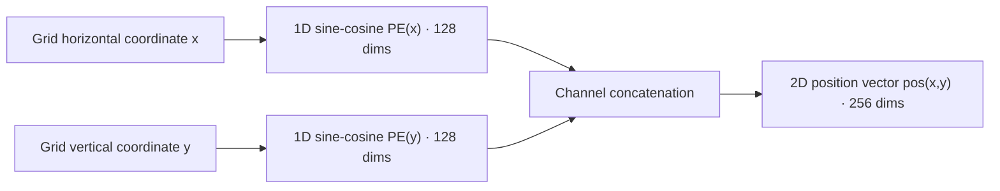

# Original DETR: Architecture and Forward Flow

In traditional detection frameworks, the pipeline from input image to final bounding boxes is full of hand-crafted geometric priors: tiling thousands of anchor boxes or sample points over the feature map, heuristic positive/negative sample assignment by IoU thresholds, cropping local features with RoI Align, and finally removing redundant boxes externally through Non-Maximum Suppression (NMS).

DETR (Carion et al., 2020) restructured this paradigm completely. It formulates object detection as a **direct set prediction** problem: given an image, a single neural network forward pass directly outputs a set of $N$ predicted objects.

This article focuses on DETR's **forward architecture and prediction mechanism**. Starting from first principles of data structures and geometric symmetry, it breaks down how an image tensor is step-by-step transformed into a set of object predictions, and examines the underlying mechanisms and computational costs of positional encoding, the dual attention of the encoder and decoder, and Object Queries.

## Overall Forward Data Flow

The object detection task faces an inherent contradiction at the data-structure level:

- **Ground truth in the physical world is a variable-length unordered set:** an image may contain 0, 3, or dozens of objects, with no natural ordering among them;
- **Standard neural network computation graphs require fixed-length tensors:** static computation graphs and matrix-parallel operations in deep learning frameworks require every layer's output tensor to have a definite dimensional shape.

To carry a variable-length set inside a fixed-length computation graph, DETR reserves $N$ parallel slots in the decoder. Regardless of how many real objects the input image contains, the model always outputs exactly $N$ predictions ($N = 100$ by default on COCO). When an image contains fewer than $N$ objects, the unused slots predict the special background class $\varnothing$ (No Object).

:::info[Question]

**Why must detection use preset fixed slots instead of emitting objects one by one, as in natural language generation?**

Language generation has a natural unidirectional temporal dependency (the previous word determines the next), so autoregressive sequential generation fits it well. Physical entities in an image, however, **coexist side by side** in two-dimensional space; there is no causal grammar ordering a bird before a tree. Forcing autoregression onto them not only makes inference strictly serial and extremely slow, but also imposes an artificial ordering (say, left to right) on entities that are inherently parallel, breaking symmetry. The $N$ parallel preset slots exist so that all possible objects are extracted **simultaneously and independently** in a single forward pass.

:::

The forward inference data flow proceeds as follows:

1. **Backbone feature extraction:** the raw image $x \in \mathbb{R}^{3 \times H_0 \times W_0}$ passes through a standard ResNet to extract stage-5 (C5) features, downsampling spatial resolution by 32× to $H = \lfloor H_0 / 32 \rfloor, W = \lfloor W_0 / 32 \rfloor$, with 2048 channels;
2. **Channel reduction:** a $1 \times 1$ convolution compresses the channel count from 2048 to the Transformer's hidden dimension $d = 256$, producing a compact 2D feature map $z_0 \in \mathbb{R}^{d \times H \times W}$;
3. **Feature flattening and encoding:** the 2D feature map is transposed and flattened into a sequence $Z \in \mathbb{R}^{L \times d}$, where $L = H \times W$. The 2D sine-cosine positional encoding is not concatenated with the features; instead, it is injected before the $Q$ and $K$ projections inside the self-attention of each of the 6 standard Transformer encoder layers. The encoder output is a feature memory $\text{Memory} \in \mathbb{R}^{L \times d}$ rich in global context and instance-decoupled information;
4. **Decoder parallel probing:** $N$ learnable Object Queries act as positional probes, paired with content embeddings initialized to zero, and feed into 6 Transformer decoder layers. In each layer, the queries first negotiate their division of labor through self-attention, then extract visual representations of concrete objects from the $\text{Memory}$ via cross-attention;
5. **Shared prediction heads:** the decoder's $N$ output feature vectors independently pass through parameter-shared classification (Linear) and regression (3-layer MLP) heads, directly mapping to $N$ predictions: class probability distributions $\hat{p}_i \in \mathbb{R}^{K+1}$ and normalized bounding box coordinates $\hat{b}_i \in [0, 1]^4$.

## CNN Backbone: Single-Scale Feature Extraction

Conventional multi-scale detectors (Faster R-CNN with FPN, YOLO, etc.) simultaneously use features downsampled by 8× (C3), 16× (C4), and 32× (C5) to cover objects at different scales. The original DETR, however, **uses only the single-scale C5 feature map**.

This choice was not made for minimalism; it was constrained by the computational complexity of standard self-attention.

Standard self-attention computes dot-product weights between all pairs of tokens in the sequence, so its time and memory complexity grows with the square of the sequence length $L$:

$$\mathcal{O}_{\text{Attention}} = \mathcal{O}(L^2 \cdot d) = \mathcal{O}((H \cdot W)^2 \cdot d)$$

For an input resolution of $800 \times 1333$, the sequence lengths and attention-matrix costs at different downsampling rates are:

| Feature level | Spatial stride | Feature map ($H \times W$) | Sequence length $L$ | Self-attention matrix elements ($L^2$) | Relative memory/compute cost |
| :--- | :--- | :--- | :--- | :--- | :--- |
| **C5 (used by DETR)** | 32 | $25 \times 42$ | **1,050** | **$\approx 1.10 \times 10^6$** | **$1 \times$ (baseline)** |
| C4 | 16 | $50 \times 84$ | 4,200 | $\approx 1.76 \times 10^7$ | $\approx 16 \times$ |
| C3 | 8 | $100 \times 168$ | 16,800 | $\approx 2.82 \times 10^8$ | $\approx 256 \times$ |

Feeding high-resolution features (such as C3) directly into global self-attention would require nearly 300 million dot products for a single layer's attention matrix on one image, instantly exhausting memory.

The original DETR therefore compromises on spatial resolution, keeping only the C5 features with the largest receptive field but the lowest resolution. This computational bottleneck carries a direct performance cost: **an inherent weakness in small-object detection**. In an $800 \times 1333$ image, a $32 \times 32$ pixel object occupies less than $1 \times 1$ grid cell on the C5 feature map, and high-level semantic abstraction severely loses spatial geometric detail. This is the fundamental reason the original DETR underperforms traditional FPN detectors on the small-object metric $\text{AP}_{\text{s}}$.

## 2D Sine-Cosine Positional Encoding

### Motivation: Recovering Spatial Position Information

CNNs naturally preserve translation equivariance and spatial neighborhood structure through the local connectivity of sliding windows. Standard self-attention inside a Transformer, by contrast, is **permutation equivariant**:

$$\text{Attention}(P X, P X, P X) = P \, \text{Attention}(X, X, X)$$

where $P$ is any permutation matrix. This means that if the flattened feature sequence is arbitrarily shuffled before entering the Transformer, the output features are numerically identical apart from the same reordering. For object detection, the absolute coordinates and relative distances of objects in the image are essential; a model that cannot sense the spatial arrangement of the grid cannot predict bounding boxes at all.

### Formula Definition of the 2D Sine-Cosine Positional Encoding

In NLP, a sentence is a one-dimensional sequence, so position can be encoded with a single scalar $pos$. Image features, however, live on a 2D discrete grid, where each feature point is uniquely located by coordinates $(x, y)$ ($x \in [1, W], y \in [1, H]$).

DETR adopts an independent 2D sine-cosine positional encoding. The hidden dimension $d = 256$ is split in half: the first 128 dimensions encode the horizontal coordinate $x$ with sine-cosine wavelength modulation, the last 128 dimensions encode the vertical coordinate $y$:

$$\begin{aligned} \text{PE}_{(x, 2i)} = \sin\left(\frac{x}{10000^{2i / (d/2)}}\right), \quad \text{PE}_{(x, 2i+1)} = \cos\left(\frac{x}{10000^{2i / (d/2)}}\right), \quad i \in \left[0, \frac{d}{4} - 1\right] \\ \text{PE}_{(y, 2i)} = \sin\left(\frac{y}{10000^{2i / (d/2)}}\right), \quad \text{PE}_{(y, 2i+1)} = \cos\left(\frac{y}{10000^{2i / (d/2)}}\right), \quad i \in \left[0, \frac{d}{4} - 1\right] \end{aligned}$$

The horizontal and vertical 128-dim encodings are concatenated along the channel dimension, forming a dedicated 256-dim position vector for each pixel $(x, y)$:

$$\text{pos}(x, y) = \left[ \text{PE}(x) \,\|\, \text{PE}(y) \right] \in \mathbb{R}^d$$

> Construction of the 2D sine-cosine positional encoding

### Injection Point of Positional Encoding in the Attention Layers

The original Vaswani Transformer adds word embeddings and positional encoding once at the input layer ($x + pos$) before passing them through all layers. DETR instead explicitly adds the positional encoding before the $Q$ and $K$ projections in every attention sublayer of the encoder and decoder, while $V$ remains pure feature content:

$$Q = (z + \text{pos}) W_Q, \quad K = (z + \text{pos}) W_K, \quad V = z W_V$$

The deeper logic of this design lies in the different roles of Q, K, and V in attention:

1. **$Q$ and $K$ perform addressing:** the dot product $Q K^T$ computes "where to look for relevant information". Whether two feature points are relevant depends both on their semantic similarity (e.g. both being dog fur) and on their geometric relative distance in space. Positional encoding must therefore participate in the $Q$ and $K$ computations.
2. **$V$ transports content:** once the addressing weights are computed, the attention layer aggregates semantic features from the selected regions through the weighted average $\text{Softmax}(Q K^T / \sqrt{d_k}) V$. The aggregated content should be the image's own visual representation; if $V$ mixes in absolute coordinate offsets, the deep feature representation becomes contaminated by spatial coordinates, undermining pure semantic extraction.
3. **Why re-inject at every layer:** after features pass through each layer's multi-head attention and feed-forward network (FFN), nonlinear transformations progressively dilute the low-level spatial position information. Explicitly re-injecting the original positional encoding at every layer keeps geometric spatial cues clear whenever the deep network performs long-range addressing.

:::info[Question]

**What side effects does adding positional encoding to the Value produce?**

Run a simple thought experiment: suppose there is an orange in the top-left corner of the image and an identical orange in the bottom-right corner. Their semantic content (color, texture, contour) should be highly consistent. During feature aggregation, we want the "orange representation" the network extracts to be independent of specific coordinates and remain pure in the eyes of the classifier.

If positional encoding is added into $V$, the top-left orange's $V$ always carries a `(0, 0)` coordinate bias, while the bottom-right orange's carries `(H, W)`. The same object would then produce artificially drifting features depending on where it is aggregated, needlessly destroying the **translation invariance** on which convolution and visual recognition depend. Positional information should guide "where the gaze looks", not contaminate "what is seen".

:::

## Transformer Encoder

The feature map $z_0 \in \mathbb{R}^{d \times H \times W}$ is transposed to $H \times W \times d$ and flattened into $Z \in \mathbb{R}^{L \times d}$, then passed together with the positional encoding tensor into 6 standard Transformer encoder layers; the positional encoding is not merged with the features at the entrance, but injected separately before the $Q$ and $K$ projections inside each layer's self-attention.

Each encoder layer uses 8-head attention ($h = 8, d = 256$, with $d_k = 32$ per head). Multi-head attention allows the model to capture multiple relation patterns simultaneously in different low-dimensional projected subspaces (for example, some heads aggregate by spatial locality, others by global same-class semantics).

### Role of the Encoder: Feature Enhancement and Context Aggregation

In conventional convolutional networks, a neuron's receptive field grows gradually through stacked convolution layers. Deep features have large receptive fields, but features inside large objects or between occluded objects often blur together.

The Transformer encoder establishes direct associations between any two pixels of the entire feature map from its very first layer. This global interaction provides two decisive capabilities:

1. **Global instance decoupling:** encoder self-attention can forcefully aggregate scattered pixels belonging to the same entity at the feature level, while cleanly separating foreground entities from complex background textures.
2. **Overcoming occlusion and fragmentation:** when an object is split in two by a foreground obstacle, the two halves share highly consistent global semantics and contextual association, so the encoder can directly pull the features of the fragmented regions back together.

## Transformer Decoder

The decoder is the core module through which DETR achieves direct set prediction. If the encoder's task is global context modeling and instance separation for the whole image, the decoder's task is to dispatch a group of parallel probes that claim the entities in the image one by one and extract them into concrete structured representations.

### Non-Autoregressive Prediction and the Slot Mechanism

#### Decoding Mechanism: Non-Autoregressive Parallel Prediction

In Seq2Seq NLP tasks, the standard Transformer decoder operates in **autoregressive** mode: generating the $t$-th word requires the previous $t-1$ words as input, so computation is strictly serial and time complexity grows linearly with output length.

Object detection, however, is inherently a spatially parallel task, not a sequential generation task. The cars, pedestrians, and traffic lights in an image coexist on a 2D canvas with no grammatical ordering among them. Forcing autoregressive generation would not only multiply inference latency, but also artificially break the geometric symmetry of the targets (e.g. forcing the model to predict left-side objects before right-side ones).

DETR adopts a **fully non-autoregressive** design: all predictions advance fully concurrently through all decoder layers. The network fixes a prediction capacity $N$ (typically $N = 100$ on COCO), and during the forward pass all $N$ predictions are emitted in a single step.

#### Concept of the Slot Mechanism

The literature often calls DETR's output channels "slots". This concept sounds abstract, but at the engineering and tensor level it has a very concrete physical meaning.

In the computation graph, a slot is essentially a slice of the decoder feature tensor $H \in \mathbb{R}^{N \times B \times d}$ along the first dimension: the $i$-th slot is the slice $H[i, :, :]$. These $N$ slots can be understood as $N$ parallel **object-capture channels (workers)** dispatched by the network.

In every forward computation:

1. Each slot searches the image for at most one independent physical entity;
2. If an image contains only 3 objects, 3 slots capture the classes and coordinates of those 3 objects, while the remaining 97 slots output the background class $\varnothing$ meaning "no object here";
3. The decoder's responsibility is to let these $N$ slots cover all salient objects in the image as completely as possible without conflicting with each other.

So what distinguishes these originally blank slots from one another, and at which step do they load image features? This leads to the dual-track design of Object Queries and content embeddings.

### The Dual-Track Input Structure of Object Queries

The tensors entering the DETR decoder are not a single variable but a strictly separated "dual-track" system: **content embeddings** and **Object Queries**.

#### Division of Labor Between Content Queries and Positional Queries

Each slot maintains two groups of vectors:

- **Content embedding (fast variable) $h \in \mathbb{R}^{N \times B \times d}$:** it carries the visual information of concrete objects in the current image (color, texture, contour, and the semantic class and bounding box ultimately distilled from them). At the input of the first decoder layer, nothing is known about what objects the image contains, so it is initialized entirely as a **zero tensor** (`torch.zeros(N, B, d)` in code). As it passes through the decoder layers, it continuously absorbs image features, and its values change dynamically and drastically with each input;
- **Object Query (slow variable) $Q_{\text{obj}} \in \mathbb{R}^{N \times d}$:** a group of **learnable parameters** of the network (declared as `nn.Embedding(N, d)` in code). Its weights are independent of the specific input image and are updated slowly by the optimizer over the entire training period, condensing the dataset-wide priors of object geometry (e.g. "small object in the upper left", "large object at the center").

In terms of roles, $Q_{\text{obj}}$ acts as the **decoder positional encoding**: it carries no semantic class information and provides only geometric priors. Later work splits this tensor into positional and semantic roles — when the positional query / content query dichotomy is discussed in the later article on DINO, $Q_{\text{obj}}$ is precisely the carrier on the content query side of that dividing line.

#### Injection of Query Vectors in Each Decoder Layer

In a conventional NLP Transformer, positional encoding is usually added to the word embeddings once at the input layer and no longer participates in deeper computation. The DETR decoder differs: to ensure deep features do not lose their initial spatial addressing bias while evolving through nonlinear transformations, $Q_{\text{obj}}$ is **explicitly re-injected in every attention sublayer of all 6 decoder layers**.

Within each decoder layer, the injection happens before the projection matrices:

1. **Injection in the self-attention sublayer:**
   the slot's content feature $h^{(l-1)}$ plus $Q_{\text{obj}}$ are projected together to generate the self-attention $Q$ and $K$, while $V$ stays pure content feature without positional bias:

   $$Q_{\text{self}} = (h^{(l-1)} + Q_{\text{obj}}) W_Q, \quad K_{\text{self}} = (h^{(l-1)} + Q_{\text{obj}}) W_K, \quad V_{\text{self}} = h^{(l-1)} W_V$$

2. **Injection in the cross-attention sublayer:**
   the new content feature $h_{\text{self}}^{(l)}$ output by the self-attention sublayer is again added to $Q_{\text{obj}}$, acting as a probe addressing the image features; on the image side, the $\text{Memory}$ is combined with the image positional encoding $\text{pos}$ as $K$, with pure image features as $V$:

   $$Q_{\text{cross}} = (h_{\text{self}}^{(l)} + Q_{\text{obj}}) W_Q, \quad K_{\text{cross}} = (\text{Memory} + \text{pos}) W_K, \quad V_{\text{cross}} = \text{Memory} \, W_V$$

The design logic of this layer-by-layer explicit addition mirrors the encoder: the positional encoding guides the addressing process (directing where the attention weight matrix should focus), while the semantic payload being transported and aggregated ($V$) always remains clean visual content, preventing absolute coordinate bias from contaminating feature semantics.

### Attention Mechanisms Within a Single Decoder Layer

Having sorted out the decoder's dual-track state and injection scheme, the two core attention sublayers of a single decoder layer can now be traced clearly in terms of the problems they each solve.

#### Self-Attention Layer: Interaction Among Query Vectors

The self-attention sublayer computes attention weights among the $N$ slots, with a computation matrix of size $N \times N$.

Its core role is inter-slot communication and **deduplication negotiation**. Because all $N$ slots work in parallel and independently, without direct dialogue among slots it is entirely possible for two slots with similar preferences to both pick the same zebra in the image and each output a high-confidence detection box — regressing into the piles of redundant predictions of traditional detectors.

In self-attention, each slot exposes its current content state and spatial preference to all other slots. Combined with the "one-to-one exclusivity penalty" of bipartite matching during training, the slots can negotiate dynamically internally: if two slots find themselves aiming at the same target, the one with the competitive advantage keeps that target while the other actively yields, falling back to background or seeking other marginal objects. It is precisely this self-attention interaction that allows DETR to achieve clean one-instance-one-prediction while completely discarding external NMS.

#### Cross-Attention Layer: Interaction Between Queries and Image Features

The cross-attention sublayer uses the $N$ slots as query probes to address the full-image memory $\text{Memory} \in \mathbb{R}^{L \times d}$ produced by the encoder, computing an attention matrix of shape $N \times L$ (where $L = H \times W$). **Its core role is directed content extraction and boundary alignment.**

The attention matrix after Softmax normalization expresses how much slot $i$ attends to each grid point of the image. Each slot, according to its own computed weights, takes the weighted sum of the feature vectors belonging to its target region across the whole image and aggregates them into its content embedding:

$$h^{(l)} = \text{Softmax}\left( \frac{Q_{\text{cross}} K_{\text{cross}}^T}{\sqrt{d}} \right) V_{\text{cross}}$$

After training converges, cross-attention behavior shows features that follow geometric regularity closely:

![Decoder attention visualization on two COCO images (colors distinguish prediction slots; left image has two elephants, right image has three zebras): attention does not spread over the whole object interior but concentrates on the extremal parts of contours such as trunks, legs, and necks — exactly the leftmost, rightmost, topmost, and bottommost points on which bounding box regression depends. Original paper Figure 6, from End-to-End Object Detection with Transformers, arXiv:2005.12872 (CC0 license)](/img/cv_img/detr-series/decoder_attn_elephants_zebras.png)

Attention does not mechanically spread uniformly inside the object; it automatically concentrates on the object's outer edges, limbs, head, and tail — the extremal boundary points. What determines the accuracy of a rectangular bounding box is precisely the object's leftmost, rightmost, topmost, and bottommost extremal points. Cross-attention lets each slot actively measure the geometric extremes of its object, providing ample local feature support for the prediction head to directly regress the bounding box.

### The Parametric Nature and Spatial Division of Labor of Object Queries

With the macro data flow and the per-layer attention clear, three key questions (know-why) about Object Queries can now be answered from the perspective of mathematics and optimization theory.

#### The Learnable-Parameter Nature of Query Vectors

A natural question: why must each slot be assigned its own learnable vector $Q_{\text{obj}, i}$? Could the input instead be initialized as pure content features, as in the encoder, or could all slots simply share one query vector?

The answer: **mutually distinct parameters must be introduced to break permutation symmetry.**

The Transformer operator is strictly permutation equivariant. At the entrance of the first decoder layer, the content embeddings are all zero. If mutually independent $Q_{\text{obj}}$ are not provided at this point (e.g. all slots use the same vector, or all are zeroed), then in the first layer's computation:

1. The self-attention input is identical everywhere, so its output is constantly 0;
2. The cross-attention Query vectors are identical across all $N$ slots, so each slot aggregates indistinguishable vectors from the image features.

Once symmetry is not broken at the entrance, and because all weights of the multi-layer network are shared, subsequent layers will forever maintain exactly identical states — the $N$ slots can only end up outputting $N$ identical bounding boxes and classes. **This set of parameters is therefore the sole fulcrum that gives each parallel slot an independent identity and breaks the system's initial symmetry.**

#### The Prior Spatial Distribution of Query Vectors

When data first enters the first decoder layer, the content embedding $h^{(0)}$ carries no information (all zeros), which means the cross-attention computation at that moment is:

$$A_i = \text{Softmax}\left( \frac{(Q_{\text{obj}, i} W_Q)(\text{Memory} + \text{pos})^T W_K^T}{\sqrt{d}} \right) \in \mathbb{R}^{1 \times L}$$

Observe this formula carefully: the attention weight $A_i$ is determined entirely by the dot product between $Q_{\text{obj}, i}$ and the image memory with positional encoding.

This reveals a highly significant physical fact: **each learned $Q_{\text{obj}, i}$ effectively defines a preset spatial addressing distribution map in the first layer.**

This is conceptually equivalent to the **anchor box** of traditional detectors:

- Faster R-CNN lays a set of rigid, discrete geometric boxes on the spatial grid as prior candidates, and the prediction head regresses offsets on top of them;
- DETR instead uses $N$ continuous vectors to generate $N$ continuous, soft, mutually-overlapping **probability addressing heatmaps**.

The paper's statistical scatter plot on the COCO validation set (Figure 7) strongly confirms this mechanism: different query slots spontaneously learn to attend to different spatial regions and aspect-ratio patterns. Some slots specialize in small objects in the lower-left corner of the image; others specialize in large objects spanning the whole frame.

#### Statistical Division of Labor and Diversity Among Slots

This set of parameters is static and fixed across all images. Why can it divide labor stably instead of all collapsing onto the image center?

This is the outcome of the **interplay between the exclusivity mechanism of bipartite matching and optimization gradients**:

1. **Random symmetry breaking:** at initialization, normal-distribution initialization gives each query a slightly different initial direction;
2. **Winner-take-all reinforcement:** bipartite matching during training requires each ground-truth object to be claimed by exactly one slot of minimum cost. Once query $A$ happens to be closer to some marginal object and wins the positive match, its parameters receive gradient updates pulling it toward that object, reinforcing its specificity to that region;
3. **Anti-collapse restoring force of spatial coverage:** if a large number of queries blindly cluster around large central objects, the marginal ground-truth objects go unclaimed, inflicting a huge missed-detection loss on the whole model. Any query even slightly biased toward the periphery can then immediately claim those isolated objects with minimal competitive resistance and receive a large positive update. This dynamic push and pull forces the spatial distribution of the $N$ queries to converge to a uniform coverage of the dataset's prior spatial distribution.

#### Limitations of the Original Query Mechanism

Although the original DETR's Object Queries display elegant mathematical properties, they have a serious engineering weakness: **this set of spatial priors is highly implicit**.

Each query vector is just a string of 256 abstract floating-point numbers; it does not explicitly specify, as a traditional anchor does, "I represent $(x=0.2, y=0.3, w=0.1, h=0.1)$". The network must endure as many as 500 epochs of repeated bipartite matching iterations before these 100 vectors painfully work out their respective spatial division of labor.

It is precisely the sluggishness of this implicit representation that became the improvement entry point for the subsequent series of DETR evolution works:

- **Conditional DETR** attempts to explicitly decouple the query into a content part and a positional part with physically meaningful coordinate reference points;
- **DAB-DETR** goes further, directly modeling the Object Query as an explicit 4-dimensional bounding box prior $(x, y, w, h)$, accelerating training convergence by several times.

The later articles in this series examine these reconstruction approaches that impose explicit geometric constraints on queries in depth.

## Prediction Output Heads (FFN)

After refinement through the 6 stacked decoder layers, the final output is a feature matrix $H_{\text{dec}} \in \mathbb{R}^{N \times d}$. DETR feeds these $N$ feature vectors independently into two parallel prediction branches.

**To be explicit: these two prediction heads are strictly parameter-shared across all $N$ slots.**
Although each query has a different spatial preference, the mapping from object features to class attributes and geometric bounding boxes is universal in the physical world. Parameter sharing guarantees the detector's generalization ability.

### Classification Branch

A single linear transformation maps the hidden dimension $d$ to the class count $K + 1$:

$$\hat{p}_i = \text{softmax}(W_{\text{cls}} h_i + b_{\text{cls}}) \in \mathbb{R}^{K + 1}, \quad i \in \{1, \dots, N\}$$

where $K$ is the dataset's class count ($K = 80$ for COCO), and the extra $(K+1)$-th class is the "no object" background class $\varnothing$.

### Bounding Box Regression Branch

An MLP of 3 fully connected layers with ReLU activations outputs 4-dimensional normalized coordinates:

$$\hat{b}_i = \sigma(\text{MLP}(h_i)) \in [0, 1]^4, \quad i \in \{1, \dots, N\}$$

A final Sigmoid $\sigma(\cdot)$ strictly constrains the values to $[0, 1]$. The output format is normalized center coordinates and width/height:

$$\hat{b}_i = (\hat{c}_x, \hat{c}_y, \hat{w}, \hat{h})$$

Unlike traditional detectors that predict spatial offsets $(\Delta x, \Delta y, \Delta w, \Delta h)$ relative to preset anchors, DETR **directly regresses the absolute normalized coordinates of the true box**. This completely discards the hand-set anchor aspect-ratio and size hyperparameters.

## End-to-End Tensor Trace

To map the formulas above precisely onto the engineering implementation, the following table shows the complete dimensional flow of tensors through each module of the DETR forward network for a single batch (Batch Size = $B$), using the standard configuration $d = 256, N = 100, K = 80$:

| Stage | Module / Operator | Input tensor and shape | Output tensor and shape | Key operations and parameters |
| :--- | :--- | :--- | :--- | :--- |
| **Image input** | Raw image batch | image data | `[B, 3, H_0, W_0]` | typical resolution $800 \times 1333$ |
| **Backbone features** | ResNet-50 (C5) | `[B, 3, H_0, W_0]` | `[B, 2048, H, W]` | 32× downsampling, $H \approx 25, W \approx 42$ |
| **Channel alignment** | $1 \times 1$ Conv | `[B, 2048, H, W]` | `[B, 256, H, W]` | compress 2048 channels to $d = 256$ |
| **Positional encoding** | 2D Sine/Cos PE | grid coordinates $(H, W)$ | `[B, 256, H, W]` | 128 sine-cosine dims each for x and y, concatenated |
| **Sequence flattening** | Flatten & Permute | `[B, 256, H, W]` | `[HW, B, 256]` | sequence length $L = H \times W \approx 1050$ |
| **Encoder interaction** | 6-layer Transformer Encoder | features and positions `[L, B, 256]` | **Memory** `[L, B, 256]` | $L \times L$ global self-attention, context extraction |
| **Query input** | Object Queries / Output Emb | learned parameters $Q_{\text{obj}}$ | `[N, B, 256]` | $N = 100$ probes; content initialized to all zeros |
| **Decoder self-attention** | Decoder Self-Attention | query features `[N, B, 256]` | `[N, B, 256]` | $N \times N$ inter-slot communication, dedup negotiation |
| **Decoder cross-attention** | Decoder Cross-Attention | query `[N]` + memory `[L]` | `[N, B, 256]` | $N \times L$ attention addressing, feature aggregation from the image |
| **Decoder output** | 6-layer stacked output | decoded features | **$H_{\text{dec}}$** `[B, N, 256]` | each slot aggregates a $d$-dim object representation vector |
| **Class prediction** | Linear head (shared) | `[B, N, 256]` | **$\hat{P}$** `[B, N, 81]` | probability distribution over 80 classes + 1 background class $\varnothing$ |
| **Bounding box prediction** | 3-layer MLP (shared) | `[B, N, 256]` | **$\hat{B}$** `[B, N, 4]` | Sigmoid constrains output to normalized $(\hat{c}_x, \hat{c}_y, \hat{w}, \hat{h})$ |

## Summary

This article dissected the design logic of DETR's forward pipeline:

1. **Task constraint and set container:** Object Queries with a fixed capacity of $N$ carry a variable-length set of physical objects inside a fixed-length computation graph;
2. **Compute bottleneck and the single-scale trade-off:** the $\mathcal{O}(L^2)$ complexity of self-attention forces the original DETR to use only the 32× downsampled C5 features, planting the seed of weak small-object detection;
3. **Geometric information injection:** 2D sine-cosine positional encoding breaks permutation equivariance and acts only on the Q and K addressing channels, keeping the V content channel pure;
4. **Encoder global decoupling:** global self-attention establishes direct connections between arbitrary pixel pairs, achieving instance boundary separation and occluded-feature aggregation;
5. **Decoder dual attention:** cross-attention performs "image-to-slot" feature extraction, while self-attention establishes "slot-to-slot" communication to avoid duplicate predictions;
6. **Parameter-shared prediction heads:** the $N$ slots share a linear classification head and a 3-layer MLP regression head, directly regressing absolute normalized coordinates.

With the forward computation now producing this fixed-size set of $N$ predictions, the next core question is: **during training, how can the unordered prediction set $\hat{Y}$ be paired unambiguously and optimally with the ground-truth object set $Y$, and how can a loss function be constructed to drive the network to converge?** The next article, [Original DETR: Bipartite Matching and Set Loss](./detr-v1-bipartite-matching-set-loss), works through the mathematics.

---

Next: [Original DETR: Bipartite Matching and Set Loss](./detr-v1-bipartite-matching-set-loss)
