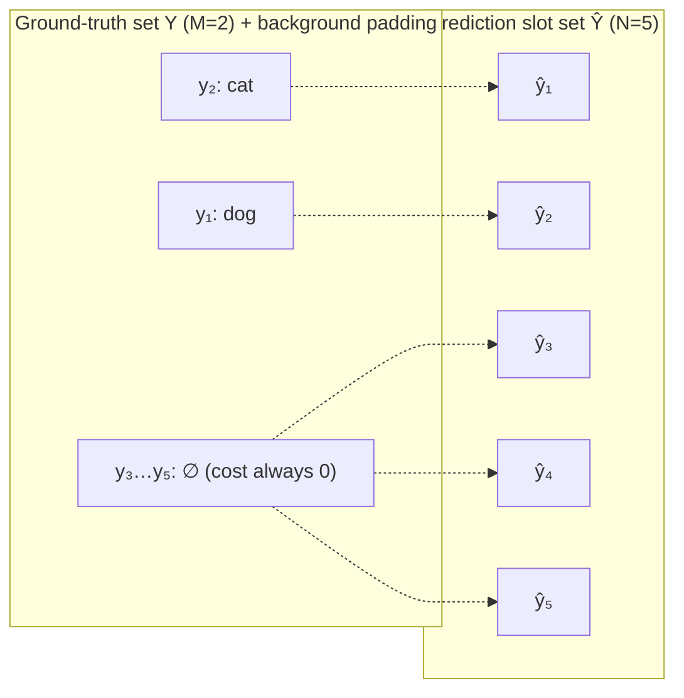

# Original DETR: Bipartite Matching and Set Loss

In [the previous article](./detr-v1-architecture-forward-pass), we dissected DETR's forward architecture: the backbone extracts C5 features, the encoder builds global pixel relations, the decoder probes in parallel through $N$ object queries, and a shared prediction head finally outputs a prediction set of fixed size $N$, $\hat{Y} = \{\hat{y}_i\}_{i=1}^N$.

However, the supervision signal for object detection is inherently an **unordered ground-truth object set of variable size**, $Y = \{y_i\}_{i=1}^M$ (where $M$ is the number of ground-truth objects in the image, typically $M < N$). Among the $N$ predictions the model outputs, which prediction slot should be responsible for which ground-truth object? And how should the remaining $N - M$ slots that miss any ground-truth object be penalized?

Traditional detectors rely on preset spatial-overlap priors (such as IoU thresholds between anchors and ground-truth boxes) for heuristic one-to-many label assignment. DETR abandons one-to-many label assignment in favor of one-to-one assignment, and therefore no longer needs NMS. Still, an assignment algorithm is required to map the network's outputs one-to-one onto the actual labels. The Hungarian algorithm — a classic combinatorial optimization algorithm for solving minimum-total-cost bijective pairings between two sets of elements — is exactly suited to establishing this one-to-one correspondence between prediction slots and ground-truth objects.

This article systematically breaks down the mathematical definition of set supervision, the two-phase training mechanism, the magnitude constraints behind the matching cost design, the construction of the set loss, and how one-to-one matching internalizes the deduplication mechanism (eliminating NMS). It then analyzes in depth the positive-sample sparsity and matching oscillation costs that this paradigm brings.

## Permutation Invariance of Set Prediction

Before designing the loss function, two groups of symmetries in the object detection task must be clarified:

1. **Permutation invariance of the ground-truth set:**
   Ground-truth annotations form a set; any reordering of the indices leaves it unchanged:

   $$
   \{y_{\pi(1)}, y_{\pi(2)}, \dots, y_{\pi(M)}\} = \{y_1, y_2, \dots, y_M\}, \quad \forall \pi \in \mathfrak{S}_M
   $$

   The indices exist only as temporary numbering for writing the annotation list. For example, if an image contains a cat and an apple, writing the annotation list as `[cat, apple]` or `[apple, cat]` differs only in numbering order; the physical ground truth expressed is exactly the same. The ordering of the list comes from the storage format of the annotation file and is not part of the physical truth.
2. **Unordered slot correspondence of the prediction set:**
   The DETR decoder outputs $N$ prediction vectors $\hat{Y} = \{\hat{y}_1, \dots, \hat{y}_N\}$. Although in tensor implementation they occupy array indices $1, \dots, N$, these slots have no prior fixed order semantically (nothing prescribes, for instance, that "slot 1 must predict the cat" or "slot 2 must predict the top-left object").

Therefore, evaluating the discrepancy between the prediction set $\hat{Y}$ and the ground-truth set $Y$ cannot directly use an element-wise loss aligned by tensor index; instead, **a globally optimal permutation must be found among all possible correspondences**.

## Hungarian Bipartite Matching

To unify the cardinality of the prediction set and the ground-truth set mathematically, DETR first pads the ground-truth object set $Y$ with a special "no-object" background class $\varnothing$ up to size $N$:

$$
Y = \{y_1, y_2, \dots, y_M, \underbrace{\varnothing, \varnothing, \dots, \varnothing}_{N - M \text{ items}}\}
$$

Each real physical object $y_i = (c_i, b_i)$ consists of a class label $c_i \in \{1, \dots, K\}$ and normalized ground-truth box coordinates $b_i = (x_i, y_i, w_i, h_i) \in [0, 1]^4$; a background object $y_i = \varnothing$ has no class and contains no box coordinates.

The purpose of the padding terms is only to make both sides the same size, forming an $N \times N$ square matrix so the standard bijective matching framework applies directly. Because the matching cost of a padding term is always 0, it never competes with foreground objects for any slot. What optimization truly needs to decide is only which slot each of the $M$ real objects lands in; the slots the padding terms end up in are simply the leftovers, and which specific slot each lands in is irrelevant.

The problem now becomes a classic weighted bipartite maximum-weight matching (or minimum-cost flow) problem: within the symmetric group $\mathfrak{S}_N$ (the set of all permutations of $N$ elements, $N!$ in total), find an optimal bijective permutation $\hat{\sigma} \in \mathfrak{S}_N$ that minimizes the **total matching cost** between the ground-truth objects and the $\sigma(i)$-th predictions:

$$
\hat{\sigma} = \arg\min_{\sigma \in \mathfrak{S}_N} \sum_{i=1}^N \mathcal{L}_{\text{match}}(y_i, \hat{y}_{\sigma(i)})
$$

where $\sigma(i)$ denotes the index of the prediction slot paired with the $i$-th ground-truth object under permutation $\sigma$.

Dashed lines show the output of one matching round. Note that the two foreground arrows cross: the dog is assigned to ŷ₂ and the cat to ŷ₁ — the assignment is independent of index order. The three background arrows carry no information: padding terms have a constant cost of 0, and the optimizer decides which slots they point to arbitrarily, without constituting a constraint.

## Decoupling Discrete Matching from Gradient Backpropagation

A core insight for understanding DETR's training mechanism: **Hungarian matching itself is a non-differentiable combinatorial optimization operation; gradients never flow through the matching operator.**

DETR training is essentially a two-phase alternating process (analogous to the logic of the Expectation-Maximization algorithm):

1. **Phase 1: discrete decision (matching / assignment).**
   With the forward outputs $\hat{Y}$ of the current network parameters fixed, compute the cost matrix between ground-truth objects and prediction slots, and invoke the Hungarian algorithm to solve for a discrete, globally optimal injective index mapping $\hat{\sigma}$. This step is only responsible for **responsibility assignment** and is a non-differentiable discrete decision.
2. **Phase 2: continuous optimization (loss backpropagation).**
   With the pairing $\hat{\sigma}$ solved in phase 1 fixed, feed the paired $(y_i, \hat{y}_{\hat{\sigma}(i)})$ into standard classification and regression losses, and propagate gradients back through backpropagation to update the backbone, the Transformer encoder/decoder, and the prediction head parameters.

## Matching Cost Matrix Design

The pairwise cost $\mathcal{L}_{\text{match}}(y_i, \hat{y}_j)$ measures the degree of mismatch between the $i$-th ground-truth object $y_i$ and the $j$-th prediction $\hat{y}_j$.

For a padding term $y_i = \varnothing$, the matching cost with any prediction is defined as 0 (background assignment incurs no active matching cost). For a real object $y_i = (c_i, b_i)$, the matching cost with a prediction $\hat{y}_j = (\hat{p}_j, \hat{b}_j)$ combines **class probability** and **spatial-geometric fit**:

$$
\mathcal{L}_{\text{match}}(y_i, \hat{y}_j) = -\mathbb{I}_{\{c_i \neq \varnothing\}} \, \hat{p}_j(c_i) + \mathbb{I}_{\{c_i \neq \varnothing\}} \, \mathcal{L}_{\text{box}}(b_i, \hat{b}_j)
$$

where:

- $\hat{p}_j(c_i)$ is the **predicted probability** that slot $j$ belongs to the ground-truth class $c_i$ (a probability scalar after Softmax normalization). The higher the predicted class probability, the lower the matching cost (hence the leading negative sign).
- $\mathcal{L}_{\text{box}}(b_i, \hat{b}_j)$ is the geometric matching cost.

### Classification Term in the Matching Cost

This is a critical design trade-off. Why not directly use the negative log-likelihood (NLL) $-\log \hat{p}$ during matching — the same term used for backpropagation?

The answer lies in **magnitude scale balance across multi-task costs**. Early in training, the network's predicted probability for the correct class, $\hat{p}_j(c_i)$, tends to be small: with random initialization it is about $1/(K+1) \approx 0.012$, so $-\log(0.012) \approx 4.4$; if the probability drops to 0.001, $-\log(0.001) \approx 6.91$. Meanwhile the geometric term $\mathcal{L}_{\text{box}}$ sits on the order of $[0, 2]$ (referring to the unweighted raw loss). By comparison, the classification term would dominate the total cost: a predicted box that fits the target tightly in space but has a low class probability could easily lose its rightful target to a prediction that is more class-confident but geometrically worse. Switching to the direct probability term $-\hat{p}_j(c_i) \in [-1, 0]$ confines the classification cost to a bounded and gentle range, letting geometric similarity retain real influence in matching, so both priors guide the matching on the same scale.

When computing the parameter-optimization loss in phase 2, however, $-\log \hat{p}_j(c_i)$ must be restored: only the log-likelihood provides gradients steep enough when predictions are wrong, driving the probability to converge rapidly toward 1.0.

:::info[Question]

**Why can bipartite matching not backpropagate gradients, forcing a two-phase split?**

The Hungarian algorithm is inherently discrete combinatorial optimization: it picks one optimal permutation $\hat{\sigma}$ out of $N!$ permutations. $\hat{\sigma}$ jumps discontinuously as the cost matrix changes — it is a piecewise-constant function, non-differentiable everywhere, and therefore cannot be optimized. But "cannot carry gradients" does not mean "unrelated to optimization". The actual role of matching is **gradient routing**: it receives no gradient itself, yet decides which prediction slot each ground-truth object lands in, and therefore where the loss $\ell(y_i, \hat{y}_{\hat{\sigma}(i)})$ sends its gradients. The routing itself is not optimized, yet it continuously redirects gradient flow.

These two roles cannot be merged into the same differentiable computation graph: once routing is placed on the backpropagation path, it requires differentiating a discrete choice that is non-differentiable everywhere. Implementation must therefore strip routing out of the gradient path (stop-gradient): first determine $\hat{\sigma}$ from the current predictions, then backpropagate under the fixed routing. "Two phases" here refers to this structural decoupling, not a differentiable step artificially split into two. The matching oscillation in early DETR training is precisely the visible effect of routing jumping as predictions drift.

:::

### Box Regression Term in the Matching Cost

The box geometric cost combines a weighted L1 distance with the GIoU loss:

$$
\mathcal{L}_{\text{box}}(b_i, \hat{b}_j) = \lambda_{\text{L1}} \, \|b_i - \hat{b}_j\|_1 + \lambda_{\text{giou}} \, \mathcal{L}_{\text{giou}}(b_i, \hat{b}_j)
$$

In the original DETR, the hyperparameters default to $\lambda_{\text{L1}} = 5, \lambda_{\text{giou}} = 2$.

These two losses form a complementary pair of geometric measures:

1. **L1 distance loss ($\|b_i - \hat{b}_j\|_1$):**
   Measures the absolute numerical deviation of box centers and dimensions. The advantage of L1 is that no matter how far apart two boxes are (even completely non-overlapping), its derivative is constant at $\pm 1$, continuously providing a stable absolute pull. However, L1 is **scale-sensitive**: although coordinates are normalized to $[0, 1]$, the absolute coordinate errors of large objects are naturally larger in magnitude than those of small objects.
2. **Generalized IoU loss (GIoU loss):**
   Optimizes the overlap region directly and is **scale-invariant**:

   $$
   \mathcal{L}_{\text{giou}}(b_i, \hat{b}_j) = 1 - \left( \frac{|b_i \cap \hat{b}_j|}{|b_i \cup \hat{b}_j|} - \frac{|C(b_i, \hat{b}_j) \setminus (b_i \cup \hat{b}_j)|}{|C(b_i, \hat{b}_j)|} \right)
   $$

   where $C(b_i, \hat{b}_j)$ is the area of the smallest enclosing rectangle covering both boxes. GIoU treats large and small objects equally and resolves the problem of standard IoU's gradient vanishing to zero when two boxes do not intersect.

Neither term is dispensable alone: using only L1 makes the model over-prefer large objects and struggle to fine-tune IoU; using only GIoU yields a weak gradient push dominated by the enclosing convex hull when two boxes are far apart.

### Solver: Assignment via the Hungarian Algorithm

In the paper's mathematical formalization, the ground-truth set is padded to size $N$ so that a bijection can be defined over the symmetric group $\mathfrak{S}_N$, framing matching as an $N \times N$ square-matrix problem. In the official code, however, `HungarianMatcher` in `models/matcher.py` never constructs this matrix. Its core comment states directly:

> For efficiency reasons, the targets don't include the no_object. Because of this, in general, there are more predictions than targets. In this case, we do a 1-to-1 matching of the best predictions, while the others are un-matched (and thus treated as non-objects).

In the engineering implementation, the code computes costs only for the $M$ ground-truth objects actually present in the image against the $N$ prediction slots, builds an $[N, M]$ cost matrix with rows as prediction slots and columns as ground-truth objects, and calls `scipy.optimize.linear_sum_assignment` directly to solve the rectangular assignment, producing only $\min(M, N)$ pairs. Prediction slots that never enter a pairing are naturally no-object. For notational convenience, the example below transposes the matrix so rows correspond to ground-truth objects and columns to prediction slots; the assignment result is unaffected.

This simplification is fully equivalent to the theoretical square-matrix matching. Because a padding term $\varnothing$ has a matching cost of exactly 0 with every prediction slot — a constant independent of the assignment — it participates in no slot competition. Removing these zero-cost padding terms does not affect the optimal assignment among real foreground objects at all. The slots left over by the foreground are precisely the unmatched predictions. The $N \times N$ square matrix exists only for notational completeness; solving the rectangular assignment directly saves computation while yielding exactly the same allocation.

Since slots only need to be chosen for the $M$ ground-truth objects, why not simply pick the row-wise minimum of the cost matrix greedily instead of relying on the Hungarian algorithm's global optimum? The reason is that independent greedy selection cannot handle conflicts: different ground-truth objects often prefer the same prediction slot.

Let an image contain $M = 2$ ground-truth objects and $N = 5$ prediction slots. Box coordinates use the normalized center format $b = (c_x, c_y, w, h)$; class index 0 is dog and 1 is cat, and $\hat{p}_j(c)$ denotes the Softmax probability that slot $j$ belongs to class $c$. The ground-truth objects are

$$
y_1 = \bigl(c_1 = 0,\ b_1 = (0.25, 0.50, 0.30, 0.25)\bigr), \qquad y_2 = \bigl(c_2 = 1,\ b_2 = (0.20, 0.35, 0.35, 0.30)\bigr)
$$

The five prediction slots are

$$
\begin{array}{c|ccc}
 & \hat{b}_j & \hat{p}_j(0) & \hat{p}_j(1) \\\hline
\hat{y}_1 & (0.60, 0.55, 0.25, 0.10) & 0.05 & 0.05 \\
\hat{y}_2 & (0.70, 0.50, 0.20, 0.20) & 0.20 & 0.08 \\
\hat{y}_3 & (0.20, 0.35, 0.35, 0.30) & 0.03 & 0.50 \\
\hat{y}_4 & (0.80, 0.20, 0.15, 0.15) & 0.03 & 0.03 \\
\hat{y}_5 & (0.35, 0.80, 0.25, 0.20) & 0.04 & 0.04
\end{array}
$$

Computing the matching cost term by term yields the cost matrix $C$:

$$
C = \begin{array}{c|ccccc}
 & \hat{y}_1 & \hat{y}_2 & \hat{y}_3 & \hat{y}_4 & \hat{y}_5 \\\hline
y_1 & 5.670 & 5.486 & 3.170 & 8.967 & 5.190 \\
y_2 & 7.521 & 7.485 & -0.500 & 8.670 & 6.976
\end{array}
$$

Reading the matrix, the row minima of both the dog $y_1$ and the cat $y_2$ fall on slot $\hat{y}_3$ (cost 3.170 for the dog, −0.500 for the cat). Under row-wise greedy assignment, both objects would compete for the same slot $\hat{y}_3$, producing an illegal non-injective allocation.

The globally optimal assignment given by the Hungarian algorithm is: cat $\to \hat{y}_3$ (cost −0.500), dog $\to \hat{y}_5$ (cost 5.190), total cost 4.690, with slots $\hat{y}_1, \hat{y}_2, \hat{y}_4$ left unmatched.

This reallocation is driven by the two objects' opportunity costs. If the cat loses $\hat{y}_3$ and must fall back to its next-best slot $\hat{y}_5$, its matching cost rises from −0.500 to 6.976 — a drop of about 7.476. If the dog loses $\hat{y}_3$ and falls back to $\hat{y}_5$, its cost changes only from 3.170 to 5.190 — a drop of about 2.020. Letting the dog occupy $\hat{y}_3$ while the cat retreats to $\hat{y}_5$ would raise the total cost to 10.146, exceeding the global optimum by 5.456. Global combinatorial optimization, when facing slot conflicts, forces the party with the smaller fallback cost to yield the slot, thereby minimizing total system cost.

## Summary

DETR replaces heuristic one-to-many label assignment with one-to-one assignment: ground-truth sets are padded with a zero-cost no-object class, and Hungarian bipartite matching finds the globally optimal bijective permutation between prediction slots and ground truth. Matching is a non-differentiable combinatorial decision that acts as gradient routing rather than an optimized operator — first assign responsibility, then backpropagate under fixed assignment. The matching cost deliberately uses the raw probability $-\hat{p}$ instead of $-\log \hat{p}$ to balance magnitudes against the geometric L1 + GIoU terms, restoring the log-likelihood only in the loss stage. One-to-one matching internalizes deduplication and removes the NMS dependency, at the price of positive-sample sparsity and early-training matching oscillation.

---

Next: [Deformable DETR](./deformable-detr)
