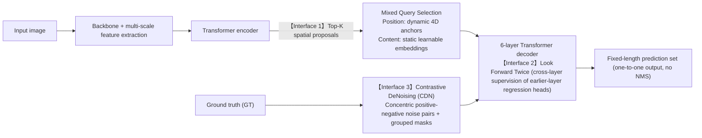
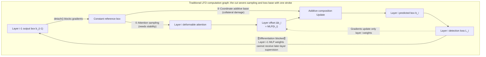
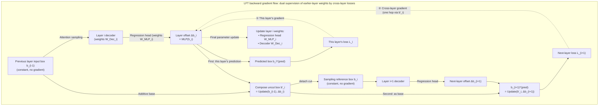
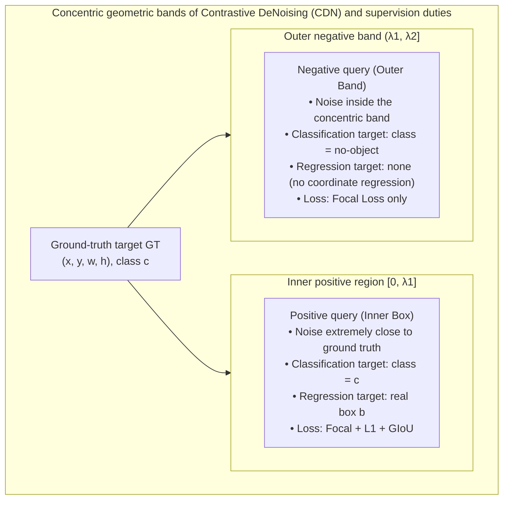
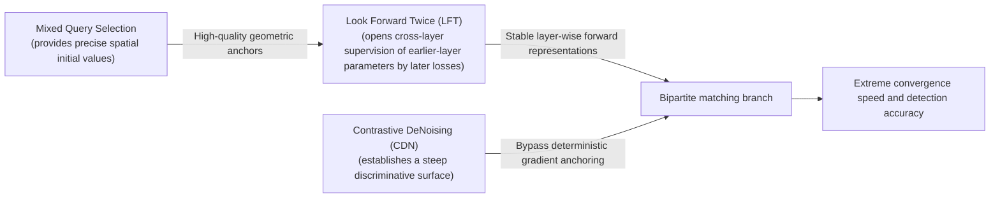
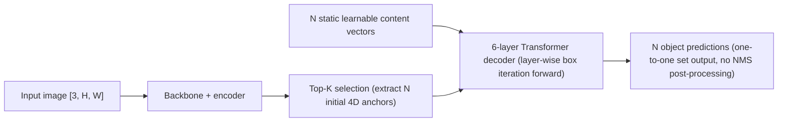

# DINO: Joint Design of Three Interfaces

The preceding installments traced three core threads of DETR architecture evolution: [Deformable DETR](./deformable-detr) restructured the feature reading path, contracting full-image dense computation into local sparse sampling around reference points via deformable attention and introducing high-resolution multi-scale features at low computational cost for the first time; [Conditional and DAB-DETR](./conditional-dab-detr) decoupled queries and explicitly parameterized them as four-dimensional dynamic anchor boxes $(x, y, w, h)$, resolving the localization cold-start problem in feature addressing; while [DN-DETR](./dn-detr) introduced a ground-truth denoising bypass during training that sidesteps Hungarian matching, eliminating the violent oscillation of bipartite discrete assignment in early training.

Each of these three works attacked one well-defined underlying bottleneck. However, they were originally proposed in independent contexts. When researchers attempted to assemble multi-scale deformable attention, four-dimensional dynamic anchor boxes, and query denoising into a unified detector, structural breaks and design conflicts persisted at the interfaces where the modules connect.

This installment focuses on **DINO (DETR with Improved deNoising anchOr boxes for End-to-End Object Detection)**, analyzing how researchers jointly restructured three core interfaces — **query initialization**, **layer-wise geometric box updates**, and **denoising training supervision** — to integrate previously scattered acceleration mechanisms into a tightly coordinated, high-performance end-to-end detection system.

:::warning[Distinguishing detection DINO from self-supervised DINO]
Two computer vision works share the name DINO, but they target entirely different research problems and technical lineages. Do not confuse them:

1. **Self-supervised DINO (Caron et al., 2021) and its successors (DINOv2, DINOv3):** belongs to **self-supervised visual representation learning**. Its core mechanism uses self-distillation (Knowledge Distillation) to pretrain visual backbones (such as Vision Transformers) on large-scale unlabeled image sets; it involves neither set matching nor coordinate regression in object detection;
2. **Detection DINO (Zhang et al., 2022):** the end-to-end object detector analyzed in this article. Its name is an abbreviation from its technical lineage. It has no lineage relationship with self-supervised DINO: it relies on neither self-supervised pretrained weights nor downstream adaptation of self-supervised representations;
3. **Grounding DINO:** a later open-vocabulary detector that aligns detection DINO with text features via cross-modal fusion, belonging to derived multimodal detection tasks.
:::

## Main Contributions of DINO

### Three Interface Defects in Existing Solutions

Before building DINO, the strong baseline produced by engineering Deformable DETR, DAB-DETR, and DN-DETR together (denoted Optimized DN-DETR in the paper, reaching 44.9 AP with multi-scale features under a 12-epoch schedule) still left three core interface-level defects in the system's forward and supervision data flow:

1. **Query initialization interface (input side): initial queries disconnected from image instance features**
   In DAB-DETR, the decoder's initial positional queries come from a set of static 4D anchor boxes jointly optimized across the entire training set. Although these anchors carry concrete center coordinates and width/height dimensions, their spatial distribution is completely fixed when inferring on any given input image, with no content awareness of the current input scene.
   Deformable DETR previously proposed a Two-Stage Query Selection scheme, attempting to directly select the Top-$K$ highest-confidence features from the encoder's last layer and initialize both the content query and the positional query with linear transformations. However, the dense tokens output by the encoder are preliminary content features that have not undergone instance-level refinement; they tend to cover multiple objects simultaneously or represent only local object parts. Injecting such coarse-grained features directly into the content query introduces severe semantic aliasing and destabilizes slot negotiation inside the decoder.
2. **Layer-wise geometric update interface (inside the decoder): gradient blockage from later-layer losses to earlier-layer regression head parameters**
   In the iterative box update mechanism of Deformable DETR and DAB-DETR, the $i$-th decoder layer predicts a geometric offset $\Delta b_i$ based on the previous layer's predicted box $b_{i-1}$. To avoid backpropagation instability from multi-layer cascaded differentiation, the conventional approach applies a `detach()` gradient cut to $b_{i-1}$ before passing it to layer $i$ (a pattern DINO summarizes as **Look Forward Once, LFO**).
   This needs clarification: in forward computation the bounding box is merely an intermediate activation generated along with features; the physical endpoint of backpropagation optimization is always the network weight parameters. The decoder's hidden-state features are never `detach()`ed between layers, so later-layer detection losses can always flow back along the feature trunk. What LFO cuts off is **the channel through which later-layer detection losses reach earlier-layer regression head MLP weights via the additive geometric chain**. Under LFO, the $i-1$-th layer's regression head parameters are driven only by that layer's own detection loss; during optimization they cannot perceive at all whether the box they output serves as a convenient additive base for the next layer to refine.
3. **Training-time denoising interface (supervision side): denoising tasks lack discriminative supervision on false-positive samples**
   As derived in the fifth installment, DN-DETR's denoising groups consist entirely of **positive samples** constructed by adding small perturbations to real targets (center offsets confined inside the ground-truth box). The supervision objective applied to the model is always the corresponding ground-truth class and real box coordinates; no background (`no-object`) targets are ever introduced inside the denoising groups.
   This purely positive design means the denoising branch only trains the network "how to pull coordinates back near a real object," but never teaches the network "when a candidate anchor deviates from a real target beyond a certain distance, it should be judged as background and decisively abandoned." During inference, when multiple anchors fall in the immediate surrounding background of a real target, the model lacks a clear suppression boundary and easily produces dense near-object duplicate false positives.

### DINO's Three Improvements

Against these three structural defects, DINO performs coordinated restructuring at three key points in the data flow:

| Interface | Baseline problem | DINO restructuring mechanism | Core operating principle |
| :--- | :--- | :--- | :--- |
| **Query initialization** | Static anchors lack image specificity; fully dynamic initialization introduces feature aliasing | **Mixed Query Selection** | **Positions dynamic, content static:** use encoder Top-$K$ proposals from the top layer for precise 4D initial anchor boxes, while content queries remain learnable generic probing vectors. |
| **Layer-wise box update** | LFO cuts cross-layer gradients from later-layer losses to earlier-layer regression heads; earlier-layer parameters cannot perceive base quality | **Look Forward Twice (LFT)** | **Parameters receive dual supervision:** keep the blockage for attention feature sampling to maintain training stability, while letting later-layer predicted boxes compose from earlier layers' uncut coordinates, opening the channel through which later-layer losses supervise earlier-layer regression head parameters. |
| **Training-time denoising** | Purely positive denoising lacks background negative feedback; dense edge false positives | **Contrastive DeNoising (CDN)** | **Concentric positive-negative pairs:** construct positive samples in the inner region regressing to ground truth, and negative samples in the outer ring band forced to `no-object`, explicitly establishing a background rejection boundary. |

![DINO framework overview: improvements concentrate on the encoder-decoder connection — Top-K features from the encoder's last layer initialize the decoder's positional queries (4D dynamic anchors) while content queries remain static learnable parameters; the decoder adds a contrastive denoising (CDN) branch, combined during training with Look Forward Twice cross-layer auxiliary supervision of earlier-layer decoder and regression head parameters. Original paper Figure 2, source: DINO, arXiv:2203.03605](/img/cv_img/detr-series/dino_framework_0.png)

## Improvement 1: Mixed Query Selection

### Separating Spatial Position from Semantic Content

In DETR-family detectors, the decoder's input consists of two vectors: the **positional query** and the **content query**. In the original [DETR](./detr-v1-architecture-forward-pass), $Q_{\text{obj}}$ doubles as the positional query; starting from DAB-DETR, the positional role is peeled off into an independent 4D anchor box, and the remaining part of $Q_{\text{obj}}$ serves exclusively as the content query.

Historically, query initialization strategies occupied two extremes:

1. **Purely static initialization (DETR / DAB-DETR / DN-DETR):** both use image-independent learnable parameters. Positional queries are jointly optimized on the training set into static anchor boxes; content queries are initialized as zeros or learnable latent vectors (Figure 5(a));
2. **Purely dynamic initialization (Deformable DETR Two-Stage / Efficient DETR):** the Top-$K$ feature tokens with the highest classification scores are selected from the encoder's last layer, and one shared set of linear transformations generates both the positional query (initial reference boxes) and the content query vectors (Figure 5(b)).

![Original paper Figure 5: comparison of three query initialization schemes. Solid blue squares are content vectors, hollow blue boxes are positional anchors, gray rounded rectangles are the encoder and decoder. (a) Both position and content come from static parameters, independent of the input image; (b) Query Selection produces both anchors and content, both connected to the encoder's Top-K features; (c) only the anchor path connects to Query Selection while content vectors still enter the decoder separately as static parameters. Source: DINO, arXiv:2203.03605](/img/cv_img/detr-series/dino_fig5_query_selection.png)

DINO's **Mixed Query Selection** approach is straightforward: remove the branch leading to the content query in (b), keeping only the positional query (Figure 5(c)), applying an asymmetric initialization strategy to spatial position and feature content:

- **Positional query (4D anchors):** dynamically initialized entirely from the Top-$K$ proposal boxes $(x, y, w, h)$ selected by auxiliary classification and regression heads over the encoder's last-layer features;
- **Content query (semantic vectors):** remain **image-independent static learnable parameters (Learnable Embeddings)**.

:::info[Question]

**Why should positional queries use dynamic image features while content queries must remain static and learnable?**

The underlying logic of this asymmetric design lies in the different physical properties of "spatial geometry" and "feature aggregation" in object detection:

1. **Spatial position is instance-specific:** where objects appear in an image depends entirely on the current input image. Through dense self-attention interaction, the encoder can already provide rough spatial extents of targets with high confidence. Extracting these regions directly as 4D anchor boxes gives the decoder an extremely high-quality spatial addressing starting point, avoiding the localization cost of blind whole-image search by the decoder;
2. **Content queries are generic probing operators (Feature Pooling Operators):** the essence of a content query is not "a slice of the current image's local features" but "a decoupled container used to pool complete instance semantics from the encoder's output features." The encoder's dense output features are preliminary features that have not been deeply refined; a single token often mixes background textures, local body parts, or overlapping objects. Forcibly initializing content queries with these preliminary features carries local noise into every decoder layer and disrupts attention negotiation between slots; keeping the content embedding static and learnable allows joint optimization across the entire training set, stably learning feature aggregation patterns for different object shapes and scales.

:::

### How Shallow Decoder Features Affect Convergence

Mixed Query Selection's effectiveness shows not only in final detection accuracy but also in significantly reducing the model's reliance on layer-by-layer refinement in deep decoder layers.

In baseline models without high-quality spatial priors, the localization boxes output by shallow decoder layers (layers 1–2) are extremely inaccurate, and the model depends heavily on progressive correction across decoder layers 4–6. In DINO, thanks to the precise initial anchors from the encoder, shallow decoder layers already possess a good feature-addressing baseline from the very first layer.

The paper's Appendix 0.C (Table 6) reports performance when reducing encoder and decoder layer counts on a ResNet-50 backbone under a 12-epoch schedule (encoder fixed at 6 layers):

| Encoder / decoder configuration | 6-layer encoder / 6-layer decoder | 6-layer encoder / 4-layer decoder | 6-layer encoder / 2-layer decoder |
| :--- | :--- | :--- | :--- |
| **DINO AP** | **47.4** | **46.0** | **44.4** (drop of **3.0 AP**) |
| **Dynamic DETR AP** | **42.9** | **40.3** | **29.2** (drop of **13.7 AP**) |
| **AP gap (DINO − Dynamic)** | +4.5 | +5.7 | **+15.2** |

This comparison provides empirical evidence: **Mixed Query Selection gives queries high-quality geometric localization initialization before entering the decoder, removing the excessive dependence on progressive refinement by deep layers.**

## Improvement 2: Cross-Layer Geometric Supervision — Look Forward Twice (LFT)

Before dissecting LFT, one easily confused premise must be clarified: **in forward propagation, the bounding box $b = (x, y, w, h)$ is not a network weight parameter at all (not an `nn.Parameter`); it is an activation tensor computed in real time from the input image and the current hidden features $h$.** It is the geometric result of projecting the feature vector $h_i$ computed by the $i$-th decoder layer through the box regression head MLP: $\Delta b_i = \mathrm{MLP}(h_i)$.

In each decoder layer's forward computation, the box produced at that stage serves a dual role:

1. **Stage output:** as the current layer's interim predicted box for the target, feeding the auxiliary detection loss $\mathcal{L}_{\mathrm{det}}^{(i)}$;
2. **Next-stage input:** passed to the next layer as the spatial reference anchor for the $(i+1)$-th layer's deformable attention sampling, guiding where attention extracts local features on the feature map.

DINO's forward computation is identical to Deformable DETR's — still layer-by-layer residual accumulation:

1. The $i$-th decoder layer receives the reference box $b_{i-1}$ from the previous layer;
2. Based on that box, it performs local attention sampling and feature aggregation on the image feature map, generating the current layer's hidden features $h_i$, from which the regression head predicts the coordinate residual $\Delta b_i = \mathrm{MLP}(h_i)$;
3. The offset is added onto the reference box to produce the current layer's new box: $b_i = \mathrm{Update}(b_{i-1}, \Delta b_i)$, handed to the next layer as the reference for the next iteration.

LFT and LFO produce tensor values that are numerically indistinguishable in forward computation. Their entire difference lies purely in **whether, during backpropagation, later-layer detection losses can flow through the additive chain to directly supervise earlier-layer network weight parameters**.

### LFO's Real Limitation: Binding Sampling Stability to Loss Feedback

The physical endpoint of backpropagation is always, and only, the neural network's learnable weight parameters (the $i$-th layer's regression head MLP weights $\mathbf{W}_{\mathrm{MLP}_i}$ and the decoder feature-extraction weights $\mathbf{W}_{\mathrm{Decoder}_i}$).

In predecessors such as Deformable DETR and DAB-DETR, the reference box simultaneously carries two entirely different duties inside the decoder:

1. **Attention addressing duty:** as the spatial geometric reference point, it determines the current layer's deformable attention sampling locations and generates the positional query sine embeddings (Query Pos Sine Embeddings);
2. **Coordinate base duty:** as the additive base of the current layer's coordinate regression, it is added to the predicted offset $\Delta b_i$ to compose the final predicted box used in the auxiliary detection loss.

Under the traditional **Look Forward Once (LFO)** setting, to prevent deep attention sampling locations from being perturbed across layers during backpropagation and destabilizing training, implementations directly apply a `detach()` cut to the input box:

$$
b_i = \text{Sigmoid}\left( \text{InverseSigmoid}(\mathrm{Detach}(b_{i-1})) + \Delta b_i \right)
$$

This treatment protects the numerical stability of attention sampling (duty 1) but inflicts collateral damage on the backpropagation channel from later-layer loss to earlier-layer network parameters (duty 2): when the $i$-th layer's detection loss $\mathcal{L}_{\text{det}}^{(i)}$ acts on $b_i$, the base $b_{i-1}$ has been forcibly turned into a gradient-free constant, so gradients sever instantly upon reaching the base and can only flow entirely into the layer's own offset $\Delta b_i$.

This creates **isolation in layer-wise network parameter optimization**: when optimizing, the $i-1$-th layer's regression head parameters have the sole goal of making their output box fit the ground truth as closely as possible at the current layer; they cannot know at all whether their box, serving as the next layer's additive regression base, is "convenient for the next layer to refine" or "drives the next layer into a dead corner."

One clarification in passing: the decoder's hidden-state features are never `detach()`ed between layers, and later-layer losses can always flow back to earlier layers through the hidden states. LFO cuts only **the differentiation path through which later-layer losses reach earlier-layer regression head MLP weights via the geometric additive base**.

### LFT's Implementation: One Box, Two Paths, Splitting Sampling from Loss Base

Since the root of the conflict is that "attention sampling fears gradient perturbation while the coordinate base craves loss feedback," DINO's solution is plain: **do not bind both duties to the same gradient-cut tensor; explicitly split them into separate paths in the computation graph.**

Equation (1) in the paper is not a new forward algorithm; it exists to attach the same geometric box to different differentiation branches in the backward computation graph:

$$
\begin{aligned}
\Delta b_i &= \mathrm{Layer}_i(b_{i-1}), & b'_i &= \mathrm{Update}(b_{i-1}, \Delta b_i) \\
b_i &= \mathrm{Detach}(b'_i), & b_i^{(\mathrm{pred})} &= \mathrm{Update}(b'_{i-1}, \Delta b_i)
\end{aligned} \tag{1}
$$

where $\mathrm{Update}(b, \Delta b) = \text{Sigmoid}\left( \text{InverseSigmoid}(b) + \Delta b \right)$ is the standard residual accumulation in inverse-Sigmoid space. These four variables have no forward numerical differences (all represent the $i$-th layer's predicted box coordinates), yet their roles in the autograd computation graph differ completely:

| Variable | Floating-point value | Role in backward graph | Corresponding duty |
| :--- | :--- | :--- | :--- |
| **$b_i$** | Current layer's updated box | **Gradient cut** (`Detach` applied) | **Duty 1 (sampling):** fed to layer $i+1$ for attention sampling and positional encoding, preserving training stability |
| **$b'_i$** | Current layer's updated box | **Gradient kept** (not `Detach`ed) | **Intermediate variable:** retains the differentiation path to this layer's regression head $\Delta b_i$, prepared to serve as the next layer's base |
| **$b'_{i-1}$** | Previous layer's updated box | **Gradient kept** ($b'_{i-1}$ passed from the previous layer) | **Duty 2 (base):** serves as the additive base of this layer's predicted box, ferrying the current layer's loss gradients back to the previous layer's network parameters |
| **$b_i^{(\mathrm{pred})}$** | Current layer's updated box | **Gradient kept** | **Loss target:** feeds the $i$-th layer's auxiliary detection loss $\mathcal{L}_{\text{det}}^{(i)}$ |

Read this structure against the original paper's Figure 6(b):

![Original paper Figure 6: computation-graph comparison of (a) LFO and (b) LFT box updates, dashed arrows denoting detach. (a) Each layer shows only one upward prediction arrow; the predicted box is the layer's own b′_i, and the b_{i-1} fed into Layer i has already had gradients cut. (b) Each layer gains an extra prediction node whose horizontal input is the previous layer's b′_{i-1} (bypassing detach, traveling along the horizontal line at the top of the graph) and whose vertical input is the layer's Δb_i. Source: DINO, arXiv:2203.03605](/img/cv_img/detr-series/dino_fig6_lft.png)

The original Figure 6 draws the forward computation graph; how gradients flow is left for the reader to infer. Drawing LFT's backward gradients separately yields the diagram below — two dashed gradient edges (① and ②) converge into the offset $\Delta b_i$ and ultimately inject into layer $i$'s network weights:

Compare against the LFO gradient diagram in the previous section: in LFO only edge ① exists, ② does not, and the offset's upstream consists entirely of constants. What LFT adds is precisely the ② cross-layer dashed edge, plus the uncut base path leading to $b_{i+1}^{(\mathrm{pred})}$.

In Figure 6(b), the predicted box computed at layer $i$ flows out along two paths:

- **One path goes down via a dashed arrow (sampling path):** after `detach`, it becomes $b_i$ and enters layer $i+1$'s $\text{Layer}_{i+1}$ as the attention sampling reference, preventing sampling coordinates from backpropagating across layers;
- **One path goes up-right via a solid line (base path):** bypassing `detach`, it serves as the additive base as $b'_i$, added directly to layer $i+1$'s predicted offset $\Delta b_{i+1}$ to compose layer $i+1$'s final predicted box $b_{i+1}^{(\mathrm{pred})}$.

The physical meaning of **"Twice"** in the paper's name is now fully clear: it does not mean computing the box twice in the forward pass, but rather that **layer $i$'s regression head weights $\mathbf{W}_{\mathrm{MLP}_i}$ and decoder parameters $\mathbf{W}_{\mathrm{Dec}_i}$ are given a dual mission during backpropagation (bearing supervision from two losses)**:

1. **First supervision:** the $\Delta b_i$ computed by the parameters participates in composing this layer's predicted box $b_i^{(\mathrm{pred})}$, receiving supervision from this layer's loss $\mathcal{L}_{\text{det}}^{(i)}$, ensuring accurate localization at this layer;
2. **Second supervision:** the composed intermediate base $b'_i$ serves as the base participating in composing the next layer's predicted box $b_{i+1}^{(\mathrm{pred})}$, receiving cross-layer supervision from the next layer's loss $\mathcal{L}_{\text{det}}^{(i+1)}$.

The chain rule directly reflects this dual constraint on network weights:

$$
\frac{\partial \mathcal{L}_{\text{total}}}{\partial \Delta b_i} = \underbrace{\frac{\partial \mathcal{L}_{\text{det}}^{(i)}}{\partial b_i^{(\mathrm{pred})}} \cdot \frac{\partial b_i^{(\mathrm{pred})}}{\partial \Delta b_i}}_{\text{First supervision: this layer's own fitting}} \;+\; \underbrace{\frac{\partial \mathcal{L}_{\text{det}}^{(i+1)}}{\partial b_{i+1}^{(\mathrm{pred})}} \cdot \frac{\partial b_{i+1}^{(\mathrm{pred})}}{\partial b'_i} \cdot \frac{\partial b'_i}{\partial \Delta b_i}}_{\text{Second supervision: later-layer auxiliary refinement}}
$$

And because $\Delta b_i = \mathrm{MLP}_i(h_i)$, gradients ultimately propagate directly to the network weights:

$$
\nabla \mathbf{W}_{\mathrm{MLP}_i} \propto \frac{\partial \mathcal{L}_{\text{total}}}{\partial \Delta b_i} \cdot \frac{\partial \Delta b_i}{\partial \mathbf{W}_{\mathrm{MLP}_i}}
$$

With the second gradient term in place, layer $i$'s regression head, when adjusting its own weights, must not only predict the box accurately but also ensure the generated box serves as a good starting point that makes it easier for the next layer to reduce the loss through residual correction on top of it.

### Propagation Boundary and Engineering Equivalence

Two facts prone to exaggeration or misunderstanding deserve special clarification:

1. **Gradient propagation spans only adjacent layers:**
   LFT establishes single-step geometric feedback between adjacent layers (from layer $i+1$ to layer $i$'s network parameters), not a single super-long gradient chain threading all six box regression heads from front to back. Because layer $i+1$ still applies $b_{i+1} = \mathrm{Detach}(b'_{i+1})$ when handing the box to layer $i+2$ for sampling, layer $i+2$'s geometric loss can never flow back across two layers to layer $i$.
2. **Absolutely zero overhead in forward and inference:**
   Since `detach()` on tensors in PyTorch only cuts the autograd computation graph and never changes underlying tensor values, the four coordinate components of $b_i^{(\mathrm{pred})}$ are numerically identical to $b'_i$ in forward computation. Once training completes and the model enters inference, it directly executes standard layer-by-layer residual updates with no dual-branch overhead and no additional model parameters. The concrete source code implementation and computation graph construction appear in Appendix 3.

## Improvement 3: Contrastive De-noising (CDN) Training

### Constructing Negative-Sample Denoising

DN-DETR established a training mechanism that bypasses Hungarian matching using noised ground truth. However, in DN-DETR the denoising groups contain **only positive samples constructed by adding small perturbations to real targets**:

The noise applied to the center coordinates of a real target $y = (c, b)$ is strictly bounded by hyperparameter $\lambda$ (satisfying $|\Delta x| < \frac{\lambda w}{2}, |\Delta y| < \frac{\lambda h}{2}$). Since the perturbed center still lies strictly inside the ground-truth box, DN-DETR sets the classification target of every denoising query to the ground-truth class $c$ and computes coordinate regression losses toward the real box $b$ for all denoising boxes.

This purely positive design carries an intrinsic defect: **the model is continuously trained to aggressively activate foreground and stretch regression for any anchor near a target, but the system never explicitly learns to output "no object" (background) and terminate regression when deviating from the target.**

During inference, prediction slots falling on target edges, local shadows, or immediately adjacent background, lacking background-suppression constraints, easily produce dense duplicate detection boxes (Figure 8, left panel).

To teach the detector to abandon decisively when deviating from targets, DINO proposes **Contrastive DeNoising (CDN) training**.

In CDN, for every real target in the image, the algorithm constructs a pair of **concentric contrastive queries (Contrastive Query Pair)** within the same denoising group: a **positive query** and a **negative query**.

The geometric perturbation ranges of the two query types are strictly partitioned by inner and outer hyperparameters $\lambda_1 < \lambda_2$ (Figure 3):

1. **Positive query (Inner Box, inner region):** noise perturbation smaller than $\lambda_1$. Its supervision target is reconstruction of the ground-truth box $b$ with class label $c$, computing $\ell_1$ loss, GIoU loss, and classification Focal Loss;
2. **Negative query (Outer Band, outer concentric band):** noise perturbation inside the interval $(\lambda_1, \lambda_2]$. Its supervision target is **forced to `no-object` (background)**; only classification Focal Loss is computed, and it **participates in no bounding-box regression loss computation whatsoever**.

:::info[Question]

**Why must negative queries compute only the classification loss and be strictly barred from coordinate regression?**

Semantically, a negative query is defined solely as "background that the system should reject." Applying a coordinate regression loss toward the ground-truth box $b$ on negative queries would, at the gradient level, instruct the network to "pull this deviated anchor toward the real target," directly destroying the decision boundary that contrastive learning is meant to establish.

DINO's loss design is extremely strict: the loss for classifying negative samples as background is optimized with Focal Loss. This means all backpropagation gradients from negative queries converge on the classification head, whose sole mission is to establish a steep discriminative surface in feature space — **once a candidate box's deviation exceeds the threshold $\lambda_1$, the model must output extremely low classification confidence and judge it background**.

:::

In the paper's practical hyperparameter configuration, $\lambda_2$ is kept small (defaults $\lambda_1 = 1.0, \lambda_2 = 2.0$), with the core consideration that **hard negative samples immediately adjacent to real targets carry the highest discriminative value**. Background regions sampled randomly across the whole image have extremely low feature responses and are trivial negatives; only negatives falling in the transitional region around target edges can effectively force the network to distinguish the target itself from its immediate background.

### Grouped Attention Mask Isolation

With CDN introduced, the decoder simultaneously contains multiple contrastive denoising groups and regular matching queries. To prevent information leakage along unintended paths, the self-attention mask must maintain strict group isolation rules:

1. **Denoising branch fully isolated from matching branch:** no denoising query may perceive the state of matching queries in self-attention, and vice versa, ensuring the matching branch's end-to-end learning property remains undisturbed;
2. **Denoising groups fully isolated from each other:** the $k$-th denoising group and the $j$-th denoising group ($j \neq k$) are mutually invisible, guaranteeing each group independently completes its denoising task against the current image's ground-truth set;
3. **Positive and negative queries within a group fully visible to each other:** inside the same CDN group, positive and negative queries are allowed full self-attention interaction, letting the model contrast the fine feature differences between foreground targets and background distractors under one shared local context representation.

### Suppressing Duplicate Predictions and Evaluation

To quantitatively assess CDN's suppression of duplicate predictions and anchor confusion, DINO proposes the **Average Top-K Distance ($\text{ATD}(k)$)** metric.

Let the validation set contain $N$ ground-truth targets $b_0, b_1, \dots, b_{N-1}$. For each ground truth $b_i$, take the **decoder's initial anchor box** $a_i$ corresponding to the prediction slot successfully matched to it under Hungarian matching. $\text{ATD}(k)$ is defined as the average of the $k$ samples with the largest $\ell_1$ distances among all matched pairs:

$$
\text{ATD}(k) = \frac{1}{k} \sum \mathrm{topK}\left( \left\{ \lVert b_0 - a_0 \rVert_1, \lVert b_1 - a_1 \rVert_1, \dots, \lVert b_{N-1} - a_{N-1} \rVert_1 \right\}, \, k \right)
$$

The metric uses $\mathrm{topK}$ to take maxima rather than a global average, and its physical meaning is: **in object detection, genuine matching confusion tends to occur on tail hard samples assigned to distant anchors**. A global average is easily diluted by large numbers of easy near samples, whereas $\text{ATD}(k)$ directly reflects the system's anchor selection quality under the worst matching conditions (lower $\text{ATD}$ values indicate the matching system selects initial anchors closer to the real targets).

Experiments show that on full-scale objects, DN and CDN exhibit similar $\text{ATD}$; but in small-object scenarios (Figure 4(b)), CDN's $\text{ATD}(100)$ is significantly lower than traditional DN, showing that CDN effectively prevents small objects from being wrongly assigned to distant irrelevant anchors. This mechanism directly drove DINO's $+1.3\text{ AP}$ gain in small-object accuracy $\text{AP}_s$ under the 12-epoch setting (Figure 4(c)).

## Synergy of the Three Mechanisms and Ablation Verification

### The Three-Interface Attribution System

DINO's three mechanisms act on different stages of the detection system's data flow and are highly complementary in function:

| Mechanism | Data-flow stage | Object of modification | Core contradiction solved | Training-time compute overhead | Inference-time compute overhead |
| :--- | :--- | :--- | :--- | :--- | :--- |
| **Mixed Query Selection** | Query initialization stage | Decoder's initial content and position inputs | Static anchors lack image specificity; fully dynamic initialization introduces representation aliasing | Extremely low (only a lightweight encoder prediction head added) | Extremely low (only Top-$K$ indexing) |
| **Look Forward Twice (LFT)** | Decoder layer-wise backward differentiation stage | Backward differentiation path of the residual coordinate base | LFO blocks gradients from later-layer losses to earlier-layer regression heads; earlier-layer parameters cannot perceive how the base affects later refinement | Slightly increases training memory and backward compute (saving the uncut box to recompute losses; backward graph gains adjacent-layer cross edges) | Zero extra overhead (forward values identical to LFO; same inference topology) |
| **Contrastive DeNoising (CDN)** | Training-time loss supervision stage | Bypass denoising query construction and loss functions | DN-DETR's purely positive samples lack background negative feedback, easily producing near-object duplicate predictions | Increased memory usage (scales with the number of denoising groups) | **Zero overhead** (branch fully removed at inference) |

### Ablation Attribution of the Three-Mechanism Synergy

Under a ResNet-50 backbone with the standard 12-epoch training budget, the original paper's controlled ablation experiments clearly recover each mechanism's independent gains (full ablation metrics in Appendix Table 4):

1. **Strong baseline established (+3.1 AP):** from the original DN-DETR (43.4 AP) to the strong baseline with Pure QS and pipeline optimization (46.5 AP), mainly due to reuse of the two-stage query selection mechanism and engineering tuning;
2. **Progressive accumulation of the three mechanisms (+1.4 AP):** from the strong baseline to DINO's final model (47.9 AP), Mixed Query Selection contributes $+0.5\text{ AP}$, Look Forward Twice contributes $+0.4\text{ AP}$, and Contrastive DeNoising contributes $+0.5\text{ AP}$. Notably, LFT's gains concentrate on medium-large objects and high IoU thresholds ($\text{AP}_m$ rises from 50.1 to 50.8, $\text{AP}_l$ from 61.5 to 61.9, $\text{AP}_{75}$ from 51.0 to 51.6), while tiny objects regress ($\text{AP}_s$ falls from 31.1 to 29.9, a drop of $-1.2\text{ AP}$); the paper does not discuss this scale trade-off; this small-object loss is only recovered to 31.2 after CDN is finally introduced (row 6);
3. **Targeted improvement of small-object representation:** the gains from Mixed QS concentrate heavily on tiny objects, with $\text{AP}_s$ leaping from 29.6 to 31.1 (a single-item gain of $+1.5\text{ AP}$, far exceeding the overall +0.5 rise), directly confirming the key role of decoupling spatial priors from content vectors in protecting weak small-object features.

## Inference Overhead Analysis and Future Evolution

### Structural Simplification at Inference

DINO strictly follows the design principle of modern end-to-end detectors: **inject strong supervision signals through complex auxiliary tasks during training, then strip them away entirely at inference to keep the forward topology minimal**.

At inference:

1. **The Contrastive DeNoising (CDN) branch is fully stripped:** all positive and negative denoising queries and their attention masks take no part in the forward computation; inference latency is fully decoupled from the number of denoising groups;
2. **Mixed Query Selection overhead is minimal:** it consists only of a lightweight linear classification head scoring the encoder's top layer plus a Top-$K$ ranking operation;
3. **LFT carries zero extra inference cost:** LFT is purely a restructuring of the training-time backward graph topology; it contains no extra weight parameters, its forward formula is identical to LFO, and inference keeps standard layer-by-layer box refinement;
4. **Per-step training time stays flat:** the paper's Appendix 0.B (Table 5) reports measured costs on 8 A100 GPUs — with a per-GPU batch size of 2, DINO takes about 55 minutes per epoch and uses 16 GB of memory, fully on par with the original Deformable DETR's per-step cost. DINO's efficiency is built entirely on compressing total training epochs from 50 to 12 through convergence acceleration.

## Summary

### This Installment's Conclusion and Future Technical Evolution

Although DINO established a new benchmark for end-to-end DETR detectors in convergence speed and detection accuracy, from a system-evolution perspective it still leaves several deep contradictions:

1. **The positive-sample sparsity of the bipartite matching branch persists:** although CDN injects dense deterministic gradients via the bypass, in the core **prediction matching branch**, each ground-truth target can still claim only one prediction slot as a positive sample during training. Spatial sparsity of positive samples still limits the learning rate of deep features. This contradiction directly spawned the subsequent **Group DETR**, which increases positive-sample density through training-time grouping, and the dense one-to-one matching architecture **DEIM**;
2. **The accuracy ceiling of continuous coordinate regression:** DINO still uses direct point-estimate regression of four continuous coordinates $(x, y, w, h)$, and localization accuracy gains slow in the strict high-IoU-threshold regime (such as $\text{AP}_{75}, \text{AP}_{90}$). This geometric representation problem is systematically solved in the subsequent **D-FINE** through boundary distance distribution refinement;
3. **High computational cost constrains real-time deployment:** DINO's 12-epoch, 4-scale configuration costs 279 GFLOPs on an A100 (24 FPS), while the 5-scale configuration costs up to 860 GFLOPs (FPS drops to 10). Its dependence on heavy-encoder multi-scale attention and a 6-layer decoder makes real-time detection on compute-constrained edge devices difficult. This compute-budget contradiction is fully conquered by the **RT-DETR** family at the end of the series through its hybrid encoder and architectural restructuring.

---

Next: [Group DETR](./group-detr)
