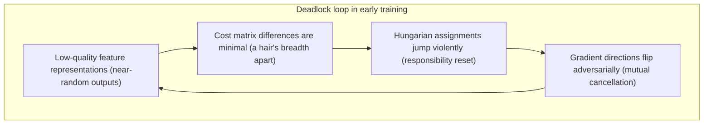
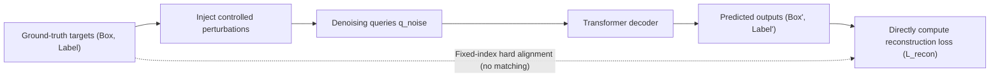
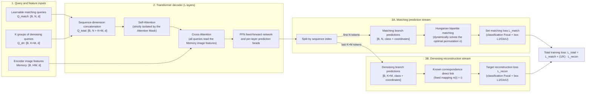
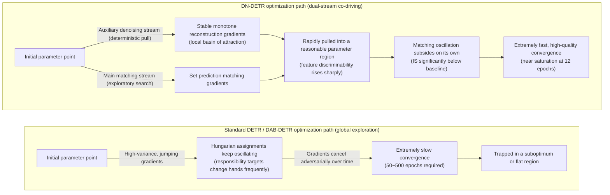

The [Conditional DETR and DAB-DETR](./conditional-dab-detr) article showed how DAB-DETR decouples and parameterizes queries as explicit 4D dynamic anchor boxes $(x, y, w, h)$, eliminating the spatial semantic ambiguity and localization cold start of the original Object Query so that decoder cross-attention can focus on local geometric regions from the first layer onward.

However, knowing "where to look" in space does not mean a query knows "which target to learn from". Even after eliminating the global wandering and contraction of attention, DAB-DETR still requires roughly 50 epochs to fully converge. This indicates that beyond the spatial contraction of feature addressing, another deep optimization bottleneck remains in the system — **early oscillation of bipartite matching in its discrete assignment**.

This article focuses on **DN-DETR (Query DeNoising DETR, 2022)**. Building directly on DAB-DETR's 4D anchor box representation, it was the first work to localize the fundamental cause of slow convergence in the recomputation instability of bipartite matching within the discrete solution space, and it injects stable, local, deterministic gradients into the network through a match-free auxiliary denoising task during training.

Start with the mechanism that spatialization never touched.

## Background and Problem: Bipartite Matching Instability

Two fundamentally different core mechanisms coexist in the DETR training loop:

1. **Feature addressing (continuous operations):** queries extract context from the image feature map through cross-attention. This is continuous, differentiable neural computation that determines which local region of the image attention concentrates on.
2. **Responsibility assignment (discrete decisions):** the Hungarian algorithm assigns each prediction slot to a specific ground-truth target based on the cost matrix. This is a non-parametric, discrete combinatorial decision that determines who provides the supervising gradient at the current training step.

As analyzed in [bipartite matching and set loss](./detr-v1-bipartite-matching-set-loss), **Hungarian matching itself contains no learnable parameters and does not directly propagate backpropagation gradients**. Its only role in the entire training loop is to **assign supervision responsibility** to each prediction slot after the forward computation (which slot regresses toward a ground truth as a positive sample, and which is suppressed as background). The parameter update direction is therefore entirely governed by the assignment produced by the Hungarian algorithm in the discrete decision space:

$$
\theta \leftarrow \theta - \eta \, \nabla_\theta \mathcal{L}_{\text{det}}\left(\theta; \, \hat{\sigma}^*(\theta)\right)
$$

where $\hat{\sigma}^*(\theta)$ is the optimal permutation found by the Hungarian algorithm under the current parameter state:

$$
\hat{\sigma}^*(\theta) = \arg\min_{\sigma \in \mathfrak{S}_N} \sum_{i=1}^N \mathcal{L}_{\text{match}}\left(y_i, \, \hat{y}_{\sigma(i)}(\theta)\right)
$$

Because the inner permutation decision $\hat{\sigma}^*$ is a non-differentiable discrete judgment, the optimal permutation $\hat{\sigma}^*$ switches in a step-like fashion whenever prediction costs fluctuate slightly.

Spatialization reforms such as Conditional DETR and DAB-DETR essentially only reconstruct the **feature addressing mechanism**, making attention contract faster in geometric space; they do not touch the **discrete responsibility assignment mechanism** at all. As long as Hungarian matching frequently overturns its assignments in early training, the gradient direction received by each query slot still swings violently between forward attraction and background suppression.

This means that even with anchor boxes carrying clear physical geometric meaning, the model still sinks early in training into an optimization quagmire caused by assignment jumps. Understanding this bottleneck and constructing a targeted solution requires dissecting the specific pathological phenomena that discrete assignment triggers in early training.

## Sources and Measurement of Matching Oscillation

In traditional grid-based or dense-anchor detectors (such as Faster R-CNN and RetinaNet), matching between candidate regions and ground-truth targets usually relies on static priors such as spatial overlap (IoU thresholds), so positive/negative sample assignment remains relatively stable across the entire training cycle. In DETR-style models, however, the Hungarian algorithm hands assignment entirely over to the network's current predictions.

The DN-DETR authors identified this design — making "dynamic discrete decisions" the sole basis for supervision assignment — as the trigger for systematic **Bipartite Matching Oscillation** in early training. To understand and verify this phenomenon mechanistically, dissect it along three dimensions: its dynamical causes, its mathematical metric, and its geometric manifestation.

### Cause of Matching Oscillation: Jumps in Discrete Bipartite Matching

The training framework of the original DETR and DAB-DETR contains a fundamental bidirectional circular dependency:

- **Matching depends on representation:** for the Hungarian algorithm to produce reasonable, coherent responsibility assignments, the classification confidence and geometric boxes output by the decoder must be sufficiently discriminative.
- **Representation depends on matching:** for the decoder and backbone to learn high-quality feature representations, each query slot must receive gradient supervision whose direction is stable and consistent over time.



In early training, network parameters are near random initialization and representation capability is extremely weak. The matching cost between different slots and a given ground truth is nearly identical, and a tiny parameter update under gradient action is enough to break this fragile equilibrium, letting the Hungarian algorithm select a completely different assignment permutation in the discrete solution space.

Take a minimal system: the image contains a single ground truth $y_1$, and the decoder has two spatially adjacent query slots $q_1$ and $q_2$.

```text
Step t:   Cost(q1, y1) = 0.501,  Cost(q2, y1) = 0.499  -->  y1 assigned to q2 (q1 judged background)
          q2 receives the positive-sample gradient pulling toward y1; q1 receives the background suppression gradient.

Step t+1: A slight parameter update slightly changes the predictions:
          Cost(q1, y1) = 0.498,  Cost(q2, y1) = 0.502  -->  y1 suddenly reassigned to q1 (q2 judged background)
          q1 suddenly switches to learning foreground; q2, which just moved toward y1, is suddenly pushed away as background.
```

Across consecutive training iterations, the supervision signal of $y_1$ is handed back and forth between $q_1$ and $q_2$. The geometric update direction accumulated in one step is directly penalized as a negative sample in the next, and gradients repeatedly self-cancel across discrete jumps. This **Bipartite Matching Oscillation** is the underlying mathematical cause of the slow early convergence of DETR-style models.

:::note[Difference between matching oscillation and positive sample sparsity]
When analyzing convergence, distinguish two independent concepts: **positive sample sparsity (Sparsity)** and **matching oscillation (Oscillation)**.
The former refers to the extremely small number of positive-sample slots participating in the regression loss in each forward pass (per image it equals the number of ground truths $M$, far fewer than the total slots $N$) — a **density problem** of supervision in the spatial dimension. The latter refers to the same ground truth being assigned to different query slots in adjacent iterations, causing the supervision target of a specific slot to jump back and forth — a **consistency problem** of supervision in the temporal dimension. Even artificially increasing the slot count cannot relieve the optimization instability if the discrete recomputation oscillation persists.
:::

### Measuring Instability

To quantitatively prove the objective existence of matching oscillation and assess its severity, the DN-DETR paper proposed the **Instability Score (IS)**.

Let the ground truths of the same image across epochs $i$ and $i-1$ be $\mathbf{T} = \{T_0, T_1, \dots, T_{M-1}\}$, and the decoder's $N$ prediction slots be $\mathbf{O}^i = \{O_0^i, O_1^i, \dots, O_{N-1}^i\}$. The assignment solved by the Hungarian algorithm is recorded as a matching index vector $\mathbf{V}^i = [V_0^i, V_1^i, \dots, V_{N-1}^i]^T$ of length $N$:

$$
V_n^i = \begin{cases}
m, & \text{if prediction slot } O_n^i \text{ matches ground-truth target } T_m \\
-1, & \text{if prediction slot } O_n^i \text{ matches no ground truth (judged background)}
\end{cases}
$$

The instability of epoch $i$ relative to the previous epoch, $\text{IS}^i$, is defined as the Hamming distance between the two matching state vectors (the number of slots whose assignment changed):

$$
\text{IS}^i = \sum_{n=0}^{N-1} \mathbb{I}\left(V_n^i \neq V_n^{i-1}\right)
$$

where $\mathbb{I}(\cdot)$ is the indicator function. The dataset-level instability is the average of $\text{IS}^i$ over all images.

The physical meaning of this metric:

- If an image contains on average $\bar{M}$ ground truths, then in the most extreme oscillation case (all $\bar{M}$ slots matched in the previous epoch turn to background while $\bar{M}$ previously background slots are reassigned as targets), the theoretical maximum per-image oscillation is $2\bar{M}$.
- On the COCO 2017 validation set the average object count is $\bar{M} \approx 7.36$, so the theoretical maximum IS variation is about $7.36 \times 2 = 14.72$.

The original paper plotted this statistic over the training schedule (12-epoch schedule, computed per epoch on the COCO 2017 validation set):


This curve conveys three facts. First, IS for all models declines over training, showing that discrete recomputation oscillation naturally eases as representation discriminability improves. Second, the DN-DETR curve lies below DAB-DETR throughout, with the gap widening over time. Finally, the two curves nearly coincide in early training, showing that denoising does not eliminate oscillation outright in the first epochs but accelerates the rate at which matching assignments stabilize. The original paper gives no concrete numbers for this curve, citing only the theoretical upper bound $7.36 \times 2 = 14.72$ as a reference.

Placing instability in the context of the DETR family's convergence results makes the benefit of denoising more intuitive.


In a direct comparison with the same multi-scale architecture and the same training budget, the contribution of denoising can be separated more cleanly:


Note that the IS metric serves offline statistics and mechanism verification only. It embeds non-differentiable discrete judgments and **does not participate in backpropagation of any training loss**.

### Geometric Distance Between Predicted and Ground-Truth Boxes

Besides assignment oscillation, unstabilized bipartite matching produces another pathological phenomenon at the geometric level: the **average anchor-to-target distance (Anchor-Target Distance)** is too large.

In the original DETR and DAB-DETR, because global Hungarian matching may assign a query at the top-left of the frame to a target at the bottom-right, queries early in training often have to traverse most of the image to regress their targets (visualized as a long cross-region dragging arrow). This long-range dragging causes two serious side effects:

1. **Quadratic expansion of the optimization search space:** the decoder must not only refine object contours but also learn large-range translation transfer.
2. **Multi-query prediction conflicts:** multiple queries dragged across long distances pass through the same intermediate regions, competing for attention weights and scrambling feature representation patterns.

```text
Long-range search in DAB-DETR (high conflict):
[ Query slot A ] ───────────────────────────────────────────> [ Target 1 (far side) ]
                            ╲           ╱
                              [ Conflict overlap zone ]
                            ╱           ╲
[ Query slot B ] ───────────────────────────────────────────> [ Target 2 (far side) ]

Localized reconstruction in DN-DETR (zero conflict):
[ Noisy query A ] ──(short-range residual refinement)──> [ Target 1 ] (local basin of attraction)
[ Noisy query B ] ──(short-range residual refinement)──> [ Target 2 ] (local basin of attraction)
```

The paper reports the average $\ell_1$ distance between the decoder's final matched targets and the initial anchor boxes. This analysis comes from a section added in the journal extended version; the conference paper contains no such statistics. The extended data shows DN-DETR's average distance stays below the DAB-DETR baseline throughout training (about 0.082–0.110 versus about 0.097–0.147); the paper describes it only as "the average distance between initial anchors and targets is much smaller", without giving a specific reduction percentage.


Denoising training confines each denoising query to the neighborhood of its ground-truth target, forcing the network to learn locally centered unimodal response functions and eliminating cross-region slot conflicts.

## Basic Construction of Denoising Training

### Constructing the Denoising Training Task

The most direct approach to solving discrete assignment oscillation is to **bypass the combinatorial optimization of bipartite matching altogether**.

DN-DETR proposes an auxiliary training path based on Query DeNoising: during training, instead of initializing queries as blank latent vectors or a fixed grid, the algorithm starts directly from the ground-truth annotation set of the current image. It injects moderate spatial noise into the ground-truth boxes and moderate label-flip noise into the class labels, feeds the resulting **Noisy Queries** into the decoder, and requires the decoder to restore them exactly to the original noise-free ground-truth targets.



From the geometric optimization perspective, the denoising task converts the original globally unordered "exploratory search" into a "local residual reconstruction" with a known starting point:

- The input noisy boxes already lie within the neighborhood spatial domain of the ground-truth targets.
- The network's optimization goal is to pull the noisy boxes back to the ground-truth boxes; the output has an extremely well-defined local monotone gradient with no cross-region multi-target competition.

### Fixed Assignment: Bypassing Bipartite Matching

The core mechanism that keeps the denoising branch absolutely stable is the **prior certainty of its supervision assignment relationship**.

In the original matching branch, the correspondence between query slot $q_j$ and ground truth $y_i$ is dynamically searched through the cost matrix:

$$
\sigma = \arg\min_{\sigma \in \mathfrak{S}_N} \sum_{i=1}^N \mathcal{L}_{\text{match}}\left(y_i, \hat{y}_{\sigma(i)}\right)
$$

In the denoising branch, each denoising query $q_i^{\text{noise}}$ is generated from the $i$-th ground truth $y_i$ by adding noise at construction time. The alignment mapping $\pi(i) = i$ between output slot $\hat{y}_i^{\text{noise}}$ and supervision target $y_i$ is therefore a constant fixed one-to-one at the input:

$$
\mathcal{L}_{\text{recon}} = \sum_{i=1}^M \mathcal{L}_{\text{step}}\left(\hat{y}_i^{\text{noise}}, y_i\right)
$$

Because the combinatorial search step is entirely removed, gradient ownership under backpropagation never changes regardless of the network's current forward predictions. This stable supervision flow provides the feature extraction network with a reliable update baseline.

The denoising branch is a pure **training-time auxiliary branch**, computed inside the decoder in parallel with the original matching branch. It does not replace the matching branch; it exists as a stabilizer.

### Content Embedding Design of the Denoising Branch

In DAB-DETR, the content embedding of a query (Content Query) is a continuous vector with no class semantics. To let the denoising branch perform label denoising (Label DeNoising) alongside box denoising, DN-DETR structurally reconstructs the decoder's content input.

DN-DETR introduces a **learnable label embedding table** $\mathbf{E} \in \mathbb{R}^{(C + 1) \times d}$ containing $C$ foreground class embedding vectors plus a special `unknown` class embedding (index $C$). To let the network distinguish whether a query comes from the denoising branch or the matching branch, a 1-dimensional **Indicator** bit is appended to the end of the vector:

$$
\text{Content Query} = \big[\mathbf{E}[c], \; \text{indicator}\big] \in \mathbb{R}^{d + 1}
$$

The two branch input configurations are fully orthogonal and symmetric:

1. **Denoising queries (DN Query):** receive a noisy class index $c^{\text{noise}} \in \{0, \dots, C-1\}$ with the indicator set to 1. The network receives prior-informed class information through the content vector.
2. **Matching queries (Matching Query):** receive the `unknown` class index $C$ with the indicator set to 0. The network receives no prior hint about the specific class and must rely entirely on image cross-attention for autonomous discrimination.

```text
Denoising query content input:  [ E[c_noise] (class semantic prior)   |  indicator = 1 ]
Matching query content input:   [ E[unknown] (prior-free latent)      |  indicator = 0 ]
```

This reconstruction strictly aligns the denoising task with the detection task at the feature dimension inside the decoder.

## Noise Forms and Multi-Group Replication

In the concrete implementation, DN-DETR's noise is applied directly at the object level to the query representations (4D spatial anchor boxes and class labels), not as image-level data augmentation.

### Noise Types: Coordinate Perturbation and Label Flipping

Noise is applied independently to spatial geometry and class semantics:

- **Bounding box geometric perturbation:** for a ground-truth box $b=(x, y, w, h)$, controlled uniform noise is applied separately to the center point and the width/height scale. The center offset is strictly limited to a fraction of the box size (default $\lambda=0.4$), ensuring the noisy anchor center still falls inside the ground-truth target; the width/height perturbation simulates scale estimation error.
- **Random label flipping:** with a preset probability $\gamma$ (default 0.2), the true class is randomly replaced by another class. This design is critical: with $\gamma=0$ (no flipping), the network degenerates into directly passing through the input class and ignoring image features; with $\gamma=1.0$ (full flipping), the prior degenerates into pure noise. Keeping the flip probability low forces the network to correct potential errors by combining visual features from cross-attention.

```text
Ground truth:
  Box: [0.50, 0.50, 0.20, 0.20],  Label: "Cat" (ID: 3)
                      ↓ inject noise (λ=0.4, γ=0.2)
Noisy query:
  Box: [0.53, 0.48, 0.24, 0.18],  Label: "Dog" (ID: 7)  <-- label flipped
                      ↓ fed to the decoder for reconstruction
Supervision target (fixed alignment):
  Regression target: [0.50, 0.50, 0.20, 0.20],  Classification target: "Cat" (ID: 3)
```

Larger noise strength $\lambda$ is not better. The DN-DETR paper ablates center noise and scale noise separately: AP is unimodal in the noise scale. Too little noise degenerates the denoising task into a trivial identity mapping that never engages image features; too much noise pushes the noisy boxes too far from the targets, voiding the reconstruction task.


### Multi-Group Replication

Natural images usually contain few ground truths per image (COCO averages about 7). To give the denoising branch sufficient gradient density, DN-DETR introduces a **multi-group replication mechanism**: the $M$ ground truths of each image are replicated $K$ times (typically $K=5$), each group **independently sampling** random geometric and label noise, producing $K \times M$ denoising queries.

Multi-group replication multiplies the supervision density of positive samples without breaking the original one-to-one matching structure. One boundary condition is worth recording: all DN-DETR denoising queries are positive samples — no matter how large the noise, the supervision target is always that query's own ground truth, and no query in the denoising branch is ever labeled `no-object`. This stage of training only teaches the model how to recover noisy boxes, not when to give up. See the appendix for the exact noise formulas.

## Matching Branch and Denoising Branch in Parallel

### Inputs and Loss Partitioning of the Two Branches

During training, the model simultaneously receives two entirely different query sets:

1. **Matching queries (Matching Queries / Learnable Queries):** $N$ of them (e.g. 300). Their spatial anchors and content embeddings both come from the model's internal learnable parameter tensors and serve normal end-to-end detection exploration.
2. **Denoising queries (DeNoising Queries):** $K \times M_{\max}$ of them, where $M_{\max}$ is the maximum ground-truth count of a single image in the current batch (shortages are padded with placeholders under masking). Their inputs are generated directly by adding noise to ground truths.

The data flow of both query types through the forward pass and loss computation is summarized below:

| Attribute | Matching Branch | DeNoising Branch |
| :--- | :--- | :--- |
| **Query count** | Fixed $N$ (e.g. 300) | Dynamic $K \times M_{\max}$ (e.g. $5 \times 7 = 35$) |
| **Input source** | Learnable prior parameter embeddings | Anchor boxes and label embeddings generated by noising ground truths |
| **Matching mechanism** | Dynamic Hungarian bipartite matching solving $\sigma$ | Static hard alignment $\pi(i) = i$ pre-bound at input |
| **Loss function** | Set prediction loss $\mathcal{L}_{\text{match}}$ (with Hungarian ordering) | Target reconstruction loss $\mathcal{L}_{\text{recon}}$ (direct per-term summation) |
| **Backpropagation behavior** | Discrete oscillation, high gradient variance (early) | Local monotonicity, highly stable gradient direction |
| **Retained at inference** | **Retained** (the only actual prediction output) | **Fully discarded** (no compute or parameter burden) |

### Two-Stream Computation and Tensor Flow Inside the Decoder

To avoid the extra cost of running the decoder twice, DN-DETR **concatenates** the matching queries and all denoising groups along the sequence dimension into a single unified large tensor:

$$
Q_{\text{total}} = \big[\underbrace{q_1^{\text{match}}, \dots, q_N^{\text{match}}}_{\text{matching branch: } N}, \; \underbrace{q_1^{\text{dn}, 1}, \dots, q_M^{\text{dn}, 1}}_{\text{denoising group } 1: \; M}, \; \dots, \; \underbrace{q_1^{\text{dn}, K}, \dots, q_M^{\text{dn}, K}}_{\text{denoising group } K: \; M}\big] \in \mathbb{R}^{(N + K \cdot M) \times d}
$$

The forward computation and loss attribution data flow across the entire training process is shown below:



The complete forward computation steps and tensor flow:

1. **Input concatenation:** concatenate the learnable matching queries with the $K$ groups of noisy queries into a single sequence of length $N + K \cdot M$, with batch size $B$.
2. **Masked self-attention:** $Q_{\text{total}}$ enters the decoder's self-attention layer; an attention mask lets the two query types run in parallel within one computation while remaining mutually isolated.
3. **Full cross-attention:** the self-attention output serves uniformly as $Q$, with the encoder's image feature tensor $\text{Memory} \in \mathbb{R}^{B \times HW \times d}$ as $K$ and $V$, reading the visual features in full.
4. **Output splitting and loss partitioning:** the output tensor of the last decoder layer (and each auxiliary decoder layer) is split into the first $N$ and the last $K \cdot M$ positions along the sequence:
   - The first $N$ outputs enter the Hungarian algorithm, dynamically matching ground truths by prediction cost to compute the set prediction loss $\mathcal{L}_{\text{match}}$.
   - The last $K \cdot M$ outputs are compared directly against the ground truths they were noised from to compute the reconstruction loss $\mathcal{L}_{\text{recon}}$, with no matching computation at all.
5. **Backpropagation:** the two losses are combined by weighting, and gradients flow back to both the decoder and the backbone.

## Attention Mask and Information Isolation

When denoising queries and matching queries are concatenated into the same decoder computation, the system faces a severe information leakage risk. A carefully designed **Attention Mask** is the mathematical foundation of denoising training's correctness.

### Why the Attention Mask Must Isolate

In Transformer self-attention, allowing all queries to interact freely triggers two fatal forms of information leakage:

1. **Blocking denoising-to-matching leakage:** denoising query coordinates sit close to the ground truths. If matching queries could attend to denoising queries, they could copy denoising features directly in the self-attention layer and produce perfect outputs at the prediction head. This would collapse bipartite matching learning entirely, leaving the model dependent on "cheating" and losing the ability to extract features from the image. Once the denoising branch is dropped at inference, the matching branch would be completely paralyzed.
2. **Blocking interaction between denoising groups:** the same ground truth receives independent random noise in different denoising groups. If groups could interact, the network could recover the original ground truth by simply averaging or cross-checking the multi-group noise, degenerating the denoising task into multi-view filtering and losing the intent of forcing the network to complete geometric reconstruction using image features.

The original paper's ablation shows: **removing the mask (allowing full interaction) drops AP from 43.4 to 24.0** (1 denoising group, ResNet-50, 50-epoch setting). This is not only far below the full masked model but even below the 42.2 baseline without denoising — the denoising branch turned from a stabilizer into an information leakage source, confirming in reverse the decisive role of information isolation for training correctness.

### Block-Diagonal Implementation of the Mask Matrix

To achieve complete isolation, the self-attention mask matrix exhibits a strict **block-diagonal** structure:

- **Matching queries (first $N$):** may attend only among themselves; all denoising groups are filled with $-\infty$ (masked).
- **Denoising group $k$ (middle $M$ queries):** may interact only within the group; matching queries and all other denoising groups are filled with $-\infty$.

This design lets 1 matching branch and $K$ denoising groups compute fully in parallel within a single self-attention operator, with no feature penetration risk while preserving computational efficiency. See the appendix for the mathematical form of the mask tensor and the matrix table.

## Dynamics Analysis: How Denoising Training Shapes Convergence

With the data flow and mask construction clarified, the loss-surface and parameter-optimization perspective reveals why DN-DETR substantially changes the training trajectory of Transformer detectors.



1. **From global combinatorial search to local geometric reconstruction:**
   The original end-to-end set prediction is an extremely difficult non-convex joint optimization problem: the network must learn both how to extract instance features and how to self-organize combinatorial assignment across an unordered slot space. In the early phase, when bipartite matching oscillates frequently, the variance of parameter updates is very large.
   The denoising branch effectively converts part of the optimization pressure into a deterministic local regression problem. The noisy queries the network receives lie within the basin of attraction of their ground truths, and gradient updates show good local convexity and determinism.
2. **Two-phase effect and feature traction:**
   In the earliest phase of training, the stable gradients from the denoising branch dominate, rapidly pulling the shared backbone and decoder cross-attention parameters into a state that effectively extracts object geometric features.
   As feature extraction quality rises quickly, the distinguishability of candidate slots in the cost matrix improves substantially, the bipartite jumps facing the main matching branch subside spontaneously, and the system transitions smoothly to a fine-tuning phase dominated by end-to-end matching.

Comparison experiments on the MS-COCO 2017 validation set (ResNet-50 backbone, detailed metrics in Appendix C) directly corroborate the acceleration from this changed optimization path:

- Under 12-epoch (1×) short-schedule training, DN-DETR-DC5 achieves 41.7 AP, already extremely close to the saturated performance of DAB-DETR without denoising after 50 epochs (44.5 AP).
- When denoising training is combined with multi-scale deformable attention (DN-Deformable-DETR), it reaches 43.4 AP in only 12 epochs — a 6.2 AP gain over the original Deformable DETR — nearly eliminating the traditional DETR architectural cliff in 1× short-schedule training.

:::info[Question]
**The denoising branch is discarded entirely at inference — why does the retained matching branch improve so much at test time?**

The core reason is that **the backbone, feature projection layers, decoder cross-attention, and prediction head parameters are fully shared**.
The denoising task also forces the decoder during the forward pass to use cross-attention to retrieve real target edge features. The stable gradients returned by the denoising branch help this shared set of weights deposit high-quality feature patterns early in training; therefore, when only matching queries are fed at test time, the shared feature extraction network already possesses strong target discrimination and boundary regression capability.
:::

## Inference Retention and Remaining Problems

### Inference Handling and Computational Overhead

A notable engineering advantage of denoising training is its **zero-overhead inference**.

Every component of the denoising mechanism — the noisy ground-truth generation logic, the label flipping module, the explicit embedding of the $K$ groups of denoising queries, and the mask firewall in self-attention — has a lifecycle strictly confined to `train()` mode.

When the model switches to `eval()` mode for inference:

- The model drops all denoising query inputs and feeds only the original $N$ learnable matching queries.
- The self-attention mask matrix degenerates to the conventional all-zero (fully connected) matrix.
- The decoder performs only standard forward computation, with output dimensions identical to the original DETR.

The network gains no extra inference parameters, introduces no special hardware-specific operators, and adds not even 1 FLOPs of inference latency. The denoising mechanism is a pure **training-time scaffold**.

### Remaining Problems: Missing Negative Samples and Duplicate Predictions

Although DN-DETR elegantly solves the early oscillation of bipartite matching, from the perspective of the DETR architecture's evolution it still leaves several deep bottlenecks unresolved:

1. **Query initialization still relies on static priors:**
   Although the denoising branch accelerates training, the $N$ matching queries responsible for final inference still enter with fully fixed learnable biases for their initial spatial anchors $(x, y, w, h)$ and content embeddings, regardless of the input image — they are not dynamically generated from the image content (Content-aware Initialization).
2. **Positive sample utilization in the inference branch remains limited:**
   Although multi-group replication increases positive sample density in the denoising branch, the matching branch responsible for final detection still holds strictly to a "one-to-one" single-target matching topology. The positive sample sparsity of one-to-one assignment still constrains the learning efficiency of feature representations.

These two remaining problems directly opened the two subsequent academic evolution lines:

- The first problem (how to fully fuse the denoising mechanism, content-aware initialization, and the multi-scale deformable architecture) receives its culminating answer in **DINO**;
- The second problem (how to break the one-to-one supervision sparsity bottleneck within the matching branch itself) leads to **Group DETR** and a series of positive-sample-expansion designs.

## Summary

This article systematically dissected the underlying mechanism and implementation details of how DN-DETR stabilizes discrete matching oscillation:

1. **Root of oscillation:** spatialization solved the contraction of continuous addressing but could not eliminate the recomputation oscillation of Hungarian matching in the discrete assignment space; tiny prediction perturbations in early training make supervision targets jump back and forth, causing adversarial gradient cancellation.
2. **Denoising construction:** by applying controlled geometric perturbation and label flipping to ground truths, DN-DETR builds an auxiliary denoising branch whose supervision alignment is fully fixed, converting global combinatorial search into stable local geometric reconstruction.
3. **Isolation mask:** the self-attention mask strictly blocks information leakage from denoising to matching and feature exchange between denoising groups at the matrix level, ensuring the training correctness of the end-to-end detection task.
4. **Technical boundary:** denoising is a training-time scaffold with zero inference burden; it dampens early oscillation, but dynamic initialization of matching queries and one-to-one supervision sparsity remain for subsequent articles to tackle.

## Appendix: Implementation and Formula Details

### A. Formal Definition of the Noise Formulas

Each denoising query consists of a 4D spatial anchor box $b=(x, y, w, h)$ and a label embedding.

#### Bounding Box Geometric Perturbation

Let the ground-truth target in the image be $b = (x, y, w, h) \in (0, 1)^4$. The uniform noise applied to the center point and the width/height scale is:

$$
\begin{aligned}
\Delta x &\sim \mathcal{U}\left(-\frac{\lambda_1 w}{2}, \frac{\lambda_1 w}{2}\right), \quad &\Delta y &\sim \mathcal{U}\left(-\frac{\lambda_1 h}{2}, \frac{\lambda_1 h}{2}\right) \\
\Delta w &\sim \mathcal{U}\left(-\lambda_2 w, \lambda_2 w\right), \quad &\Delta h &\sim \mathcal{U}\left(-\lambda_2 h, \lambda_2 h\right)
\end{aligned}
$$

The noisy anchor box $b^{\text{noise}} = (x', y', w', h')$ is computed as:

$$
\begin{aligned}
x' &= x + \Delta x, \quad &y' &= y + \Delta y \\
w' &= w + \Delta w, \quad &h' &= h + \Delta h
\end{aligned}
$$

Because $|\Delta x| < \frac{\lambda_1 w}{2} < \frac{w}{2}$, the perturbed center is guaranteed to fall inside the original box; the scale perturbation gives $w' \in [(1-\lambda_2)w, (1+\lambda_2)w]$. The defaults are $\lambda_1 = \lambda_2 = 0.4$.

#### Random Label Flipping

Let the true class index be $c \in \{0, 1, \dots, C-1\}$. With flip probability $\gamma$ (default 0.2), it is replaced by another class:

$$
c^{\text{noise}} = \begin{cases}
c_{\text{rand}} \sim \mathcal{U}(\{0, \dots, C-1\} \setminus \{c\}), & \text{with probability } \gamma \\
c, & \text{with probability } 1 - \gamma
\end{cases}
$$

### B. Structure of the Self-Attention Mask Matrix

The self-attention mask matrix $\mathbf{M} \in \mathbb{R}^{(N + K \cdot M) \times (N + K \cdot M)}$ exhibits a strict block-diagonal structure:

$$
\mathbf{M} = \begin{bmatrix}
\mathbf{0}_{N \times N} & -\boldsymbol{\infty} & -\boldsymbol{\infty} & \cdots & -\boldsymbol{\infty} \\
-\boldsymbol{\infty} & \mathbf{0}_{M \times M} & -\boldsymbol{\infty} & \cdots & -\boldsymbol{\infty} \\
-\boldsymbol{\infty} & -\boldsymbol{\infty} & \mathbf{0}_{M \times M} & \cdots & -\boldsymbol{\infty} \\
\vdots & \vdots & \vdots & \ddots & \vdots \\
-\boldsymbol{\infty} & -\boldsymbol{\infty} & -\boldsymbol{\infty} & \cdots & \mathbf{0}_{M \times M}
\end{bmatrix}
$$

The per-block visibility rules (taking $N$ matching queries and $K=2$ denoising groups):

| Row: Query \ Column: Key | Key: matching slots ($N$) | Key: denoising group 1 ($M$) | Key: denoising group 2 ($M$) |
| :--- | :--- | :--- | :--- |
| **Query: matching slots ($N$)** | $\mathbf{0}_{N \times N}$ (free interaction) | $-\boldsymbol{\infty}_{N \times M}$ (masked) | $-\boldsymbol{\infty}_{N \times M}$ (masked) |
| **Query: denoising group 1 ($M$)** | $-\boldsymbol{\infty}_{M \times N}$ (masked) | $\mathbf{0}_{M \times M}$ (intra-group interaction) | $-\boldsymbol{\infty}_{M \times M}$ (masked) |
| **Query: denoising group 2 ($M$)** | $-\boldsymbol{\infty}_{M \times N}$ (masked) | $-\boldsymbol{\infty}_{M \times M}$ (masked) | $\mathbf{0}_{M \times M}$ (intra-group interaction) |

In batch processing, the entire rows and columns of padded placeholder queries (Padding Queries) are additionally set to $-\infty$ in full.

### C. Benchmark Comparison of Denoising Training

The table summarizes the performance on the COCO 2017 validation set (ResNet-50 backbone) of DAB-DETR and Deformable DETR before and after introducing denoising training:

| Model architecture | Epochs | AP | $\text{AP}_{50}$ | $\text{AP}_{75}$ | $\text{AP}_{\text{S}}$ | $\text{AP}_{\text{M}}$ | $\text{AP}_{\text{L}}$ | Gain over baseline |
| :--- | :--- | :--- | :--- | :--- | :--- | :--- | :--- | :--- |
| **DAB-DETR-DC5** | 12 (1×) | 38.0 | 60.3 | 39.8 | 19.2 | 40.9 | 55.4 | Baseline |
| **DN-DETR-DC5** | 12 (1×) | **41.7** | 61.4 | 44.1 | 21.2 | 45.0 | 60.2 | **+3.7 AP** |
| **DAB-DETR-DC5** | 50 | 44.5 | 65.1 | 47.7 | 25.3 | 48.2 | 62.3 | Baseline |
| **DN-DETR-DC5** | 50 | **46.3** | 66.4 | 49.7 | 26.7 | 50.0 | 64.3 | **+1.8 AP** |
| **Deformable DETR** | 12 (1×) | 37.2 | 55.5 | 40.5 | 21.1 | 40.7 | 50.5 | Baseline |
| **DN-Deformable-DETR** | 12 (1×) | **43.4** | 61.9 | 47.2 | 24.8 | 46.8 | 59.4 | **+6.2 AP** |

---

Next: [DINO](./dino) — fusing the denoising mechanism, contrastive denoising, content-aware query initialization, and the multi-scale deformable architecture into a unified framework.
