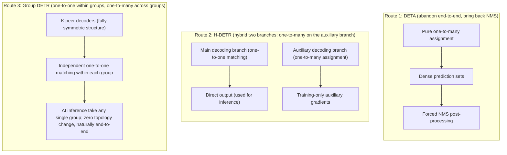

# Group DETR: Training-Time Query Grouping

Across the six preceding installments, researchers advanced three main lines against DETR's architectural defects: [Deformable DETR](./deformable-detr) rebuilt the feature-reading topology, resolving the dense global computation overhead through sparse local sampling; [Conditional and DAB-DETR](./conditional-dab-detr) equipped query slots with 4D dynamic anchor boxes $(x, y, w, h)$, solving the localization cold start; [DN-DETR](./dn-detr) and [DINO](./dino), through the bypass task of noised ground-truth anchors and a joint redesign of three core interfaces, eliminated the violent oscillation of discrete bipartite matching in early training.

These works greatly accelerated training convergence and pushed detection accuracy on COCO to new heights. However, when stepping back to examine the system's **loss computation and gradient flow**, an underlying structural contradiction that runs through everything and was never directly addressed becomes visible: **positive-sample supervision signals are extremely sparse in the spatial dimension**.

Although DN-DETR and DINO injected dense deterministic gradients through the bypass denoising branch, the assignment logic of the **real bipartite matching branch** — the core of object detection — has never changed since the original DETR: each ground-truth object can be assigned to exactly one prediction slot (i.e. **one-to-one assignment**).

This article focuses on **Group DETR (Chen et al., ICCV 2023)** and analyzes how researchers, through **decoupled inter-group one-to-many matching** and **grouped self-attention isolation**, systematically resolve the training-time bottleneck of extremely sparse positive-sample supervision while fully preserving the end-to-end one-to-one inference architecture.

## Background

### The Positive-Sample Supervision Scarcity Problem

Traditional convolutional detectors (such as Faster R-CNN, RetinaNet, or FCOS) generally adopt a **one-to-many assignment** strategy during training: for each ground truth (GT) object in the image, the algorithm marks dozens or even hundreds of candidate anchor boxes or feature-map pixels as positive samples, based on spatial IoU or center-sampling regions.

Take the single-stage anchor-free detector FCOS as an example: inside one ground-truth box, dozens of spatial feature points are typically assigned both a foreground classification label and a continuous centerness regression target. During backpropagation, these spatial positions simultaneously send bounding-box geometric residual gradients and classification gradients back to the backbone and the feature pyramid.

The assignment topology of end-to-end DETR is the exact opposite. On the standard COCO training set, a single image contains on average only about 7 ground-truth objects. In a decoder equipped with $N = 300$ query slots:

- Only 7 query slots can successfully match a ground truth, receiving positive-sample classification cross-entropy (or Focal Loss) and bounding-box $\ell_1$ and GIoU regression gradients;
- The remaining 293 slots (over 97%) are all forcibly assigned the virtual background class (`no-object`) and produce no geometric regression loss at all.

This raises a conceptual distinction that is often confused: the essential difference between **sample imbalance** and **positive-sample scarcity**.

In the original DETR, the authors mitigated the gradient drowning caused by an excess of background negatives by lowering the background-class loss weight (e.g. $\text{no-object weight} = 0.1$) or switching to Focal Loss. But **negative-sample down-weighting is merely an optimization-level re-weighting of existing gradients; it cannot conjure new positive-sample geometric supervision signals out of thin air**. Across the vast majority of its computation paths, the feature extractor and decoder receive only inhibitory negative feedback of the form "there is no object here". The positive localization gradients that actually guide "how the object's geometric boundary should be fitted" are one to two orders of magnitude lower than in traditional detectors, both in spatial coverage and in information content.

:::info[Question]

**Why can the denoising branches of DN-DETR and DINO not be equated with positive-sample densification?**

In the fifth and sixth installments, the denoising branch did introduce additional positive-sample queries. But denoising queries have clear particularities:

1. **Geometric starting points anchored near ground truth:** denoising queries are synthesized by adding small noise to ground-truth boxes, so their coordinates inherently fall around the targets — a local fitting task requiring no search;
2. **The Hungarian matching is bypassed entirely:** the ownership of denoising queries is explicitly designated by hand, requiring no slot competition or bipartite assignment across the image;
3. **The core prediction slots do not benefit:** in the real matching branch, the model still has to rely on the extremely sparse 7 positive samples to explore the target distribution over the global feature map.

In other words, the denoising task builds a "ladder" for the model from the periphery, but it does not change the physical reality of positive-sample sparsity in the core matching branch, where "a single tree cannot support the weight".

:::

### Why Naive One-to-Many Fails

Since one-to-many assignment in traditional detectors supplies abundant positive-sample gradients, the most intuitive idea is: **can we simply abolish the Hungarian one-to-one matching and force multiple query slots of DETR to match the same ground-truth object?**

For example, select the top-$k$ prediction slots with the lowest cost for a ground truth, or use a dynamic threshold to make multiple candidate boxes matches for that target.

The original paper's controlled experiment (Table 7(b), topology corresponding to Figure 2(c)) directly pronounced this naive attempt bankrupt: extending the baseline model (Conditional DETR) from 300 queries to 3300 queries, and directly applying naive one-to-many matching for both training and inference, detection accuracy collapses from the baseline's **32.6 AP to a cliff-like 8.4 AP**.

This is not a matter of convergence speed; the network's predicted outputs are physically unusable. The underlying mechanism of this collapse is: **one-to-one matching is the only mathematical premise that lets DETR eliminate non-maximum suppression (NMS) post-processing.**

As analyzed in depth in [the original DETR: bipartite matching and set loss](./detr-v1-bipartite-matching-set-loss), DETR can predict sets directly end-to-end because bipartite matching mathematically constructs an exclusive competitive game (Figure 2(c)):

$$
\mathcal{L}_{\text{match}}(y, \hat{y}) = \sum_{i=1}^M \ell(y_i, \hat{y}_{\sigma(i)}) + \sum_{j \notin \{\sigma(i)\}} \ell_{\text{cls}}(\varnothing, \hat{y}_j)
$$

Within a single prediction set, for a given ground-truth object, the system **rewards only the single best-fitting sample, while judging all tightly adjacent, highly overlapping but slightly inferior redundant prediction slots as background and strongly suppressing them**. Combined with the self-attention inside the decoder, different slots continuously exchange information across layers, reaching a slot negotiation of "you handle this object, I handle the background", which internalizes "deduplication" as the model's forward inference capability.

Once naive one-to-many assignment is applied:

1. **The competition mechanism vanishes:** multiple query slots near the ground truth are simultaneously given positive-sample status, and the loss function simultaneously encourages all of them to output high confidence and coordinates close to the ground truth;
2. **Training objectives directly conflict with inference needs:** during training, the model is explicitly taught to produce multiple coincident, redundant high-score boxes for the same object;
3. **Inference cannot be self-consistent:** at inference, lacking the one-to-one competition penalty, the decoder outputs dense duplicate false positives, forcing hand-designed NMS back into the post-processing pipeline — directly destroying the core value of DETR's end-to-end prediction.

Therefore, the real technical dilemma DETR faces is: **during training it urgently needs the abundant supervision of one-to-many to speed up convergence, but at inference it must strictly preserve the exclusivity of one-to-one competition to remove redundancy.**

## The Core Mechanism of Group DETR

### Defining Query Groups

Before entering the concrete algorithm, the most easily misunderstood intuition behind "**query grouping (Group DETR)**" must first be clarified: **there is no operation of "clustering or dynamically partitioning existing queries" (Partition / Clustering)**. In fact, in Group DETR, "grouping" is not a **verb** that posterior-partitions an existing tensor; it means that during training, the system organizes **multiple** **complete** query spaces with the "group" as the boundary unit.

| Architecture | Query count and organization | Hungarian matching domain | Final end-to-end output |
| :--- | :--- | :--- | :--- |
| **Standard DETR** | Single group, $N = 300$ slots | Global one-to-one matching over all 300 slots | 300 candidate predictions |
| **Naive one-to-many** | Single group, $M = 3300$ slots | Within all 3300 slots, 1 GT claims multiple slots | 3300 predictions (severely duplicated, NMS required) |
| **Group DETR** | **$K$ independent query groups**, each containing the full $N = 300$ slots ($K \times N = 3300$ total) | **Each group is a closed boundary**; each performs its own internal one-to-one matching independently | At inference only the 1st group is used (300), naturally free of redundancy |

In other words, Group DETR's "grouping" is essentially **horizontally replicating and instantiating $K-1$ fully parallel query sets (Multi-Group Queries) on top of the original single complete query set during training**.

### Query Generation: Single-Stage vs Two-Stage Initialization

How, then, are these $K$ mutually independent query groups actually generated in the network implementation? The original paper gives two clear generation mechanisms depending on whether the underlying detector is single-stage or two-stage:

1. **Single-stage fixed-query architectures (e.g. Conditional DETR, DAB-DETR, DN-DETR):**
   In these models, queries are globally learnable static embedding vectors. The original model needs only a single parameter table:

   ```python
   # Standard DETR: a single group of 300 queries
   self.query_embed = nn.Embedding(300, hidden_dim)
   ```

   In Group DETR, the code simply enlarges the parameter table $K$-fold:

   ```python
   # Group DETR (K=11): directly instantiate 11 independent groups of query vectors
   self.query_embed = nn.Embedding(11 * 300, hidden_dim)
   ```

   These $K \times N$ parameters are **independently randomly initialized** at network construction, with no cross-group numeric binding or sharing constraints; during training they explore freely along their own received gradients and evolve independently.

2. **Two-stage feature-prior architectures (e.g. DINO, Deformable DETR Two-Stage):**
   In two-stage models, the decoder's initial anchor boxes and content features are no longer determined by static embeddings; instead, the Top-$N$ priors are dynamically selected from the feature scores after the first stage (the encoder). The number of groups cannot be enlarged by simply defining static embeddings.
   The original paper provides the corresponding adaptation in Appendix A.2: **construct $K$ pairs of parallel classification and regression prediction heads (Predictor Heads) in the first stage**. After the encoder outputs the feature map, these $K$ pairs of heads each score the features and each select their own set of Top-$N$ proposals, serving as the input anchors for the decoder's 1st through $K$-th groups respectively. At inference, the model directly discards the other $K-1$ pairs of heads and keeps only the Top-$N$ boxes from the 1st pair — 100% identical to the baseline inference topology.

### Intra-Group and Inter-Group Matching Rules

With the origin of the $K$ complete query groups clarified, Group DETR's entry point into the structural contradiction above follows naturally: **it does not modify the one-to-one matching rule inside a single prediction set; instead, it constructs multiple fully parallel prediction spaces during training**.

Concretely, Group DETR introduces $K$ fully independent sets of object queries during training:

$$
\mathbf{Q} = \left\{ \mathbf{Q}_1, \mathbf{Q}_2, \dots, \mathbf{Q}_K \right\}, \quad \text{each } \mathbf{Q}_k \in \mathbb{R}^{N \times C}
$$

The decoder accordingly outputs $K$ prediction sets $\left\{ \mathbf{Y}_1, \mathbf{Y}_2, \dots, \mathbf{Y}_K \right\}$. When computing the matching and supervision losses, the algorithm performs **group-wise one-to-one** assignment:

$$
\sigma_k = \arg\min_{\sigma \in \mathfrak{S}_N} \sum_{n=1}^N \mathcal{L}_{\text{cost}}(y_n, \hat{y}_{\sigma(n)}^{(k)}), \quad k = 1, 2, \dots, K
$$

![Original paper Figure 2: comparison of three assignment topologies; colored lines are matches to ground-truth objects and gray lines are background slots, with 4 queries per group in the example. (a) Group DETR: group-wise one-to-many assignment plus grouped self-attention, structurally equivalent to a set of parameter-sharing parallel decoders; (b) group-wise one-to-one assignment only, without self-attention isolation; (c) naive one-to-many assignment, where a single ground truth connects to multiple match lines simultaneously and no "single winner" competitive structure exists. Source: Group DETR, arXiv:2207.13085](/img/cv_img/detr-series/group_detr_fig2_assignment.png)

The total training loss is the arithmetic mean of the $K$ group losses:

$$
\mathcal{L}_{\text{total}} = \frac{1}{K} \sum_{k=1}^K \mathcal{L}_{\text{det}}\left( \mathbf{Y}_k, \bar{\mathbf{Y}}, \sigma_k \right) = \frac{1}{K} \sum_{k=1}^K \sum_{n=1}^N \ell\left( \mathbf{y}_{\sigma_k(n)}^{(k)}, \bar{\mathbf{y}}_n \right)
$$

From a macro perspective, this design achieves a perfect unification under two viewpoints:

| Viewpoint | Structural state | Mathematical and physical effect |
| :--- | :--- | :--- |
| **Intra-group microscopic** | **Strict one-to-one assignment** | Within each group, one GT can be claimed by only one unique slot, and the remaining slots are suppressed as negative samples. **The exclusive competition mechanism is fully preserved, and deduplication is strictly trained within each group.** |
| **Global macroscopic** | **Explicit one-to-many supervision** | Since each ground truth is assigned once in each of the $K$ groups, **each GT is effectively assigned to $K$ different prediction slots**, and the number of positive-sample gradients back-propagated by the model is directly amplified $K$-fold. |

This is the so-called "group-wise one-to-many assignment": **one-to-many does not happen between competing slots, but between parallel, independent observation domains**.

### Grouped Self-Attention

However, merely splitting the queries into $K$ groups and running $K$ matches is not enough. The original paper's experiment (Table 7(c)) reveals a crucial ablation phenomenon:

If only group-wise one-to-one matching is used, while all $K \times N$ queries still perform global self-attention interaction inside the decoder, the performance gain is very weak (from 32.6 AP to only 34.8 AP); only when **strict grouped isolation (Separate Self-Attention)** is imposed on the self-attention does performance jump further to **37.6 AP** (a net gain of 2.8 AP).

:::info[Question]

**Why must self-attention between different query groups be completely severed, forbidding any information interaction?**

The essence of this design is maintaining **consistency between training and inference in the feature-negotiation space**:

1. **Aligning the competition domain with the perception domain:** in Group DETR, one-to-one competition is defined only "within a group"; there is no inter-group competition of better or worse. If inter-group self-attention interaction were allowed, group 1's queries would perceive at the feature level that group 2's queries have already fitted the target, producing retreat, concession, or semantic aliasing in the feature space, and destroying the negotiation premise of independent intra-group deduplication;
2. **Eliminating the inference-time distribution shift:** at inference, to keep the topology minimal, only a single group of queries ($N$ slots) is fed in. If during training a single query's representation evolution depended on contextual support from the other $K-1$ groups, then cutting off the other groups at inference leaves the remaining single group facing severe representational deficit and attention-distribution shift;
3. **Orthogonal decomposition of the computation graph:** after blocking inter-group interaction, the entire forward computation is mathematically equivalent to $K$ completely independent decoders running in parallel; each group's representation trajectory is independent, and a single group's inference performance no longer depends on the existence of other groups.

:::

In terms of the concrete attention-mask implementation, let the global query tensor have length $K \cdot N$. The self-attention mask $\mathbf{M} \in \mathbb{R}^{(KN) \times (KN)}$ is constructed as a block diagonal matrix:

$$
\mathbf{M}_{i, j} = \begin{cases} 0, & \text{if and only if } \lfloor i / N \rfloor = \lfloor j / N \rfloor \\ -\infty, & \text{otherwise} \end{cases}
$$

Any cross-group attention weight is forcibly set to negative infinity, ensuring that each group of queries in the deep decoder completely "cannot perceive" the existence of any other group.

## Principle Analysis

### The Weight-Sharing Network View

Examined from the algebraic structure of the computation topology, grouped self-attention plus independent intra-group matching makes Group DETR physically **fully equivalent to simultaneously training $K$ independent detection networks with identical architecture and fully shared parameters**:

$$
\begin{aligned}
\mathbf{Y}_1 &= \mathrm{Detector}(\mathbf{X}, \mathbf{Q}_1; \, \boldsymbol{\theta}), & \mathcal{L}_1 &= \mathrm{HungarianLoss}(\mathbf{Y}_1, \bar{\mathbf{Y}}) \\
\mathbf{Y}_2 &= \mathrm{Detector}(\mathbf{X}, \mathbf{Q}_2; \, \boldsymbol{\theta}), & \mathcal{L}_2 &= \mathrm{HungarianLoss}(\mathbf{Y}_2, \bar{\mathbf{Y}}) \\
&\;\;\vdots & &\;\;\vdots \\
\mathbf{Y}_K &= \mathrm{Detector}(\mathbf{X}, \mathbf{Q}_K; \, \boldsymbol{\theta}), & \mathcal{L}_K &= \mathrm{HungarianLoss}(\mathbf{Y}_K, \bar{\mathbf{Y}})
\end{aligned}
$$

Here $\boldsymbol{\theta}$ denotes all parameters of the detector (the backbone, the encoder, each decoder layer's projection matrices, and the final classification and regression heads). The gradient these shared weights receive in a single backpropagation is:

$$
\nabla_{\boldsymbol{\theta}} \mathcal{L}_{\text{total}} = \frac{1}{K} \sum_{k=1}^K \nabla_{\boldsymbol{\theta}} \mathcal{L}_k
$$

In a single forward pass, **the backbone and decoder parameters** are simultaneously pulled by supervision from $K$ different prediction sets. Although the scalar prefix of the gradient is averaged, its **effective gradient signal-to-noise ratio (SNR) improves qualitatively**: the geometric information of every ground-truth object flows back into the network simultaneously through $K$ different initial conditions and feature paths, greatly smoothing the loss surface of the parameter space.

### The Query Augmentation and Symmetry View

The only difference among these $K$ parallel networks lies in the initial query embeddings (Object Queries) they take as input.

In computer vision, conventional data augmentation perturbs the input image through random scaling, cropping, or color jittering to improve the model's generalization and convergence speed. Group DETR's multi-group query mechanism is, in mathematical essence, precisely an automated "**query augmentation**" performed in the **query space**.

During training, the $K$ groups of learnable queries evolve jointly over the whole dataset. The original paper demonstrates through visualization (Figure 3): after convergence, the query vectors matched to the same ground-truth object in different groups produce predicted geometric boxes and attention reference points that are spatially highly close, with small spatial displacements and scale perturbations.


This property — spatially close yet mutually perturbed — means that in every iteration the decoder must learn to converge stably to the same true geometric target from slightly different spatial initializations, greatly strengthening the decoder's fault tolerance to the query's initial distribution.

More crucial is the original paper's **group performance-equivalence verification (Figure 4)**: after training completes, the researchers independently extract group 1, group 2, up to group $K$ and evaluate each alone on the COCO validation set; the final detection accuracy of all $K$ groups shows striking consistency (all stably within the extremely narrow tolerance band of $37.5 \pm 0.1\text{ AP}$).

This experimental phenomenon directly proves: **no group of queries degenerated into a marginal by-product. Due to the fully symmetric structure and equal loss supervision, the $K$ groups' parameter evolution is highly consistent, and each group is a mature, complete, independently runnable high-performance detector.**

## Engineering Implementation

### Training Time: Folding into the Batch Dimension

On first encountering Group DETR, many readers worry that introducing $K$ groups multiplies GPU memory by $K$ and slows training substantially. Yet in engineering practice, Group DETR employs an exceptionally elegant tensor transformation trick.

Recall the internal computation flow of the Transformer decoder:

1. **Cross-attention:** each query independently retrieves information from the encoder's image features $\mathbf{X}$; there is **no lateral interaction between queries**;
2. **Feed-forward network (FFN):** computed purely point-wise per token; query slots are fully independent;
3. **Self-attention:** the **only operator in the entire flow that defines lateral interaction between queries**.

Since inter-group interaction must be severed, there is no need to build $K$ independent decoder objects in the computation graph, nor even to construct a huge block-diagonal mask matrix. Using PyTorch tensor reshaping, one can directly **fold the query-group dimension into the batch dimension** (the original paper's Algorithm 1):

```python
# Q: shape (K * N, B, C), where K is the number of groups, N the queries per group,
# B the batch size, C the feature channels
if self.training:
    # 1. Split into K tensors, each of shape (N, B, C)
    Q_list = Q.split(N, dim=0)

    # 2. Key trick: concatenate along the batch dimension; shape becomes (N, K * B, C)
    parallel_Q = torch.cat(Q_list, dim=1)

    # 3. Run standard self-attention (parallelized over the large K*B batch;
    #    groups are physically isolated by construction)
    out = self.self_attn(parallel_Q)  # output shape still (N, K * B, C)

    # 4. Restore the tensor structure; concatenate back along the sequence axis to (K * N, B, C)
    out = torch.cat(out.split(B, dim=1), dim=0)

    # 5. Cross-attention and FFN proceed normally (all K*N queries processed in parallel)
    out = self.ffn(self.cross_attn(out, memory))
else:
    # Inference: physically truncate, keeping only the 1st group of queries!
    Q_single = Q[:N]  # (N, B, C)
    out = self.ffn(self.cross_attn(self.self_attn(Q_single), memory))
```


This implementation brings three decisive engineering advantages:

1. **Natural inter-group isolation:** no multi-head self-attention operator ever computes attention across different batch samples. Rearranging the $K$ groups into the batch dimension **physically and completely seals off any possibility of cross-group information leakage**, with no extra memory spent storing and computing a huge sparse attention mask;
2. **Seamless compatibility with operator acceleration:** modern efficient attention operators (such as FlashAttention) support sparse masks over long sequences only awkwardly, but have extreme native optimization for batch-dimension concurrency. This rearrangement lets Group DETR directly absorb the FlashAttention dividend;
3. **Stable, controlled overhead:** the original paper's measurements on 8× A100 (Figure 7 and Table 2) show that with a ResNet-50 backbone, Group DETR with 11 query groups increases per-GPU memory by only about **1.2 GB ~ 1.7 GB** over the baseline, and per-epoch training time by only about **5 minutes** (from 23 minutes to 28) — none of the memory-explosion burden of traditional one-to-many models.

### Inference Time: Single-Group Forward Truncation

When entering inference or validation, Group DETR demonstrates strict restraint as an end-to-end detector:

$$
\text{Inference input:} \quad \mathbf{Q}_{\text{infer}} = \mathbf{Q}_{1} \in \mathbb{R}^{N \times C}
$$

The model directly discards the other $K-1$ query groups and their corresponding head branches, feeding only a single group of $N$ queries into the standard decoder.

This means:

- **Inference-time computation is identical to the baseline:** FLOPs, memory usage, and forward latency are **100% identical** to the original baseline model without the Group modification;
- **Zero structural dependency:** the inference code needs no grouping logic, tensor splitting, or extra merging operators;
- **Completely free of NMS post-processing:** because the retained 1st group of queries was shaped under strict one-to-one competition penalties throughout the entire training cycle, its fixed-length output set inherently possesses exclusivity; taking the high-score outputs directly suffices, with no heuristic deduplication component attached.

## Experimental Evaluation

### Gains Across Baseline Architectures

Group DETR is not a trick specific to some particular attention variant, but a general, plug-and-play training-time assignment paradigm. On the COCO 2017 validation set, the original paper covers the full range of architectures from classic to strong baselines (Tables 3 and 4):

| Model (ResNet-50) | Epochs | Baseline AP | Group DETR AP | Absolute gain ($\Delta\text{AP}$) | Small-object gain ($\Delta\text{AP}_s$) |
| :--- | :---: | :---: | :---: | :---: | :---: |
| **Conditional DETR** | 12 e | 32.6 | **37.6** | **+5.0** | **+3.5** |
| **Conditional DETR-DC55** | 12 e | 36.4 | **41.2** | **+4.8** | **+3.4** |
| **DAB-DETR** | 12 e | 35.2 | **39.1** | **+3.9** | **+3.0** |
| **DAB-DETR-DC55** | 12 e | 37.5 | **41.9** | **+4.4** | **+3.9** |
| **DN-DETR** | 12 e | 38.6 | **40.6** | **+2.0** | **+1.9** |
| **DN-DETR-DC55** | 12 e | 41.9 | **44.5** | **+2.6** | **+3.7** |
| **DAB-Deformable-DETR** | 12 e | 44.2 | **45.7** | **+1.5** | **+0.6** |
| **DINO (4-scale)** | 12 e | 49.4 | **50.1** | **+0.7** | **+0.1** |
| **Conditional DETR** | 50 e | 40.9 | **43.4** | **+2.5** | **+2.5** |
| **DAB-DETR** | 50 e | 42.2 | **44.5** | **+2.3** | **+2.7** |
| **DAB-Deformable-DETR** | 50 e | 48.1 | **49.7** | **+1.6** | 0.0 |
| **DINO (4-scale)** | 36 e | 50.9 | **51.3** | **+0.4** | **+0.1** |
| **DINO (4-scale, Swin-L)** | 36 e | 58.0 | **58.4** | **+0.4** | -0.3 |

Two deep technical conclusions can be drawn from the progression in the table:

1. **Massive liberation of basic baselines (+3.9 ~ +5.0 AP):** on models lacking multi-scale dense features and denoising bypasses (such as Conditional DETR and DAB-DETR), extreme positive-sample sparsity is the number-one bottleneck constraining convergence. Once 11 query groups densify the supervision, performance soars by 4–5 points within 12 epochs, reaching in a very short cycle the accuracy that previously required 50 epochs;
2. **Diminishing marginal returns and gain convergence:** as the baseline itself integrates ever more complete acceleration techniques (from plain DN-DETR to the super-baseline DINO with contrastive denoising and mixed query selection), Group DETR's gain steadily shrinks from $+5.0$ to $+0.7$ and then $+0.4\text{ AP}$. This clearly shows: **once feature reading, geometric initialization, and denoising training are all highly optimized, the headroom from purely densifying the positive-sample count gradually approaches the performance ceiling**.

### Equal-Training-Time Comparison

Since Group DETR introduces extra forward and backward computation during training, an inevitable objection is: **is this performance jump merely because the per-step computation cost grew slightly — effectively extending the network's training time on the data?**

To rule out this confounding variable, the original paper ran a strict **equal-training-time comparison (Table 2)**: extending the baseline's training schedule from 12 to 15 epochs and from 50 to 60 epochs, aligning the baseline's full-pipeline GPU wall-clock hours exactly with Group DETR:

| Model | Training config | Measured total time on 8× A100 | COCO val mAP |
| :--- | :---: | :---: | :---: |
| **Conditional DETR baseline** | 12 epochs | 4.6 hours | 32.6 |
| **Conditional DETR extended** | **15 epochs** | **5.8 hours** | 34.4 |
| **Conditional DETR + Group** | **12 epochs** | **5.6 hours** | **37.6** (**+3.2 AP** higher) |
| **Conditional DETR baseline** | 50 epochs | 19.2 hours | 40.9 |
| **Conditional DETR extended** | **60 epochs** | **23.0 hours** | 41.6 |
| **Conditional DETR + Group** | **50 epochs** | **23.3 hours** | **43.4** (**+1.8 AP** higher) |

The measured data thoroughly demolishes the "it's just training longer" hypothesis: at fully equal — or even longer — baseline cost, Group DETR still establishes a large absolute advantage of nearly 2–3 points. This fully confirms that its benefit comes from **an efficient topological reorganization of the backpropagation gradient flow, not brute-force accumulation of compute**.

### Encoder Backpropagation Benefits and Matching-Stability Evaluation

Although Group DETR acts directly on the decoder's inputs and matching, its backpropagated gradient flow penetrates the decoder and cross-attention, flowing directly back into the Transformer encoder and the backbone.

In Appendix Section 3.2, the paper designs a highly insightful decoupled verification experiment (Table 1), examining whether Group DETR merely trains a better decoder, or reshapes the encoder along with it:

- **Option A (frozen encoder, decoder trained normally):** 40.6 AP;
- **Option B (frozen encoder, decoder trained with Group DETR):** improved to 41.5 AP (the decoder's own improvement contributes $+0.9\text{ AP}$);
- **Option C (encoder and decoder jointly trained with Group DETR):** jumps to **42.9 AP** (a further large stride of **+1.4 AP** over Option B).

This experiment clearly shows: **the abundant regression and classification gradients aggregated from $K$ groups of positive samples, when back-propagated to the encoder along the attention weights, greatly promote the refinement of the image's dense token feature representations**. The encoder learns more discriminative instance features, which in turn provide higher-quality contextual support for the decoder's cross-attention addressing.

Even more illuminating is the **matching instability score (Instability Score) evolution** shown in the original paper's Figure 5:

In the fifth installment, DN-DETR systematically defined the matching-oscillation metric and proved that the denoising task stabilizes matching. The original paper's measurements show: **Group DETR's matching stability not only substantially surpasses DAB-DETR without denoising, but significantly outperforms even DN-DETR, which was specifically designed for matching stability!**

The underlying logic of this phenomenon is an inversion of causality: DN-DETR "forcibly stabilizes" by adding deterministic priors from the periphery; whereas Group DETR, by substantially increasing positive-sample supervision, lets the network weights learn more robust and more accurate geometric predictions very early in training. **The rapid improvement of the network's own prediction quality makes the Hungarian matching naturally reduce its back-and-forth flips and target jumps during discrete assignment — achieving stronger assignment stability than the denoising branch, without introducing any noised ground truth.**


## Comparison with Related Methods

### Mechanism Comparison with Denoising Training (DN-DETR)

In the DETR evolution spectrum, Group DETR and DN-DETR (and the CDN in DINO) are often discussed side by side, because both construct multiple sets of additional queries during training. However, a deep analysis of their mathematical mechanisms reveals that they are **fully orthogonal and complementary** in functional positioning and supervision dimension:

| Dimension | **DN-DETR / CDN denoising route** | **Group DETR grouped-matching route** |
| :--- | :--- | :--- |
| **Core contradiction addressed** | Discrete instability and target jumps of early bipartite matching | Absolute spatial scarcity of positive-sample supervision in the bipartite matching branch |
| **Query generation** | Synthesized by artificially adding coordinate and class noise around ground truths (GT) | $K$ groups of general learnable slots learned automatically by the model (jointly optimized over the whole training set) |
| **Per-group query capacity** | Query count **strictly equals the number of GT objects in the current image** (no background slots) | Each group contains the full $N$ slots (e.g. 300, including foreground and the vast majority of background slots) |
| **Matching and loss** | Completely bypasses Hungarian matching, forcibly assigned to the corresponding ground truth | **Full Hungarian bipartite matching executed within each group**, with matching cost computed strictly |
| **Negatives and deduplication** | Pure positive samples (DN) or concentric-ring negative samples (CDN); intra-group exclusive deduplication is not trained | **Each group simultaneously trains foreground recognition and the suppression of the vast majority of background slots, natively training end-to-end deduplication** |

The original paper's ablation (Figure 8) confirms this orthogonal complementarity: on the DAB-DETR baseline (35.2 AP), introducing DN-DETR alone reaches 38.8 AP, introducing Group DETR alone reaches 39.1 AP, and **stacking the two pushes performance further to 40.6 AP**. This shows their gains come from entirely different sources: the denoising branch removes early search oscillation, while grouped matching injects abundant positive-sample momentum for convergence.


### Comparison with Contemporary One-to-Many Methods (DETA, $\mathcal{H}$-DETR)

Around 2022, introducing one-to-many into end-to-end detectors to accelerate convergence became a shared focus of the field, and three distinct technical routes emerged:



1. **DETA (Finest One-to-Many):** completely abandons DETR's set-prediction promise, directly transplanting traditional IoU one-to-many assignment into the Transformer and re-attaching NMS post-processing at inference. This route converges extremely fast but betrays the end-to-end, post-processing-free technical intent;
2. **$\mathcal{H}$-DETR (Hybrid DETR):** adopts an asymmetric two-branch design. The main branch maintains standard one-to-one matching for inference; an additional parallel auxiliary branch uses traditional one-to-many assignment (matching multiple queries per GT), used only during training to send dense gradients back to the encoder and removed entirely at inference. This route preserves end-to-end inference but introduces hyperparameter tuning for the two heterogeneous branches (e.g. the number of auxiliary queries, the one-to-many assignment thresholds);
3. **Group DETR:** adopts a **fully symmetric, peer-to-peer grouped topology**. The model does not distinguish a "main branch" from an "auxiliary branch": the $K$ groups are fully equal, and all follow the end-to-end one-to-one matching rule. This not only keeps the algorithm extremely pure (the whole pipeline introduces a single hyperparameter $K$) but also ensures that every query slot learns the end-to-end exclusive optimal representation.

## Limitations

### Saturation of the Group-Count Hyperparameter

The original paper studies in depth (Figure 9) how the number of query groups $K$ affects detection performance (with Conditional DETR as the reference):

As the group count rises step by step from $K = 1$ (baseline, 32.6 AP) to $K = 3$ (35.3 AP), $K = 5$ (36.7 AP), up to $K = 11$ (37.6 AP), detection performance shows a clear monotonic increase. The continuously increasing density of positive-sample supervision amplifies the convergence speed roughly linearly.


However, when the group count further exceeds 11, reaching $K = 13$ or beyond, the performance curve enters a gentle plateau (holding at 37.6 AP) and the marginal gain fully saturates.

This saturation indicates: **under single-scale feature maps and ordinary batch sizes, the gradient infusion from 11 positive samples already suffices for the deep attention's geometric representation learning.** Stacking more groups provides no new information increment and only linearly increases the compute budget of each backward pass. The paper therefore establishes $K = 11$ as the default golden compromise of the whole architecture.

### Remaining Bottlenecks and the Path Forward

With its ingenious "one-to-one within groups, one-to-many across groups" topology, Group DETR solved the positive-sample supervision sparsity that had long plagued the DETR evolution, without breaking the end-to-end competition mechanism at all. It proved that the training dividend of one-to-many can be fully absorbed within the set-prediction framework through peer-to-peer replication along a parallel dimension.

However, following the main line of technical evolution further, Group DETR still leaves two deep open problems, which directly became the breakthrough points of subsequent work:

1. **The "low-quality match" hazard after densifying positive samples:** Group DETR only guarantees that each ground truth is matched, in each group, to a "relatively optimal within the group" slot; **it cannot guarantee that this forcibly assigned positive sample is truly high-quality in geometry and semantics**. Early in training, or in dense small-object scenes, some intra-group positive samples have extremely low overlap between their own predicted boxes and the ground truth, and forcing high-weight regression losses on them can steer feature optimization astray. This governance contradiction — targeting "match quality" rather than mere "match quantity" — continues in the next two installments: **[D-FINE](./d-fine)** first replaces per-layer point estimates with distributions over boundary distances, so each predicted box carries its own quality information; **[DEIM](./deim)** then formally exposes the low-quality-match problem after densification;
2. **Mismatch of the compute budget and edge-deployment latency:** Group DETR focuses on squeezing **training-time convergence speed**; it does not change the detector's inference forward latency. For industrial edge deployment, the bottleneck of end-to-end real-time detection lies in the computation cost of the multi-scale Transformer encoder and the latency of the deep decoder. This architectural-efficiency contradiction is systematically tackled by the **[RT-DETR](./rt-detr)** series at the end of this series, through hybrid-encoder decoupling and compute reallocation.

---

Next: [D-FINE: Refining Boundaries as Distributions](./d-fine)
