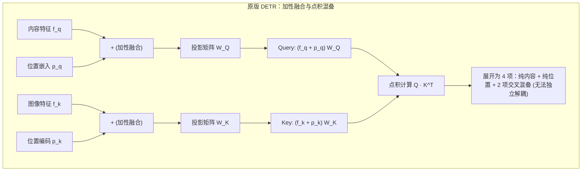
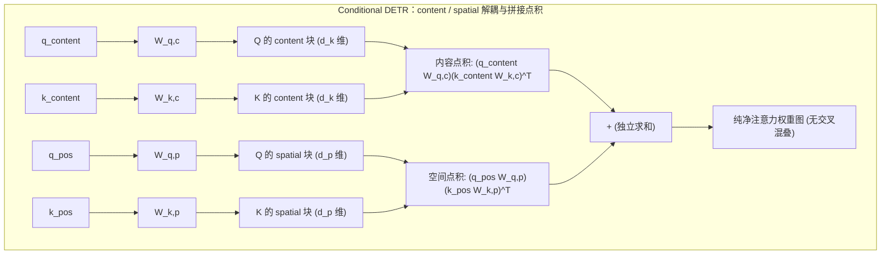
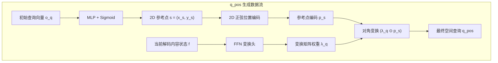
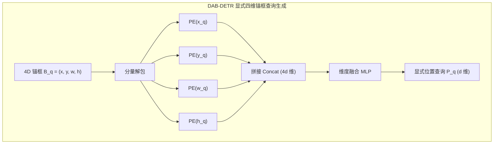
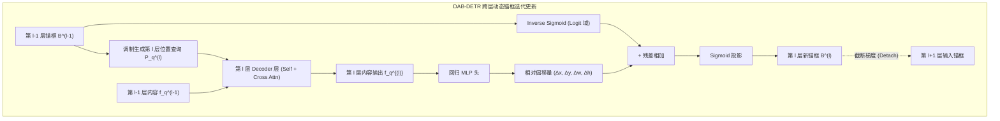

在 [3）Deformable DETR：稀疏采样与多尺度注意力](./deformable-detr) 中我们梳理过，针对原版 DETR 慢收敛的瓶颈，学术界存在两条平行的攻关路线。在第一条路线中，Deformable DETR 从底层的特征读取算子切入，通过局部稀疏采样打破了计算与收敛壁垒。

本篇聚焦第二条路线——在保持**单尺度特征与标准密集交叉注意力（Standard Dense Cross-Attention）** 的框架内，彻底消除 Object Query 本身的空间语义模糊：**目标查询的空间化（Query Spatialization）**。

在这条演进线上，两项标志性工作构成了清晰严密的直接递进关系：

1. **Conditional DETR（2021）：** 从注意力计算的代数形式切入，通过拼接解耦消除了内容与位置的交叉混叠，构建了受内容调制的 2D conditional spatial query；
2. **DAB-DETR（2022）：** 承接并深化了条件解耦思想，将无尺度的 2D 点先验彻底升级为显式的 4D 动态锚框（4D Anchor Box），并引入尺度归一化温度调制与跨层级联更新机制。

我们首先从原版查询在代数与几何层面的根本病灶谈起。

## 原版 Object Query 的空间表示缺陷

### 加性融合导致的特征混叠问题

在原版 DETR 解码器的跨注意力（Cross-Attention）机制中，$Q$ 与 $K$ 均由 " 内容嵌入 " 与 " 位置嵌入 " 两部分直接相加而成。

设解码器第 $l$ 层的输入内容特征为 $f_q \in \mathbb{R}^d$，对应的可学习查询位置嵌入为 $p_q \in \mathbb{R}^d$；编码器输出的图像特征为 $f_k \in \mathbb{R}^d$，图像特征对应的二维正弦位置编码为 $p_k \in \mathbb{R}^d$。在跨注意力计算中，$Q$ 与 $K$ 分别由两者相加后经线性投影矩阵 $W_Q, W_K \in \mathbb{R}^{d \times d}$ 映射得到：

$$
Q = (f_q + p_q) W_Q, \quad K = (f_k + p_k) W_K
$$

为了看清寻址过程中的计算本质，我们将未缩放的点积注意力项展开（略去线性投影矩阵以简化推导）：

$$
Q K^T = (f_q + p_q)(f_k + p_k)^T = \underbrace{f_q f_k^T}_{\text{内容-内容}} + \underbrace{f_q p_k^T}_{\text{内容-位置}} + \underbrace{p_q f_k^T}_{\text{位置-内容}} + \underbrace{p_q p_k^T}_{\text{位置-位置}}
$$

展开式中的四项各自承担了不同的相互作用：

1. **$f_q f_k^T$（内容—内容）：** 负责根据语义类别匹配目标，回答 " 待检测目标属于什么类别 "。
2. **$p_q p_k^T$（位置—位置）：** 负责根据空间位置定位目标，回答 " 待检测目标在图像的什么几何区域 "。
3. **$f_q p_k^T$ 与 $p_q f_k^T$（交叉混叠项）：** 这一对交叉项将语义特征与坐标编码直接相乘。

在物理意义上，图像像素的绝对坐标与物体的语义类别之间不存在普适的线性点积对应关系。交叉项在训练中既无法提供纯粹的几何约束，也无法提供明确的语义匹配信号，反而导致了**寻址混叠（Matching Ambiguity）**：反向传播计算梯度时，误差信号无法清晰区分究竟是分类预测错误还是空间定位偏差，模型必须依靠大量训练迭代才能逐步抑制交叉项带来的干扰。



:::info[问题]
为什么 NLP 中 Transformer 的 Token 嵌入与位置编码直接相加工作良好，而在 DETR 中相加却导致了严重混叠？

在自然语言处理（NLP）中，词嵌入表示的是离散符号语义，而一维绝对位置编码表示的是离散序列顺序。句子的语法结构通常允许 " 词义 " 与 " 位置 " 产生复杂的交互（例如某些介词只出现在特定语序位置）。

但在目标检测这一连续二维视觉任务中，**空间几何与语义类别具有强烈的正交性**：一只 " 猫 " 可以出现在图像的左上角、正中央或右下角，其类别语义与它所在的绝对像素坐标 $(x, y)$ 在几何本质上是独立的。加性融合强行令 $f_q$ 与 $p_k$ 在同一个向量空间做点积，强迫网络去拟合 " 猫的语义特征与坐标 $(120, 300)$ 的内积 "，这破坏了空间几何变换的平移不变性，放大了优化搜索空间。
:::

### 查询向量缺乏几何物理基准的问题

由于原版 DETR 的位置查询 $p_q$ 是一组在训练初期随机初始化的连续向量，并不对应具体的几何坐标，模型在最初阶段无法通过 $p_q p_k^T$ 形成局部的空间关注。同时，内容嵌入 $f_q$ 在初期也尚未汇聚具体的实例特征。

两个条件叠加，导致解码器各层在训练初期的注意力权重呈现近乎均匀的全局弥散分布。每个查询槽位不得不扫描全图的全部像素，再在反向传播中依靠二分图匹配的监督信号，非常缓慢地将关注范围收敛到特定的图像局部。

Conditional DETR 的实验对比表明，原版 DETR 需要经过大约 40 个 Epoch 的训练，交叉注意力的权重分布才开始在前景目标的边缘和极端点区域出现明显的空间聚焦。这种漫长的寻址收缩过程，是原版模型在密集注意力下收敛缓慢的关键诱因。

## Conditional DETR

### 条件交叉注意力机制

针对加性融合中的点积混叠，Conditional DETR（Meng 等人，2021）从代数结构上对跨注意力进行了重构。论文作者提出，与其将内容和位置向量相加后映射，不如将两者在通道维度进行**拼接（Concatenation）**，从而彻底剥离交叉混叠项。

设 content query 为 $q_{\text{content}} \in \mathbb{R}^d$，conditional spatial query 为 $q_{\text{pos}} \in \mathbb{R}^d$；编码器输出的 $K$ 在每个图像位置各有一个，其中 content embedding 为 $k_{\text{content}} \in \mathbb{R}^d$，空间位置编码为 $k_{\text{pos}} \in \mathbb{R}^d$。跨注意力的 $Q$ 与 $K$ 构建为分块拼接形式：

$$
Q = \begin{bmatrix} q_{\text{content}} W_{q,c} \\ q_{\text{pos}} W_{q,p} \end{bmatrix}, \quad K = \begin{bmatrix} k_{\text{content}} W_{k,c} \\ k_{\text{pos}} W_{k,p} \end{bmatrix}
$$

其中 $W_{q,c}, W_{k,c} \in \mathbb{R}^{d \times d_k}$ 为内容投影矩阵，$W_{q,p}, W_{k,p} \in \mathbb{R}^{d \times d_p}$ 为空间位置投影矩阵。

未缩放的点积计算由此被严格拆解为两项独立内积之和：

$$
Q K^T = \underbrace{(q_{\text{content}} W_{q,c})(k_{\text{content}} W_{k,c})^T}_{\text{content 分支：语义匹配}} + \underbrace{(q_{\text{pos}} W_{q,p})(k_{\text{pos}} W_{k,p})^T}_{\text{spatial 分支：几何定位}}
$$



根据向量分块点积的可加性，解耦后的计算式天然排除了 $q_{\text{content}} k_{\text{pos}}^T$ 与 $q_{\text{pos}} k_{\text{content}}^T$ 两项无意义的混叠干扰。内容分支专职计算类别与语义相似度，空间分支专职计算几何邻近程度，两路梯度回传时互不干扰。

### 空间查询的构造方式

解耦之后的关键问题是：**$q_{\text{pos}}$ 应当如何构造？**

在动手构造之前，先确认这个符号的物理身份。$q_{\text{pos}}$ 是每个查询槽位各持有的一个 $d$ 维向量，其只在一处被使用了——与图像位置编码 $k_{\text{pos}}$ 的内积，即上一节解耦式中的空间寻址项。因此，其不是一个坐标，而是**一个由内积曲面定义形状的空间探针**：这个内积在画布上扫出的响应在哪里隆起、隆起多宽、向哪个方向拖尾，就是该查询的空间视场。探针本身不携带可读的坐标，它的全部几何意义都寄生在它与 $K$ 端固定基底 $\text{PE}(p)$ 的相互作用里。

一个抽象的 $d$ 维向量要凭空在画布上定义出这样一个曲面，唯一的途径是让它与 $K$ 端共享代数结构。这决定了 Conditional DETR 的构造可以被压缩成两句话：参考点 $s$ 决定曲面的中心，缩放因子 $\lambda_q$ 决定曲面的形状。下面的两步构造，就是把这两句话落实成可计算的形式。

在原版 DETR 中，$p_q$ 是一组不依赖图像内容、全局固定的可学习向量（代码中的 `nn.Embedding`）。Conditional DETR 认为，一个 $q_{\text{pos}}$ 不应是孤立的静态坐标，而必须在目标参考点的几何约束下，结合当前图像解码出的实例特征动态生成，论文称之为 **conditional spatial query**。

整个生成过程分为两步：

1. **生成参考点正弦基底：** 利用查询槽位未结合图像前的未处理特征，预测出目标在画布上的 2D 中心参考点，并转化为正弦位置编码，作为基础几何基底；
2. **内容驱动的自适应形变：** 解码器结合当前已抽取的实例内容，预测一组频域缩放因子，通过逐元素相乘对基底进行调制，将原本对称的中心响应拉伸、平移到物体的各个边缘极值点，输出最终的 $q_{\text{pos}}$。

#### 参考点的生成与正弦编码

在原版 DETR 中，解码器第 $l$ 层的输入位置查询直接沿用静态参数向量 $p_q \in \mathbb{R}^d$，网络无法显式得知这个向量到底对应画布上的哪一个具体像素点。

Conditional DETR 改变了这一设定：每个查询槽位包含一个未绑定图像的初始可学习向量 $o_q \in \mathbb{R}^d$（即 Object Query 原始特征）。在进入解码器之前，网络首先通过一个小型前馈网络将 $o_q$ 投影为二维未归一化坐标，并通过 Sigmoid 限制在图像画布内：

$$
s = (x_s, y_s) = \text{sigmoid}\big(\text{MLP}(o_q)\big) \in [0, 1]^2
$$

这个二维坐标 $s = (x_s, y_s)$ 即为该查询所绑定的**参考点（Reference Point）**。随后，网络对其计算标准的二维正弦位置编码，得到参考点的基础几何嵌入：

$$
p_s = \text{PE}(s) = \left[ \text{PE}(x_s) \,\|\, \text{PE}(y_s) \right] \in \mathbb{R}^d
$$

$p_s$ 是参考点在频域的基础几何基底。它并不直接作为最终的 $q_{\text{pos}}$ 参与跨注意力点积，而是作为未调制的几何模板，在下一步与当前层解码出的实例内容特征相结合。

#### 基于内容特征的自适应坐标变换

有了以参考点为中心的空间分布还不够。在目标检测任务中，边界框的定位由物体的上下左右四条边界所界定，注意力机制不仅需要关注物体中心，更需要各个注意力头分别定位到物体的**极值点（Extremum Points，即物体的上、下、左、右边缘）**。

中心参考点 $s=(x_s, y_s)$ 只是一个零阶的二维坐标，它只有位置，完全没有尺度（scale）与长宽比（aspect ratio）信息。网络无法单凭 $s$ 得知目标到底是细高的人体还是扁长的车辆。要让注意力从中心延伸到物体的真实边界，必须依赖当前已经解码出的物体特征。

因此，**最终进入跨注意力空间分支的 $q_{\text{pos}}$ 并非静态向量，而是以内容隐状态 $f$ 为条件、对参考点基底 $p_s$ 进行动态变换后的产物**：

$$
q_{\text{pos}} = T p_s = \lambda_q \odot p_s, \quad \text{其中 } T = \text{diag}(\lambda_q), \; \lambda_q = \text{FFN}(f) \in \mathbb{R}^d
$$

在这一变换中，内容特征 $f$ 充当条件生成器，通过小型前馈网络输出对角变换权重 $\lambda_q$，再通过 Hadamard 积 $\odot$ 逐元素调制正弦基底 $p_s$，输出最终的 $q_{\text{pos}}$。



为什么通过对角变换输出 $q_{\text{pos}}$，而不是直接用全连接稠密网络映射？

- **保持频率正交性：** 正弦编码的几何信息分布在固定的频率基底上。对角矩阵仅对每个频率通道的振幅进行缩放，不跨通道混合不同的频率，完整保留了频域基底的正交性。
- **输出具有多头几何分工的 $q_{\text{pos}}$：** 参考点编码 $p_s$ 在所有头之间完全共享，锁定物体的大致中心。但各注意力头需要定位不同的边界，因此在实际实现中，网络为第 $i$ 个注意力头输出专属的空间查询分量：
  $$
  q_{\text{pos}}^{(i)} = \lambda_q^{(i)} \odot p_s, \quad i = 1, \dots, h
  $$
  三角恒等式表明，对不同频率通道赋予各异的振幅权重，在数学上等价于对频域响应曲线进行重塑。通过这一变换，输出的 $q_{\text{pos}}$ 在各个 head 上不再是对称凝聚在 $(x_s, y_s)$ 的单峰，而是发生了定向平移与拉伸，分别成为精准指向物体上、下、左、右边缘极值点的空间探针。

### 空间注意力的定位性质

构造出 $q_{\text{pos}}$ 并在跨注意力中与图像位置编码 $k_{\text{pos}}$ 进行点积后，空间分支为什么能比原版 DETR 收敛更快？这主要归功于正弦基底提供的局部高斯衰减先验，以及多头注意力对边界极值点的解耦定位。

#### 正弦位置编码内积的衰减特性

为什么正弦位置编码能够充当空间寻址的局部基准？我们可以对比原版 DETR 与 Conditional DETR 在空间内积项上的代数差异。

回顾原版 DETR，其空间位置的未缩放点积项为：

$$
\text{Attn}_{\text{pos}}^{\text{DETR}} = p_q p_k^T = p_q \cdot \text{PE}(x, y)^T
$$

这里存在本质的**基底失配**：图像位置编码 $p_k = \text{PE}(x, y)$ 是确定性的正余弦连续基底，而查询端 $p_q$ 却是没有任何代数结构的自由参数。在训练初期，$p_q$ 的权重是随机高斯分布，它与正弦向量的点积无法形成任何具有几何规律的响应峰，只能在全图产生近乎均匀的杂乱响应，导致注意力在全图盲目漫游。

而在 Conditional DETR 中，网络强行让查询端的位置编码也建立在正余弦基底之上。对于图像中坐标为 $p = (x, y)$ 的像素与参考点 $s = (x_s, y_s)$，以横坐标 $x$ 分量为例，两者正余弦编码在各个不同频率通道上的逐项内积满足三角恒等式：

$$
\text{Attn}_{\text{pos}}^{\text{Cond}} = \text{PE}(x) \cdot \text{PE}(x_s) = \sum_{i=0}^{d/4 - 1} \left[ \sin\left(\frac{x}{\tau_i}\right)\sin\left(\frac{x_s}{\tau_i}\right) + \cos\left(\frac{x}{\tau_i}\right)\cos\left(\frac{x_s}{\tau_i}\right) \right] = \sum_{i=0}^{d/4 - 1} \cos\left(\frac{x - x_s}{\tau_i}\right)
$$

其中 $\tau_i = T^{4i/d}$ 为不同通道预设的波长基底（$T=10000$）。

根据三角函数的叠加性质：

1. **参考点中心（$\Delta x = x - x_s = 0$）：** 所有连续频率分量的余弦项均为 $\cos(0) = 1$，相位发生同相相长干涉，点积取得全局最大值；
2. **远离参考点（$|\Delta x| > 0$）：** 随着空间位移 $|\Delta x|$ 增大，不同波长基底 $\tau_i$ 对应的相位差迅速拉开，余弦项在正负之间交替振荡，产生相消干涉，内积总和迅速跌落至 0 附近。

这一代数性质使得正弦编码内积在几何空间中天然呈现出**单峰带通滤波（Band-pass / Gaussian-like Peak）**形态。只要 $Q$ 端采用了与 $K$ 端相同的正弦基底，注意力机制在初始状态下就能自动获得以参考点为中心的局部几何先验，无需经历原版 DETR 那种长达数十个 Epoch 的全图搜索收缩。

#### 多头注意力的几何聚焦效果

$q_{\text{pos}}$ 从根本上改变了空间分支的响应形态。

当 $q_{\text{pos}}$ 与图像中各像素的位置编码 $k_{\text{pos}}$ 进行点积时，经过对角变换调制的各注意力头会在参考点周围形成具有明确几何指向性的高响应带：

- 负责左边界的 head 会在 $x < x_s$ 处形成一条纵向的高响应带；
- 负责右边界的 head 会在 $x > x_s$ 处形成纵向高响应带；
- 负责上/下边界的 head 分别在 $y < y_s$ 与 $y > y_s$ 处形成横向高响应带；
- 负责内容分类的 head 则保持在中心区域附近响应。


至此，Conditional DETR 完成了单个解码器层内的特征提取闭环：

```text
Query 输入 (内容 f + 参考点 s)
  ├── 内容分支: f 与图像内容 k_content 计算语义相似度 (回答"是什么")
  ├── 空间分支: f 驱动生成 λ_q 调制参考点 p_s，与图像位置 k_pos 计算几何对齐 (回答"在哪里与边界何在")
  └── 拼接求和: 生成纯净交叉注意力权重，聚合 Value 特征并输出更新后的内容向量
```

实验数据表明，仅需训练 50 个 Epoch，Conditional DETR 的空间分支就已经能清晰定位目标的四条边缘；而原版 DETR 在 50 个 Epoch 时仍有多个边界处于未聚焦状态，需要 500 个 Epoch 才能达到类似效果。代数解耦与条件变换大幅压缩了寻址搜索空间，这是收敛速度显著提升的根本原因。

### 2D 参考点的局限性

Conditional DETR 证明了“消除交叉混叠 + 引入局部空间先验”是加速收敛的正确方向。但在物理建模的严谨性上，它依然留下了两个深层瓶颈，构成了向下一步演进的直接动机：

1. **尺度失明（Scale-Ignorant）与视场失配：**
   二维参考点 $s = (x_s, y_s)$ 仅能表征物体在画布上的中心位置，完全缺失了物体的尺寸先验（宽度 $w$ 与高度 $h$）。然而，正弦编码内积所形成的带通滤波器，其理论衰减带宽是由固定的预设温度基底 $T = 10000$ 决定的。
   面对一只占据半张图像的大卡车或远处仅占数个像素的小鸟，2D 参考点给出的初始空间注意力的衰减速度是完全相同的。虽然 Conditional DETR 试图让内容特征通过 FFN 预测对角因子 $\lambda_q$ 来微调有效带宽，但这是一种参数空间的隐式弥补，极难稳定控制空间视场的大小。其直接后果是：解码器浅层的注意力权重极易因为视场与真实目标尺寸不匹配，而发散至远离目标的背景区域（后文可视化将印证这一现象）。
2. **空间状态未显式沉淀与跨层更新断裂：**
   在原版 DETR 和 Conditional DETR 中，层与层之间传递的仅仅是抽象的内容隐向量 $f_q$。虽然每一层解码器的预测头都会基于当前特征输出一个边界框并计算辅助损失，但这组几何预测值并不会作为显式状态传给下一层。
   下一层解码器在生成 $q_{\text{pos}}$ 时，依然必须基于上一层的内容向量“从零推算”新的几何调制，前一层已经定位到的位置与边界信息无法在几何物理层面直接累加与继承。

这两个局限清晰地指明了演进方向：**如果 Object Query 不仅携带中心坐标，还显式携带宽度与高度；不仅在单层内部调制带宽，还在跨层传递中作为物理状态逐级精修，寻址收缩会不会进一步加快？**

这正是 DAB-DETR 的核心问题意识。

## DAB-DETR

### 4D 动态锚框设计

DAB-DETR（Liu 等人，2022）完全继承了 Conditional DETR 建立的“拼接点积解耦”与“基于空间先验生成条件查询”的理论框架，但在底层将 Object Query 的物理状态从二维点先验推进到了**显式四维动态锚框（Dynamic Anchor Box）**：

彻底废弃抽象的可学习位置向量，将每个 Object Query 显式重塑为一个具有明确几何尺寸的四元组：

$$
B_q = (x_q, y_q, w_q, h_q) \in [0, 1]^4
$$

其中 $(x_q, y_q)$ 代表目标的归一化中心坐标，$(w_q, h_q)$ 代表目标的归一化宽度与高度。

这一步的必要性可以从初始化的散点分布上直接读出。若查询仅由二维中心坐标 $(x_q, y_q)$ 承载，300 个查询在初始化时退化为 300 个无尺寸信息的孤立点，在平面上近似均匀散布，彼此无从区分"谁负责大目标、谁负责小目标"。而一旦将查询重述为四维锚框，同样的 300 个查询便在初始化阶段就携带了各不相同的宽高尺寸，天然铺开成一层覆盖不同尺度目标的候选框集合。


四维锚框 $B_q$ 虽然在物理空间中具备直观的几何意义，但 Transformer 的自注意力与交叉注意力算子只能在连续的通道特征空间（$\mathbb{R}^d$）中完成点积与线性变换。因此，设计上的核心工程问题是：**如何将这组人类可读的物理几何四元组，无损接入到解码器的计算图中？**

DAB-DETR 继承并深化了 Conditional DETR 的双轨思想，但对 Object Query 的底层表示做出了根本性重塑，彻底剥离了原版 DETR 中将内容与位置杂糅在一起的黑盒隐向量：

- **content query（内容查询）：** $C_q \in \mathbb{R}^d$，初始化为全 0 向量。它不再承载任何未解耦的位置或类别偏置，而是作为纯净的特征汇聚容器，在解码层间专职吸收来自图像的实例语义（回答“是什么”）；
- **positional query（位置查询）：** $P_q \in \mathbb{R}^d$，不再引入任何自由的可学习向量参数，其唯一的数学源头就是显式几何锚框 $B_q$（回答“在哪里与尺寸多大”）。

为了将四维几何坐标映射为能够与图像特征内积的高频位置探针，DAB-DETR 分别对 $x_q, y_q, w_q, h_q$ 四个连续标量计算正弦位置编码，在通道维度拼接后经过一个小型 MLP 投影为通道维度 $d$：

$$
P_q = \text{MLP}\left(\left[ \text{PE}(x_q) \,\|\, \text{PE}(y_q) \,\|\, \text{PE}(w_q) \,\|\, \text{PE}(h_q) \right]\right) \in \mathbb{R}^d
$$



### 尺度调制机制：引入宽高几何先验

在 Conditional DETR 中，作者已经意识到“不同尺寸的目标需要不同宽度的注意力视场”。但当时采取的做法是：让内容隐向量 $f_q$ 经过一个黑盒前馈网络来预测对角变换因子 $\lambda_q = \text{FFN}(f_q)$。

这种设计存在致命的逻辑缺陷：**它把尺度当成了内容特征的隐式估计值（Latent Estimation）**。在解码器浅层，内容特征 $f_q$ 尚未聚集足够的前景语义，由它反推出来的缩放因子极不稳定。一旦 FFN 预测失准，注意力权重的空间带宽就会严重漂移，甚至导致浅层注意力权重直接发散到远离目标的背景区域。

DAB-DETR 的关键修正，在于**确立了尺度 $(w_q, h_q)$ 的显式参数地位**：目标物体的宽高与中心点一样，属于天然的几何属性，应当作为显式几何参数（Explicit Parameters）直接进入注意力计算，而不应依赖黑盒网络去二次猜测。

拥有了显式的宽和高之后，DAB-DETR 摒弃了复杂的 FFN 映射，直接通过**对正弦位置编码进行温度调制（Temperature Modulation）**，以确定性的代数形式控制注意力的空间衰减带宽。

#### 尺度调制的数学推导

回顾一维标准正弦编码公式：

$$
\text{PE}(x, 2i) = \sin\left(\frac{x}{T^{2i/d}}\right), \quad \text{PE}(x, 2i+1) = \cos\left(\frac{x}{T^{2i/d}}\right)
$$

其中 $T$ 为基底温度参数（默认 $T = 10000$）。若直接使用固定温度 $T$，位置点积的高斯衰减带宽是恒定的。

为了让注意力带宽与物体尺寸自适应匹配，DAB-DETR 将目标的宽度 $w_q$ 与高度 $h_q$ 作为缩放因子，引入位置编码的温度调制计算中：

$$
\begin{aligned}
\text{PE}_{\text{modulated}}(x_q, 2i) &= \sin\left(\frac{x_q}{(T / \sigma_x)^{2i/d}}\right), \quad \text{其中 } \sigma_x = \frac{w_{\text{ref}}}{w_q} \\
\text{PE}_{\text{modulated}}(y_q, 2i) &= \sin\left(\frac{y_q}{(T / \sigma_y)^{2i/d}}\right), \quad \text{其中 } \sigma_y = \frac{h_{\text{ref}}}{h_q}
\end{aligned}
$$

其中 $w_{\text{ref}}, h_{\text{ref}}$ 为参考尺度常数（通常设为 1）。

我们将调制后的位置查询与图像像素位置 $x_k$ 的点积展开：

$$
\text{PE}_{\text{modulated}}(x_q) \cdot \text{PE}_{\text{modulated}}(x_k) = \sum_{i=0}^{d/2 - 1} \cos\left(\frac{x_k - x_q}{(T / \sigma_x)^{2i/d}}\right) = \sum_{i=0}^{d/2 - 1} \cos\left( \frac{x_k - x_q}{w_q} \cdot \frac{w_{\text{ref}}}{T^{2i/d}} \right)
$$

从推导中可以看出，温度除以 $\sigma_x$ 在数学上严格等价于**将空间坐标的相对位移按物体宽度 $w_q$ 进行了归一化**：

$$
\Delta x_{\text{effective}} = \frac{x_k - x_q}{w_q}, \quad \Delta y_{\text{effective}} = \frac{y_k - y_q}{h_q}
$$

这种归一化直接改变了空间注意力的几何衰减形态：

当锚框尺度较小（$w_q, h_q$) 较小时，分母压缩使得有效相对位移随像素距离急剧放大，空间点积随距离拉开而迅速衰减，注意力权重在中心周围形成陡峭的高锐度尖峰，能够精准锁定微小目标并抑制周围背景噪声；反之，当锚框尺度较大时，平缓变化的相对位移减慢了点积衰减速度，注意力权重在较大范围内平滑铺开，从而充分覆盖大尺寸目标的整体轮廓与上下文。

这一机制赋予了解码器物理层面的“变焦”能力：在小目标上收紧视场聚焦细节，在大目标上放宽视场容纳全局。

### 4D 锚框的逐层迭代更新机制

前两节的设计中，锚框始终是一个静态输入：它在进入解码器前初始化完毕，此后逐层保持不变，每一层都用同一组数值生成位置查询、调制注意力带宽。这意味着，寻址的中心与变焦的尺度都依赖同一个前提——初始锚框已经大致对准目标。而初始锚框只是一组与输入图像无关的可学习偏置，训练早期与目标的真实位置往往相去甚远；若几何状态在层间冻结，第 1 层的定位偏差会被后续每一层原样继承，变焦能力再强，对准的也只是一块错误的区域。

这一问题的根源可以追溯到原版 DETR 的层间数据流。原版 DETR 在每个解码器层后都会接入共享的预测头来计算辅助损失，但层与层之间传递的仅有内容隐向量 $f_q$。上一层预测头输出的边界框只参与该层损失的计算，并不会作为几何先验传给下一层。DAB-DETR 虽然把查询重塑为显式锚框，但若止步于前两节的设计，锚框在层间的地位与原版的位置向量并无区别——由于缺乏跨层的几何状态更新，后续解码层的位置查询始终停留在初始状态，无法利用上一层已经学到的位置和尺寸信息来调整本层的寻址区域。

DAB-DETR 引入了**锚框逐层迭代更新（Iterative Box Update）** 机制，将锚框自身作为跨层传递的显式几何状态。每一层解码器利用上一层修正后的锚框重新生成位置查询，实现由粗到精（Coarse-to-fine）的渐进式空间寻址。


在几何更新的数值实现上，DAB-DETR 吸收了 Deformable DETR 提出的 **Logit 空间残差累加机制**：利用 $\text{InverseSigmoid}$ 将归一化坐标映射至无界实数空间 $\mathbb{R}$，叠加当前层回归头预测的无约束偏移量 $(\Delta x, \Delta y, \Delta w, \Delta h) = \text{MLP}(f_q^{(l)})$ 后，再经 $\text{Sigmoid}$ 映射回 $(0, 1)$。这种映射消除了直接加法带来的越界风险，并在整个实数域内保留了平滑梯度。

同时，第 $l$ 层计算得到的新锚框 $B_q^{(l)}$ 在传给第 $l+1$ 层用于生成位置查询时，必须执行**梯度截断（Gradient Detach）** 操作。这保证了第 $l$ 层的回归头仅负责估计当前几何框与真值之间的单步相对残差，避免深层与浅层损失在同一个回归分支上发生多跳梯度竞争。

逐层更新带来的几何改善可以直接从预测框的演化过程读出。同一只棕熊在第 1 层解码时，预测框只套住脸部，宽度和高度都明显偏小。经过 6 层解码器的逐级修正，同一个查询的预测框已经紧贴目标边界。


DAB-DETR 的这种逐层收敛特性，相较于 Conditional DETR 的单次定位还有一个额外收益：显式的框状态让每个解码层的注意力都能读到自己当前的预测误差，从而把采样与注意力范围自动收缩到尚未对齐的那部分边界上。




:::info[问题]
DETR 重新拾起 Anchor Box，是对传统检测器（如 YOLO）的妥协或倒退吗？

表面上看，DAB-DETR 将 Query 重塑为四元组 $(x, y, w, h)$ 并学习相对偏移量，与经典检测器（如 Faster R-CNN、YOLOv2~v5）的 Anchor Box 高度相似。但深入其底层机制，两者在几何属性、特征提取与优化逻辑上存在本质差异：

1. **稠密穷举 vs 稀疏全局：** YOLO 在各尺度特征图的每一个网格（grid cell）上稠密铺设数万个预设尺寸的候选框；DAB-DETR 全图仅保留极少数（如 300 个）可学习锚框，不依赖空间平铺。
2. **网格绑定 vs 自由流动：** YOLO 的 Anchor 几何中心严格绑定在特定的空间网格上，各检测头独立预测局部偏移；DAB-DETR 的锚框是完全脱离像素网格的独立物理实体，在 Transformer 解码层间通过残差累加自由平移、缩放，实现由粗到精的跨层迭代。
3. **硬性裁剪 vs 软性变焦：** YOLO 依靠卷积在网格附近的局部感受野获取特征，或通过 RoIAlign 硬性截取框内特征；DAB-DETR 的锚框仅作为参数输入，通过尺度归一化温度调制直接控制全图注意力的衰减带宽（大框视场宽、小框视场窄），依然是全局软性寻址。
4. **空间重叠分配 + NMS vs 匈牙利二分图匹配：** YOLO 依靠先验 IoU 规则匹配样本，存在多对一冗余，必须依赖启发式 NMS 滤除重叠框；DAB-DETR 依然严格贯彻集合预测范式，依靠一对一匈牙利匹配实现端到端训练，完全不需要 NMS。

原版 DETR 反对的从来不是“边界框包含中心与宽高”的客观几何事实，而是反对“密集手工超参”与“启发式 NMS”。原版试图将几何偏置隐式塞进黑盒向量，带来了 500 个 Epoch 的收敛代价；DAB-DETR 将几何归纳偏置显式参数化，同时完整保留了端到端直接集合预测的纯粹性。这不是历史倒退，而是在更高维度上的螺旋式上升。
:::

## 与稀疏采样的正交结合及演进谱系

### 性能对比：空间化对收敛与精度的提升

空间化改动对网络优化的提升主要体现在收敛速度与精度上限两个维度（详细跨架构实测数据见文末附录）：

1. **单尺度体系下的纯空间化加速：** 在同样仅使用 C5 单尺度特征的约束下，Conditional DETR 与 DAB-DETR 仅用 50 个 Epoch 便追平甚至超越了原版 DETR 500 个 Epoch 的精度（42.2 vs 42.0 AP），将训练开销缩短了整整 10 倍。
2. **正交结合的协同效应：** 当 DAB-DETR 的 4D 锚框与 Deformable DETR 的多尺度稀疏采样结合时（DAB-Deformable-DETR），模型在 50 Epoch 下达到了 46.9 AP，小目标指标 $\text{AP}_{\text{s}}$ 从原版的 20.5 提升至 30.1。

### 4D 锚框与可变形注意力的结合

从系统架构层面审视，DAB-DETR 与 Deformable DETR 解决的是完全不同维度的瓶颈：

- **Deformable DETR 改变的是特征读取的算子：** 将计算复杂度为 $\mathcal{O}(L^2)$ 的全局密集交叉注意力，替换为局部连续采样的可变形注意力算子，解决了多尺度特征的计算吞吐问题；
- **DAB-DETR 改变的是 Object Query 的状态表示：** 将无物理意义的抽象隐向量，重塑为携带明确几何尺寸的显式 4D 动态锚框 $(x, y, w, h)$，解决了空间寻址的冷启动与尺度失明问题。

由于算子实现与查询表示相互独立，两者在工程上具有完全的正交性。将显式 4D 锚框与多尺度可变形注意力结合（即 DAB-Deformable-DETR），具体通过三个几何接口完成耦合：

1. **采样基准点对齐：** 锚框的中心归一化坐标 $(x_q, y_q)$ 直接作为可变形注意力算子在多尺度特征图上的采样参考点（Reference Point），无需解码器额外从隐向量预测参考点；
2. **采样偏移量的尺度自适应缩放：** 在原版 Deformable DETR 中，线性头预测出的采样点空间偏移量 $\Delta p$ 是尺度无偏的。而在 DAB-Deformable-DETR 中，预测出的偏移量会与当前锚框的宽高 $(w_q, h_q)$ 进行逐元素相乘：

$$
p_{\text{sample}} = (x_q, y_q) + \Delta p \odot (w_q, h_q)
$$

   这一缩放使得大尺寸锚框自动在更大感受野内采集多尺度上下文，而小尺寸锚框则把有限的采样预算高度聚焦在目标局部，在局部稀疏算子层面还原了尺度自适应的“变焦”能力；
3. **跨层级联的 Logit 残差累加：** 每一层解码头预测的相对几何偏移量，在 Logit 空间直接累加更新 4D 锚框。更新后的框不仅作为下一层更精准的采样参考点与缩放基准，还在跨层传递时阻断梯度，维持单步优化的稳定性。

这种结合消除了可变形注意力原先“参考点与内容特征无显式框约束”的缺陷，使模型在 COCO 上的检测精度直接跃升至 46.9 AP（小目标指标提升尤其显著），为后续顶级端到端架构（如 DINO、RT-DETR）奠定了标准范式。

### 查询空间化的演进谱系与总结

回顾原版 DETR、Conditional DETR 与 DAB-DETR 的演进，改动分别落在了不同的系统层级上：

| 维度           | 原版 DETR (2020)                | Conditional DETR (2021)          | DAB-DETR (2022)                      |
| :----------- | :---------------------------- | :------------------------------- | :----------------------------------- |
| **查询的数学形式**  | 隐式连续向量 $p_q \in \mathbb{R}^d$ | 隐式向量 $o_q$ + 动态 $q_{\text{pos}}$ | 显式 4D 锚框 $(x, y, w, h)$ + 内容向量 $C_q$ |
| **空间几何先验**   | 无（随机初始化、全图漫游）                 | 2D 点先验 $(x, y)$                  | 4D 几何区域先验 $(x, y, w, h)$             |
| **交叉注意力计算**  | 加性融合点积（含交叉混叠项）                | 拼接式点积（内容与空间解耦）                   | 尺度调制正弦点积                             |
| **尺度感知能力**   | 无                             | 无（点先验无尺度信息）                      | 显式尺度归一化温度调制                          |
| **空间信息留存方式** | 隐式可学习参数                       | 逐层单次计算的条件向量                      | 作为显式几何状态逐层更新与传递                      |

- **Conditional DETR** 改动的是**单次注意力的计算结构**。它通过代数重构消除了混叠项，使空间信息作为条件约束介入寻址。
- **DAB-DETR** 改动的是**查询的根本状态表示**。它将 Object Query 从一个黑盒向量重述为可解释、可观测、带尺度的物理实体。

从技术演化视角审视，目标查询的空间化经历了一条清晰严密的物理具象化路径，并最终与稀疏读取算子合流：

```text
原版 DETR (2020)                   Conditional DETR (2021)              DAB-DETR (2022)
[ 隐式连续向量 p_q ]         ──►   [ 2D 参考点 (x, y) ]          ──►   [ 4D 动态锚框 (x, y, w, h) ]
加性混叠、无偏全局漫游             拼接解耦、单峰带通极值点定位          尺度归一化温度调制 + 跨层级联精修
                                                                         │
                                                                         ▼ 正交结合稀疏采样
                                                                 DAB-Deformable-DETR (2022)
                                                                 [ 4D 锚框 + 多尺度可变形注意力 ]
```

这一条线索将 Object Query 从缺乏物理意义的抽象向量逐步推进为具备四维几何尺度的实体，为后续整个体系补齐了最关键的基建：

1. **为去噪训练提供实体载体：** 只有当查询变成了真实的四维几何框 $(x, y, w, h)$，训练阶段才能对其施加显式的高斯位移与尺度扰动，进而诞生了 DN-DETR 的去噪任务；
2. **打通二阶段方案的几何接口：** 在后续的 DINO 中，编码器筛选出的高置信度候选框可以直接无缝赋值给解码器作为初始 4D 锚框，完成了端到端二阶段初始化的闭环；
3. **完成两路演进的合流：** DAB-DETR 验证了查询空间化与 Deformable DETR 稀疏采样算子的完全正交性，二者的结合（DAB-Deformable-DETR）直接成为了后续 DINO、RT-DETR 等现代检测器的标准形态。

### 遗留问题：二分图匹配的离散震荡

经过 Conditional DETR 与 DAB-DETR 的改造，解码器在第一轮迭代中就拥有了高度集中的空间感知能力，模型在 COCO 数据集上的收敛速度从原版的 500 个 Epoch 显著缩短到了 50 个 Epoch 左右。

然而，我们必须清醒地看到空间化留下的**未解矛盾**：虽然查询的寻址搜索范围从全图缩小到了特定锚框周围，但 **" 哪一个查询槽位去负责匹配图像中的哪一个真值物体 "** ，依然完全交由匈牙利二分图匹配算法在每个训练 Step 动态决定。因此，在网络权重尚未充分收敛的早期阶段，预测分数的微小扰动会导致二分图匹配结果剧烈震荡（同一个真值目标在第 $t$ 步被分配给槽位 $i$，在第 $t+1$ 步突然被改派给槽位 $j$）。由于匹配目标在离散空间中持续跳变，即便查询已经拥有了明确的空间锚框，其梯度更新方向依然会反复对抗。

如何消除二分图匹配在训练早期的离散跳变？下一篇我们将深入剖析 [5）DN-DETR：查询去噪与早期匹配稳定化](./dn-detr)。

## 小结

本篇系统拆解了目标查询空间化的演进逻辑与数学机理：

1. **混叠根源：** 原版 DETR 的加性位置编码导致内容与位置在点积中产生交叉混叠项，破坏了平移不变性，引发漫长的全局注意力漫游；
2. **Conditional DETR 的代数解耦：** 通过拼接式点积将内容与空间寻址彻底分离，并利用上一层解码特征预测对角变换因子，使不同注意力头自适应锁死目标边界极值点；
3. **DAB-DETR 的 4D 动态锚框：** 将 Query 形式化为显式的几何四元组 $(x, y, w, h)$，利用宽高调节正弦编码温度，在数学上严格实现了空间位移的尺度归一化；
4. **级联几何更新：** 通过 Logit 空间中的可微残差累加与层间梯度截断，实现了由粗到精的逐层几何精修；
5. **承前启后：** 4D 锚框完成了 Query 的物理具象化，但匈牙利匹配在离散空间的早期震荡仍未解决，去噪训练（DN-DETR）应运而生。

## 附录：空间化与基准模型对比数据

下表汇总了原版 DETR、Conditional DETR、DAB-DETR 与 Deformable DETR 在 COCO 2017 验证集上的性能对比（均基于 ResNet-50 骨干网络）：

| 模型架构 | 特征层级 | 空间先验形式 | 训练周期 (Epochs) | AP | $\text{AP}_{50}$ | $\text{AP}_{\text{s}}$ | $\text{AP}_{\text{l}}$ |
| :--- | :--- | :--- | :--- | :--- | :--- | :--- | :--- |
| **DETR (原版)** | C5 (单尺度) | 隐式参数向量 | 500 | 42.0 | 62.4 | 20.5 | 61.1 |
| **DETR (原版短训)** | C5 (单尺度) | 隐式参数向量 | 50 | 34.9 | 55.4 | 14.4 | 52.6 |
| **Conditional DETR** | C5 (单尺度) | 2D 条件参考点 | 50 | 40.9 | 61.8 | 20.8 | 61.8 |
| **DAB-DETR** | C5 (单尺度) | 4D 动态锚框 | 50 | 42.2 | 63.1 | 21.5 | 62.6 |
| **Deformable DETR** | C3~C6 (多尺度) | 2D 稀疏采样点 | 50 | 43.8 | 62.6 | 26.4 | 58.0 |
| **DAB-Deformable-DETR** | C3~C6 (多尺度) | 4D 动态锚框 + 稀疏采样 | 50 | 46.9 | 66.0 | 30.1 | 64.3 |
