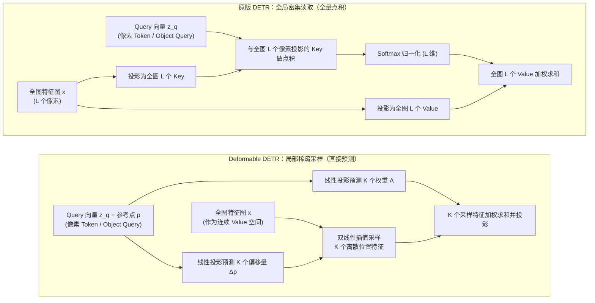
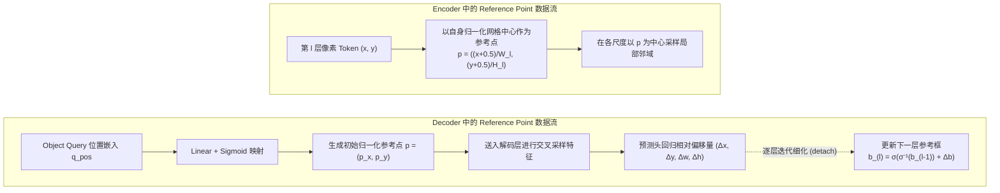

# Deformable DETR：稀疏采样与多尺度注意力

在前面两篇中，我们拆解了原版 DETR 的两大核心支柱：[原版 DETR：网络架构与前向流程](./detr-v1-architecture-forward-pass) 建立了基于 Object Queries 与 Transformer 编解码器的定长容器预测架构；[原版 DETR：二分图匹配与集合损失](./detr-v1-bipartite-matching-set-loss) 通过匈牙利算法与集合损失消除了传统检测器对 NMS 的依赖。

然而，原版 DETR 留下了两个让其实际应用受限的严重瓶颈：**高分辨率多尺度特征无法计算（$\mathcal{O}(L^2)$ 复杂度导致小目标检测极差）**，以及**训练收敛极其缓慢（COCO 上需 500 epochs）**。

面对收敛缓慢与特征读取的困境，学术界随后演化出了两条截然不同的破局路线：

- **特征读取算子的稀疏化重构（本篇）：** 认为全局密集点积过于沉重且缺乏局部几何偏置，主张将稠密注意力替换为围绕参考点的局部**稀疏采样算子**，在降低计算复杂度的同时直接打通多尺度特征；
- **目标查询的几何空间化（下一篇）：** 则坚持在标准密集注意力的框架内，认为瓶颈在于 Object Query 缺乏物理几何含义且内容/位置加性混叠，主张将隐向量**显式具象化为空间几何实体**。

很多解读将 Deformable DETR（Zhu 等人，2020）简单概括为“把可变形卷积的思想搬到了 Transformer 里以加快训练速度”。这种理解忽略了其在检测 Transformer 体系中的真正定位：**Deformable DETR 第一次系统重构了 query 读取图像 token 的方式**——将原先每个 query 对全图所有像素的密集全局点积，转变为围绕**参考点（Reference Point）** 在有限邻域内的多尺度稀疏采样。

本篇聚焦第一条路线，深入剖析可变形注意力模块（Deformable Attention Module）的数学构建、多尺度特征读取机制、参考点在 Encoder 与 Decoder 中的双重实现，以及它如何成为后续 DINO、RT-DETR 等主流模型的通用底层基础设施。

## 原版密集注意力的计算瓶颈

要理解特征读取机制为何必须重构，我们需要回顾原版 DETR 中全局注意力带来的计算与优化困境。

### 密集注意力的计算复杂度缺陷

在图像编码器中，序列长度为 $L$。计算所有 token 两两之间的注意力矩阵，时间与显存复杂度均为 $\mathcal{O}(L^2 \cdot d)$。

这种二次方复杂度在图像分类或 NLP 任务中尚可承受（例如 ViT-Base 处理 $224 \times 224$ 图像仅产生 196 个 patch token），但在目标检测中遇到了不可调和的矛盾：**目标检测天然依赖高分辨率特征图来捕捉微小目标**。以经典分辨率 $800 \times 1333$ 的图像为例：

- 下采样 32 倍的 C5 特征图尺寸约为 $25 \times 42$，token 数量 $L \approx 1050$；
- 下采样 16 倍的 C4 特征图尺寸约为 $50 \times 84$，$L \approx 4200$；
- 下采样 8 倍的 C3 特征图尺寸约为 $100 \times 168$，$L \approx 16800$。

在物理图像中，一个 $16 \times 16$ 像素的小目标映射到 C5 特征图上甚至不足半个像素，其空间细节与语义在骨干网络的逐级下采样中已基本丢失。若想有效检测小目标，接入 C3 和 C4 特征是必然要求。

然而，若将包含 C3、C4、C5 的多尺度特征图（总 token 数 $N_{\text{pix}} > 22000$）直接送入标准自注意力，单张图像单层的注意力矩阵大小为 $22000 \times 22000$。单就这一张 float32 注意力图，显存占用就接近 2 GB；算上 8 个注意力头与 6 层编码器堆叠，在反向传播时仅暂存用于计算梯度的注意力权重激活值（Activation Memory），显存需求就高达近百 GB，彻底超出了主流硬件的承受极限。正因如此，原版 DETR 被迫做出了**只使用 C5 单尺度特征**的妥协。

### 缺乏局部空间先验导致的慢收敛

许多解读将原版 DETR 训练慢（COCO 上需要 500 个 epoch）简单归咎于“初始化时注意力分散在全图”。但这只是表面现象：原版 DETR 建立在充分预训练的 ResNet 骨干之上，Backbone 输出的特征本就具备局部语义，接入 6 层 Transformer 后收敛依然极其迟缓。其深层根源在于**显式空间几何先验的丢失**以及随之引发的优化动力学困境：

1. **Encoder 端的局部归纳偏置缺失与梯度稀释：**
   传统 CNN 的卷积核天然锁定了局部的网格拓扑；而标准自注意力将 2D 图像拉平成一维无序序列，抛弃了像素间的空间几何邻近先验。在训练初期，线性投影层随机初始化，注意力均匀散落在上千个 token 上，单位置分配的权重仅约 $\mathcal{O}(1/L)$。真正包含目标语义的有效区域往往只有几十个像素，其余绝大多数为背景。在全图 Softmax 的反向传播中，海量背景 token 产生的杂散梯度严重稀释了前景信号，导致梯度的信噪比极低，优化长期在平坦的高维鞍点区域徘徊。编码器必须经历漫长的数据驱动迭代，才能把丢掉的空间几何邻近关系重新学出来。
2. **Decoder 端的全局盲搜与二分图匹配震荡：**
   更致命的瓶颈发生在解码器的交叉注意力中。由于初始的 Object Query 是没有物理坐标锚点的抽象向量，它们在整张图像的全部空间中进行无偏的全局搜索。在优化的前中期，同一 Query 在前后不同训练步所预测出的边界框存在剧烈的位置漂移。而 DETR 的监督信号严格依赖匈牙利算法的全局一对一二分图匹配：Query 输出的微小抖动，会导致它在当前步被匹配给目标 A，下一步被匹配给目标 B，随后又被指派为背景（即匹配震荡 / Label Bouncing）。匹配目标的反复跳变，导致反向传播给 Query 权重的梯度方向不断互相冲突、打架，使注意力权重难以稳定收拢。

原版 DETR 将检测任务置于全图无偏搜索的极致自由度之下，代价便是必须消耗漫长的迭代周期让网络自行摸索出物理世界局部连续性的规律。密集计算逼退了多尺度特征，全局盲搜又引发了优化震荡，这两者的交织，构成了原版 DETR 收敛缓慢且小目标性能欠佳的底层根源。

## 单尺度可变形注意力

针对上述矛盾，Deformable DETR 设计了一个通用的**可变形注意力算子（Deformable Attention）**，同时替换了编码器的多头自注意力与解码器的交叉注意力。它做出的核心改动是：**彻底抛弃把特征图像素投影为 Key 并进行全图成对点积的寻址方式，改为让 Query 向量围绕指定的参考点，直接预测若干个关键采样点的相对坐标偏移量与聚合权重。**

具体而言，原版 DETR 中由注意力矩阵（$Q K^T$）驱动的全局检索被彻底重构，特征图被直接视为一个可连续采样的特征画布。此时，算子在编码器与解码器中承载着不同的实体角色：

- **在编码器端（替代自注意力）：** 这里的 Query 是特征图上的**各个像素 Token**，参考点直接绑定为该像素自身的网格中心坐标。像素不再与全图其他所有像素（原先的 Key）逐一计算点积相似度，而是仅以自身为锚，向有限邻域发射采样探针提取多尺度特征。
- **在解码器端（替代交叉注意力）：** 这里的 Query 才是检测任务中的 **Object Query**，参考点是由 Query 位置嵌入预测出的目标几何中心坐标。Object Query 不再对全图所有图像像素（原先的 Key）进行全局无偏点积扫描，而是仅聚焦在自身参考点附近提取目标局部的关键特征。
*(注：解码器内部 300 个 Object Query 之间的自注意力依然保留标准点积，因为 Query 数量较小，且需要全局协商以消除重复预测。)*




### 单尺度可变形注意力的算子定义

在形式化定义可变形注意力之前，我们需要明确该算子的输入三元组 $(z_q, p, x)$ 在架构两端的具体代入：

- **Query 向量 $z_q \in \mathbb{R}^d$：** 在编码器中代入的是某个像素自身的内容特征；在解码器中代入的则是当前 Object Query 经自注意力交互后的内容特征。
- **二维连续参考点 $p = (p_x, p_y) \in [0, 1]^2$：** 在编码器中直接取该像素自身的归一化网格中心坐标；在解码器中则由 Object Query 的位置嵌入预测得到。
- **输入特征图 $x \in \mathbb{R}^{C \times H \times W}$：** 它在算子中直接扮演了连续的 **Value 来源**。网络不再为其生成 Key 矩阵，也不再进行 $Q K^T$ 点积，而是通过坐标采样直接读取特征。

值得注意的是，参考点并不是由注意力计算产生的，而是在注意力之外作为输入直接给定。也就是说，" 看哪里 " 这件事被拆成了两层：锚定在哪里，由参考点在算子之外确定；在锚附近具体伸向哪里，才由 query 内容去预测。参考点从哪里来、为什么这样安排，我们留到后文讨论编码器与解码器的数据流差异时专门拆解。

对于包含 $M$ 个注意力头的可变形注意力模块，每个 head 仅在参考点周围采样固定数量 $K$ 个点（通常默认 $K = 4$）。其数学表达式为：

$$
\text{DeformAttn}(z_q, p, x) = \sum_{m=1}^M W_m \left[ \sum_{k=1}^K A_{m, q, k} \cdot W'_m \, x\big(\phi(p) + \Delta p_{m, q, k}\big) \right]
$$

这个公式描述了一条从 "确定位置" 到 "提取特征"、再到 "多头聚合" 的完整数据流，各部分的计算机制与物理含义如下：

1. **确定采样坐标（$\phi(p) + \Delta p_{m, q, k}$）：**
   - $p \in [0, 1]^2$ 是 Query 绑定的归一化参考点坐标，映射函数 $\phi(p) = (p_x W, p_y H)$ 将其还原为特征图上的绝对像素位置，作为局部搜索的基准锚点。
   - $\Delta p_{m, q, k} \in \mathbb{R}^2$ 是 Query 特征 $z_q$ 经线性投影直接预测的二维偏移量。两者相加后，Query 就在参考点周围精准定出了第 $m$ 个 head 下第 $k$ 个采样的具体落点。
2. **连续特征采样（$x(\dots)$）：**
   - 由于预测出的偏移量是连续实数，采样坐标通常落在离散像素之间。网络通过双线性插值从特征图 $x$ 中采样出连续位置的特征向量。
   - 这一步扮演了注意力机制中提取 Value 的角色，双线性插值的可导性确保了梯度能反向传播，直接优化采样偏移量。
3. **单头稀疏聚合（$\sum_{k=1}^K A_{m, q, k} \cdot W'_m (\dots)$）：**
   - $W'_m \in \mathbb{R}^{d_v \times d}$（$d_v = d / M$）将采样特征投影到当前注意力头的通道子空间。
   - $A_{m, q, k} \in [0, 1]$ 是 Query 经由线性层和 Softmax 预测出的注意力权重（满足 $\sum_{k=1}^K A_{m, q, k} = 1$），它替代了传统的点积注意力图，由 Query 自主决定给这 $K$ 个采样点分配多少关注度，过滤背景并聚焦关键结构。
4. **多头通道融合（$\sum_{m=1}^M W_m [\dots]$）：**
   - 不同的 head $m$ 各自预测独立的偏移量与权重，分别捕捉目标的不同局部边缘与部件。
   - 输出投影矩阵 $W_m \in \mathbb{R}^{d \times d_v}$ 将所有 head 汇聚出的局部特征投影并叠加回 $d$ 维空间，完成最终的特征融合。

在这套全新的机制里，注意力的范式发生了一次根本性的翻转。在标准注意力中，" 看哪里 " 是由 Query 和所有 Key 点积算出来的，这是一个被动的全局匹配过程。但在可变形注意力中，网络干脆抛弃了 Key，也不再做任何点积。" 看哪里 "（采样坐标）和 " 看多少 "（聚合权重），完全由 Query 自己直接预测。具体而言，Query 会先以参考点 $p$ 为锚，通过一次线性投影直接回归出 $K$ 个二维偏移量，从而在特征图上撒下 $K$ 个具体的采样坐标；接着再经过第二次线性投影和 Softmax，算出这 $K$ 个点的聚合权重。由于预测出的坐标通常是浮点数，网络会顺手调用双线性插值，在连续空间中精准提取特征值，最后按权重混合输出。整个过程一气呵成：输入一个 Query，输出几个坐标和权重，然后直接去特征图上 " 抓取 " 数据，完全不需要在全图像素中进行相似度比对。

这种 "指哪打哪" 的机制背后，隐含了一个极其重要的物理假设：**视觉目标在空间上是局部连续的实体**。既然要检测的是一只猫或一辆车，它的特征必然聚集在某个局部区域，而不是散落在全图。因此，网络只需要在参考点附近的小范围内搜索就够了。通过训练，生成偏移量的线性层会逐步学会 " 什么样的 Query 应该关注参考点周围的哪些特定结构 "。作为这种局部性假设的回报，可变形注意力彻底切断了计算量与特征图全局分辨率 $L$ 的绑定。寻址范围从全局的 $L$ 个像素，收缩到了固定的 $K$ 个采样点。无论输入图像的分辨率怎么翻倍，特征图变得多大，每个 Query 读取特征的计算成本都被死死钉在了 $O(K)$ 上。

:::info[问题]

**抛弃了全局的 Key，连点积都不做了，这还能叫 " 注意力 " 吗？**

算。因为注意力的本质从来不是 "Q 和 K 做点积 " 这个具体操作，而是**由 Query 主导的、可微的信息检索**——给定一个查询，决定去哪里读、读多少，然后把读到的 Value 加权混合。标准注意力通过全局点积，来计算相关性，是因为其假设 Q 和 K 中任何两个元素都可能存在关联，是一种 " 无先验 " 的极致自由。而可变形注意力把 " 视觉目标具有空间局部连续性 " 这个物理常识，当作先验注入了网络：它预设了有意义的信息必然聚集在参考点附近。**它用物理先验为注意力戴上了 " 镣铐 "，但依然保留了动态寻址的灵魂。**

不过注入了物理先验，并不意味着它变成了死板的卷积。卷积的先验是刚性的（比如死死盯着 $3 \times 3$ 的固定网格），而可变形注意力的先验是弹性的。它虽然划定了 " 只在参考点附近找 " 的大方向，但具体伸出哪 $K$ 根 " 触手 "（采样坐标），每根触手分配多少注意力（聚合权重），依然是由 Query 根据上下文**动态预测**出来的。

:::

## 多尺度可变形注意力

单尺度采样解决了单个特征图的开销，但目标检测还需要跨越不同尺度。Deformable DETR 将这一机制自然推广到了多尺度特征图集合 $\{x^l\}_{l=1}^L$（$L$ 为尺度层数，与前文表示 token 总数的 $L$ 含义不同），包含下采样 8 倍、16 倍、32 倍和 64 倍的 4 层特征图。

值得注意的是这组特征图的来源：Deformable DETR 直接从 backbone 引出 C3、C4、C5 三层，用 $1 \times 1$ 卷积把通道统一到 256 维，再在 C5 上追加一个额外的 stride-2 卷积得到第 4 层（stride 64）。整个过程没有 FPN 式的自顶向下融合，也没有横向连接——各层在进入编码器之前完全独立，每个 token 额外附加一个可学习的层级嵌入（Level Embedding），用来标记 " 我属于哪一层 "，让聚合时能感知特征的尺度来源。

在空间几何方面，虽然采样的浮点坐标本身显式携带了局部的几何结构，但在实际实现中，**Query 向量依然保留了绝对位置编码（Sine-Cosine PE）**。Query 的内容特征与位置编码相加后，才送入线性投影层预测偏移量与权重。这是因为线性层需要结合绝对空间位置与局部语义，才能对目标边界的走向做出合理的偏移预测。

在多尺度可变形注意力中，每个 query 在每一层特征图上的每个注意力头均采样 $K$ 个点。输入的多尺度特征图集合 $\{x^l\}_{l=1}^L$ 充当连续的多尺度 Value 场。其核心公式为：

$$
\text{MSDeformAttn}(z_q, \hat{p}, \{x^l\}_{l=1}^L) = \sum_{m=1}^M W_m \left[ \sum_{l=1}^L \sum_{k=1}^K A_{m, l, q, k} \cdot W'_m \, x^l\big(\phi_l(\hat{p}) + \Delta p_{m, l, q, k}\big) \right]
$$

这里有两处关键的机制设计：

### 跨尺度注意力权重的归一化方式

注意力权重张量的大小为 $M \times L \times K$。Softmax 归一化是在所有层级 $L$ 和所有采样点 $K$ 的联合维度上进行的：

$$
\sum_{l=1}^L \sum_{k=1}^K A_{m, l, q, k} = 1, \quad \forall m \in \{1, \dots, M\}
$$

这意味着网络不仅在学习同一个尺度内应该关注哪个空间位置，还在**动态学习当前 query 应当主要从哪个尺度层级提取特征**。如果一个目标尺寸较小，分配在低层高分辨率特征图（如 C3）上的权重就会自然占主导。

这份联合归一化约束可以看成一份 " 注意力预算 "：每个 head 恰好持有 1.0 的总权重，必须在 $L \times K$ 个（层级，采样点）槽位之间分完。层级与层级之间是零和竞争——粗层多拿一分，细层就少一分，网络被迫做出取舍。反过来设想：如果 Softmax 在每层内部各自归一化，那么无论 query 追踪的是 $8 \times 8$ 像素的小目标还是铺满画面的背景，stride-64 的最粗层都会无条件拿到一份固定权重，强行混入聚合结果。联合归一化把 " 看哪一层 " 从写死在架构里的隐式行为，变成了可以被梯度直接优化的显式决策。

### 多尺度特征图的坐标对齐机制

输入的参考点坐标 $\hat{p} \in [0, 1]^2$ 是全图尺度的归一化坐标。映射到第 $l$ 层特征图时，乘以该层具体的高宽：

$$
\phi_l(\hat{p}) = (\hat{p}_x \cdot W_l, \; \hat{p}_y \cdot H_l)
$$

偏移量的语义需要留意公式中的层级下标。$\Delta p_{m, l, q, k}$​ 由同一个线性层一次性输出所有层级的偏移（输出维度 $M \times L \times K \times 2$），但每一层拿到的偏移量以该层自身的像素坐标为单位，直接加在 $\phi_l(\hat{p})$ 上。这意味着 " 偏移 3 个像素 " 在 stride-8 层上只对应原图 24 像素的物理距离，而在 stride-64 层上对应 192 像素——同一个数值，在不同层级天然覆盖不同大小的物理范围，恰好与各层负责的目标尺度相匹配。

### 复杂度对比

设多尺度特征图的总像素 token 数量为 $N_{\text{pix}} = \sum_{l=1}^L H_l W_l$，解码器 Object Query 数量为 $N_q$（通常 $N_q = 300 \ll N_{\text{pix}}$）。由于多尺度可变形注意力的通用复杂度为 $\mathcal{O}(N_{\text{query}} \cdot M \cdot L \cdot K \cdot d)$，在两端代入具体实体后，计算开销发生质的改变：

| 模块位置与计算范式 | 时间复杂度 | 激活值显存占用 | 是否可直接承载 C3~C5 多尺度 |
| :--- | :--- | :--- | :--- |
| **原版 DETR 编码器（标准自注意力）** | $\mathcal{O}(N_{\text{pix}}^2 \cdot d)$ | $\mathcal{O}(N_{\text{pix}}^2)$ | 否（22000+ 像素全量点积导致显存耗尽） |
| **Deformable 编码器（代入 $N_{\text{query}} = N_{\text{pix}}$）** | $\mathcal{O}(N_{\text{pix}} \cdot M \cdot L \cdot K \cdot d)$ | $\mathcal{O}(N_{\text{pix}} \cdot M \cdot L \cdot K)$ | **是（开销与特征图总分辨率严格呈线性关系）** |
| **原版 DETR 解码器（标准交叉注意力）** | $\mathcal{O}(N_q \cdot N_{\text{pix}} \cdot d)$ | $\mathcal{O}(N_q \cdot N_{\text{pix}})$ | 勉强支持，但随特征图分辨率线性激增 |
| **Deformable 解码器（代入 $N_{\text{query}} = N_q$）** | $\mathcal{O}(N_q \cdot M \cdot L \cdot K \cdot d)$ | $\mathcal{O}(N_q \cdot M \cdot L \cdot K)$ | **是（计算开销彻底与特征图总分辨率 $N_{\text{pix}}$ 解耦）** |

在实际配置中，超参数通常设为 $M = 8, L = 4, K = 4$，则每个 query 每次交互仅需采样 $8 \times 4 \times 4 = 128$ 个点。在编码器中，计算复杂度从特征图大小的二次方 $\mathcal{O}(N_{\text{pix}}^2)$ 骤降为线性相关的 $\mathcal{O}(N_{\text{pix}})$；而在解码器中，特征采样的计算开销更是直接与图像大小脱钩，仅取决于 Query 自身数量 $N_q$。

### 采样点数量设置与张量流转

为了在工程实现中精确追踪可变形注意力的计算通路，下表以**解码器交互**的标准参数（Batch Size = $B$, Query 数量 $N_q = 300$, 隐藏维度 $d = 256$, 头数 $M = 8$, 多尺度层数 $L = 4$, 每层每头采样点数 $K = 4$）梳理核心张量的维度流转（若在编码器中，张量流转逻辑完全一致，仅需将 $N_q$ 替换为特征图总 Token 数 $N_{\text{pix}} \approx 22000$）：

| 变量名称 | 物理语义 | 张量形状 (Tensor Shape) | 形状说明 |
| :--- | :--- | :--- | :--- |
| $z_q$ | 输入 Query 特征 | `[B, N_q, 256]` | 待执行特征采样的 Query 槽位 |
| $\hat{p}$ | 归一化参考点坐标 | `[B, N_q, 2]` | 中心点坐标 $(p_x, p_y) \in [0, 1]^2$ |
| $\Delta p$ | 预测的连续采样偏移量 | `[B, N_q, 8, 4, 4, 2]` | 经线性层直接输出：`[B, N_q, M, L, K, 2]` |
| $A$ | 预测的联合聚合权重 | `[B, N_q, 8, 16]` | 经线性层输出并在联合维度 $L \times K = 16$ 上做 Softmax |
| $x_{\text{sampled}}$ | 双线性插值采样出的特征 | `[B, N_q, 8, 16, 32]` | 每头通道 $d_v = 256 / 8 = 32$，从 4 层特征图提取 |
| $z_{\text{out}}$ | 多头加权求和并输出投影 | `[B, N_q, 256]` | 沿 16 个采样点加权求和，拼回 8 头再经 Linear 映射 |

每一个 Query 不论图像特征图有多大，都只通过轻量级的线性层预测 $8 \times 4 \times 4 \times 2 = 256$ 个偏移标量与 $8 \times 16 = 128$ 个权重标量，随后在 GPU 上调用高效的 CUDA 双线性采样算子直接拉取张量。这彻底打破了传统注意力需要物化 $N_q \times N_{\text{pix}}$ 巨大矩阵的显存壁垒。

## 参考点（Reference Point）机制

很多技术解读习惯将 Encoder 和 Decoder 中的可变形注意力一概而论为 " 在参考点附近采样 "，这会掩盖两者在数据流和几何语义上的本质差异。

在 Deformable DETR 中，**编码器中的参考点是静态网格坐标，而解码器中的参考点是动态几何状态**。



### 编码器中的参考点处理

在编码器中，每一个输入 token 既是 query，也是自身所在空间位置的承载者。

- **参考点的来源：** 对于第 $l$ 层特征图上坐标为 $(x, y)$ 的像素 token，其参考点就是其自身的物理归一化中心：

  $$p = \left(\frac{x + 0.5}{W_l}, \; \frac{y + 0.5}{H_l}\right)$$
- **作用机制：** 该像素作为 query，以自身坐标为基准，向所有尺度特征图的局部邻域发射采样探针，吸纳周围特征。
- **编码器层内无须交叉点积：** 编码器纯粹由多尺度可变形自注意力层堆叠而成，替代了原版 DETR 中沉重的密集自注意力，在多尺度特征之间完成了快速的空间与语义特征融合。

### 解码器中的初始参考点生成

在解码器中，Object Queries 是变长目标的预测容器，初始状态下并不对应图像中的具体物理像素。

- **参考点的来源：** 解码器的参考点是由 query 的位置嵌入（Query Position Embedding）经过一个线性变换和 Sigmoid 激活函数直接预测得到的：

  $$p = \sigma(\text{Linear}(Q_{\text{pos}})) \in [0, 1]^2$$
- **作用机制：** 初始阶段，各 Object Query 的参考点由随机初始化的位置嵌入回归得到，大体分布在图像中心附近（回归层的 bias 初始化为零，而 Sigmoid 在零点的输出 0.5 正对应图像中心）；在交叉注意力子层中，Query 根据自身的 $p$ 探查图像中该位置附近的局部特征；
- **自注意力子层仍然保持密集：** 解码器内部的 Self-Attention 依然采用标准注意力机制（因为 Query 数量 $N = 300$ 较小，复杂度仅为 $\mathcal{O}(N^2)$），用于槽位之间互相感知、协商分工以消除重复预测。

### 参考点来源的设计取舍

前两个小节说明了参考点在编码器和解码器中分别是怎么产生的，但没有回答一个更根本的问题：为什么偏偏这样安排？而这也不是仅有的两种来源——两阶段变体（Two-Stage，先让 encoder 特征自行生成候选框、再交给 decoder 精修的扩展版本，后文详述）提供了第三种。把三种来源放在一起比较，会发现它们其实都在回答同一个问题：query 的 " 看哪里 "，究竟由谁来决定。

先看编码器。参考点取自身坐标，不是设计者的偏好，而是由编码器的职责决定的：编码器要做的是把多尺度特征图 " 原位 " 精修一遍——进来多少 token，就出去多少 token，输出的每个位置都对应输入的同一个位置。在这样的约束下，参考点取在自身中心几乎是唯一自然的选择。可变形注意力由此成为一个以自身为锚、偏移量由内容预测的动态局部滤波算子，结构上与可变形卷积一脉相承。反过来设想，如果参考点改由内容预测，输入与输出的位置对应关系就会被破坏，编码器也就无法输出与输入同构的稠密特征图。论文也指出，当 $L = 1$、$K = 1$ 且 $W'_m$ 取单位矩阵时，多尺度可变形注意力就退化为可变形卷积。

解码器的情况则不同，决定权交给了可学习的嵌入。一个自然的疑问是：为什么不学 anchor-based 检测器，直接给 300 个 query 铺一张均匀的初始锚点网格？这是因为 DETR 的核心思想是集合预测。在这套设计里，query 是一组彼此对称、可交换的容器，" 哪个 query 负责图像的哪片区域 " 应当由训练和二分图匹配逐步确定，而不是预先写死在架构里。固定网格恰恰等于提前划定了每个 query 的管辖范围，等于退回了 anchor-based 范式。让 query 从自身的位置嵌入回归坐标，既保留了容器的对称性，也让 " 看哪里 " 和 " 预测什么 " 在同一个可学习的空间里被联合优化，Sigmoid 则保证坐标始终落在 $[0, 1]$ 内。

两阶段变体则更进一步，把决定权交给图像内容本身：encoder 输出的每个像素 token 直接预测一个边界框并给出得分，取得分最高的若干候选框被用作解码器的初始参考点。三种来源放到一起，差别就很清楚：编码器依赖架构给定的空间位置，解码器依赖训练学到的、与具体图像无关的先验，两阶段依赖当前图像的特征。决定 " 看哪里 " 的信息，从位置到先验再到内容，一步步变得更具体。

### 跨层候选框的迭代精修机制

既然解码器中的每个 Query 都关联了一个明确的参考点，那么这个参考点能否随着解码层数的加深而逐步校准？Deformable DETR 由此提出了**候选框迭代细化（Iterative Bounding Box Refinement）** 机制。

在原版 DETR 中，每一层解码器的预测头都是从绝对坐标开始做独立预测。而在 Deformable DETR 中，预测头输出的是**相对于当前层参考框的相对偏移量**。

设第 $l$ 层解码器输入的参考框为 $\hat{b}^{(l-1)} = (\hat{x}, \hat{y}, \hat{w}, \hat{h})$（对于第一层，中心点 $(\hat{x}, \hat{y})$ 即为初始参考点 $p$，宽高初始化为先验默认值）。第 $l$ 层的预测分支输出相对修正量 $(\Delta x, \Delta y, \Delta w, \Delta h) = \text{MLP}(h^{(l)})$，下一层解码器使用的参考框更新为：
$$

\begin{aligned}
\hat{x}^{(l)} = \sigma\left(\sigma^{-1}(\hat{x}^{(l-1)}) + \Delta x\right) \\
\hat{y}^{(l)} = \sigma\left(\sigma^{-1}(\hat{y}^{(l-1)}) + \Delta y\right) \\
\hat{w}^{(l)} = \sigma\left(\sigma^{-1}(\hat{w}^{(l-1)}) + \Delta w\right) \\
\hat{h}^{(l)} = \sigma\left(\sigma^{-1}(\hat{h}^{(l-1)}) + \Delta h\right)
\end{aligned}

$$

其中 $\sigma^{-1}(\cdot)$ 为 Logit 函数（反 Sigmoid）。

通过反 Sigmoid 与 Sigmoid 变换，网络保证了边界框坐标在任意层更新后始终严格约束在 $[0, 1]$ 物理区间内。这里需要厘清其在数据流中的本质：**这里的边界框不是网络参数，而是前向计算中由当前隐藏特征 $h^{(l)}$ 投影生成的中间激活值（Activation）。它既作为当前层针对该目标的阶段性检测输出，又被复用为下一层可变形注意力的空间采样锚点。**

官方实现里还有一个容易被忽略的细节：每层计算出的参考框，是先经过 `detach()`（切断梯度）才交给下一层作为采样锚点与累加底座的。由于边界框本身只是中间张量，反向传播优化的终点始终是网络参数（Decoder 注意力权重与回归头 MLP 权重）；`detach()` 的真正影响在于**切断了后一层检测损失向前一层网络参数回传的求导链条**。在这一设定下，每一层预测头的权重参数只受本层检测损失驱动，只负责当前单步残差的拟合，后面的层无法把监督信号跨层回传给前面的回归头。这种逐层隔离的做法，在后续基于参考几何逐层细化的设计中被普遍沿用，直到 DINO 提出 Look Forward Twice 才重新打通了这套跨层参数监督通路，本系列第六篇展开。

### 与特征金字塔（FPN）的机制对比

在经典卷积检测器（如 Faster R-CNN、RetinaNet）中，多尺度特征处理是通过**特征金字塔网络（FPN）** 完成的。很多人直觉上会把 Deformable DETR 的多尺度处理等同于某种 Transformer 版的 FPN。而如前文所述，它的多尺度特征在进入编码器之前没有经过任何金字塔式的融合——C3 到 C6 只是并列送入，所有跨层交互全部发生在可变形注意力算子内部，所以这种理解混淆了两种范式的数据交互方式。

FPN 与 Deformable DETR 的本质区别在于特征聚合的控制流：

| 维度       | 传统 FPN / PANet                                         | Deformable DETR 多尺度机制                      |
| :------- | :----------------------------------------------------- | :----------------------------------------- |
| **拓扑结构** | 固定的网格式自顶向下（Top-Down）或自底向上（Bottom-Up）金字塔连接              | 无固定拓扑的**全连通注意力汇聚**                         |
| **特征对齐** | 刚性的 $2 \times$ 双线性上采样 + $1 \times 1$ 卷积逐通道相加           | 连续浮点偏移量的双线性插值采样                            |
| **层间交互** | 只能按相邻分辨率逐级传递信息（如 P5 $\rightarrow$ P4 $\rightarrow$ P3） | 任意 token 或 query 可以**单步同时跨越 C3 到 C6** 提取特征 |
| **权重选择** | 固定的求和或拼接操作，所有通道与空间位置共享相同的融合逻辑                          | **由 Softmax 归一化注意力权重自适应分配**跨尺度与跨空间的关注比重    |

换言之，FPN 是一种**固定的宏观特征路由架构**，而多尺度可变形注意力是一种**由数据驱动的微观特征读取算子**。它不仅融合了多尺度信息，而且在每一次特征读取时，都由 query 自身决定 " 看哪一层 " 和 " 看哪个点 "。

## 计算复杂度与收敛表现评估

Deformable DETR 在 COCO 数据集上仅用 50 个 Epoch 即可达到并超越原版 DETR 500 个 Epoch 的性能，收敛速度提升了整整 10 倍。

这一突破并非单纯依赖算力节省，而是**计算复杂度的降低**与**优化搜索空间的收缩**共同作用的结果：

1. **计算通路的高效化带来高分辨率红利：**
   $\mathcal{O}(N_{\text{pix}})$ 的线性复杂度使得模型可以轻松接入包含 C3（Stride 8）的高分辨率特征。在原版 DETR 中，小目标特征在 C5 单尺度下采样中几乎丢失殆尽；多尺度特征的引入直接弥补了这一短板，使小目标指标 $\text{AP}_{\text{s}}$ 获得了质的跃升。
2. **局部先验大大缩小了初始寻址空间：**
   原版 DETR 必须通过梯度回传，在全图 $L \times L$ 的点积空间中从零摸索出目标的局部边界。Deformable DETR 通过引入 " 参考点 + 局部偏移量 " 的显式先验，强迫注意力的初始搜索范围限制在参考点的邻近区域。这相当于为网络预设了 " 物体在空间上是连续局部实体 " 的强归纳偏置（Inductive Bias），避免了前期在全图无关背景区域做无意义的梯度震荡。
3. **两阶段机制（Two-Stage Deformable DETR）的进一步延伸：**
   在扩展版本中，Deformable DETR 还可以利用 Encoder 输出的高质量特征图直接生成初步的 Region Proposals（候选框），并将这些候选框的坐标直接作为 Decoder Query 的初始参考点与位置嵌入。这进一步将随机初始化的 Object Queries 替换为了具有真实前景概率的候选目标，极大缓解了初始匹配的不确定性。

## 机制总结：可变形注意力与参考点体系

回顾整个 DETR 演进史，Deformable DETR 的深远意义不仅在于其自身的性能提升，更在于它奠定了后续高性能目标检测 Transformer 的通用底层基础设施：

- **多尺度稀疏采样算子：** 成为 DINO、RT-DETR、D-FINE 等后续主流检测模型在特征聚合时的标准底层实现；
- **显式几何参考机制：** 将无偏漫游的隐式容器拉回到具备明确物理意义的参考点与参考框上，为后续结合几何先验与去噪训练提供了基础协议；
- **层间相对偏移更新：** 引入的反 Sigmoid 域相对坐标回归与逐层梯度截断机制，成为了后续多层渐进式框细化的通用工程范式。

Deformable DETR 成功将目标检测 Transformer 从 " 黑盒式的全图全局关联 " 拉回到了 " 兼具局部几何先验与多尺度高效建模 " 的成熟轨道上。

## 小结

本篇剖析了 Deformable DETR 如何通过重构特征读取机制解决原版 DETR 的固有矛盾：

1. **矛盾根源：** 原版 DETR 的全局自注意力具有 $\mathcal{O}(L^2)$ 复杂度，迫使其只能使用单尺度 C5 特征；同时无偏全局寻址导致训练初期收敛缓慢；
2. **稀疏可变形注意力：** 放弃全图 Key 点积，改由 Query 自身直接预测参考点周围有限 $K$ 个采样点的连续偏移量与归一化聚合权重；
3. **多尺度跨层读取：** 在单步操作中联合完成跨层与跨空间的加权采样，突破传统 FPN 的固定拓扑限制；
4. **Encoder 与 Decoder 的参考点分治：** Encoder 像素以网格自身坐标为参考点完成多尺度自适应传播，Decoder Query 通过可学习嵌入生成参考点并借助逐层候选框细化实现迭代定位，加上两阶段变体的图像内容提议，参考点的来源由空间位置、可学习先验到图像内容逐级递进；
5. **基础设施演进：** 稀疏采样与参考点机制不仅带来 10 倍的训练加速与显著的小目标提升，更为后续实时化与高精度检测器确立了高效的特征读取底座。

Deformable DETR 通过改写“特征读取算子”克服了计算瓶颈并提升了局部聚焦效率。但在原版 DETR 收敛缓慢的另一端——**Object Query 内部的内容与位置混叠、以及查询本身缺乏显式物理语义**的问题，则是由另一批研究者在标准密集注意力的框架下独立推进解决的。

在下一篇《[Conditional 与 DAB-DETR：查询空间化](./conditional-dab-detr)》中，我们将转向这条平行的探索线索，看研究者们如何沿着“条件空间解耦”到“4D 动态锚框”的递进脉络，彻底重构 Object Query 的几何表征。

## 附录：官方实现的代码拆解

正文讲清机制之后，本附录落到官方仓库 fundamentalvision/Deformable-DETR 的代码上，只挑影响理解与复现的重点：算子 `MSDeformAttn` 的构造与前向张量流、双线性采样的两种实现、参考点的生成位置，以及迭代细化与两阶段提议在 Transformer 主体里的代码形态。

代码分两层：`models/ops/` 是纯算子层（Python 模块加手写 CUDA kernel），不含任何检测逻辑，后续工作直接复用的就是这一层；`models/deformable_transformer.py` 与 `models/deformable_detr.py` 是模型层，负责参考点生成、逐层细化与损失组织。backbone 的 C3–C5 在 `deformable_detr.py` 里经 `input_proj` 的 $1 \times 1$ 卷积加 GroupNorm(32) 统一到 256 维，第 4 层则由一个 stride-2 的 $3 \times 3$ 卷积从最深层特征再下采样得到，padding mask 同步用 `F.interpolate` 缩放到对应尺寸——与正文的描述一致。

### 算子模块 MSDeformAttn：两条线性层与扇形初始化

`MSDeformAttn` 的全部参数就是四个 `nn.Linear`：

```python
self.sampling_offsets = nn.Linear(d_model, n_heads * n_levels * n_points * 2)  # 256 -> 8*4*4*2 = 256
self.attention_weights = nn.Linear(d_model, n_heads * n_levels * n_points)     # 256 -> 8*4*4 = 128
self.value_proj = nn.Linear(d_model, d_model)
self.output_proj = nn.Linear(d_model, d_model)
```

对照标准注意力的 Q/K/V 三套投影，这里 query 侧没有任何投影：$z_q$ 原样进入上面两条线性层，直接产出 $\Delta p$ 与 $A$；value 侧才有 `value_proj`，末尾再接 `output_proj`。

初始化是这个仓库被复现和引用最多的代码段：

```python
def _reset_parameters(self):
    constant_(self.sampling_offsets.weight.data, 0.)   # 偏移量的权重置零，输出只剩 bias
    thetas = torch.arange(self.n_heads) * (2.0 * math.pi / self.n_heads)
    grid_init = torch.stack([thetas.cos(), thetas.sin()], -1)      # 8 个头指向圆周均匀的 8 个方向
    grid_init = (grid_init / grid_init.abs().max(-1, keepdim=True)[0]) \
                    .view(n_heads, 1, 1, 2).repeat(1, n_levels, n_points, 1)   # 归一化后恰为 (±1,0),(0,±1),(±1,±1)
    for i in range(self.n_points):
        grid_init[:, :, i, :] *= i + 1                  # 第 i 个采样点的初始距离 ×(i+1)
    with torch.no_grad():
        self.sampling_offsets.bias = nn.Parameter(grid_init.view(-1))
    constant_(self.attention_weights.weight.data, 0.)   # 注意力权重全零
    constant_(self.attention_weights.bias.data, 0.)
```

偏移量权重置零后，线性层输出就是 bias 本身；注意力权重全零，Softmax 给出均匀的 $1/(L \cdot K)$。于是初始化状态下的算子是一个对称的局部平滑器：每个头沿一个固定方向、按 $1,2,3,4$ 逐点变远的间距采样，8 个方向合起来近似参考点周围的均匀平均。这正是正文提到的退化关系在工程上的用法——训练起点就落在“可变形卷积式局部聚合”附近，梯度只需要学习在这个基础上的偏移修正，而不是从随机采样的噪声里收敛。由于运行时偏移还要除以各层的 $(W_l, H_l)$，同一份 bias 在越粗的层覆盖越大的物理范围，初始采样天然形成由细到粗的间距梯度。另外模块构造时有一条 warning：要求每头维度 $d/M = 32$ 取 2 的幂，这与后文 CUDA backward 的归约 kernel 特化有关。

### 前向张量流：全程保持归一化坐标

forward 的主干如下（省略 docstring）：

```python
value = self.value_proj(input_flatten)                    # [B, ΣH_l·W_l, 256]
value = value.view(N, Len_in, self.n_heads, self.d_model // self.n_heads)   # [B, ΣH_l·W_l, 8, 32]
if input_padding_mask is not None:
    value = value.masked_fill(input_padding_mask[..., None], float(0))
sampling_offsets = self.sampling_offsets(query).view(N, Len_q, 8, 4, 4, 2)
attention_weights = self.attention_weights(query).view(N, Len_q, 8, 4 * 4)
attention_weights = F.softmax(attention_weights, -1).view(N, Len_q, 8, 4, 4)
offset_normalizer = torch.stack([input_spatial_shapes[..., 1], input_spatial_shapes[..., 0]], -1)  # (W_l, H_l)
sampling_locations = reference_points[:, :, None, :, None, :] \
                     + sampling_offsets / offset_normalizer[None, None, None, :, None, :]
output = MSDeformAttnFunction.apply(value, input_spatial_shapes, input_level_start_index,
                                    sampling_locations, attention_weights, self.im2col_step)
output = self.output_proj(output)
```

有三个点值得停留。

第一，正文的“联合归一化”在代码里就是一句 `F.softmax(attention_weights, -1)`：线性层输出在拆成 $[B, N_q, M, L, K]$ 之前是 $[B, N_q, M, L \times K]$，Softmax 恰好作用在展平的 $L \times K$ 维上。层级之间零和竞争这件事，代码形态上只是“先展平、再归一化、后拆维”。

第二，坐标运算的等价变形。公式写的是“参考点乘回该层像素坐标，再加像素单位的偏移”（$\phi_l(\hat p) + \Delta p$）；代码反过来，让参考点停留在 $[0,1]$ 域，把偏移除以该层的 $(W_l, H_l)$ 折算成归一化单位，两者通分后完全等价，偏移的有效单位仍是各层自身的像素。这样写的原因是 CUDA kernel 接收的就是归一化坐标，换算被放进了 kernel 内部，Python 侧免去了一遍大张量的逐层乘法。

第三，`offset_normalizer` 里 `stack([..., 1], [..., 0])` 的分量交换不是笔误：`input_spatial_shapes` 存储的是 $(H_l, W_l)$，而坐标分量的顺序是 $(x, y)$。复现时若直接拿 $(H_l, W_l)$ 去除，全部采样点会整体转置——这是这段代码最经典的踩坑点。

padding 的处理也在上面几行里：被 mask 标记的位置在 `value` 中置零，采样落到那里时插值结果自然为零，无需额外分支。进入算子的 `reference_points` 形状是 $[B, N_q, L, 2]$，即每个 query 在每个尺度层各有一份坐标（由 Transformer 主体生成，见下文），在 `[:, :, None, :, None, :]` 处广播成 $[B, N_q, 1, L, 1, 2]$，与偏移张量对齐。

### 双线性采样：PyTorch 参考版与 CUDA kernel

`MSDeformAttnFunction` 是自定义 autograd Function：forward 调 CUDA 扩展，backward 一次返回 value、偏移、权重三份梯度，并用 `@once_differentiable` 声明不支持高阶导。仓库另附一份纯 PyTorch 参考实现 `ms_deform_attn_core_pytorch`（注释写明仅供 debug 与测试），它把双线性采样还原成 PyTorch 原语：

```python
sampling_grids = 2 * sampling_locations - 1          # [0,1] 映射到 grid_sample 的 [-1,1] 约定
for lid_, (H_, W_) in enumerate(value_spatial_shapes):
    value_l_ = value_list[lid_].flatten(2).transpose(1, 2).reshape(N_*M_, D_, H_, W_)
    sampling_grid_l_ = sampling_grids[:, :, :, lid_].transpose(1, 2).flatten(0, 1)
    sampling_value_l_ = F.grid_sample(value_l_, sampling_grid_l_,
                                      mode='bilinear', padding_mode='zeros', align_corners=False)
    sampling_value_list.append(sampling_value_l_)
output = (torch.stack(sampling_value_list, dim=-2).flatten(-2) * attention_weights).sum(-1)  # (略去 reshape)
```

`2 * loc - 1` 加 `align_corners=False` 的组合值得记住：grid_sample 在该约定下归一化坐标 $\pm 1$ 指首末像素的边界，像素中心落在半整数位置，官方的 $[0,1]$ 坐标恰好线性映射过去。实现按层 split 后逐层 grid_sample，最后在 $L \times K$ 维上与权重相乘求和。这份版本逻辑直观，但每层都要物化中间张量，仓库只用它作为 CUDA 版的正确性基准。

CUDA 版把整条采样流水线融进一个 kernel。`ms_deformable_im2col_gpu_kernel` 启动 $B \times N_q \times M \times d/M$ 个线程，线程 index 从低位到高位解包出 `(b, q, m, c)`，每个线程负责输出张量里的一个标量。核心循环很短：

```cpp
const scalar_t h_im = loc_h * spatial_h - 0.5;      // 归一化坐标 -> 像素中心坐标（同一把 align_corners=False 标尺）
const scalar_t w_im = loc_w * spatial_w - 0.5;
if (h_im > -1 && w_im > -1 && h_im < spatial_h && w_im < spatial_w) {
  col += ms_deform_attn_im2col_bilinear(data_value_ptr, spatial_h, spatial_w,
                                        num_heads, channels, h_im, w_im, m_col, c_col) * weight;
}
```

`ms_deform_attn_im2col_bilinear` 就是标准双线性：由落点取整得到左上整点，四个邻域值按 $(1{-}lh)(1{-}lw)$ 这类面积权重混合，越界邻域取零；落点整体在图外时整个点跳过。每个线程把 $L \times K$ 次采样各自乘上注意力权重后累加成一个标量写回。采样、加权、求和三步完全融合，显存里自始至终不存在 $N_q \times N_{\text{pix}}$ 的中间矩阵——复杂度对比表里“线性”“与 $N_{\text{pix}}$ 解耦”两行，落到代码上就是这个 kernel 的线程分工。

backward（col2im）在同一套坐标上反向走一遍：对 `grad_value`，把 $A_{m,q,k} \cdot \nabla$ 按同样的四个面积权重用 `atomicAdd` 散射回四个邻域像素，因为不同 query 的采样落点会重叠，必须原子加；对偏移量，双线性权重对 $(h, w)$ 的偏导在同一个函数里顺手算出，再乘上链式法则里的 $W_l$、$H_l$（来自 `loc * W - 0.5` 的求导）；注意力权重的梯度等于上游梯度乘该点采样值。这些逐线程的局部偏导先在每个 block 的共享内存里归约再写回，backward 因此按每头通道数 $1 \sim 512$ 模板特化出多个归约 kernel 变体，前文“2 的幂”的 warning 对应的就是这条特化路径。`im2col_step = 64` 只是把 batch 分块启动 kernel 的工程参数，不参与数学。

### 参考点的生成代码

编码器的参考点在 `DeformableTransformerEncoder.get_reference_points` 里生成，循环外算一次，6 层共享同一个张量：

```python
ref_y, ref_x = torch.meshgrid(torch.linspace(0.5, H_ - 0.5, H_),
                              torch.linspace(0.5, W_ - 0.5, W_))
ref_y = ref_y.reshape(-1)[None] / (valid_ratios[:, None, lvl, 1] * H_)
ref_x = ref_x.reshape(-1)[None] / (valid_ratios[:, None, lvl, 0] * W_)
...
reference_points = reference_points[:, :, None] * valid_ratios[:, None]   # [B, N_pix, L, 2]
```

`linspace(0.5, H - 0.5)` 就是正文 $(x + 0.5)/H$ 的代码形态：端点取半格，落点恰是每个像素的中心。除以 `valid_ratios` 再乘回来的两步容易看漏，它解决的是 batch 内图像尺寸不一的问题：padding 之后各层特征图尺寸相同，但真实内容只占画布的一块，`valid_ratios` 记录真实高宽占画布的比例。坐标先以有效区域为分母归一化，再乘回比例，落点始终被压回真实图像范围内，采样不会落进 padding 区域。解码器每层入口处的 `reference_points_input = reference_points[:, :, None] * src_valid_ratios[:, None]` 做的是同一件事。

解码器的初始参考点只有一行：

```python
self.reference_points = nn.Linear(d_model, 2)          # __init__
reference_points = self.reference_points(query_embed).sigmoid()   # forward
```

权重 xavier 初始化、bias 置零，所以 300 个参考点初始都落在 $\sigma(0) = 0.5$，与正文“大体分布在图像中心附近”的说法一致。

位置编码的相加位置也在代码里有了着落。层级嵌入在特征展平阶段就加进了位置流：`lvl_pos_embed = pos_embed + self.level_embed[lvl].view(1, 1, -1)`，其中 `level_embed` 是 $[4, 256]$ 的可学习参数。而注意力层的 query 一律经 `with_pos_embed` 包装：

```python
# encoder：query = 内容 + 位置（含层级嵌入），value = 纯内容
src2 = self.self_attn(self.with_pos_embed(src, pos), reference_points, src, ...)
# decoder 自注意力：标准 nn.MultiheadAttention，且 V 侧不带位置
q = k = self.with_pos_embed(tgt, query_pos)
tgt2 = self.self_attn(q.transpose(0, 1), k.transpose(0, 1), tgt.transpose(0, 1))
# decoder 交叉注意力：query = 内容 + 位置
tgt2 = self.cross_attn(self.with_pos_embed(tgt, query_pos), reference_points, src, ...)
```

正文说“Query 的内容特征与位置编码相加后才送入线性投影层预测偏移量”，对应的就是这几处：位置信息只进 query 侧，value 侧永远是纯内容特征。解码器内部的 300 路自注意力用的是 PyTorch 原生 `nn.MultiheadAttention`，正文“自注意力子层保持标准点积”在代码里只是一个类选择。

### 迭代细化与逐层监督的代码形态

解码器循环里的细化只有几行：

```python
if self.bbox_embed is not None:                       # 仅 with_box_refine / two_stage 时非空
    tmp = self.bbox_embed[lid](output)                # 每层独立的 MLP 头
    if reference_points.shape[-1] == 4:
        new_reference_points = tmp + inverse_sigmoid(reference_points)
        new_reference_points = new_reference_points.sigmoid()
    else:                                             # 第一层：参考还是 2 维中心，只有中心参与细化
        new_reference_points = tmp
        new_reference_points[..., :2] = tmp[..., :2] + inverse_sigmoid(reference_points)
        new_reference_points = new_reference_points.sigmoid()
    reference_points = new_reference_points.detach()  # 切断跨层梯度
```

`inverse_sigmoid` 是带数值保护的小工具：clamp 到 $[\varepsilon, 1-\varepsilon]$ 后取 $\log(x / (1-x))$，正文的 $\sigma^{-1}$ 就是它。第一层的参考是 2 维中心，细化后升为 4 维框，从第二层起全程在 logit 域做残差累加。宽高的初始先验写在 `deformable_detr.py` 的构造函数里：`nn.init.constant_(self.bbox_embed[0].layers[-1].bias.data[2:], -2.0)`，即 $\sigma(-2) \approx 0.12$，初始框默认是一张全图约 $12\%$ 见方的框；two-stage 变体下这个 bias 被重置为零，因为 proposal 已经自带尺寸。

输出端的监督与正文“每层只对本层损失负责”严格对应。`DeformableDETR.forward` 把每层的隐藏状态分别送进对应的头：

```python
for lvl in range(hs.shape[0]):
    reference = init_reference if lvl == 0 else inter_references[lvl - 1]
    tmp = self.bbox_embed[lvl](hs[lvl])
    tmp += inverse_sigmoid(reference)          # reference 已 detach，梯度只流向本层的头
    outputs_coord = tmp.sigmoid()
```

每层输出的框与解码循环内部的细化是同一份计算，只是这里不 detach——本层损失要回传到本层的头与注意力参数。`SetCriterion` 对 `aux_outputs`（除最后一层外的每层输出）逐一重新做匈牙利匹配再算损失，配合上面的 `detach()`，每层头的梯度只来自本层的匹配结果。另外只有 `with_box_refine=True` 时 `bbox_embed` 才被 `deepcopy` 成每层独立的 ModuleList，否则 ModuleList 里放的是同一个实例，各层共享一套回归头。

### 两阶段变体的提议生成

`gen_encoder_output_proposals` 为 encoder 输出的每个像素 token 造一个初始框：网格中心取 `linspace(0, H-1)` 加半格再除以有效高宽；宽高是固定的尺度锚 `0.05 × 2^lvl`——越粗的层锚框越大，与各层的语义粒度对应。坐标落在 $(0.01, 0.99)$ 之外的贴边框被有效性过滤剔除，padding 位置另用 `inf` 填充，随后对剩余框取 logit，供后续在 logit 域上直接加偏移。挑选与初始化的代码是：

```python
enc_outputs_class = self.decoder.class_embed[self.decoder.num_layers](output_memory)   # 为 proposal 额外附加的头
enc_outputs_coord_unact = self.decoder.bbox_embed[self.decoder.num_layers](output_memory) + output_proposals
topk_proposals = torch.topk(enc_outputs_class[..., 0], topk, dim=1)[1]      # 取第 0 类 logit 当 objectness（官方注释：hack）
topk_coords_unact = torch.gather(enc_outputs_coord_unact, 1, topk_proposals.unsqueeze(-1).repeat(1, 1, 4)).detach()
reference_points = topk_coords_unact.sigmoid()
pos_trans_out = self.pos_trans_norm(self.pos_trans(self.get_proposal_pos_embed(topk_coords_unact)))
query_embed, tgt = torch.split(pos_trans_out, c, dim=2)     # 同一份输出拆成 query_pos 与内容向量
```

正文所说参考点的第三种来源——“由图像内容提议”——就是这几行：得分最高的 300 个 proposal 经 sigmoid 成为初始参考点；同时框的 4 个分量先过 sine 位置编码（`get_proposal_pos_embed`，每个分量生成 128 维），再经一个 $\text{Linear}(2d, 2d)$ 变换，拆成解码器的 `query_pos` 与内容向量 `tgt`。初始 query 的位置嵌入不再来自可学习参数，而是由当前图像的候选框生成。

这套代码的各个部件——算子的初始化、归一化坐标约定、参考点生成、`detach()` 细化——在 DINO、RT-DETR 等后续实现里大多被原样继承，这也从工程侧印证了正文“通用底层基础设施”的判断。
