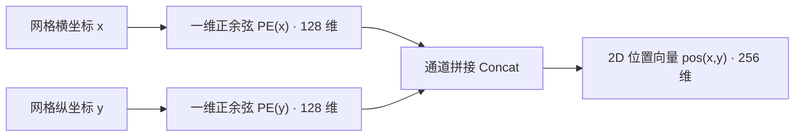

# 原版 DETR：网络架构与前向流程

在传统目标检测框架中，从输入图像到生成最终边界框的流程充满了人工设定的几何先验：在特征图上铺设成千上万个锚框（Anchors）或采样点、根据 IoU 阈值做启发式正负样本分配、通过 RoI Align 截取局部特征，最后依赖非极大值抑制（NMS）在外部消除冗余框。

DETR（Carion 等人，2020）彻底重构了这一范式。它将目标检测形式化为**直接集合预测（Direct Set Prediction）** 问题：输入一张图像，直接通过神经网络前向计算，一步输出一个包含 $N$ 个预测目标的集合。

本篇聚焦 DETR 的**前向架构与预测机制**。我们将从数据结构与几何对称性的第一性原理出发，拆解图像张量如何一步步转化为目标预测集合，并探究位置编码、编解码器双重注意力以及 Object Query 的底层机理与计算代价。

## 整体前向数据流

目标检测任务在数据结构上面临一个内在矛盾：

- **物理世界的真值是变长的无序集合：** 一张图像中可能存在 0 个、3 个或数十个目标，且目标之间没有天然的先后顺序；
- **标准神经网络计算图要求定长张量：** 深度学习框架的静态计算图与矩阵并行运算，要求网络每一层的输出张量具有确定的维度形状。

为了在定长计算图中承载变长集合，DETR 在解码器中预设了 $N$ 个并行槽位（Slot），无论输入图像包含多少真实目标，模型始终固定输出 $N$ 个预测结果（COCO 数据集上默认 $N = 100$）。当图像中目标不足 $N$ 个时，空余槽位将预测为特殊的背景类别 $\varnothing$（No Object）。

:::info[问题]

**为什么非要用预设的固定槽位，而不能像自然语言生成那样逐个吐出目标？**

语言生成具有天然的时序单向依赖（前一个词决定后一个词），所以适合用自回归（Autoregressive）循环生成；而图像中的物理实体在二维空间上是**并列共存**的。一只飞鸟和一棵树之间没有谁先谁后的因果语法。如果硬套自回归，不仅推理必须一步步串行执行、速度极慢，还会强行给原本并列的目标强加一个人工规定的先后顺序（比如从左到右），破坏了对称性。预设 $N$ 个并行槽位，就是为了让所有可能的目标在一次前向传播中**同时且独立**地被提取出来。

:::

整个前向推理的数据流向如下：

1. **骨干特征提取：** 原始图像 $x \in \mathbb{R}^{3 \times H_0 \times W_0}$ 经过标准 ResNet 提取第 5 阶段（C5）特征，空间分辨率下采样 32 倍至 $H = \lfloor H_0 / 32 \rfloor, W = \lfloor W_0 / 32 \rfloor$，通道数为 2048；
2. **通道降维：** 采用 $1 \times 1$ 卷积将通道数由 2048 压缩到 Transformer 的隐藏维度 $d = 256$，得到紧凑的二维特征图 $z_0 \in \mathbb{R}^{d \times H \times W}$；
3. **特征展平与编码：** 将二维特征图的空间维度转置后展平为序列 $Z \in \mathbb{R}^{L \times d}$，其中 $L = H \times W$。二维正余弦位置编码不与特征拼接，而是在 6 层标准 Transformer 编码器的每层自注意力内部，注入到 $Q$ 与 $K$ 的投影之前。编码器的输出是富含全局上下文与实例解耦信息的特征记忆体 $\text{Memory} \in \mathbb{R}^{L \times d}$；
4. **解码器并行探测：** $N$ 个可学习的 Object Queries 作为位置探针，配合初始化为 0 的内容嵌入，输入 6 层 Transformer 解码器。在每一层中，Queries 之间先通过自注意力协商分工，再通过交叉注意力从 $\text{Memory}$ 中提取具体物体的视觉表征；
5. **共享预测头输出：** 解码器输出的 $N$ 个特征向量分别独立通过参数共享的分类头（Linear）与回归头（3-layer MLP），直接映射出 $N$ 个预测项：包含类别概率分布 $\hat{p}_i \in \mathbb{R}^{K+1}$ 与归一化边界框坐标 $\hat{b}_i \in [0, 1]^4$。

## CNN 骨干网络：单尺度特征提取

在常规多尺度检测器（如带 FPN 的 Faster R-CNN 或 YOLO）中，网络会同时利用下采样 8 倍（C3）、16 倍（C4）和 32 倍（C5）的多层特征来覆盖不同尺度的物体。但原版 DETR **仅使用了单尺度 C5 特征图**。

这一选择不是为了追求极简，而是受限于标准自注意力算子的计算复杂度。

标准自注意力机制需要计算全序列所有 Token 两两之间的点积权重，其时间与显存复杂度与输入序列长度 $L$ 的平方成正比：

$$\mathcal{O}_{\text{Attention}} = \mathcal{O}(L^2 \cdot d) = \mathcal{O}((H \cdot W)^2 \cdot d)$$

以输入图像分辨率 $800 \times 1333$ 为例，不同下采样率下的序列长度与注意力矩阵开销如下：

| 特征层级 | 空间步长 (Stride) | 特征图尺寸 ($H \times W$) | 序列长度 $L$ | 自注意力矩阵元素量 ($L^2$) | 显存与计算开销相对倍数 |
| :--- | :--- | :--- | :--- | :--- | :--- |
| **C5 (DETR 采用)** | 32 | $25 \times 42$ | **1,050** | **$\approx 1.10 \times 10^6$** | **$1 \times$ (基准)** |
| C4 | 16 | $50 \times 84$ | 4,200 | $\approx 1.76 \times 10^7$ | $\approx 16 \times$ |
| C3 | 8 | $100 \times 168$ | 16,800 | $\approx 2.82 \times 10^8$ | $\approx 256 \times$ |

如果直接将高分辨率特征（如 C3）送入全局自注意力，单张图像的单层注意力矩阵就需要计算接近 3 亿次点积，显存将瞬间耗尽。

因此，原版 DETR 必须在空间分辨率上做出妥协，仅保留感受野最大但分辨率最低的 C5 特征。这一计算瓶颈直接带来了性能代价：**小目标检测能力的先天不足**。在 $800 \times 1333$ 的图像中，一个 $32 \times 32$ 像素的小物体在 C5 特征图上只占据不到 $1 \times 1$ 的网格像素，高层语义抽象后空间几何细节严重丢失，这是原版 DETR 在小目标指标 $\text{AP}_{\text{s}}$ 上显著弱于传统 FPN 检测器的根本原因。

## 二维正弦位置编码

### 位置编码的动机：恢复空间位置信息

卷积神经网络通过滑动窗口的局部连通性天然保留了平移等变性与空间邻域结构。而标准 Transformer 内部的自注意力操作是**置换等变（Permutation Equivariant）** 的：

$$\text{Attention}(P X, P X, P X) = P \, \text{Attention}(X, X, X)$$

其中 $P$ 是任意的置换矩阵。这意味着如果将展平后的特征序列任意打乱顺序输入 Transformer，输出的特征除了顺序跟着被打乱之外，计算出的数值完全不变。对于目标检测而言，物体在图像中的绝对坐标与相对距离至关重要，模型若无法感知网格空间排列，就根本无法预测边界框。

### 二维正弦位置编码的公式定义

在自然语言处理中，句子是一维时序，位置可以用单一标量 $pos$ 编码。而图像特征分布在二维离散网格上，每个特征点由坐标 $(x, y)$ 唯一定位（$x \in [1, W], y \in [1, H]$）。

DETR 采用了二维独立正余弦位置编码。将隐藏维度 $d = 256$ 均分为两半，前 128 维对水平坐标 $x$ 进行正余弦波长调制，后 128 维对垂直坐标 $y$ 调制：

$$\begin{aligned} \text{PE}_{(x, 2i)} = \sin\left(\frac{x}{10000^{2i / (d/2)}}\right), \quad \text{PE}_{(x, 2i+1)} = \cos\left(\frac{x}{10000^{2i / (d/2)}}\right), \quad i \in \left[0, \frac{d}{4} - 1\right] \\ \text{PE}_{(y, 2i)} = \sin\left(\frac{y}{10000^{2i / (d/2)}}\right), \quad \text{PE}_{(y, 2i+1)} = \cos\left(\frac{y}{10000^{2i / (d/2)}}\right), \quad i \in \left[0, \frac{d}{4} - 1\right] \end{aligned}$$

最后将横纵两路的 128 维编码在通道维度拼接，构成每个像素点 $(x, y)$ 专属的 256 维位置向量：

$$\text{pos}(x, y) = \left[ \text{PE}(x) \,\|\, \text{PE}(y) \right] \in \mathbb{R}^d$$

> 二维正余弦位置编码构造

### 位置编码在注意力层中的注入位置

原始 Vaswani Transformer 是在输入层将词向量与位置编码直接相加（$x + pos$），随后送入各层。而 DETR 在编解码器的每一层注意力子层中，显式地将位置编码加在 $Q$ 和 $K$ 的投影前，而 $V$ 保持纯粹的特征内容：

$$Q = (z + \text{pos}) W_Q, \quad K = (z + \text{pos}) W_K, \quad V = z W_V$$

这种设计的深层逻辑在于 Q、K、V 在注意力机制中的分工不同：

1. **$Q$ 与 $K$ 负责寻址（Addressing）：** 点积 $Q K^T$ 计算的是 " 去哪里寻找相关信息 "。判断两个特征点是否相关，既取决于它们的语义相似性（如都是狗的毛发），也取决于它们在空间上的几何相对距离。因此，位置编码必须参与 $Q$ 和 $K$ 的运算。
2. **$V$ 负责搬运内容（Content Transport）：** 一旦寻址权重计算完成，注意力层通过加权平均 $\text{Softmax}(Q K^T / \sqrt{d_k}) V$ 从选中的区域汇聚语义特征。汇聚的内容应当是图像本身的视觉表征，如果 $V$ 中混入了绝对坐标偏移量，会导致深层特征表示被空间坐标污染，破坏纯粹的语义提取。
3. **逐层显式注入的原因：** 特征在穿过每一层的多头注意力和前馈网络（FFN）后，非线性变换会逐步稀释底层的空间位置信息。每一层显式重新注入原始的位置编码，能够确保深层网络在进行长距离寻址时，几何空间线索始终保持清晰。

:::info[问题]

**把位置编码加到 Value 里，到底会产生什么副作用？**

可以做一个直观的思想实验：假设图像左上角有一个橙子，右下角也有一个完全相同的橙子。它们的语义内容（颜色、纹理、轮廓）理应是高度一致的。在特征聚合时，我们希望网络提取出的 " 橙子表征 " 能够脱离具体坐标、在分类器看来保持纯净。

如果把位置编码加进 $V$，那么左上角的橙子吐出的 $V$ 永远带着 `(0, 0)` 的坐标偏置，右下角的橙子带着 `(H, W)` 的坐标偏置。这会导致同一个物体在不同位置汇聚出的特征产生人为的数值漂移，白白破坏了卷积和视觉识别赖以生存的**平移不变性**。所以，位置信息应该用来指导 " 视线看到哪里 "，而不是污染 " 看到的东西本身 "。

:::

## Transformer 编码器

将特征图 $z_0 \in \mathbb{R}^{d \times H \times W}$ 转置为 $H \times W \times d$ 后展平为 $Z \in \mathbb{R}^{L \times d}$，与位置编码张量一同传入 6 层标准 Transformer 编码器；位置编码不在入口处与特征合并，而是在每层自注意力内部单独注入到 $Q$ 与 $K$ 的投影前。

编码器每层采用 8 头注意力机制（$h = 8, d = 256$，每个注意力头 $d_k = 32$）。多头注意力允许模型在不同的低维投影子空间中同时捕捉多种关联模式（例如某几个头依据空间局部相邻聚合，另一些头依据全局同类语义聚合）。

### 编码器的作用：特征增强与上下文聚合

在传统卷积网络中，神经元的感受野依赖卷积核层级堆叠逐步扩大，深层特征虽然感受野大，但在大尺度目标内部或存在遮挡的目标之间，特征往往粘连混淆。

Transformer 编码器在第一层就建立了全特征图任意两个像素之间的直接关联。这种全局交互带来两个决定性的能力：

1. **全局实例解耦：** 编码器自注意力能够将属于同一个实体的分散像素在特征层面强行聚合，同时将前景实体与复杂的背景纹理清晰剥离。
2. **克服遮挡与断裂：** 当一个物体被前景障碍物切分为两半时，由于两部分具有高度一致的全局语义与上下文关联，编码器能够直接将断裂区域的特征拉紧在一起。

## Transformer 解码器

解码器是 DETR 实现直接集合预测的核心模块。如果说编码器的任务是对整张图像做全局上下文建模与实例分离，那么解码器的任务，就是派出一组并行探测器，把图像中的实体逐一认领并提取为具体的结构化表征。

### 非自回归预测与槽位机制

#### 解码机制：非自回归并行预测

在自然语言处理的 Seq2Seq 任务中，标准 Transformer 解码器采用**自回归（Autoregressive）** 模式：生成第 $t$ 个词时，必须依赖前 $t-1$ 个词作为输入，计算步步串行，时间复杂度随输出长度线性增长。

然而，目标检测在本质上是空间并列的任务，不是时序生成任务。一幅图像中的汽车、行人与交通信号灯同时存在于空间二维画布上，彼此之间没有语法先后次序。如果强行引入自回归生成，不仅推理延迟会成倍增加，还会人为破坏目标的几何对称性（例如强迫模型先预测左边的物体再预测右边的物体）。

DETR 采用了**完全非自回归**的设计：所有预测在所有解码层中全并发推进。网络设定了一个固定的预测规模 $N$（在 COCO 数据集上通常为 $N = 100$），在前向传播时，$N$ 个预测项是一步到位同时吐出的。

#### 槽位机制概念：Slot

文献中常把 DETR 的输出通道称为"槽位（Slot）"。这个概念听起来有些抽象，但在工程与张量实现层面，它有着非常具体的物理含义。

在计算图中，所谓槽位，实质上就是解码器特征张量 $H \in \mathbb{R}^{N \times B \times d}$ 在第一维度上的切片：第 $i$ 个槽位就是切片 $H[i, :, :]$。我们可以把这 $N$ 个槽位理解为网络派出的 $N$ 个并行的**目标捕获通道（Worker）**。

在每一次前向计算中：

1. 每个槽位负责在图像中搜寻至多一个独立的物理实体；
2. 如果某幅图像里只有 3 个物体，那么其中 3 个槽位会分别捕获这 3 个物体的类别与坐标，其余 97 个槽位则输出表示"此处没有物体"的背景类 $\varnothing$；
3. 解码器的职责，就是让这 $N$ 个槽位在互不冲突的前提下，尽可能完整地覆盖整张图像中所有显著的目标。

那么，这 $N$ 个原本空白的槽位，依靠什么来区分彼此、又是在哪一步把图像特征装载进去的？这就涉及 Object Query 与内容嵌入的双轨设计。

### Object Query 的双轨输入结构

进入 DETR 解码器的张量状态并不是单一变量，而是严格分离的"双轨制"：**内容嵌入（Content Embeddings）** 与 **Object Query**。

#### 内容查询与位置查询的分工

每个槽位内部维护两组向量：

- **内容嵌入（快变量）$h \in \mathbb{R}^{N \times B \times d}$：** 它用来承载当前图像中具体目标的视觉信息（如物体的颜色、纹理、轮廓以及最终由其提炼出的语义类别与边界框）。在输入第 1 层解码器时，我们对图像中到底有什么物体一无所知，因此它被完全初始化为**全零张量**（在代码中为 `torch.zeros(N, B, d)`）。随着网络穿过一层层解码器，它不断吸收来自图像的特征，数值随具体输入动态剧烈变化；
- **Object Query（慢变量）$Q_{\text{obj}} \in \mathbb{R}^{N \times d}$：** 它是网络的一组**可学习参数**（在代码中声明为 `nn.Embedding(N, d)`）。它的权值与具体的输入图像无关，而是在训练全周期由优化器缓慢更新，凝聚了整个数据集的目标几何空间先验（例如"左上方小目标"、"画面正中心大目标"）。

从角色划分来看，$Q_{\text{obj}}$ 扮演的是**解码器端的位置编码（Decoder Positional Encoding）**：它不携带任何语义类别信息，只提供几何先验。后续工作会把这一个张量拆成位置与语义两职——在后续关于 DINO 的文章中讨论 positional query 与 content query 的二分时，$Q_{\text{obj}}$ 就是那条分界线上 content query 一侧的载体。

#### 查询向量在各解码层的注入方式

在传统自然语言 Transformer 中，位置编码通常只在输入层与词向量相加一次，便不再单独干预深层计算。但 DETR 的解码器不同，为了确保深层特征在不断非线性演化的过程中不丢失初始的空间寻址偏置，$Q_{\text{obj}}$ 会在**全部 6 层解码器的每一个注意力子层中显式重新注入**。

具体到每一层解码器内部，注入发生在投影矩阵之前：

1. **自注意力子层（Self-Attention）中的注入：**
   槽位的内容特征 $h^{(l-1)}$ 加上 $Q_{\text{obj}}$ 后，共同投影生成自注意力的 $Q$ 与 $K$；而 $V$ 则保持纯净的内容特征，不包含位置偏置：

   $$Q_{\text{self}} = (h^{(l-1)} + Q_{\text{obj}}) W_Q, \quad K_{\text{self}} = (h^{(l-1)} + Q_{\text{obj}}) W_K, \quad V_{\text{self}} = h^{(l-1)} W_V$$

2. **交叉注意力子层（Cross-Attention）中的注入：**
   自注意力子层输出的新内容特征 $h_{\text{self}}^{(l)}$ 再次与 $Q_{\text{obj}}$ 相加，作为探针向图像特征发起寻址；图像端输入的 $\text{Memory}$ 则叠加图像位置编码 $\text{pos}$ 作为 $K$，以图像纯特征作为 $V$：

   $$Q_{\text{cross}} = (h_{\text{self}}^{(l)} + Q_{\text{obj}}) W_Q, \quad K_{\text{cross}} = (\text{Memory} + \text{pos}) W_K, \quad V_{\text{cross}} = \text{Memory} \, W_V$$

这种逐层显式相加的设计逻辑与编码器如出一辙：位置编码负责引导寻址过程（指导注意力权重矩阵应该聚焦在何处），而搬运与聚合的语义载荷（$V$）始终保持干净的视觉内容，防止绝对坐标偏置污染特征语义。

### 解码器单层中的注意力机制

梳理了解码器的双轨状态与注入方式后，我们便能清晰追踪单个解码层内部的两个核心注意力子层各自在解决什么问题。

#### 自注意力层：查询向量之间的交互

自注意力子层在计算 $N$ 个槽位相互之间的注意力权重，其计算矩阵维度为 $N \times N$。

它的核心作用是槽位间的通信与**去重协商**。因为所有 $N$ 个槽位是并行独立工作的，如果缺少槽位之间的直接对话，完全有可能出现两个偏好相近的槽位同时看中了画面中的同一只斑马，并各自输出一个高置信度的检测框，这就会退化出传统检测器中成堆的冗余预测。

在自注意力中，每个槽位将自身目前携带的内容状态与空间偏好暴露给其他所有槽位。配合训练阶段二分图匹配的"一对一排他惩罚"，槽位之间可以在内部完成动态协商：如果两个槽位发现彼此瞄准了同一个目标，其中一个槽位会依据竞争优势保留该目标，另一个槽位则主动避开，转而退守为背景或者去寻找其他边缘目标。正是这种自注意力交互，让 DETR 得以在完全抛弃外部 NMS 的前提下实现干净的单实例单预测。

#### 交叉注意力层：查询与图像特征的交互

交叉注意力子层把 $N$ 个槽位作为查询探针，向编码器吐出的整幅图像记忆体 $\text{Memory} \in \mathbb{R}^{L \times d}$ 发起寻址，其计算出的注意力矩阵形状为 $N \times L$（其中 $L = H \times W$）。**它的核心作用是定向内容汲取与边界对齐。**

经过 Softmax 归一化后的注意力矩阵，表示第 $i$ 个槽位对图像中每一个网格点的关注程度。每个槽位依据各自计算出的权重，把全图属于该目标区域的特征向量加权求和，汇聚到自己的内容嵌入中：

$$h^{(l)} = \text{Softmax}\left( \frac{Q_{\text{cross}} K_{\text{cross}}^T}{\sqrt{d}} \right) V_{\text{cross}}$$

在实际训练收敛后，交叉注意力的行为呈现出高度符合几何规律的特征：

注意力并不是机械地均匀洒在物体内部，而是自动集中在物体的外边缘、四肢、头尾等极值边界点上。因为决定一个矩形边界框精度的，正是物体的最左、最右、最上、最下四个极值点。交叉注意力让槽位主动去测量物体的几何极值，为后续预测头直接回归边界框提供了充分的局部特征支持。

### Object Query 的参数本质与空间分工

建立了宏观数据流与单层注意力的清晰图景之后，我们可以从数学与优化理论的视角，进一步解答三个关于 Object Query 的关键问题（Know-why）。

#### 查询向量的可学习参数本质

一个自然的疑问是：为什么必须为每个槽位单独分配一组可学习向量 $Q_{\text{obj}, i}$？如果直接像编码器那样，把输入初始化为一组纯内容特征，或者干脆让所有槽位共享同一个查询向量行不行？

答案是：**必须引入互不相同的参数来打破置换对称性（Permutation Symmetry）。**

Transformer 算子是严格置换等变（Permutation Equivariant）的。在第 1 层解码器入口处，内容嵌入全为 0。如果此时不提供相互独立的 $Q_{\text{obj}}$（例如让所有槽位使用相同的向量，或者全部置零），那么在第一层计算中：

1. 自注意力的输入处处相同，输出恒为 0；
2. 交叉注意力的 Query 向量在所有 $N$ 个槽位上完全一致，导致每个槽位从图像特征中聚合出的向量毫无分别。

一旦对称性没有在入口处打破，由于多层网络所有权重都是共享的，后续层将永远保持完全相同的状态，$N$ 个槽位最终只能输出 $N$ 份一模一样的边界框与类别。因此，**这组参数是赋予各个并行槽位独立身份、破坏系统初始对称性的唯一支点**。

#### 查询向量的先验空间分布

在数据刚刚进入第 1 层解码器时，内容嵌入 $h^{(0)}$ 毫无信息（全为 0），这意味着在此时的交叉注意力计算中：

$$A_i = \text{Softmax}\left( \frac{(Q_{\text{obj}, i} W_Q)(\text{Memory} + \text{pos})^T W_K^T}{\sqrt{d}} \right) \in \mathbb{R}^{1 \times L}$$

注意观察这个公式：注意力权重 $A_i$ 完全由 $Q_{\text{obj}, i}$ 与带有位置编码的图像记忆体点积决定。

这揭示了一个极为重要的物理事实：**每个学习出来的 $Q_{\text{obj}, i}$，在第一层实质上定义了一个预设的空间寻址分布图。**

这与传统检测器中的**锚框（Anchor Box）** 在概念上是等价的：

- Faster R-CNN 是在空间网格上铺设一组刚性、离散的几何方框作为先验候选，预测头在此基础上回归偏移；
- DETR 则是用 $N$ 个连续向量生成了 $N$ 个连续、软性、允许互相重叠的**概率寻址热力图**。

原论文在 COCO 验证集上的统计散点图（Figure 7）强力印证了这一机制：不同的 Query 槽位自发学会了关注不同的空间区域和长宽比模式。有些槽位专职负责检测图像左下角的小目标，有些槽位专职捕捉横跨全图的大物体。

#### 不同槽位的统计分工与多样性

这组参数在所有图像中是静态固定的，它为何能够稳定分工而不全部坍缩到图像中央？

这是**二分图匹配的排他机制与优化梯度相互博弈**的结果：

1. **随机破缺：** 初始阶段，正态分布初始化让每个 Query 的初始方向略有偏差；
2. **赢家通吃强化：** 训练中的二分图匹配要求每个真实目标只能由一个代价最小的槽位认领。一旦 Query $A$ 碰巧更靠近某个边缘目标并赢得了正样本匹配，它的参数就会受到向该目标靠近的梯度更新，从而强化了对该区域的特异性；
3. **空间覆盖的防坍缩回复力：** 如果大量 Query 盲目聚集在中心大目标区域，边缘的真实目标就会无人认领，从而对整个模型产生巨大的未检出损失；此时，任何稍微偏向边缘区域的 Query 都会立刻以极小的竞争阻力认领到这些孤立目标，并获得巨大的正向更新反馈。正是这种动态拉扯，迫使 $N$ 个 Query 的空间分布最终收敛为对整个数据集先验空间分布的均匀覆盖。

#### 原版查询机制的局限性

尽管原版 DETR 的 Object Query 展现了优雅的数学性质，但它存在一个严重的工程短板：**这组空间先验是高度隐式的**。

每个 Query 向量只是一串 256 维的抽象浮点数，它并没有像传统 Anchor 那样明确规定"我代表 $(x=0.2, y=0.3, w=0.1, h=0.1)$"。网络必须耗费长达 500 个 Epoch 的反复二分匹配迭代，才能艰难地让这 100 个向量把各自的空间分工摸索清楚。

正是这一隐式表示的迟钝性，直接成为了后来一系列 DETR 演进工作的改进突破口：

- **Conditional DETR** 尝试将 Query 显式解耦为内容部分与具有物理坐标投影的参考点位置部分；
- **DAB-DETR** 则更彻底地把 Object Query 直接建模为明确的 4 维边界框先验 $(x, y, w, h)$，从而将训练收敛速度提升了数倍。

我们将在后续的演进篇章中，深入探讨这些对 Query 进行显式几何约束的重构思路。

## 预测输出头（FFN）

经过 6 层解码器的级联提炼，最终输出形状为 $H_{\text{dec}} \in \mathbb{R}^{N \times d}$ 的特征矩阵。DETR 将这 $N$ 个特征向量独立送入两个并行的预测分支。

**特别需要明确：这两个预测头在所有 $N$ 个槽位之间是严格参数共享（Parameter-Shared）的。**
尽管各个 Query 具有不同的空间偏好，但物体特征到类别属性以及几何边界框的映射规律在物理世界中是通用的。参数共享保证了检测器的泛化能力。

### 分类分支

由一个单层线性变换构成，将隐藏维度 $d$ 映射到类别数 $K + 1$：

$$\hat{p}_i = \text{softmax}(W_{\text{cls}} h_i + b_{\text{cls}}) \in \mathbb{R}^{K + 1}, \quad i \in \{1, \dots, N\}$$

其中 $K$ 为目标数据集的具体类别数（如 COCO 数据集 $K = 80$），额外的第 $K+1$ 类表示 " 无目标 " 背景类 $\varnothing$。

### 边界框回归分支

由一个包含 3 层全连接层与 ReLU 激活函数的 MLP 构成，输出 4 维归一化坐标：

$$\hat{b}_i = \sigma(\text{MLP}(h_i)) \in [0, 1]^4, \quad i \in \{1, \dots, N\}$$

末端经过 Sigmoid 函数 $\sigma(\cdot)$ 将数值严格约束在 $[0, 1]$ 之间。输出格式为归一化的中心坐标与宽高：

$$\hat{b}_i = (\hat{c}_x, \hat{c}_y, \hat{w}, \hat{h})$$

与传统检测器预测相对于预设 Anchor 的空间偏移量 $(\Delta x, \Delta y, \Delta w, \Delta h)$ 不同，DETR **直接回归真实框的绝对归一化坐标**。这彻底摒弃了人为设定的 Anchor 宽高比与尺寸超参数。

## 端到端张量追踪

为了把上述公式与工程实现精确对应起来，下表展示了单批次（Batch Size = $B$）输入下，张量在 DETR 前向网络各模块间的完整维度流转过程（以标准配置 $d = 256, N = 100, K = 80$ 为例）：

| 计算阶段 | 模块 / 算子 | 输入张量及形状 | 输出张量及形状 | 关键操作与参数说明 |
| :--- | :--- | :--- | :--- | :--- |
| **图像输入** | 原始图像 Batch | 图像数据 | `[B, 3, H_0, W_0]` | 典型分辨率 $800 \times 1333$ |
| **骨干特征** | ResNet-50 (C5) | `[B, 3, H_0, W_0]` | `[B, 2048, H, W]` | 下采样 32 倍，$H \approx 25, W \approx 42$ |
| **通道对齐** | $1 \times 1$ Conv | `[B, 2048, H, W]` | `[B, 256, H, W]` | 将 2048 通道压缩至 $d = 256$ |
| **位置编码** | 2D Sine/Cos PE | 网格坐标 $(H, W)$ | `[B, 256, H, W]` | 横纵各 128 维正余弦拼接 |
| **序列展平** | Flatten & Permute | `[B, 256, H, W]` | `[HW, B, 256]` | 序列长度 $L = H \times W \approx 1050$ |
| **编码器交互** | 6 层 Transformer Encoder | 特征与位置 `[L, B, 256]` | **Memory** `[L, B, 256]` | $L \times L$ 全局自注意力，提取上下文 |
| **查询输入** | Object Queries / Output Emb | 学习参数 $Q_{\text{obj}}$ | `[N, B, 256]` | $N = 100$ 个探针；Content 初始全 0 |
| **解码自注意** | Decoder Self-Attention | Query 特征 `[N, B, 256]` | `[N, B, 256]` | $N \times N$ 槽位间通信，协商去重 |
| **解码交叉注意** | Decoder Cross-Attention | Query `[N]` + Memory `[L]` | `[N, B, 256]` | $N \times L$ 注意力寻址，从图像汇聚特征 |
| **解码器输出** | 6 层堆叠输出 | 解码特征 | **$H_{\text{dec}}$** `[B, N, 256]` | 每个槽位汇聚出 $d$ 维目标表征向量 |
| **类别预测** | Linear Head (共享) | `[B, N, 256]` | **$\hat{P}$** `[B, N, 81]` | 输出 80 类 + 1 个背景类 $\varnothing$ 的概率分布 |
| **边界框预测** | 3-layer MLP (共享) | `[B, N, 256]` | **$\hat{B}$** `[B, N, 4]` | Sigmoid 约束输出归一化 $(\hat{c}_x, \hat{c}_y, \hat{w}, \hat{h})$ |

## 小结

本篇剖析了 DETR 前向推导流水线的设计逻辑：

1. **任务约束与集合容器：** 引入固定容量为 $N$ 的 Object Queries，在定长计算图中承载变长的物理目标集合；
2. **算力瓶颈与单尺度取舍：** 自注意力 $\mathcal{O}(L^2)$ 复杂度迫使原版 DETR 只能使用下采样 32 倍的 C5 特征，埋下了小目标检测偏弱的隐患；
3. **几何信息注入：** 利用 2D 正余弦位置编码打破置换等变性，且仅作用于 Q 与 K 寻址通道，保持 V 内容通道的纯净；
4. **编码器全局解耦：** 通过全局自注意力建立任意像素对的直接连接，实现实例边界分离与遮挡特征聚合；
5. **解码器双重注意力：** 交叉注意力完成 " 图到槽位 " 的特征抓取，自注意力建立 " 槽位到槽位 " 的通信通道以避免重复预测；
6. **参数共享预测头：** $N$ 个槽位共享分类线性头与 3 层 MLP 回归头，直接回归绝对归一化坐标。

在前向计算生成了这固定大小为 $N$ 的预测集合后，接下来的核心问题是：**在模型训练阶段，如何将无序的预测集合 $\hat{Y}$ 与真实目标集合 $Y$ 进行无歧义的最优配对，并构建损失函数驱动网络收敛？** 我们将在下一篇《[原版 DETR：二分图匹配与集合损失](./detr-v1-bipartite-matching-set-loss)》中展开数学拆解。

---

下一篇：[原版 DETR：二分图匹配与集合损失](./detr-v1-bipartite-matching-set-loss)
