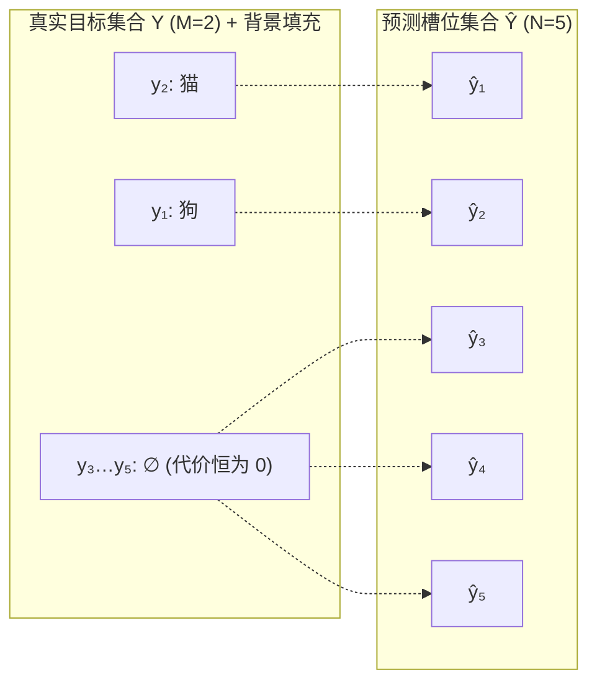

# 原版 DETR：二分图匹配与集合损失

在上一篇《[1）原版 DETR：网络架构与前向流程](./detr-v1-architecture-forward-pass)》中，我们剖析了 DETR 的前向架构：主干网络提取 C5 特征，编码器建立全局像素关联，解码器通过 $N$ 个 Object Queries 并行探测，最终由共享预测头输出一个大小固定为 $N$ 的预测集合 $\hat{Y} = \{\hat{y}_i\}_{i=1}^N$。

然而，目标检测的监督信号本质是一个**无序且数量可变的真实目标集合** $Y = \{y_i\}_{i=1}^M$（其中 $M$ 为该图像中的真实目标数量，通常 $M < N$）。在模型输出的 $N$ 个预测中，到底哪一个预测槽位应当负责哪一个真实目标？对于未命中真实目标的剩余 $N - M$ 个槽位，又该如何实施惩罚？

传统检测器依赖预设的空间重叠先验（如 Anchor 与真实框的 IoU 阈值）进行启发式的一对多标签分配。DETR 抛弃了一对多标签分配的思路，变成一对一分配，因此也就不再需要 NMS。不过，我们还是需要一个分配的算法，将网络的输出，和实际的标签一一对应。恰好，匈牙利算法，就是一种用来在两组元素之间求解最小总代价双射配对的经典组合优化算法，正好可以承担起为预测槽位与真实目标建立一一对应关系的任务。

本篇系统拆解集合监督的数学定义、两阶段训练机制、匹配代价设计的量级约束、集合损失的构造，以及一对一匹配如何自发内化去重机制（消除 NMS），并深入分析该范式带来的正样本稀疏与匹配震荡代价。

## 集合预测的排列不变性

在设计损失函数之前，必须先明确目标检测任务中的两组对称性：

1. **真实目标集合的排列不变性（Permutation Invariance of Ground Truth）：**
   真实标注是一个集合，对下标的任意重排都不改变它自身：

   $$
   \{y_{\pi(1)}, y_{\pi(2)}, \dots, y_{\pi(M)}\} = \{y_1, y_2, \dots, y_M\}, \quad \forall \pi \in \mathfrak{S}_M
   $$

   这里的下标只是为了书写标注列表而临时赋予的编号。例如一张图像中有一只猫和一个苹果，标注列表写成 `[猫, 苹果]` 还是 `[苹果, 猫]`，只是编号顺序不同，其所表达的物理世界真值完全相同。列表的先后次序来自标注文件的存储格式，不属于物理真值。
2. **预测集合的槽位无序对应：**
   DETR 解码器输出 $N$ 个预测向量 $\hat{Y} = \{\hat{y}_1, \dots, \hat{y}_N\}$。虽然在张量实现中它们占据数组索引 $1, \dots, N$，但这些槽位在语义上并没有先验的固定顺序（例如并没有规定 " 槽位 1 必须预测猫 " 或 " 槽位 2 必须预测左上角物体 "）。

因此，评估预测集合 $\hat{Y}$ 与真实集合 $Y$ 之间的差异，不能直接使用按张量索引对齐的逐元素损失，而必须在**所有可能的对应关系中，找到一组全局最优的排列**。

## 匈牙利二分图匹配

为了在数学上统一预测集合与真实集合的基数（Cardinality），DETR 首先将真实目标集合 $Y$ 用特殊的 " 无目标 " 背景类别 $\varnothing$ 填充（Pad）至大小 $N$：

$$
Y = \{y_1, y_2, \dots, y_M, \underbrace{\varnothing, \varnothing, \dots, \varnothing}_{N - M \text{ 个}}\}
$$

每个真实的物理目标 $y_i = (c_i, b_i)$ 由类别标签 $c_i \in \{1, \dots, K\}$ 和归一化真实框坐标 $b_i = (x_i, y_i, w_i, h_i) \in [0, 1]^4$ 构成；而背景目标 $y_i = \varnothing$ 则表示无类别且不含边界框坐标。

引入填充项的目的，只是把左右两侧凑成相同大小、凑出 $N \times N$ 的方阵，从而直接套用标准的双射匹配框架。由于填充项的匹配代价恒为 0，它们不与前景目标争夺任何槽位。优化真正需要决定的，只有 $M$ 个真实目标各自落在哪个槽位；填充项最终落到的槽位，就是被前景挑剩下的那些，具体落到哪一个无关紧要。

现在，问题转化为一个经典的赋权二分图最大权匹配（或最小费用流）问题：在对称群 $\mathfrak{S}_N$（即 $N$ 个元素的所有全排列集合，共有 $N!$ 种排列方式）中，寻找一个最优的双射排列 $\hat{\sigma} \in \mathfrak{S}_N$，使得真实目标与第 $\sigma(i)$ 个预测之间的**总配对代价（Matching Cost）最小**：

$$
\hat{\sigma} = \arg\min_{\sigma \in \mathfrak{S}_N} \sum_{i=1}^N \mathcal{L}_{\text{match}}(y_i, \hat{y}_{\sigma(i)})
$$

其中 $\sigma(i)$ 表示在排列 $\sigma$ 下，与第 $i$ 个真实目标配对的预测槽位索引。

> 虚线表示一次匹配的输出。注意前景的两条箭头是交叉的：狗被派到 ŷ₂，猫被派到 ŷ₁，指派结果与下标顺序无关。三条背景箭头则没有信息——填充项的代价恒为 0，它们指向哪个槽位由优化器任意决定，不构成约束。

## 离散匹配与梯度反传的解耦

理解 DETR 训练机制的一个核心是：**匈牙利匹配（Hungarian Matching）本身是不可微的组合优化操作，梯度绝不穿透匹配算子。**

DETR 的训练本质上是一个两阶段交替过程（类似于 Expectation-Maximization 算法的逻辑）：

1. **第一阶段：离散决策（Matching / Assignment）**
   固定当前网络参数的前向输出 $\hat{Y}$，计算真实目标与预测槽位之间的代价矩阵，调用匈牙利算法求解出一个离散的全局最优单射索引映射 $\hat{\sigma}$。这一步只负责**定责（责任分配）**，属于不可微的离散决策。
2. **第二阶段：连续优化（Loss Backpropagation）**
   固定第一阶段求解出的配对关系 $\hat{\sigma}$，将配对的 $(y_i, \hat{y}_{\hat{\sigma}(i)})$ 送入标准的分类与回归损失函数中计算数值，通过反向传播将梯度更新回主干网络、Transformer 编解码器与预测头参数。

## 匹配代价矩阵设计

配对代价 $\mathcal{L}_{\text{match}}(y_i, \hat{y}_j)$ 用于衡量第 $i$ 个真实目标 $y_i$ 与第 $j$ 个预测结果 $\hat{y}_j$ 之间的不契合程度。

对于填充项 $y_i = \varnothing$，它与任何预测的匹配代价均定义为 0（即背景分配不产生主动匹配代价）。对于实际存在的物理目标 $y_i = (c_i, b_i)$，其与预测 $\hat{y}_j = (\hat{p}_j, \hat{b}_j)$ 的匹配代价综合了**类别概率**与**空间几何契合度**：

$$
\mathcal{L}_{\text{match}}(y_i, \hat{y}_j) = -\mathbb{I}_{\{c_i \neq \varnothing\}} \, \hat{p}_j(c_i) + \mathbb{I}_{\{c_i \neq \varnothing\}} \, \mathcal{L}_{\text{box}}(b_i, \hat{b}_j)
$$

其中：

- $\hat{p}_j(c_i)$ 是预测槽位 $j$ 属于真实类别 $c_i$ 的**预测概率值**（通过 Softmax 归一化后的概率标量）。预测出的类别概率越高，匹配代价越低（因此前面加负号）。
- $\mathcal{L}_{\text{box}}(b_i, \hat{b}_j)$ 是几何匹配代价。

### 匹配代价设计：分类损失项

这是一个非常关键的设计取舍。为什么匹配时不直接采用反向传播使用的负对数似然（Negative Log-Likelihood）$-\log \hat{p}$？

答案在于**多任务代价的数值尺度平衡（Magnitude Scale Balance）**。在训练初期，网络对正确类别的预测概率 $\hat{p}_j(c_i)$ 往往很小：随机初始化时约为 $1/(K+1) \approx 0.012$，$-\log(0.012) \approx 4.4$；概率进一步降到 0.001 时，$-\log(0.001) \approx 6.91$。而几何项 $\mathcal{L}_{\text{box}}$ 的数值处于 $[0, 2]$ 量级（这里指不带权重的原始损失）。两相对照，分类项会主导总代价，一个在空间几何上与目标高度贴合、但类别概率偏低的预测框，就很容易被一个分类更自信、几何更差的预测抢走本该属于它的目标。改用直接概率项 $-\hat{p}_j(c_i) \in [-1, 0]$ 后，分类代价被约束在一个有界且平缓的区间内，几何相似度得以在匹配中保有实际影响，两类先验也就能在同一架天平上共同指导匹配。

而在第二阶段计算参数优化损失时，必须恢复使用 $-\log \hat{p}_j(c_i)$，因为只有对数似然函数才能在预测错误时提供足够陡峭的梯度，驱动概率向 1.0 快速收敛。

:::info[问题]

**为什么二分图匹配不能带梯度反向传播，必须分两阶段？**

匈牙利算法的本质是离散组合优化：它在 $N!$ 个排列里挑出一个最优排列 $\hat{\sigma}$。$\hat{\sigma}$ 随代价矩阵的变化而跳变，是一个分段常值函数，不可导，所以当然也就无法优化。但 " 不能带梯度 " 不等于 " 与优化无关 "。匹配的实际定位是**梯度路由（Gradient Routing）**：它自身不接收梯度，却决定每个真实目标落在哪个预测槽位，从而决定损失 $\ell(y_i, \hat{y}_{\hat{\sigma}(i)})$ 把梯度送往哪一条预测分支。路由本身不被优化，却持续改变梯度流向。

这两个角色无法合进同一个可微的计算图：路由一旦被放进反传路径，就要对离散选择求导，而它处处不可导。因此实现上必须把路由从梯度路径中摘除（stop-gradient），先用当前预测定出 $\hat{\sigma}$，再在固定路由下反向传播。这里的 " 两阶段 " 指的是这种结构性解耦，而不是一个可微步骤被硬拆成两次可微步骤。DETR 训练早期的匹配震荡，正是路由随预测漂移而跳变的表现。

:::

### 匹配代价设计：边界框回归项

边界框几何代价由加权的 L1 距离与 GIoU 损失组合而成：

$$
\mathcal{L}_{\text{box}}(b_i, \hat{b}_j) = \lambda_{\text{L1}} \, \|b_i - \hat{b}_j\|_1 + \lambda_{\text{giou}} \, \mathcal{L}_{\text{giou}}(b_i, \hat{b}_j)
$$

在原版 DETR 中，超参数默认设置为 $\lambda_{\text{L1}} = 5, \lambda_{\text{giou}} = 2$。

这两项损失构成了几何度量的互补组合：

1. **L1 距离损失（$\|b_i - \hat{b}_j\|_1$）：**
   衡量框中心及宽高的绝对数值偏差。L1 损失的优势在于无论两个框相距多远（即使完全不重叠），其导数恒为 $\pm 1$，能够持续提供稳定的绝对拉近力。但 L1 存在**尺度敏感性**：虽然坐标归一化到 $[0, 1]$，但大目标产生的绝对坐标误差在数值上天然大于小目标。
2. **广义交并比损失（GIoU Loss）：**
   针对重叠区域优化且具备**尺度不变性（Scale Invariance）**：

   $$
   \mathcal{L}_{\text{giou}}(b_i, \hat{b}_j) = 1 - \left( \frac{|b_i \cap \hat{b}_j|}{|b_i \cup \hat{b}_j|} - \frac{|C(b_i, \hat{b}_j) \setminus (b_i \cup \hat{b}_j)|}{|C(b_i, \hat{b}_j)|} \right)
   $$

   其中 $C(b_i, \hat{b}_j)$ 为包围两框的最小外接矩形面积。GIoU 既对大物体和小物体一视同仁，又解决了标准 IoU 在两框不相交时梯度归零的问题。

两者缺一不可：单独使用 L1，模型对大物体偏好过度且难以精细优化交并比；单独使用 GIoU，在两框相距甚远时外包凸包主导的梯度推力较为微弱。

### 求解算法：基于匈牙利算法的指派实现

在论文的数学形式化中，为了在对称群 $\mathfrak{S}_N$ 上定义双射，真实目标集合被填充至大小 $N$，将匹配表述成一个 $N \times N$ 的方阵问题。但在官方代码 `models/matcher.py` 的 `HungarianMatcher` 中，并没有真正构造这个方阵。其核心注释直接写明了：

> For efficiency reasons, the targets don't include the no_object. Because of this, in general, there are more predictions than targets. In this case, we do a 1-to-1 matching of the best predictions, while the others are un-matched (and thus treated as non-objects).

在工程实现中，代码只为当前图像实际存在的 $M$ 个真实目标与 $N$ 个预测槽位计算代价，构建一个行对应预测槽位、列对应真实目标的 $[N, M]$ 代价矩阵，直接调用 `scipy.optimize.linear_sum_assignment` 求解矩形指派，只匹配出 $\min(M, N)$ 对。那些没有进入配对的预测槽位，天然就是无目标（no-object）。下面的例子为了书写方便，把矩阵转置写成行对应真实目标、列对应预测槽位，指派结果不受影响。

这种简化与理论上的方阵匹配是完全等价的。因为填充项 $\varnothing$ 与任何预测槽位的匹配代价恒为 0，是一个与指派方案无关的常数，不参与任何槽位竞争。把这些代价恒为 0 的填充项去掉，丝毫不影响真实前景目标之间的最优指派。被前景挑剩下的槽位，就是那些未匹配的预测。构建 $N \times N$ 方阵只是为了数学写法的完备，工程上直接求解矩形指派既节省了计算开销，又得到了完全一致的分配结果。

既然只需为 $M$ 个真实目标挑选槽位，为什么不能直接在代价矩阵上逐行挑选最小值进行贪心分配，而必须依赖匈牙利算法求解全局最优？原因在于独立贪心无法处理冲突：不同真实目标的最优预测槽位往往会重叠。

设一张图像中有 $M = 2$ 个真实目标与 $N = 5$ 个预测槽位。框坐标采用归一化中心格式 $b = (c_x, c_y, w, h)$；类别下标 0 为狗、1 为猫，$\hat{p}_j(c)$ 记第 $j$ 个预测槽位属于类别 $c$ 的 Softmax 概率。真实目标为

$$
y_1 = \bigl(c_1 = 0,\ b_1 = (0.25, 0.50, 0.30, 0.25)\bigr), \qquad y_2 = \bigl(c_2 = 1,\ b_2 = (0.20, 0.35, 0.35, 0.30)\bigr)
$$

五个预测槽位为

$$
\begin{array}{c|ccc}
 & \hat{b}_j & \hat{p}_j(0) & \hat{p}_j(1) \\\hline
\hat{y}_1 & (0.60, 0.55, 0.25, 0.10) & 0.05 & 0.05 \\
\hat{y}_2 & (0.70, 0.50, 0.20, 0.20) & 0.20 & 0.08 \\
\hat{y}_3 & (0.20, 0.35, 0.35, 0.30) & 0.03 & 0.50 \\
\hat{y}_4 & (0.80, 0.20, 0.15, 0.15) & 0.03 & 0.03 \\
\hat{y}_5 & (0.35, 0.80, 0.25, 0.20) & 0.04 & 0.04
\end{array}
$$

逐项计算匹配代价，得到代价矩阵 $C$

$$
C = \begin{array}{c|ccccc}
 & \hat{y}_1 & \hat{y}_2 & \hat{y}_3 & \hat{y}_4 & \hat{y}_5 \\\hline
y_1 & 5.670 & 5.486 & 3.170 & 8.967 & 5.190 \\
y_2 & 7.521 & 7.485 & -0.500 & 8.670 & 6.976
\end{array}
$$

观察该矩阵可知，狗 $y_1$ 与猫 $y_2$ 各自的行最小值均落在槽位 $\hat{y}_3$ 上（狗的代价为 3.170，猫为 −0.500）。若采取逐行贪心，两个目标将争夺同一个槽位 $\hat{y}_3$，产生非法的非单射分配。

匈牙利算法给出的全局最优指派是：猫 $\to \hat{y}_3$（代价 −0.500），狗 $\to \hat{y}_5$（代价 5.190），总代价为 4.690，未匹配槽位为 $\hat{y}_1, \hat{y}_2, \hat{y}_4$。

这种调配方向取决于两者的机会成本（Opportunity Cost）：猫若失去 $\hat{y}_3$ 被迫退选次优的 $\hat{y}_5$，匹配代价将从 −0.500 升至 6.976，落差约为 7.476；而狗若失去 $\hat{y}_3$ 退选次优的 $\hat{y}_5$，代价仅从 3.170 变为 5.190，落差约为 2.020。如果让狗霸占 $\hat{y}_3$ 而猫退至 $\hat{y}_5$，总代价将变为 10.146，比全局最优多出 5.456。全局组合优化正是在面对槽位冲突时，迫使失去代价更小的一方让出槽位，从而实现系统总代价最小化。

## 小结

DETR 以一对一分配取代启发式的一对多标签分配：真实目标集合用代价恒为 0 的无目标类别填充，由匈牙利二分图匹配求解预测槽位与真实目标之间全局最优的双射排列。匹配是不可微的组合决策，充当梯度路由而非被优化的算子——先定责，再在固定指派下反向传播。匹配代价刻意使用原始概率 $-\hat{p}$ 而非 $-\log \hat{p}$，以平衡与几何项 L1 + GIoU 的数值量级，并在损失阶段恢复对数似然。一对一匹配内化了去重机制、消除了 NMS 依赖，代价是正样本稀疏与训练早期的匹配震荡。

---

下一篇：[Deformable DETR](./deformable-detr)
