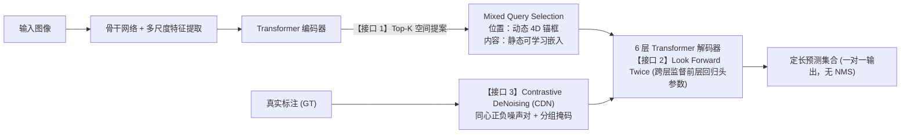
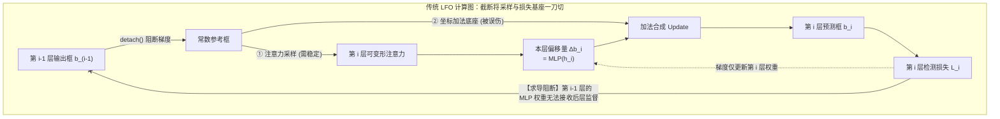
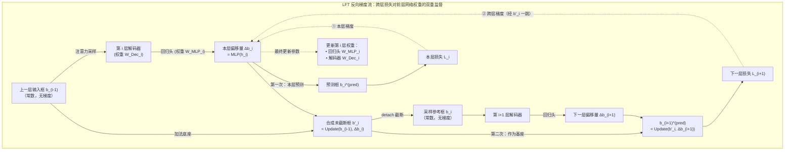
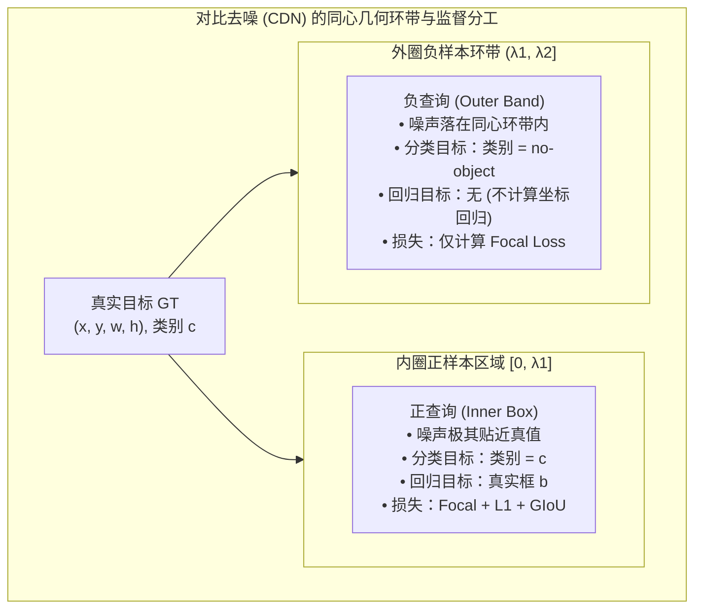
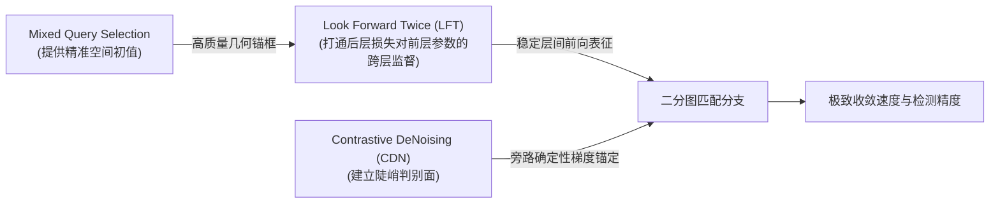
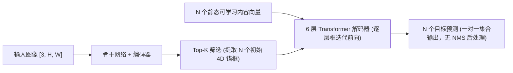

# DINO：三处接口的联合设计

在前面的讨论中，我们系统梳理了 DETR 架构演进的三条核心线索：Deformable DETR 重构了特征读取路径，利用可变形注意力将全图密集计算收缩为围绕参考点的局部稀疏采样，首次以较低计算开销引入了高分辨率多尺度特征；Conditional 与 DAB-DETR 将查询解耦并显式参数化为四维动态锚框 $(x, y, w, h)$，解决了特征寻址中的定位冷启动难题；而 DN-DETR 则通过在训练期引入绕过匈牙利匹配的真值去噪旁路，消除了二分图离散分配在训练早期的剧烈震荡。

这三项工作各自攻克了一个明确的底层瓶颈。然而，它们最初是在各自独立的语境下分别提出的。当研究者尝试将多尺度可变形注意力、四维动态锚框与查询去噪技术拼装成一个统一的检测器时，却发现不同模块在连接接口处依然存在着结构性断裂与设计矛盾。

本篇聚焦于 **DINO（DETR with Improved deNoising anchOr boxes for End-to-End Object Detection）**，剖析研究者如何通过在**查询初始化**、**几何框层间更新**与**去噪训练监督**三处核心接口上的联合重构，将原本分散的加速机制整合成一套紧密协同的高性能端到端检测体系。

:::warning[检测 DINO 与自监督 DINO 的区别]
在计算机视觉文献中存在两个名称相同的 DINO 工作，两者面向的研究问题与技术谱系完全不同，不能混淆：

1. **自监督 DINO（Caron 等人，2021）及其后续演进（DINOv2、DINOv3）：** 属于**自监督视觉表征学习（Self-Supervised Representation Learning）**范畴，其核心机制是利用自蒸馏（Knowledge Distillation）在无标注的大规模图像集上预训练视觉骨干网络（如 Vision Transformer），不涉及目标检测中的集合匹配与坐标回归；
2. **检测 DINO（Zhang 等人，2022）：** 即本篇所解析的端到端目标检测器。其命名来自于技术血统的缩写。它与自监督 DINO 之间不存在任何谱系继承关系，既不依赖自监督预训练权重，也不是自监督表征的下游适配；
3. **Grounding DINO：** 是后续将检测 DINO 与文本特征进行跨模态对齐的开放词表检测器，属于多模态检测衍生任务。
:::

## DINO 的主要贡献

### 现有方案的三处接口缺陷

在构建 DINO 之前，领域内将 Deformable DETR、DAB-DETR 与 DN-DETR 进行工程融合后的强基线（论文中记为 Optimized DN-DETR，配合多尺度特征在 12-epoch 下达到 44.9 AP），在系统的前向与监督数据流中依然遗留了三处接口层面的核心缺陷：

1. **查询初始化接口（输入端）：初始查询与图像实例特征脱节**
   在 DAB-DETR 中，解码器的初始位置查询由一组在整个训练集上联合优化的静态 4D 锚框提供。虽然锚框具备具体的中心坐标与宽高尺寸，但在推理任意不同输入图像时，这组初始锚框的空间分布是完全固定的，缺乏对当前输入场景的内容感知。
   Deformable DETR 曾提出过双阶段查询选择（Two-Stage Query Selection）方案，尝试直接从编码器最后一层选出 Top-$K$ 个高置信度特征，并用线性变换同时初始化 content query 与 positional query。然而，编码器输出的密集 token 属于未经实例级精炼的初步内容特征（Preliminary Content Features），容易同时覆盖多个物体或仅表征物体的局部部件。将这类粗粒度特征直接注入 content query，会引入严重的语义混叠，破坏解码器内部槽位协商的稳定性。
2. **层间几何更新接口（解码器内部）：后层损失向前层回归头参数的梯度阻断**
   在 Deformable DETR 与 DAB-DETR 的逐层框迭代（Iterative Box Update）机制中，第 $i$ 层解码器基于前一层输出的预测框 $b_{i-1}$ 预测几何偏移量 $\Delta b_i$。为了避免多层级联求导导致反向传播不稳定，传统做法在将 $b_{i-1}$ 传给第 $i$ 层之前对其执行了 `detach()` 梯度截断操作（这一模式被 DINO 概括为 **Look Forward Once, LFO**）。
   这里需要明确：前向计算中边界框只是随特征生成的中间激活值，反向传播优化的物理终点始终是网络权重参数。解码器的隐藏状态特征在层间从未被 `detach()`，后一层的检测损失本来就能沿着特征主干回传。LFO 所截断的是**后一层检测损失经由加法几何链条回传给前一层回归头 MLP 权重的通道**。在 LFO 机制下，第 $i-1$ 层的回归头参数只受本层检测损失驱动，它在优化时完全无法感知自己输出的这个框作为加法底座时是否便于下一层继续微调。
3. **训练期去噪接口（监督端）：去噪任务缺少对假阳性样本的判别监督**
   我们在第五篇中推导过，DN-DETR 的去噪组内全部是由真实目标添加微小扰动构造的**正样本**（中心偏移限制在真值框内部）。模型被施加的监督目标恒为对应的真值类别与真实框坐标，去噪组内完全没有引入背景（`no-object`）目标。
   这种纯正样本的设计意味着去噪分支只训练了网络“在真实物体附近如何拉回坐标”，但从未教会网络“当候选锚框偏离真实目标到一定距离后，应当将其判定为背景并果断放弃”。在推理过程中，当多个锚框落在真实目标紧邻的外围背景区域时，模型缺乏清晰的抑制边界，极易产生密集的近景重复假阳性（False Positives）。

### DINO 的三项改进

针对这三处结构性缺陷，DINO 在数据流的三个关键节点上进行了协同重构：

| 接口位置      | 强基线遗留问题                   | DINO 重构机制                       | 核心作用原理                                                                    |
| :-------- | :------------------------ | :------------------------------ | :------------------------------------------------------------------------ |
| **查询初始化** | 静态锚框缺乏图像特异性；全盘动态初始化引入特征混叠 | **Mixed Query Selection**       | **位置动态化，内容静态化**：用编码器顶层 Top-$K$ 提案提供精准 4D 初始锚框，content query 保留为可学习通用探测向量。 |
| **层间框更新** | LFO 切断了后层损失对前层回归头的跨层梯度，前层参数无法感知基座质量 | **Look Forward Twice (LFT)**    | **参数受双重监督**：既保留注意力特征采样的阻断以维持训练稳定，又让后层预测框基于前层未截断的坐标合成，打通后层损失监督前层回归头参数的通道。 |
| **训练期去噪** | 纯正样本去噪缺乏背景负反馈，边缘假阳性密集     | **Contrastive DeNoising (CDN)** | **同心正负样本对**：在内圈构造正样本回归真值，在外圈环带构造负样本强行判为 `no-object`，显式建立背景拒绝边界。           |

## 改进一：混合查询选择-Mixed Query Selection

### 空间位置与语义内容的分离设计

在 DETR 类检测器中，解码器的输入由两部分向量共同构成：**positional query** 与 **content query**。原版 DETR 中的 $Q_{\text{obj}}$ 兼着 positional query 一职，而 DAB-DETR 起位置职责被剥离出来独立成 4D 锚框，$Q_{\text{obj}}$ 剩余的那部分专职充当 content query。

回顾历史方案，模型在查询初始化策略上存在两种极端：

1. **纯静态初始化（DETR / DAB-DETR / DN-DETR）：** 两者均采用与具体图像无关的可学习参数。positional query 在训练集上联合优化为静态锚框，content query 初始化为全零或可学习隐向量（Figure 5(a)）；
2. **纯动态初始化（Deformable DETR Two-Stage / Efficient DETR）：** 从编码器最后一层挑选分类得分最高的 Top-$K$ 个特征 token，经过同一组线性变换同时生成 positional query（初始参考框）与 content query 向量（Figure 5(b)）。

DINO 的**混合查询选择（Mixed Query Selection）**做法很直接：把 (b) 中通往 content query 的那条支路去掉，只留下 positional query（Figure 5(c)），对空间位置与特征内容采取非对称的初始化策略：

- **positional query（4D 锚框）：** 完全由编码器最后一层特征经过辅助分类与回归头筛选出的 Top-$K$ 提案框 $(x, y, w, h)$ 进行动态初始化；
- **content query（语义向量）：** 依然保持为**与具体输入图像无关的静态可学习参数（Learnable Embeddings）**。

:::info[问题]

**为什么 positional query 应当使用动态图像特征，而 content query 必须保持静态可学习？**

这一非对称设计的底层逻辑在于目标检测任务中“空间几何”与“特征聚合”的不同物理属性：

1. **空间位置是实例特异的（Instance-Specific）：** 图像中目标出现在何处完全取决于当前输入图像。编码器通过密集自注意力交互，已经能够以较高置信度给出目标的粗略空间范围。直接将这些区域提取为 4D 锚框，能够为解码器提供极高质量的空间寻址起点，避免了解码器在全图盲目搜索的定位开销；
2. **content query 是通用探测算子（Feature Pooling Operators）：** content query 的本质不是“当前图像局部特征的切片”，而是“用于从编码器输出的图像特征中汇聚完整实例语义的解耦容器”。编码器输出的密集特征属于未经深层精炼的初步特征，单个 token 往往混杂了背景纹理、局部肢体部件或重叠物体的特征。如果强行用这些初步特征初始化 content query，会将局部噪声带入解码器各层，破坏槽位之间的注意力协商；而保持静态可学习的内容嵌入在整个训练集上联合优化，能够稳定地学习到针对不同物体形态与尺度的特征聚合模式。

:::

### 解码器浅层特征对收敛的影响

Mixed Query Selection 的有效性不仅体现为最终检测精度的提升，更体现在它显著降低了模型对深层解码器逐层精修的依赖。

在未引入高质量空间先验的基线模型中，浅层解码器（如第 1~2 层）输出的定位框精度极低，模型严重依赖 4~6 层解码器的逐层递进修正。而在 DINO 中，得益于编码器提供的精准初始锚框，浅层解码器在第一层就已经具备了良好的特征寻址基准。

论文在附录 0.C（Table 6）中给出了在 ResNet-50 骨干网络、12-epoch 训练设置下，缩减编码器与解码器层数时的性能演变（编码器固定为 6 层）：

| 编码器 / 解码器配置 | 6 层编码器 / 6 层解码器 | 6 层编码器 / 4 层解码器 | 6 层编码器 / 2 层解码器 |
| :--- | :--- | :--- | :--- |
| **DINO AP** | **47.4** | **46.0** | **44.4**（下降 **3.0 AP**） |
| **Dynamic DETR AP** | **42.9** | **40.3** | **29.2**（下降 **13.7 AP**） |
| **AP 差距（DINO − Dynamic）** | +4.5 | +5.7 | **+15.2** |

这一对比实证表明：**Mixed Query Selection 使查询在进入解码器前就完成了高质量的几何定位初始化，摆脱了对深层网络逐层精化过程的过度依赖。**

## 改进二：跨层几何监督 - Look Forward Twice（LFT）

在剖析 LFT 之前，必须先澄清一个容易产生认知混淆的前提：**在前向传播中，边界框 $b = (x, y, w, h)$ 根本不是网络权重参数（不是 `nn.Parameter`），而是随输入图像和当前隐藏特征 $h$ 实时计算出的中间激活值张量（Activation Tensor）。** 它是由第 $i$ 层 Decoder 算出的特征向量 $h_i$ 经由边界框回归头 MLP 投影出的几何结果：$\Delta b_i = \mathrm{MLP}(h_i)$。

在解码器每一层的前向计算中，该阶段生成的框承担着双重任务：

1. **本阶段输出：** 作为当前层针对目标的阶段性预测框，接入辅助检测损失 $\mathcal{L}_{\mathrm{det}}^{(i)}$；
2. **下阶段输入：** 传递给下一层，作为第 $i+1$ 层可变形注意力采样的空间基准锚点，指导注意力在特征图的何处提取局部特征。

DINO 的前向计算公式与 Deformable DETR 完全一致，依然是逐层残差累加：

1. 第 $i$ 层解码器拿到上一层给出的基准框 $b_{i-1}$；
2. 基于该框在图像特征图上进行注意力局部采样与特征聚合，生成当前层的隐藏特征 $h_i$，再由回归头预测出坐标残差 $\Delta b_i = \mathrm{MLP}(h_i)$；
3. 将偏移量叠加到基准框上，生成当前层的新框：$b_i = \mathrm{Update}(b_{i-1}, \Delta b_i)$，并交给下一层作为下一轮迭代的基准。

所谓的 LFT 与 LFO，在前向计算中产生的张量数值分毫不差。两者的全部差异，纯粹在于**反向传播时，后一层的检测损失能否通过加法链条回传并直接监督前一层的网络权重参数**。

### LFO 的真正局限：采样稳定与损失反馈的绑定

反向传播优化的物理终点，永远且只能是神经网络的可学习权重参数（第 $i$ 层的回归头 MLP 权重 $\mathbf{W}_{\mathrm{MLP}_i}$ 以及 Decoder 特征提取权重 $\mathbf{W}_{\mathrm{Decoder}_i}$）。

在 Deformable DETR 与 DAB-DETR 等前作中，参考框在解码器内部同时承担着两项截然不同的职责：

1. **注意力寻址职责：** 作为空间几何参考点，决定当前层可变形注意力的采样位置，并生成位置查询嵌入（Query Pos Sine Embeddings）；
2. **坐标基座职责：** 作为本层坐标回归的加法底座，与当前层预测的偏移量 $\Delta b_i$ 相加，合成用于计算辅助检测损失的最终预测框。

在传统的 **Look Forward Once（LFO）** 设定下，为了防止深层注意力采样位置在反向传播中跨层扰动导致训练发散，实现中对输入框直接执行了 `detach()` 截断：

$$
b_i = \text{Sigmoid}\left( \text{InverseSigmoid}(\mathrm{Detach}(b_{i-1})) + \Delta b_i \right)
$$

这种处理保护了注意力采样的数值稳定性（职责 1），却误伤了后一层损失向前一层网络参数的反传通道（职责 2）：第 $i$ 层的检测损失 $\mathcal{L}_{\text{det}}^{(i)}$ 作用在 $b_i$ 上时，由于底座 $b_{i-1}$ 被强行变成了无梯度的常数，梯度在到达底座后瞬间断流，只能全部流向本层的偏移量 $\Delta b_i$。

这就造成了**层间网络参数优化的孤立**：第 $i-1$ 层的回归头参数在优化时，唯一的目标是让自己输出的框在当前层尽量贴近真值；它完全无法得知自己输出的这个框作为下一层回归头的加法底座时，究竟是“方便下一层微调”还是“把下一层逼入死角”。

需要顺带澄清的是：解码器的隐藏状态特征在层间从来没有被 `detach()`，后一层的损失本来就能通过隐藏状态回传到前一层。LFO 截断的仅仅是**后一层损失经由几何加法底座流向上一层回归头 MLP 权重的求导通路**。

### LFT 的底层实现：一框两路，分流采样与损失基座

既然矛盾的根源在于“注意力采样害怕梯度扰动，而坐标基座渴望损失反馈”，DINO 的做法非常朴素：**不要将这两项职责绑死在同一个带阻断的张量上，而是在计算图上将它们明确分流。**

论文中的式 (1) 并不是什么新的前向算法，它只是为了在反向求导计算图上把同一个几何框挂载到不同的求导分支上：

$$
\begin{aligned}
\Delta b_i &= \mathrm{Layer}_i(b_{i-1}), & b'_i &= \mathrm{Update}(b_{i-1}, \Delta b_i) \\
b_i &= \mathrm{Detach}(b'_i), & b_i^{(\mathrm{pred})} &= \mathrm{Update}(b'_{i-1}, \Delta b_i)
\end{aligned} \tag{1}
$$

其中 $\mathrm{Update}(b, \Delta b) = \text{Sigmoid}\left( \text{InverseSigmoid}(b) + \Delta b \right)$ 为逆 Sigmoid 空间下的标准残差累加。这四个变量在前向数值上没有任何差别（都代表第 $i$ 层的预测框坐标），但在 autograd 计算图中的分工截然不同：

| 变量符号 | 浮点数值 | 在反向计算图中的角色 | 对应职责 |
| :--- | :--- | :--- | :--- |
| **$b_i$** | 当前层更新后的框 | **切断梯度**（执行了 `Detach`） | **职责 1（采样）：** 喂给第 $i+1$ 层做注意力采样和位置编码，守住训练稳定性 |
| **$b'_i$** | 当前层更新后的框 | **保留梯度**（未 `Detach`） | **中间变量：** 保留对本层回归头 $\Delta b_i$ 的求导通路，准备交给下一层当底座 |
| **$b'_{i-1}$** | 前一层更新后的框 | **保留梯度**（上一层传来的 $b'_{i-1}$） | **职责 2（基座）：** 作为本层预测框的加法底座，将当前层的损失梯度渡运回上一层的网络参数 |
| **$b_i^{(\mathrm{pred})}$** | 当前层更新后的框 | **保留梯度** | **损失目标：** 接入第 $i$ 层的辅助检测损失 $\mathcal{L}_{\text{det}}^{(i)}$ |

对照原论文 Figure 6(b) 读这个结构：

原论文 Figure 6 画的是前向计算图，梯度怎么流需要读者自行推断。把 LFT 的反向梯度单独补画出来，就是下面这张图——两条虚线梯度边（① 与 ②）汇入偏移量 $\Delta b_i$，并最终注入第 $i$ 层的网络权重中：

与前一节 LFO 的梯度图对照着看：LFO 里只有 ① 这一条梯度边，② 不存在，且偏移量的上游全是常数；LFT 补上的正是 ② 这一条跨层虚线，以及通往 $b_{i+1}^{(\mathrm{pred})}$ 的那条未截断基座路。

在 Figure 6(b) 中，第 $i$ 层计算出的预测框数值分成了两路流出：

- **一路向下走虚线箭头（采样路）：** 经过 `detach` 截断变成 $b_i$，进入第 $i+1$ 层的 $\text{Layer}_{i+1}$ 作为注意力采样的参考点，阻止采样坐标跨层反传；
- **一路向右上方走实线（基座路）：** 绕过 `detach`，以 $b'_i$ 的身份作为加法底座，直接与第 $i+1$ 层预测的偏移量 $\Delta b_{i+1}$ 相加，合成第 $i+1$ 层的最终预测框 $b_{i+1}^{(\mathrm{pred})}$。

由此，论文名字里的 **"Twice"** 的物理含义也就一清二楚了：它指的不是前向算两次框，而是**第 $i$ 层的回归头权重 $\mathbf{W}_{\mathrm{MLP}_i}$ 与解码器参数 $\mathbf{W}_{\mathrm{Dec}_i}$，在反向传播中被赋予了双重使命（承受两次损失的监督）**：

1. **第一次监督：** 参数计算出的 $\Delta b_i$ 参与本层预测框 $b_i^{(\mathrm{pred})}$ 的生成，接受本层损失 $\mathcal{L}_{\text{det}}^{(i)}$ 的监督，确保本层定位准确；
2. **第二次监督：** 合成中间基座 $b'_i$，作为底座参与下一层预测框 $b_{i+1}^{(\mathrm{pred})}$ 的生成，接受下一层损失 $\mathcal{L}_{\text{det}}^{(i+1)}$ 的跨层监督。

求导链式法则直接反映了这一针对网络权重的双重约束：

$$
\frac{\partial \mathcal{L}_{\text{total}}}{\partial \Delta b_i} = \underbrace{\frac{\partial \mathcal{L}_{\text{det}}^{(i)}}{\partial b_i^{(\mathrm{pred})}} \cdot \frac{\partial b_i^{(\mathrm{pred})}}{\partial \Delta b_i}}_{\text{第一次监督：本层自身拟合}} \;+\; \underbrace{\frac{\partial \mathcal{L}_{\text{det}}^{(i+1)}}{\partial b_{i+1}^{(\mathrm{pred})}} \cdot \frac{\partial b_{i+1}^{(\mathrm{pred})}}{\partial b'_i} \cdot \frac{\partial b'_i}{\partial \Delta b_i}}_{\text{第二次监督：后一层辅助微调}}
$$

而因为 $\Delta b_i = \mathrm{MLP}_i(h_i)$，梯度最终直接传导至网络权重：

$$
\nabla \mathbf{W}_{\mathrm{MLP}_i} \propto \frac{\partial \mathcal{L}_{\text{total}}}{\partial \Delta b_i} \cdot \frac{\partial \Delta b_i}{\partial \mathbf{W}_{\mathrm{MLP}_i}}
$$

有了第二项梯度，第 $i$ 层的回归头在调整自身权重时，不仅要把框预测准，还必须让生成的框能够作为一个良好的起点，让下一层在上面做残差修正时更容易把损失降下去。

### 传导边界与工程等价性

这里需要特别澄清两点容易被夸大或误解的事实：

1. **梯度传导范围仅限相邻两层：**
   LFT 建立的是相邻层（第 $i+1$ 层向第 $i$ 层网络参数）之间的单步几何反馈，并非把整整 6 层的框回归头串成了一条贯穿前后的超长梯度链。因为在第 $i+1$ 层把框交给第 $i+2$ 层做采样时，依然会执行 $b_{i+1} = \mathrm{Detach}(b'_{i+1})$，所以第 $i+2$ 层的几何损失绝对无法跨越两层逆流回第 $i$ 层。
2. **前向与推理的绝对零开销：**
   由于 PyTorch 中张量的 `detach()` 操作仅切断 autograd 计算图，不改变底层的张量数值，前向运算中 $b_i^{(\mathrm{pred})}$ 的四个坐标分量与 $b'_i$ 分毫不差。在模型完成训练进入测试推理时，模型直接执行标准的逐层残差更新，没有任何双路分支开销，也不增加任何模型参数。其具体的源码实现与计算图构建方式可见附录 3。

## 改进三：对比去噪训练 - Contrastive De-noising（CDN）

### 负样本去噪的构造方式

DN-DETR 建立了一套利用加噪真值绕过匈牙利匹配的训练机制。然而在 DN-DETR 中，去噪组内部**全部是由真实目标添加微小扰动构造的正样本**：

在真实目标 $y = (c, b)$ 的中心坐标上施加的噪声尺度被超参数 $\lambda$ 严格约束（满足 $|\Delta x| < \frac{\lambda w}{2}, |\Delta y| < \frac{\lambda h}{2}$）。由于扰动后的中心点依然严格落在真值框内部，DN-DETR 将所有去噪查询的分类目标均设为真值类别 $c$，并对全部去噪框计算向真实框 $b$ 的坐标回归损失。

这种纯正样本的设计存在一个内在缺陷：**模型被持续训练去对目标附近的任意锚框进行激进的前景激活与回归拉伸，但系统从未显式学习如何在偏离目标时输出 "no object"（背景）并终止回归。**

在推理阶段，多个落在目标边缘、局部阴影或紧邻背景处的预测槽位，由于缺乏背景抑制约束，极易产生密集的重复检测框（Figure 8 左图）。

为了教会检测器在偏离目标时果断放弃，DINO 提出了**对比去噪训练（Contrastive DeNoising, CDN）**。

在 CDN 中，针对图像中的每一个真实目标，算法在同一个去噪组内构造一对**同心对比查询（Contrastive Query Pair）**：一个**正查询（Positive Query）** 与一个**负查询（Negative Query）**。

两类查询的几何扰动范围由内、外两个同心超参数 $\lambda_1 < \lambda_2$ 严格划分（Figure 3）：

1. **正查询（Inner Box，内圈区域）：** 噪声扰动尺度小于 $\lambda_1$。其监督目标是重建真实目标框 $b$，类别标签为真值类别 $c$，计算 $\ell_1$ 损失、GIoU 损失与分类 Focal Loss；
2. **负查询（Outer Band，外圈同心环带）：** 噪声扰动尺度位于区间 $(\lambda_1, \lambda_2]$ 之内。其监督目标被**强制设定为 `no-object`（背景）**，仅计算分类 Focal Loss，**完全不参与任何边界框回归损失计算**。

:::info[问题]

**为什么负查询必须仅计算分类损失，且严禁参与坐标回归？**

负查询在语义层面的唯一定位是“应当被系统拒绝的背景”。如果对负查询施加向真值框 $b$ 的坐标回归损失，等同于在梯度层面指示网络“把这个偏离的锚框拉向真实目标”，这会直接摧毁对比学习所期望建立的决策边界。

DINO 在损失函数的设计上极其严格：将负样本分类为背景的损失采用 Focal Loss 进行优化。这意味着负查询产生的所有反向传播梯度全部汇聚于分类头，其唯一使命就是在特征空间中建立一条陡峭的判别曲面——**只要候选框的偏离程度超过阈值 $\lambda_1$，模型必须输出极低的分类置信度并将其判定为背景**。

:::

论文在实际超参数配置中采用较小的 $\lambda_2$（默认设置 $\lambda_1 = 1.0, \lambda_2 = 2.0$），其核心考量在于**紧邻真实目标的困难负样本（Hard Negative Samples）具备最高的判别价值**。全图随机采样的背景区域特征响应极低，属于平凡负样本；只有落在目标边缘过渡区域的负样本，才能有效迫使网络学会区分目标本体与紧邻背景。

### 分组注意力掩码隔离

在引入 CDN 后，解码器内部同时存在多个对比去噪组与常规匹配查询。为了防止信息在非预期路径上泄漏，自注意力掩码必须维持严格的分组隔离准则：

1. **去噪分支与匹配分支完全隔离：** 任何去噪查询在自注意力中绝对不能感知匹配查询的状态，反之亦然，确保匹配分支的端到端学习特性不受干扰；
2. **去噪组之间完全隔离：** 第 $k$ 个去噪组与第 $j$ 个去噪组（$j \neq k$）互不可见，保证每个组独立完成针对当前图像真值集合的去噪任务；
3. **同组内正负查询完全互见：** 在同一个 CDN 组内部，正查询与负查询之间允许进行完整的自注意力交互，使模型能够在同一个局部上下文表征下对比前景目标与背景干扰的细微特征差异。

### 重复预测现象的抑制与评估

为了定量评估 CDN 对重复预测与锚框混淆的抑制能力，DINO 提出了 **Average Top-K Distance（$\text{ATD}(k)$）** 指标。

设验证集中包含 $N$ 个真实目标 $b_0, b_1, \dots, b_{N-1}$。对于每一个真值 $b_i$，在匈牙利匹配中找到与其匹配成功的那个预测槽位所对应的**解码器初始锚框** $a_i$。$\text{ATD}(k)$ 定义为所有匹配对中 $\ell_1$ 距离最大的前 $k$ 个样本的平均距离：

$$
\text{ATD}(k) = \frac{1}{k} \sum \mathrm{topK}\left( \left\{ \lVert b_0 - a_0 \rVert_1, \lVert b_1 - a_1 \rVert_1, \dots, \lVert b_{N-1} - a_{N-1} \rVert_1 \right\}, \, k \right)
$$

指标采用 $\mathrm{topK}$ 取极大值而非全局平均，其物理意义在于：**在目标检测中，真正的匹配混淆往往发生在那些被分配给较远锚框的尾部困难样本上**。全局平均容易被大量近距离的简单样本稀释，而 $\text{ATD}(k)$ 能够直接反映系统在最恶劣匹配条件下的锚框选择质量（$\text{ATD}$ 值越低，表明匹配系统选取的初始锚框越贴近真实目标）。

实验表明，在全尺度目标上，DN 与 CDN 的 $\text{ATD}$ 表现相近；但在小目标场景下（Figure 4(b)），CDN 的 $\text{ATD}(100)$ 显著低于传统 DN，表明 CDN 能够有效防止小目标被错误指派给远处的无关锚框。这一机制直接推动了 DINO 在 12-epoch 设置下小目标检测精度 $\text{AP}_s$ 获得 $+1.3\text{ AP}$ 的显著提升（Figure 4(c)）。

## 三项机制的协同逻辑与消融验证

### 三接口归因体系

DINO 的三项机制分别作用于检测系统数据流的不同阶段，三者在功能上高度互补：

| 机制名称 | 作用数据流阶段 | 改造对象 | 解决的核心矛盾 | 训练期计算开销 | 推理期计算开销 |
| :--- | :--- | :--- | :--- | :--- | :--- |
| **Mixed Query Selection** | 查询初始化阶段 | 解码器初始内容与位置输入 | 静态锚框缺乏图像特异性；全盘动态初始化引发表征混叠 | 极低（仅增加轻量编码器预测头） | 极低（仅执行 Top-$K$ 索引） |
| **Look Forward Twice (LFT)** | 解码器层间反向求导阶段 | 残差坐标底座的反向求导通路 | LFO 阻断了后层损失向前层回归头的梯度，前层网络参数无法感知基座对后续修正的影响 | 略微增加训练显存与反向计算（保存未截断框重算损失，反向图增加相邻层跨层边） | 零额外开销（前向数值与 LFO 完全一致，推理拓扑相同） |
| **Contrastive DeNoising (CDN)** | 训练期损失监督阶段 | 旁路去噪查询构造与损失函数 | DN-DETR 纯正样本缺乏背景负反馈，容易产生近景重复预测 | 增加显存占用（按去噪组数缩放） | **零开销**（推理期彻底移除该分支） |

### 三机制协同的消融归因

在 ResNet-50 骨干网络与标准 12-epoch 训练预算下，原论文受控消融实验清晰地还原出了各项机制的独立收益（完整消融指标见附录 Table 4）：

1. **强基线建立（+3.1 AP）：** 从原始 DN-DETR（43.4 AP）到引入 Pure QS 与流程优化的强基线（46.5 AP），主要得益于两阶段查询选择机制与工程调优的复用；
2. **三大机制的逐步累加（+1.4 AP）：** 从强基线到 DINO 最终模型（47.9 AP），Mixed Query Selection 贡献 $+0.5\text{ AP}$，Look Forward Twice 贡献 $+0.4\text{ AP}$，Contrastive DeNoising 贡献 $+0.5\text{ AP}$。值得注意的是，LFT 的收益主要集中在中大目标和高 IoU 阈值上（$\text{AP}_m$ 从 50.1 升至 50.8，$\text{AP}_l$ 从 61.5 升至 61.9，$\text{AP}_{75}$ 从 51.0 升至 51.6），而在微小目标上却出现了回退（$\text{AP}_s$ 从 31.1 跌落至 29.9，下跌 $-1.2\text{ AP}$），论文并未展开讨论这一尺度权衡；这一微小目标的性能损失直到最后引入 CDN（第 6 行）才被重新拉回至 31.2；
3. **小目标表征的定向改善：** Mixed QS 机制带来的增益高度集中于微小目标，其 $\text{AP}_s$ 从 29.6 跃升至 31.1（单项提升达 $+1.5\text{ AP}$，远超整体指标的 +0.5 涨幅），直接印证了解耦空间先验与内容向量对保护弱小目标特征的关键作用。

## 推理开销分析与后续演进线索

### 推理阶段的结构简化

DINO 严格遵循了现代端到端检测器的设计准则：**在训练期利用复杂的辅助任务注入强监督信号，在推理期将其彻底剥离以保持极简的前向拓扑**。

在推理阶段：

1. **对比去噪（CDN）分支彻底剥离：** 全部正负去噪查询及对应的注意力掩码不参与前向计算，推理延迟与去噪组数完全解耦；
2. **Mixed Query Selection 开销极低：** 仅包含编码器顶层的一个轻量线性分类头打分与 Top-$K$ 排序操作；
3. **LFT 机制零额外推理成本：** LFT 纯属训练期反向图拓扑的重构，不包含任何额外权重参数，前向计算公式与 LFO 完全一致，推理时保持标准逐层框精化即可；
4. **单步训练耗时保持平稳：** 论文在附录 0.B（Table 5）中报告了在 8 张 A100 GPU 上的实测开销——DINO 在单卡 Batch Size 为 2 时，单 Epoch 训练耗时约为 55 分钟，显存占用为 16 GB，与原始 Deformable DETR 的单步开销完全持平。DINO 的高效性完全建立在将总训练轮次从 50 轮压缩至 12 轮的收敛加速之上。

## Summary

### 本章总结与后续技术演进方向

尽管 DINO 确立了端到端 DETR 检测器在收敛速度与检测精度上的新基准，但从体系演进的视角审视，它依然遗留了若干深层次的矛盾：

1. **二分图匹配分支的正样本稀疏矛盾依然存在：** 虽然 CDN 通过旁路注入了密集的确定性梯度，但在核心的**预测匹配分支**中，每个真实目标在训练中依然只能与唯一一个预测槽位建立正样本匹配。正样本在空间维度上的稀疏性依然限制了深层特征的学习速率。这一矛盾直接催生了后续通过训练期分组增加正样本密度的 **Group DETR** 以及密集一对一匹配架构 **DEIM**；
2. **连续坐标回归的精度天花板：** DINO 依然采用直接回归四维连续浮点坐标 $(x, y, w, h)$ 的点估计方式，在严苛的高 IoU 阈值区间（如 $\text{AP}_{75}, \text{AP}_{90}$）下定位精度提升放缓。这一几何表征问题将在后续的 **D-FINE** 中通过边界距离分布细化得到系统解决；
3. **高计算开销制约实时部署：** DINO 12-epoch、4-scale 配置在 A100 上的计算量为 279 GFLOPs（FPS 为 24），而 5-scale 配置的计算量高达 860 GFLOPs（FPS 降至 10）。其对重型编码器多尺度注意力与 6 层解码器的依赖，使得它难以在算力受限的边缘端实现实时检测。这一算力预算矛盾将由系列收尾处的 **RT-DETR** 系列通过混合编码器与架构重构全面攻克。

---

Next: [Group DETR](./group-detr)
