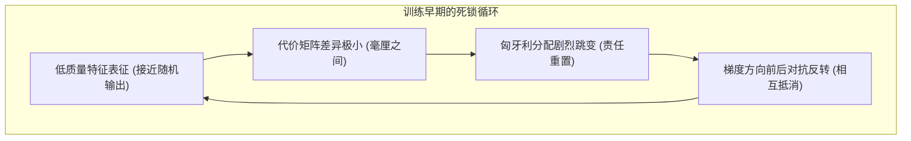
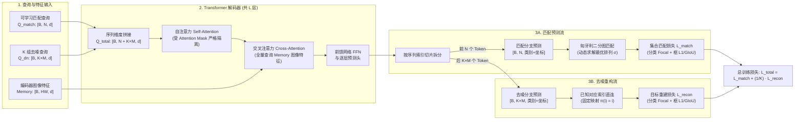
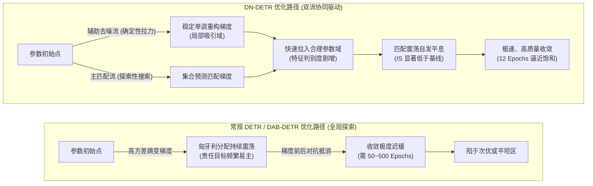

在 [4）Conditional 与 DAB-DETR：查询空间化](./conditional-dab-detr) 中，DAB-DETR 通过将查询显式解耦并参数化为四维动态锚框 $(x, y, w, h)$，消除了原版 Object Query 空间语义模糊与定位冷启动的难题，使解码器的交叉注意力从第 1 层起就能快速聚焦于局部几何区域。

然而，查询在空间上"知道往哪里看"，并不等同于它"知道该向哪个目标学习"。即使消除了注意力在全图的漫游收缩，DAB-DETR 依然需要约 50 个 Epoch 才能充分收敛。这一现象表明，在特征寻址的空间收缩之外，系统中还存在另一个阻碍优化的深层瓶颈——**二分图匹配在离散分配上的早期震荡**。

本篇聚焦于 **DN-DETR（Query DeNoising DETR，2022）**。它直接承接 DAB-DETR 的 4D 锚框表征，首次将慢收敛的根本矛盾定位为二分图匹配在离散解空间中的重算不稳定性，并通过在训练期引入无须匹配的旁路去噪任务，为网络注入稳定、局部的确定性梯度。

让我们首先从空间化未能触碰的机制分离谈起。

## 背景与问题：二分图匹配的不稳定性

在 DETR 的训练回路中，实际上并存着两个截然不同的核心机制：

1. **特征寻址（连续运算）：** 查询通过交叉注意力从图像特征图中提取上下文。这是连续、可微的神经网络计算，决定了注意力集中在图像的哪个局部区域；
2. **责任分配（离散决策）：** 匈牙利算法根据代价矩阵，为每个预测槽位指定具体的真值目标。这是非参数、离散的组合决策，决定了当前训练步由谁来提供监督梯度。

我们在第二篇中分析过，**匈牙利匹配本身不包含可学习参数，也不直接传导反向传播梯度**。它在整个训练回路中的唯一角色，就是在前向计算结束后，为每个预测槽位**指定监督责任**（谁算作正样本回归真值，谁算作背景被抑制）。这意味着，模型的参数更新方向完全受制于匈牙利算法在离散决策空间中的分配结果：

$$
\theta \leftarrow \theta - \eta \, \nabla_\theta \mathcal{L}_{\text{det}}\left(\theta; \, \hat{\sigma}^*(\theta)\right)
$$

其中 $\hat{\sigma}^*(\theta)$ 是匈牙利算法在当前参数状态下求得的最优排列：

$$
\hat{\sigma}^*(\theta) = \arg\min_{\sigma \in \mathfrak{S}_N} \sum_{i=1}^N \mathcal{L}_{\text{match}}\left(y_i, \, \hat{y}_{\sigma(i)}(\theta)\right)
$$

由于内层的排列决策 $\hat{\sigma}^*$ 是不可微的离散判定，当预测代价稍有波动时，最优排列 $\hat{\sigma}^*$ 就会发生阶跃式的切换。

因此，空间化改造（如 Conditional DETR 与 DAB-DETR）本质上只重构了**特征寻址机制**，使注意力在几何空间中收缩得更快；但它完全没有触及**离散责任分配机制**。只要匈牙利匹配在训练初期频繁推翻分配结果，每个查询槽位接收到的梯度方向就依然会在正向拉伸与反向抑制之间剧烈摆动。

这意味着，即使锚框已经具备了明确的物理几何含义，模型在训练初期仍旧会陷入由分配跳变带来的优化泥潭。要理解这一瓶颈并构建针对性的解决方案，我们需要深入剖析这种离散分配在训练早期引发的具体病态现象。

## 匹配震荡的来源与度量

在传统基于网格或密集 Anchor 的检测器（如 Faster R-CNN、RetinaNet）中，候选区域与真实目标的匹配通常基于空间重合度（如 IoU 阈值）等静态先验，正负样本的分配在训练全周期保持相对稳定。但在 DETR 类模型中，匈牙利算法将分配完全交给了网络当前的预测输出。

DN-DETR 的研究者指出，正是这种将“动态离散决策”作为监督分配唯一依据的设计，在训练早期引发了系统的**匹配震荡（Bipartite Matching Oscillation）**。为了从机理上理解并验证这一现象，我们需要从它的动力学成因、数学度量指标以及几何空间表现三个维度展开拆解。

### 匹配震荡的成因：离散二分图匹配的跳变

在原版 DETR 与 DAB-DETR 的训练框架中，存在着一个根本性的双向循环依赖：

- **匹配依赖表征：** 匈牙利算法要想给出合理、连贯的责任分配，前提是解码器输出的分类置信度和几何边界框具备足够的判别度；
- **表征依赖匹配：** 解码器和主干网络要想学出高质量的特征表征，前提是每个查询槽位必须接收到方向稳定、前后一致的梯度监督。



在训练早期，网络参数接近随机初始化，表征能力极其微弱。此时代价矩阵中不同槽位与某个真值之间的匹配代价相差无几。参数在梯度作用下的微小更新，就足以打破原有的微弱平衡，让匈牙利算法在离散解空间中选出完全不同的分配排列。

我们以一个最小系统为例：假设图像中只有 1 个真值目标 $y_1$，解码器中有两个空间位置相近的查询槽位 $q_1$ 和 $q_2$。

```text
Step t:   Cost(q1, y1) = 0.501,  Cost(q2, y1) = 0.499  -->  y1 分配给 q2 (q1 判为背景)
          q2 接收正样本拉向 y1 的梯度；q1 接收背景抑制梯度。

Step t+1: 由于参数微调，预测值微变:
          Cost(q1, y1) = 0.498,  Cost(q2, y1) = 0.502  -->  y1 突然改派给 q1 (q2 判为背景)
          q1 突然转为学习前景；刚刚朝 y1 移动的 q2 突然被作为背景向外推开。
```

在连续的训练迭代中，$y_1$ 的监督信号在 $q_1$ 与 $q_2$ 之间来回倒手。前一步累积的几何更新方向在后一步被直接判定为负样本惩罚，梯度在离散跳变中反复自我抵消。这种**匹配震荡（Bipartite Matching Oscillation）** 是导致 DETR 类模型早期收敛迟缓的底层数学原因。

:::note[匹配震荡与正样本稀疏的差异]
在分析收敛问题时，需要注意区分两个独立概念，**正样本稀疏（Sparsity）** 和 **匹配震荡（Oscillation）** 。
前者指的是每一轮前向传播中，参与计算回归损失的正样本槽位数量极少（每张图仅等于真值个数 $M$，远少于总槽位数 $N$）。这属于监督信号在空间维度上的**密度问题**；后者指的是同一个真值在相邻迭代步被分配给不同的查询槽位，导致特定槽位的监督目标来回跳跃。这属于监督信号在时间维度上的**一致性问题**。即使人为增加槽位数量，如果离散重算的震荡依然存在，优化的不稳定性就无法缓解。
:::

### 不稳定性的度量

为了定量证明匹配震荡的客观存在并评估其严重程度，DN-DETR 原文提出了**不稳定状态指标（Instability Score, IS）**。

设在第 $i$ 轮（Epoch）和第 $i-1$ 轮训练中，针对同一张图像中的 $M$ 个真实目标 $\mathbf{T} = \{T_0, T_1, \dots, T_{M-1}\}$ 以及解码器输出的 $N$ 个预测槽位 $\mathbf{O}^i = \{O_0^i, O_1^i, \dots, O_{N-1}^i\}$，匈牙利算法求解出的分配结果用一个长为 $N$ 的匹配索引向量 $\mathbf{V}^i = [V_0^i, V_1^i, \dots, V_{N-1}^i]^T$ 记录：

$$
V_n^i = \begin{cases}
m, & \text{若预测槽位 } O_n^i \text{ 匹配到真实目标 } T_m \\
-1, & \text{若预测槽位 } O_n^i \text{ 未匹配到任何真值（被判定为背景）}
\end{cases}
$$

第 $i$ 轮训练相对于前一轮的不稳定度 $\text{IS}^i$ 定义为两个匹配状态向量之间的汉明距离（即分配发生变化的槽位数）：

$$
\text{IS}^i = \sum_{n=0}^{N-1} \mathbb{I}\left(V_n^i \neq V_n^{i-1}\right)
$$

其中 $\mathbb{I}(\cdot)$ 为指示函数。全数据集上的不稳定度则取所有图像 $\text{IS}^i$ 的平均值。

该指标的物理意义如下：

- 若某张图像平均包含 $\bar{M}$ 个真值，在最极端的震荡情况下（即上一轮匹配的 $\bar{M}$ 个槽位全部丢失变为背景，同时另外 $\bar{M}$ 个原本为背景的槽位被重新分配为目标），单张图像的理论最大震荡上限为 $2\bar{M}$；
- 在 COCO 2017 验证集上，图像平均目标数 $\bar{M} \approx 7.36$，因此 $\text{IS}$ 的理论最大变化量约为 $7.36 \times 2 = 14.72$。

原论文将这一统计绘成了随训练轮次演变的曲线（12-epoch 训练日程，在 COCO 2017 验证集上逐轮统计）：


这条曲线给出了三个信息。首先，所有模型的 $\text{IS}$ 都随训练进程整体下降，说明离散重算的震荡会随着表征判别度的提升而自然缓解；其次，DN-DETR 的曲线全程位于 DAB-DETR 之下，且差距随训练逐渐拉开；最后，两条曲线在训练初期几乎重合，说明去噪并没有在前几轮就直接消除震荡，而是加快了匹配分配稳定下来的速度。原论文没有为这条曲线给出具体数值，只以 $7.36 \times 2 = 14.72$ 的理论上限作为参照。

把不稳定性放到整个 DETR 家族的收敛结果上看，去噪带来的收益更加直观。


在同为多尺度架构、训练预算相同的直接对比中，去噪的贡献可以被更干净地分离出来：


需要明确的是，$\text{IS}$ 指标仅用于离线统计与机制验证，其本身包含不可微的离散判定，**不参与任何训练损失的反向传播**。

### 预测框与真实框的几何距离变化

除了分配震荡之外，未稳定化的二分图匹配还导致了另一个几何层面的病态现象：**初始锚框到目标之间的平均几何距离（Anchor-Target Distance）过大**。

在原版 DETR 和 DAB-DETR 中，由于全局匈牙利算法允许将画面左上角的查询匹配给画面右下角的目标，查询在训练早期常常要跨越大半个图像区域去回归目标（在可视化中表现为一条长长的跨区域拉扯箭头）。这种长程拉扯带来了两个严重的副作用：

1. **优化搜索空间呈二次方膨胀：** 解码器不仅要微调物体轮廓，还必须学习大范围的平移迁移；
2. **多查询预测冲突（Prediction Conflicts）：** 多个查询在远距离拉扯过程中会跨越同一中间区域，互相争夺注意力权重，导致特征表示的模式混乱。

```text
DAB-DETR 的长程搜索 (高冲突):
[ Query 槽位 A ] ───────────────────────────────────────────> [ 目标 1 (远端) ]
                            ╲           ╱
                              [ 冲突交叠区 ]
                            ╱           ╲
[ Query 槽位 B ] ───────────────────────────────────────────> [ 目标 2 (远端) ]

DN-DETR 的局域化重构 (零冲突):
[ 带噪查询 A ] ──(短距离残差微调)──> [ 目标 1 ] (局部吸引域)
[ 带噪查询 B ] ──(短距离残差微调)──> [ 目标 2 ] (局部吸引域)
```

原文统计了解码器最终匹配目标与初始锚框之间的平均 $\ell_1$ 距离。需要说明的是，这组分析出自期刊扩展版新增的小节，会议版正文并无此项统计。扩展版的数据显示，DN-DETR 的平均距离在训练全程都低于 DAB-DETR 基线（约 0.082–0.110 对约 0.097–0.147），原文对此的表述是"初始锚框与目标之间的平均距离小得多"，并未给出具体缩减百分比。


去噪训练将每个去噪查询限制在其真值目标的邻域内，强迫网络学习以局部为中心的单峰响应函数，消除了跨区域的槽位冲突。

## 去噪训练的基本构造

### 去噪训练任务的构造方式

解决离散分配震荡最直接的思路，是**绕过求解二分图匹配的组合优化过程**。

DN-DETR 提出了一种基于查询去噪（Query DeNoising）的辅助训练路径：在训练阶段，算法不再将查询初始化为空白的隐向量或固定网格，而是直接从当前图像的真实标注集合（Ground Truth）出发。算法对真值的几何边界框注入适度空间噪声，对类别标签注入适度类别翻转噪声，将得到的**带噪查询（Noisy Queries）** 送入解码器，并要求解码器将其精确恢复为原本的无噪真实目标。


从几何优化的视角来看，去噪任务将原本全局无序的"探索性搜索"，转化为已知起点的"局部残差重构"：

- 输入的带噪框本身就已经落在真实目标的近邻空间域内；
- 网络的优化目标是将带噪框拉回真实框的位置，输出具有极其明确的局部单调梯度，不会发生跨区域的多目标竞争。

### 固定指派机制：规避二分图匹配

去噪分支能够保持绝对稳定的核心机理，在于其**监督分配关系的先验确定性**。

在原版的匹配分支中，查询槽位 $q_j$ 与真值 $y_i$ 的对应关系是通过代价矩阵动态搜索出来的：

$$
\sigma = \arg\min_{\sigma \in \mathfrak{S}_N} \sum_{i=1}^N \mathcal{L}_{\text{match}}\left(y_i, \hat{y}_{\sigma(i)}\right)
$$

而在去噪分支中，每个去噪查询 $q_i^{\text{noise}}$ 在构造时就是由第 $i$ 个真实目标 $y_i$ 经过加噪生成的。因此，输出槽位 $\hat{y}_i^{\text{noise}}$ 与监督目标 $y_i$ 之间的对齐映射 $\pi(i) = i$ 是一对一固化在输入端的常量：

$$
\mathcal{L}_{\text{recon}} = \sum_{i=1}^M \mathcal{L}_{\text{step}}\left(\hat{y}_i^{\text{noise}}, y_i\right)
$$

由于彻底剔除了组合搜索步骤，无论网络当前的前向预测输出是什么，反向传播的梯度归属永远不会改变。这种稳定的监督流为特征提取网络提供了可靠的更新基准。

去噪分支是纯粹的**训练期辅助分支**，与原有的匹配分支在解码器内部并行计算。它并不替换原有的匹配分支，而是作为稳定器存在。

### 去噪分支的内容嵌入设计

在 DAB-DETR 中，查询的内容嵌入部分（Content Query）是一个无分类语义的连续向量。为了使去噪分支能够同时执行类别去噪（Label DeNoising），DN-DETR 对解码器的内容输入进行了结构性重构。

DN-DETR 引入了一个**可学习的类别嵌入表（Label Embedding Table）** $\mathbf{E} \in \mathbb{R}^{(C + 1) \times d}$，其中包含 $C$ 个前景类别嵌入向量和一个特殊的 `unknown` 类别嵌入向量（索引为 $C$）。同时，为了让网络区分当前查询究竟来自去噪分支还是匹配分支，向量末尾拼接了一个 1 维的**指示位（Indicator）**：

$$
\text{Content Query} = \big[\mathbf{E}[c], \; \text{indicator}\big] \in \mathbb{R}^{d + 1}
$$

两类分支的输入配置完全正交且对称：

1. **去噪查询（DN Query）：** 传入带噪的类别索引 $c^{\text{noise}} \in \{0, \dots, C-1\}$，指示位设为 1。网络通过内容向量接收到了带有先验提示的类别信息；
2. **匹配查询（Matching Query）：** 传入 `unknown` 类别索引 $C$，指示位设为 0。网络无法获得任何关于具体类别的先验提示，必须完全依靠图像交叉注意力自主判别。

```text
去噪查询内容输入: [ E[c_noise] (类别语义先验)  |  indicator = 1 ]
匹配查询内容输入: [ E[unknown] (无先验隐向量)  |  indicator = 0 ]
```

这种重构使去噪任务与检测任务在解码器内部实现了特征维度的严格对齐。

## 噪声的形式与多组复制

在具体实现中，DN-DETR 的噪声直接施加在目标级的查询表征（4D 空间锚框与类别标签）上，而不是在图像像素层面做数据增强。

### 噪声类型：坐标扰动与类别翻转

加噪过程对空间几何与类别语义独立实施：

- **边界框几何扰动：** 对真实框 $b=(x, y, w, h)$，在中心点与宽高尺度上分别施加受控均匀噪声。中心偏移量被严格限制在框尺寸的一定比例内（默认 $\lambda=0.4$），确保加噪后的锚框中心点依然落在真实目标内部；宽高扰动则模拟尺度估计误差。
- **类别标签随机翻转：** 以预设概率 $\gamma$（默认 0.2）将真实类别随机替换为其他类别。这一设计极为关键：若 $\gamma=0$（不翻转），网络会退化为直接透传输入类别而忽略图像特征；若 $\gamma=1.0$（全翻转），先验完全沦为纯噪声；保持低概率翻转强迫网络结合交叉注意力中的视觉特征来纠正潜在错误。

```text
真实目标: 
  Box: [0.50, 0.50, 0.20, 0.20],  Label: "Cat" (ID: 3)
                      ↓ 注入噪声 (λ=0.4, γ=0.2)
带噪查询: 
  Box: [0.53, 0.48, 0.24, 0.18],  Label: "Dog" (ID: 7)  <-- 类别发生翻转
                      ↓ 送入解码器重构
监督目标 (固定对齐):
  回归目标: [0.50, 0.50, 0.20, 0.20],  分类目标: "Cat" (ID: 3)
```

噪声强度 $\lambda$ 并非越大越好。DN-DETR 原文对中心噪声与尺度噪声分别做了消融，AP 随噪声尺度呈单峰分布：过小的噪声使去噪任务退化为平凡的恒等映射，模型无需真正调用图像特征；过大的噪声则让带噪框偏离目标过远，重构任务失去意义。


### 多组复制

自然图像中单张图片的真值数通常较少（COCO 平均每张约 7 个）。为了让去噪分支提供足够密度的梯度，DN-DETR 引入了**多组复制机制**：将每张图的 $M$ 个真实目标复制 $K$ 份（通常 $K=5$），每组**独立采样**随机几何与类别噪声，产生 $K \times M$ 个去噪查询。

多组复制成倍增加了正样本的监督密度，且不破坏原本一对一匹配的结构。这里有一处边界值得记下：DN-DETR 的去噪查询全部是正样本，无论噪声取多大，监督目标始终是它自己对应的那一个真值，去噪分支里没有被判为 `no-object` 的查询。也就是说，这一阶段训练只教模型怎么把带噪框找回来，没有教它什么时候应该放弃。具体加噪公式见附录。

## 匹配分支与去噪分支的并行

### 匹配分支与去噪分支的输入与损失划分

在训练过程中，整个模型同时接收两组完全不同的查询集合：

1. **匹配查询（Matching Queries / Learnable Queries）：** 数量为 $N$（如 300 个）。其空间锚框与内容嵌入均来自模型内部可学习的参数张量，用于正常的端到端检测探索。
2. **去噪查询（DeNoising Queries）：** 数量为 $K \times M_{\max}$（其中 $M_{\max}$ 为当前 Batch 中单张图像包含的最大真值数，不足部分用占位符填充并配合掩码处理）。其输入直接由真实真值加噪产生。

两类查询在前向传播与损失计算中的数据流转关系如下表所示：

| 属性 | 匹配分支 (Matching Branch) | 去噪分支 (DeNoising Branch) |
| :--- | :--- | :--- |
| **查询数量** | 固定数量 $N$（如 300） | 动态数量 $K \times M_{\max}$（如 $5 \times 7 = 35$） |
| **输入来源** | 可学习的先验参数嵌入 | 由真实真值加噪生成的锚框与类别嵌入 |
| **匹配机制** | 动态匈牙利二分图匹配求解 $\sigma$ | 输入时预先绑定的静态硬对齐 $\pi(i) = i$ |
| **损失函数** | 集合预测损失 $\mathcal{L}_{\text{match}}$（含 Hungarian 排序） | 目标重建损失 $\mathcal{L}_{\text{recon}}$（直接对应项求和） |
| **反向传播性质** | 离散震荡、梯度方差大（早期） | 局部单调、梯度方向高度稳定 |
| **推理期保留状态** | **保留**（唯一的实际预测输出） | **完全舍弃**（不引入任何计算与参数负担） |

### 解码器内的双流计算与张量流转

为了避免分别运行两次解码器带来的额外计算开销，DN-DETR 将匹配查询与所有去噪组的查询在序列长度维度（Sequence Dimension）直接**拼接（Concatenate）** 为一个统一的大张量：

$$
Q_{\text{total}} = \big[\underbrace{q_1^{\text{match}}, \dots, q_N^{\text{match}}}_{\text{匹配分支: } N \text{ 个}}, \; \underbrace{q_1^{\text{dn}, 1}, \dots, q_M^{\text{dn}, 1}}_{\text{去噪第 } 1 \text{ 组: } M \text{ 个}}, \; \dots, \; \underbrace{q_1^{\text{dn}, K}, \dots, q_M^{\text{dn}, K}}_{\text{去噪第 } K \text{ 组: } M \text{ 个}}\big] \in \mathbb{R}^{(N + K \cdot M) \times d}
$$

整个训练过程中的前向计算与损失归属数据流如下图所示：



前向传播的完整计算步骤与张量流转如下：

1. **输入拼接：** 将可学习匹配查询与 $K$ 组带噪查询拼接为长度为 $N + K \cdot M$ 的单一序列，批大小为 $B$；
2. **掩码自注意力：** $Q_{\text{total}}$ 输入解码器自注意力层，利用注意力掩码使两类查询在同一次计算中并行且彼此隔离；
3. **全量跨注意力：** 自注意力的输出统一作为 $Q$，以编码器输出的图像特征张量 $\text{Memory} \in \mathbb{R}^{B \times HW \times d}$ 作为 $K$ 和 $V$，全量读取视觉特征；
4. **输出拆分与损失分流：** 解码器最后一层（以及各辅助解码层）的输出张量被按序列前 $N$ 与后 $K \cdot M$ 拆开：
   - 前 $N$ 个输出送入匈牙利算法，根据预测代价动态匹配真值，计算集合预测损失 $\mathcal{L}_{\text{match}}$；
   - 后 $K \cdot M$ 个输出直接与其加噪前对应的真实真值计算重建损失 $\mathcal{L}_{\text{recon}}$，无需任何匹配计算；
5. **反向传播：** 两部分损失加权求和，梯度同时回传至解码器和主干网络。

## 注意力掩码与信息隔离

将去噪查询与匹配查询拼入同一个解码器计算时，系统面临着严重的信息泄漏风险。设计严密的**注意力掩码（Attention Mask）** 是保证去噪训练正确性的数学基础。

### 注意力掩码的隔离必要性

在 Transformer 自注意力中，如果允许全量查询自由交互，会引发两类致命的信息泄漏：

1. **阻断去噪向匹配泄漏：** 去噪查询的坐标高度贴近真值。若允许匹配查询关注去噪查询，匹配查询在自注意力层只需直接抄袭去噪特征，就能在预测头输出完美结果。这会导致二分图匹配学习彻底崩溃，模型退化为依赖"作弊"而失去从图像提取特征的能力。一旦推理期丢弃去噪分支，匹配分支将完全瘫痪。
2. **阻断不同去噪组之间的交互：** 同一个真值在不同去噪组中被施加了独立的随机噪声。若允许不同组互相交互，网络只需对多组噪声做简单的平均或互校即可恢复原始真值，去噪任务退化为多视图滤波，丧失了迫使网络结合图像特征完成几何重构的初衷。

原论文消融实验表明：**若移除掩码（允许全量交互），AP 将从 43.4 跌至 24.0**（1 个去噪组、ResNet-50、50-epoch 设定），不仅远低于带掩码的完整模型，甚至比不使用去噪的 42.2 基线还低——去噪分支从稳定器变成了信息泄漏源，反向印证了信息隔离对训练正确性的决定性作用。

### 掩码矩阵的分块实现

为实现完全隔离，自注意力掩码矩阵呈现出严格的**对角分块（Block-diagonal）** 结构：

- **匹配查询（前 $N$ 个）：** 只能关注匹配查询内部，对所有去噪组填入 $-\infty$（屏蔽）；
- **第 $k$ 组去噪查询（中间 $M$ 个）：** 只能在本组内部交互，对匹配查询以及所有其他去噪组全部填入 $-\infty$。

这种设计让 1 个匹配分支和 $K$ 个去噪组在单个自注意力算子中完全并行计算，既无特征穿透风险，又兼顾了计算效率。具体的掩码张量数学形式与矩阵表格见附录。

## 动力学分析：去噪训练对收敛过程的影响

在厘清了数据流与掩码构造后，我们可以站在损失曲面与参数优化的宏观视角，审视 DN-DETR 为何能够显著改变 Transformer 检测器的训练轨迹。



1. **从全局组合搜索到局部几何重构：**
   原版的端到端集合预测本质上是一个极其困难的非凸联合优化问题：网络既要学习如何提取实例特征，又要学习如何在无序的槽位空间中自组织完成组合分配。在二分图匹配频繁震荡的早期阶段，参数更新的方差极大。
   去噪分支实质上将一部分优化压力转化为确定性的局部回归问题。网络接收到的带噪查询位于真值的局部吸引域（Basin of Attraction）内，梯度更新方向呈现出良好的局部凸性与确定性。
2. **两阶段效应与特征牵引：**
   在训练的最早期，去噪分支产生的稳定梯度占据主导地位，迅速将共享的主干网络（Backbone）和解码器交叉注意力参数牵引至能够有效提取物体几何特征的状态；
   随着特征提取质量的快速上升，代价矩阵中不同候选槽位的可区分度大幅提高，此时主匹配分支面临的二分图跳变现象自发消失，系统平滑过渡到以端到端匹配为主导的微调阶段。

原论文在 MS-COCO 2017 验证集上的对比实验（基于 ResNet-50 骨干，详细指标见附录 C）直接佐证了这一优化路径改变带来的加速效果：

- 在 12-epoch 的短日程（1×）训练下，DN-DETR-DC5 取得了 41.7 AP，已经极其接近未加去噪的 DAB-DETR 训练 50-epoch 的饱和性能（44.5 AP）；
- 当去噪训练与多尺度可变形注意力（Deformable Attention）结合时（DN-Deformable-DETR），在仅训练 12 个 Epoch 时就取得了 43.4 AP，相比原始 Deformable DETR 提升了 6.2 AP，几乎完全消除了传统 DETR 架构在 1× 短周期训练下性能断崖式落后的短板。

:::info[问题]
**去噪分支在推理时被直接丢弃，为什么留存下来的匹配分支在测试时性能会大幅提升？**

核心原因在于**主干网络、特征投影层、解码器交叉注意力以及预测头参数是完全共享的**。
去噪任务在前向传播中同样强迫解码器利用交叉注意力去检索真实目标的边缘特征。去噪分支回传的稳定梯度，在训练初期帮助这套共享权重完成了高质量的特征模式沉淀；因此，当测试期只有匹配查询输入时，共享的特征提取网络已经具备了极强的目标判别与边界回归能力。
:::

## 推理保留与遗留问题

### 推理阶段的处理与计算开销

去噪训练机制在工程落地上的一个显著优势在于其**推理期零成本（Zero-overhead Inference）**。

去噪分支的所有组件——包括带噪真值的生成逻辑、标签翻转模块、$K$ 组去噪查询的显式嵌入、以及自注意力中的掩码防火墙——其生命周期均严格局限在 `train()` 模式下。

当模型切换至 `eval()` 模式进行推理时：

- 模型直接丢弃所有去噪查询输入，仅输入原本的 $N$ 个可学习匹配查询；
- 自注意力掩码矩阵退化为常规的全零（全连接）矩阵；
- 解码器仅执行标准的前向计算，输出维度与原版 DETR 完全一致。

网络没有增加任何额外的推理参数，没有引入任何特殊的硬件定制算子，亦没有增加哪怕 1 FLOPs 的推理计算延迟。去噪机制完全是一种纯粹的**训练期脚手架（Training-time Scaffold）**。

### 遗留问题：负样本缺失与重复预测

尽管 DN-DETR 极为漂亮地解决了二分图匹配的早期震荡问题，但站在整个 DETR 架构演进的角度审视，它依然留下了若干尚未解决的深层次瓶颈：

1. **查询初始化依然依赖静态先验：**
   去噪分支虽然加速了训练，但负责最终推理的 $N$ 个匹配查询，其初始空间锚框 $(x, y, w, h)$ 和内容嵌入在面对不同输入图像时依然是完全固定的可学习偏置，未能做到依据输入图像的内容动态生成（Content-aware Initialization）。
2. **正样本利用率在推理分支依然受限：**
   多组复制机制虽然增加了去噪分支的正样本密度，但负责最终检测的匹配分支依然固守着严格的"一对一"单目标匹配拓扑。一对一分配所带来的正样本稀疏性，依然制约着特征表示的学习效率。

这两个遗留问题，直接开启了后续两大学术演进脉络：

- 第一个问题（如何将去噪机制、内容感知初始化与多尺度形变架构彻底融合）将在 [DINO](./dino) 中得到集大成的解答；
- 第二个问题（如何在匹配分支本身打破一对一监督稀疏瓶颈）则引出了 [Group DETR](./group-detr) 等一系列基于正样本扩增的创新设计。

## 小结

本篇系统拆解了 DN-DETR 稳定离散匹配震荡的底层机理与实现细节：

1. **震荡根源：** 空间化解决了连续寻址收缩，但未能消除匈牙利匹配在离散分配空间的重算震荡；训练早期的微小预测扰动会导致监督目标来回跳变，引发梯度对抗抵消；
2. **去噪构造：** 通过对真实真值施加受控的几何扰动与类别翻转，构建了监督对齐关系完全固定的辅助去噪分支，将全局组合搜索转化为稳定的局部几何重构；
3. **隔离掩码：** 自注意力掩码在矩阵层面严格阻断了去噪向匹配的信息泄漏以及不同去噪组之间的特征互通，确保了端到端检测任务的训练正确性；
4. **技术边界：** 去噪是推理期零负担的训练脚手架；它平抑了早期震荡，但匹配查询的动态初始化与一对一监督稀疏问题仍有待后续篇章进一步攻克。

## 附录：实现与公式细节

### A. 加噪公式的形式化定义

每个去噪查询由 4D 空间锚框 $b=(x, y, w, h)$ 与类别嵌入两部分构成。

#### 边界框几何扰动

设图像中真实目标为 $b = (x, y, w, h) \in (0, 1)^4$，中心点与宽高尺度上施加的均匀分布噪声为：

$$
\begin{aligned}
\Delta x &\sim \mathcal{U}\left(-\frac{\lambda_1 w}{2}, \frac{\lambda_1 w}{2}\right), \quad &\Delta y &\sim \mathcal{U}\left(-\frac{\lambda_1 h}{2}, \frac{\lambda_1 h}{2}\right) \\
\Delta w &\sim \mathcal{U}\left(-\lambda_2 w, \lambda_2 w\right), \quad &\Delta h &\sim \mathcal{U}\left(-\lambda_2 h, \lambda_2 h\right)
\end{aligned}
$$

加噪后的带噪锚框 $b^{\text{noise}} = (x', y', w', h')$ 计算为：

$$
\begin{aligned}
x' &= x + \Delta x, \quad &y' &= y + \Delta y \\
w' &= w + \Delta w, \quad &h' &= h + \Delta h
\end{aligned}
$$

中心偏移量因 $|\Delta x| < \frac{\lambda_1 w}{2} < \frac{w}{2}$ 而保证加噪中心必落在原框内；尺度扰动使 $w' \in [(1-\lambda_2)w, (1+\lambda_2)w]$。默认取 $\lambda_1 = \lambda_2 = 0.4$。

#### 类别标签随机翻转

设真实类别索引为 $c \in \{0, 1, \dots, C-1\}$，以翻转概率 $\gamma$（默认 0.2）将其替换为其他类别：

$$
c^{\text{noise}} = \begin{cases}
c_{\text{rand}} \sim \mathcal{U}(\{0, \dots, C-1\} \setminus \{c\}), & \text{以概率 } \gamma \\
c, & \text{以概率 } 1 - \gamma
\end{cases}
$$

### B. 自注意力掩码矩阵结构

自注意力掩码矩阵 $\mathbf{M} \in \mathbb{R}^{(N + K \cdot M) \times (N + K \cdot M)}$ 呈现出严格的对角分块（Block-diagonal）结构：

$$
\mathbf{M} = \begin{bmatrix}
\mathbf{0}_{N \times N} & -\boldsymbol{\infty} & -\boldsymbol{\infty} & \cdots & -\boldsymbol{\infty} \\
-\boldsymbol{\infty} & \mathbf{0}_{M \times M} & -\boldsymbol{\infty} & \cdots & -\boldsymbol{\infty} \\
-\boldsymbol{\infty} & -\boldsymbol{\infty} & \mathbf{0}_{M \times M} & \cdots & -\boldsymbol{\infty} \\
\vdots & \vdots & \vdots & \ddots & \vdots \\
-\boldsymbol{\infty} & -\boldsymbol{\infty} & -\boldsymbol{\infty} & \cdots & \mathbf{0}_{M \times M}
\end{bmatrix}
$$

各分块可见性规则如下（以 $N$ 个匹配查询和 $K=2$ 组去噪查询为例）：

| 行：Query（查询方） \ 列：Key（被查方） | Key: 匹配槽位（$N$ 个） | Key: 去噪组 1（$M$ 个） | Key: 去噪组 2（$M$ 个） |
| :--- | :--- | :--- | :--- |
| **Query: 匹配槽位（$N$ 个）** | $\mathbf{0}_{N \times N}$（自由交互） | $-\boldsymbol{\infty}_{N \times M}$（屏蔽） | $-\boldsymbol{\infty}_{N \times M}$（屏蔽） |
| **Query: 去噪组 1（$M$ 个）** | $-\boldsymbol{\infty}_{M \times N}$（屏蔽） | $\mathbf{0}_{M \times M}$（组内交互） | $-\boldsymbol{\infty}_{M \times M}$（屏蔽） |
| **Query: 去噪组 2（$M$ 个）** | $-\boldsymbol{\infty}_{M \times N}$（屏蔽） | $-\boldsymbol{\infty}_{M \times M}$（屏蔽） | $\mathbf{0}_{M \times M}$（组内交互） |

在批处理中，填充补齐的占位查询（Padding Queries）所在的整行整列额外全量置为 $-\infty$。

### C. 去噪训练基准指标对比

下表汇总了 DAB-DETR 与 Deformable DETR 在引入去噪训练前后于 COCO 2017 验证集上的性能对比（ResNet-50 骨干网络）：

| 模型架构 | 训练轮次 (Epochs) | AP | $\text{AP}_{50}$ | $\text{AP}_{75}$ | $\text{AP}_{\text{S}}$ | $\text{AP}_{\text{M}}$ | $\text{AP}_{\text{L}}$ | 相对基线提升 |
| :--- | :--- | :--- | :--- | :--- | :--- | :--- | :--- | :--- |
| **DAB-DETR-DC5** | 12 (1×) | 38.0 | 60.3 | 39.8 | 19.2 | 40.9 | 55.4 | 基线 |
| **DN-DETR-DC5** | 12 (1×) | **41.7** | 61.4 | 44.1 | 21.2 | 45.0 | 60.2 | **+3.7 AP** |
| **DAB-DETR-DC5** | 50 | 44.5 | 65.1 | 47.7 | 25.3 | 48.2 | 62.3 | 基线 |
| **DN-DETR-DC5** | 50 | **46.3** | 66.4 | 49.7 | 26.7 | 50.0 | 64.3 | **+1.8 AP** |
| **Deformable DETR** | 12 (1×) | 37.2 | 55.5 | 40.5 | 21.1 | 40.7 | 50.5 | 基线 |
| **DN-Deformable-DETR** | 12 (1×) | **43.4** | 61.9 | 47.2 | 24.8 | 46.8 | 59.4 | **+6.2 AP** |

下一篇：[DINO](./dino)。
