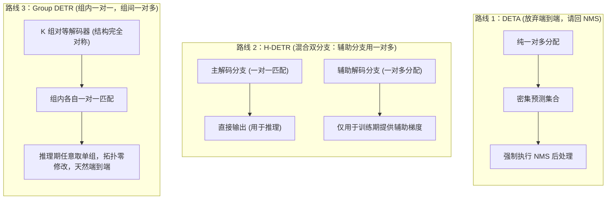

# Group DETR：训练期查询分组

在前面六篇的演进脉络中，研究者针对 DETR 的架构缺陷推进了三条主线：[3）Deformable DETR：稀疏采样与多尺度注意力](./deformable-detr) 重构了特征读取拓扑，利用稀疏局部采样化解了密集全局计算开销；[4）Conditional 与 DAB-DETR：查询空间化](./conditional-dab-detr) 为查询槽位赋予了四维动态锚框 $(x, y, w, h)$，解决了定位冷启动；[5）DN-DETR：查询去噪与早期匹配稳定化](./dn-detr) 与 [6）DINO：三处接口的联合设计](./dino) 则通过引入加噪真值锚框的旁路任务与三处核心接口重构，消除了训练早期的离散二分图匹配剧烈震荡。

这些工作极大地加快了训练收敛，并将 COCO 上的检测精度推向了新的高度。然而，当我们退后一步审视整套系统的**损失计算与梯度流**时，会发现一个贯穿始终且从未被正面触碰的底层结构性矛盾：**正样本监督信号在空间维度上极度稀疏**。

尽管 DN-DETR 和 DINO 通过旁路去噪分支注入了密集的确定性梯度，但作为目标检测核心的**真实二分图匹配分支**，其正样本分配逻辑自原版 DETR 确立以来从未改变——每一个真实目标有且仅能分配给唯一一个预测槽位（即**一对一匹配，One-to-One Assignment**）。

本篇聚焦于 **Group DETR（Chen 等人，ICCV 2023）**，剖析研究者如何通过**组间解耦的一对多匹配**与**分组自注意力隔离**，在完全保留端到端一对一推理架构的前提下，系统性解决训练期正样本监督极度稀疏的瓶颈。

## 问题背景

### 正样本监督稀缺问题

在传统卷积目标检测器（如 Faster R-CNN、RetinaNet 或 FCOS）中，训练期普遍采用**一对多分配（One-to-Many Assignment）**策略：对于图像中的每一个真实目标（Ground Truth, GT），算法会根据空间交并比（IoU）或中心采样区域，将数十个甚至上百个候选锚框或特征图像素标记为正样本。

以单阶段无锚框检测器 FCOS 为例，一个真实目标框内部往往有数十个空间特征点同时被赋予前景分类标签与中心度连续回归目标。在反向传播时，这几十个空间位置同时向骨干网络与特征金字塔回传边界框几何残差梯度与分类梯度。

而端到端 DETR 的分配拓扑则完全相反。在标准的 COCO 训练集上，单张图像中平均仅包含约 7 个真实目标。在配备 $N = 300$ 个查询槽位的解码器中：

- 仅有 7 个查询槽位能与真实目标成功匹配，接收到分类交叉熵（或 Focal Loss）以及边界框 $\ell_1$ 和 GIoU 的正样本回归梯度；
- 其余 293 个查询槽位（占比超过 97%）全部被强制指派给虚拟的背景类别（`no-object`），且完全不产生任何几何回归损失。

这就引出了一个常常被混淆的概念界定：**样本不平衡（Imbalance）** 与 **正样本稀缺（Scarcity）** 的本质区别。

在原版 DETR 中，作者通过调小背景类别的损失权重（如 $\text{no-object weight} = 0.1$）或者改用 Focal Loss，能够有效缓解由于背景负样本数量过多而导致的梯度淹没。但**负样本降权仅仅是在优化层面对已有梯度进行重新平衡（Re-weighting），它无法凭空变出新的正样本几何监督信号**。整个特征提取器与解码器在绝大部分计算路径上，接收到的全是“这里不是物体”的抑制性负反馈，真正用于指引“物体几何边界应当如何拟合”的正向定位梯度，在空间覆盖度与信息量上都比传统检测器低了一到两个数量级。

:::info[问题]

**为什么不能将 DN-DETR 和 DINO 的去噪分支等同于正样本增密？**

在第五篇与第六篇中，去噪分支确实引入了额外的正样本查询。但去噪查询具有明确的特殊性：

1. **几何起点锚定在真值附近：** 去噪查询是由真值框添加微小噪声合成而来，它们的坐标天生落在目标周围，属于无须搜索的局部拟合任务；
2. **完全绕过匈牙利匹配：** 去噪分支的归属关系由人工显式指定，不需要网络在全图范围内进行槽位竞逐与二分图分配；
3. **核心预测槽位并未受益：** 在真实的匹配分支中，模型依然只能依靠极度稀疏的 7 个正样本去从全局特征图里探索目标分布。

换句话说，去噪任务是在外围给模型“搭梯子”，但并没有改变核心匹配分支“单木难支”的正样本稀疏物理现实。

:::

### 朴素一对多的失效机理

既然传统检测器的一对多分配能够提供充沛的正样本梯度，一个最符合直觉的设想便是：**我们能否直接废除匈牙利一对一匹配，强行让 DETR 的多个查询槽位去匹配同一个真实目标？**

例如，选择与真实目标代价最低的前 $k$ 个预测槽位，或者采用动态阈值将多个候选框都设为该目标的匹配项。

原论文通过受控实验（Table 7(b)，拓扑对应 Figure 2(c)）直接宣判了这一朴素尝试的破产：将基线模型（Conditional DETR）的 300 个查询扩展至 3300 个，并直接施加朴素一对多匹配进行训练与推理，模型的检测精度从基线的 **32.6 AP 断崖式暴跌至 8.4 AP**。

这并不是收敛快慢的问题，而是网络输出的预测结果在物理上彻底不可用。这一崩溃的底层机理在于：**一对一匹配是 DETR 消除非极大值抑制（NMS）后处理的唯一数学前提。**

我们在 [2）原版 DETR：二分图匹配与集合损失](./detr-v1-bipartite-matching-set-loss) 中深入剖析过，DETR 之所以能实现端到端直接预测集合，是因为二分图匹配在数学上构筑了一个排他性的竞争博弈（Figure 2(c)）：

$$
\mathcal{L}_{\text{match}}(y, \hat{y}) = \sum_{i=1}^M \ell(y_i, \hat{y}_{\sigma(i)}) + \sum_{j \notin \{\sigma(i)\}} \ell_{\text{cls}}(\varnothing, \hat{y}_j)
$$

在同一个预测集合内部，对于某个真实目标，系统**只奖励那个拟合得最好的唯一样本，而将所有紧邻的、重叠度极高但稍逊一筹的冗余预测槽位全部判为背景并强力压制**。配合解码器内部的自注意力机制，不同槽位在层间不断交换信息，达成“你负责这个目标，我负责背景”的槽位协商，从而将“去重”内化成了模型的前向推理能力。

而一旦施加朴素一对多分配：

1. **竞争机制荡然无存：** 紧邻真实目标的多个查询槽位同时被赋予正样本身份，损失函数同时鼓励它们输出高置信度与贴近真值的坐标；
2. **训练目标与推理需求直接冲突：** 模型在训练期被明确教导去针对同一个目标生成多个重合的冗余高分框；
3. **推理期无法自洽：** 在推理阶段，由于缺乏一对一竞争惩罚，解码器会输出密集的重复假阳性，必须强行把手工设计的 NMS 挂回后处理流程，这直接摧毁了 DETR 架构端到端预测的核心价值。

因此，DETR 面临的真正技术两难是：**训练期迫切需要一对多的充沛监督信号来加快收敛，但推理期必须严格保持一对一的排他性竞争以剔除冗余。**

## Group DETR 的核心机制

### 查询组的定义与概念界定

在深入具体算法之前，必须首先廓清“**查询分组（Group DETR）**”在概念上最容易引发的一处直觉误解：**这里并不存在任何“把已有查询进行聚类或动态切分（Partition / Clustering）”的操作**。事实上，“分组”在 Group DETR 中不是一个对既有张量做后验划分的**动词**，而是指系统在训练期以“组（Group）”为边界单位去组织 **多套** **完整** 的查询空间。

| 架构形态 | 查询总数与组织形式 | 匈牙利匹配域 | 最终端到端输出 |
| :--- | :--- | :--- | :--- |
| **标准 DETR** | 单组，共 $N = 300$ 个槽位 | 在全量 300 个槽位内做全局一对一匹配 | 300 个候选预测 |
| **朴素一对多** | 单组，共 $M = 3300$ 个槽位 | 在全量 3300 个槽位内让 1 个 GT 认领多个槽位 | 3300 个预测（严重重复，需 NMS） |
| **Group DETR** | **$K$ 组独立的查询**，每组包含完整的 $N = 300$ 个槽位（共 $K \times N = 3300$ 个） | **以组为封闭边界**，每组各自独立做内部一对一匹配 | 推理期仅取第 1 组（300 个），天然无冗余 |

换句话说，Group DETR 的“分组”，实质上是**在原本 1 组完整查询的基础上，在训练期横向复制并实例化了 $K-1$ 组完全平行的查询集合（Multi-Group Queries）**。

### 查询生成机制：单阶段与两阶段的物理初始化

那么，这 $K$ 组相互独立的查询在网络实现中究竟是如何生成的？原论文根据底层检测器是单阶段还是两阶段，给出了两种清晰的生成机制：

1. **单阶段固定查询架构（如 Conditional DETR、DAB-DETR、DN-DETR）：**
   在这些模型中，查询是全局可学习的静态嵌入向量。原版模型仅需定义单套参数表：

   ```python
   # 标准 DETR：单组 300 个查询
   self.query_embed = nn.Embedding(300, hidden_dim)
   ```

   而在 Group DETR 中，代码直接将参数表扩充 $K$ 倍：

   ```python
   # Group DETR (设 K=11)：直接实例化 11 组独立的查询向量
   self.query_embed = nn.Embedding(11 * 300, hidden_dim)
   ```

   这 $K \times N$ 个参数在网络构建时**各自独立随机初始化**，没有任何跨组的数值绑定或共享约束；在训练期间，它们沿着各自接收到的梯度自由探索、独立演化。

2. **两阶段特征先验架构（如 DINO、Deformable DETR Two-Stage）：**
   在两阶段模型中，解码器的初始锚框与内容特征不再由静态 Embedding 决定，而是根据第一阶段（Encoder 之后）的特征分数动态挑出 Top-$N$ 个先验框。此时无法直接通过定义静态 Embedding 来扩充组数。
   原论文在附录 A.2 中给出了对应的适配方案：**在第一阶段构建 $K$ 对平行的分类与回归预测头（Predictor Heads）**。在 Encoder 输出特征图后，这 $K$ 对预测头分别打分并各自挑选出属于该组的一套 Top-$N$ 提议框，分别作为解码器第 1 组、第 2 组直至第 $K$ 组的输入锚框。而在推理阶段，模型直接丢弃其余 $K-1$ 对头，仅保留第 1 对头输出的 Top-$N$ 框，与基线推理拓扑保持百分之百的一致。

### 组内与组间匹配规则

在明确了 $K$ 组完整查询的来源之后，Group DETR 解决前述结构矛盾的切入点便水到渠成：**它没有在单个预测集合内部去修改一对一的匹配规则，而是在训练期构造了多个完全平行的预测空间**。

具体而言，Group DETR 在训练阶段引入 $K$ 组完全独立的目标查询（Object Queries）：

$$
\mathbf{Q} = \left\{ \mathbf{Q}_1, \mathbf{Q}_2, \dots, \mathbf{Q}_K \right\}, \quad \text{其中每组 } \mathbf{Q}_k \in \mathbb{R}^{N \times C}
$$

解码器随之输出 $K$ 组预测集合 $\left\{ \mathbf{Y}_1, \mathbf{Y}_2, \dots, \mathbf{Y}_K \right\}$。在计算匹配与监督损失时，算法执行**组内一对一（Group-Wise One-to-One）**分配：

$$
\sigma_k = \arg\min_{\sigma \in \mathfrak{S}_N} \sum_{n=1}^N \mathcal{L}_{\text{cost}}(y_n, \hat{y}_{\sigma(n)}^{(k)}), \quad k = 1, 2, \dots, K
$$


整个训练损失是 $K$ 个组损失的算术平均：

$$
\mathcal{L}_{\text{total}} = \frac{1}{K} \sum_{k=1}^K \mathcal{L}_{\text{det}}\left( \mathbf{Y}_k, \bar{\mathbf{Y}}, \sigma_k \right) = \frac{1}{K} \sum_{k=1}^K \sum_{n=1}^N \ell\left( \mathbf{y}_{\sigma_k(n)}^{(k)}, \bar{\mathbf{y}}_n \right)
$$

从宏观视角看，这套设计实现了双重视角下的完美统一：

| 观察视角 | 结构状态 | 产生的数学与物理效果 |
| :--- | :--- | :--- |
| **组内微观视角** | **严格的一对一分配** | 每一组内部，一个 GT 只能被唯一一个槽位认领，其余槽位被作为负样本压制。**排他性竞争机制完整保留，去重能力在组内被严格训练**。 |
| **全图宏观视角** | **显式的一对多监督** | 由于每个真实目标在 $K$ 个组中各被分配了一次，**每个 GT 实际上被指派给了 $K$ 个不同的预测槽位**，模型回传的正样本梯度数量直接放大了 $K$ 倍。 |

这就是所谓的“组间一对多（Group-Wise One-to-Many Assignment）”：**一对多并不发生在竞争槽位之间，而是发生在平行的独立观测域之间**。

### 分组自注意力机制

然而，仅仅把查询分成 $K$ 组跑 $K$ 次匹配还不够。原论文实验（Table 7(c)）给出了一个极为关键的消融现象：

如果仅仅采用分组一对一匹配，但在解码器内部依然让所有 $K \times N$ 个查询进行全局自注意力交互，模型的性能提升非常微弱（从 32.6 AP 仅提升至 34.8 AP）；只有当对自注意力施加**严格的分组隔离（Separate Self-Attention）**后，性能才进一步跃升至 **37.6 AP**（净提升 2.8 AP）。

:::info[问题]

**为什么不同查询组之间必须完全切断自注意力，严禁任何信息交互？**

这一设计的本质在于维护**训练与推理在特征协商空间上的一致性**：

1. **竞争域与感知域的范围对齐：** 在 Group DETR 中，一对一竞争只在“组内”被定义，组与组之间并无优劣竞争。如果允许组与组之间发生自注意力交互，组 1 的查询就会在特征层面上感知到组 2 的查询已经拟合了该目标，从而在特征空间产生退缩、让步或语义混叠，破坏了组内独立去重的协商前提；
2. **消除推理期的分布偏移：** 在推理阶段，为了保持极简拓扑，我们只会输入单一组查询（$N$ 个槽位）。如果在训练期间，单个查询的表征演变依赖了来自其他 $K-1$ 个组的上下文支撑，那么在推理期切除其余各组时，剩余的单组查询就会遭遇严重的表征缺失与注意力分布偏移；
3. **计算图的正交分解：** 阻断组间交互后，整个前向计算在数学上等价于 $K$ 个完全独立的解码器并行运算，各组的表征轨迹彼此独立，单组的推理表现不再依赖其他组的存在。

:::

在具体的注意力掩码矩阵实现上，设全局查询张量长度为 $K \cdot N$。自注意力掩码 $\mathbf{M} \in \mathbb{R}^{(KN) \times (KN)}$ 被构造成一个块对角矩阵（Block Diagonal Matrix）：

$$
\mathbf{M}_{i, j} = \begin{cases} 0, & \text{当且仅当 } \lfloor i / N \rfloor = \lfloor j / N \rfloor \\ -\infty, & \text{其他情况} \end{cases}
$$

任何跨组的注意力权重全部被强制置为负无穷，确保各组查询在解码器深层完全“感知不到”外部其他组的存在。

## 原理解析

### 权重共享网络视角

从计算拓扑的代数结构审视，分组自注意力加上独立的组内匹配，使得 Group DETR 在物理上**完全等价于同时训练 $K$ 个架构完全相同、共享全部参数的独立检测网络**：

$$
\begin{aligned}
\mathbf{Y}_1 &= \mathrm{Detector}(\mathbf{X}, \mathbf{Q}_1; \, \boldsymbol{\theta}), & \mathcal{L}_1 &= \mathrm{HungarianLoss}(\mathbf{Y}_1, \bar{\mathbf{Y}}) \\
\mathbf{Y}_2 &= \mathrm{Detector}(\mathbf{X}, \mathbf{Q}_2; \, \boldsymbol{\theta}), & \mathcal{L}_2 &= \mathrm{HungarianLoss}(\mathbf{Y}_2, \bar{\mathbf{Y}}) \\
&\;\;\vdots & &\;\;\vdots \\
\mathbf{Y}_K &= \mathrm{Detector}(\mathbf{X}, \mathbf{Q}_K; \, \boldsymbol{\theta}), & \mathcal{L}_K &= \mathrm{HungarianLoss}(\mathbf{Y}_K, \bar{\mathbf{Y}})
\end{aligned}
$$

其中 $\boldsymbol{\theta}$ 代表检测器的全部参数（包括骨干网络、编码器、解码器各层投影矩阵以及最后的分类与回归预测头）。这组共享权重在一次反向传播中所接收到的梯度为：

$$
\nabla_{\boldsymbol{\theta}} \mathcal{L}_{\text{total}} = \frac{1}{K} \sum_{k=1}^K \nabla_{\boldsymbol{\theta}} \mathcal{L}_k
$$

在单次前向中，**骨干网络与解码器参数**同时受到 $K$ 个不同预测集合的监督拉动。虽然梯度的标量前缀被平均化了，但其**有效梯度的信噪比（Signal-to-Noise Ratio, SNR）获得了质的跃升**：每一个真实目标的几何信息，以 $K$ 种不同的初始条件与特征路径同时反向灌入网络，极大地平滑了参数空间的损失曲面。

### 查询增强与对称性视角

这 $K$ 个并行网络唯一的不同之处，仅仅在于它们输入的初始查询嵌入（Object Queries）不同。

在计算机视觉中，常规的数据增强（Data Augmentation）通过对输入图像施加随机缩放、裁剪或色彩抖动，在输入空间制造扰动以提升模型的泛化能力与收敛速率。Group DETR 的多组查询机制，在数学本质上恰恰是在**查询空间（Query Space）执行的自动化“查询增强（Query Augmentation）”**。

在训练过程中，$K$ 组可学习查询在整个数据集上联合演化。原论文通过可视化证明（Figure 3）：在收敛后，不同组中匹配到同一个真实目标的查询向量，其对应的预测几何框与注意力参考点在空间上高度贴近，但存在微小的空间位移与尺度扰动。


这种空间贴近但互有扰动的特性，意味着在每一次迭代中，解码器都必须学会在略微不同的空间初值下稳定收敛到同一个真实几何目标，这极大地增强了解码器对查询初始分布的容错能力。

更为关键的是原论文展示的**各组性能等价性验证（Figure 4）**：在训练完成后，研究者分别独立抽取第 1 组、第 2 组直至第 $K$ 组查询单独进行 COCO 验证集评测，所有 $K$ 个组的最终检测精度呈现出惊人的一致性（全部稳定在 $37.5 \pm 0.1\text{ AP}$ 的极窄公差带内）。

这一实验现象直接证明：**没有任何一组查询演化为了边缘副产物，由于完全对等的对称结构与平等的损失监督，$K$ 个组的参数演化高度一致，每一组都是一个成熟完备、可独立运行的高性能检测器。**

## 工程实现

### 训练期实现：Batch 维度折叠

很多读者初见 Group DETR 时，往往会担忧引入 $K$ 个组会导致显存占用翻 $K$ 倍、训练大幅变慢。然而在工程实现上，Group DETR 采用了一套极为精妙的张量变换技巧。

回顾 Transformer 解码器的内部运算流：

1. **交叉注意力（Cross-Attention）：** 每个查询独立地去从编码器图像特征 $\mathbf{X}$ 中检索信息，查询与查询之间**没有任何横向交互**；
2. **前馈网络（FFN）：** 纯粹按 token 逐点计算，各查询槽位完全独立；
3. **自注意力（Self-Attention）：** 全流程中**唯一定义了查询横向交互的算子**。

既然组间交互必须被切断，那么我们根本不需要在计算图中构建 $K$ 个独立的解码器对象，甚至不需要构造巨大的块对角掩码矩阵。利用 PyTorch 的张量重排（Reshape），我们可以直接**将查询组维度折叠进 Batch 维度**（原论文 Algorithm 1）：

```python
# Q: 形状为 (K * N, B, C)，其中 K 为组数，N 为单组查询数，B 为批大小，C 为特征通道
if self.training:
    # 1. 拆分成 K 个张量，每个形状为 (N, B, C)
    Q_list = Q.split(N, dim=0)
    
    # 2. 核心巧思：沿 Batch 维度拼接，张量形状变为 (N, K * B, C)
    parallel_Q = torch.cat(Q_list, dim=1)
    
    # 3. 执行标准自注意力运算 (在 K*B 的大 Batch 上并行执行，组间天然物理隔离)
    out = self.self_attn(parallel_Q)  # 输出形状仍为 (N, K * B, C)
    
    # 4. 还原张量结构，沿序列长度拼接回 (K * N, B, C)
    out = torch.cat(out.split(B, dim=1), dim=0)
    
    # 5. 跨注意力与 FFN 正常计算 (直接并行处理 K*N 个查询)
    out = self.ffn(self.cross_attn(out, memory))
else:
    # 推理阶段：直接物理截断，只保留第 1 组查询！
    Q_single = Q[:N]  # (N, B, C)
    out = self.ffn(self.cross_attn(self.self_attn(Q_single), memory))
```


这种实现带来了三大决定性的工程优势：

1. **天然的组间隔离：** 任何多头自注意力算子都绝不会在不同 Batch 样本之间进行注意力计算。将 $K$ 个组重排进 Batch 维，**在物理层面上直接彻底封死了任何跨组信息泄漏的可能**，根本不需要消耗额外的显存去存储和计算巨大稀疏的注意力掩码；
2. **算子加速的无缝适配：** 现代高效注意力算子（如 FlashAttention）对长序列的稀疏掩码支持较为复杂，但对 Batch 维度的并发有着极致的原生优化。这一重排使 Group DETR 能够直接吞吐 FlashAttention 算子红利；
3. **开销平稳受控：** 原论文在 8 卡 A100 上的实测显示（Figure 7 与 Table 2），在 ResNet-50 骨干下，采用 11 组查询的 Group DETR 相比基线模型，单张 GPU 显存仅仅增加了约 **1.2 GB ~ 1.7 GB**，单 Epoch 的训练耗时仅增加约 **5 分钟**（从 23 分钟微增至 28 分钟），完全没有传统一对多模型显存爆炸的负担。

### 推理期实现：单组前向裁剪

在进入模型推理（Inference）或验证阶段时，Group DETR 严格展现了其作为端到端检测器的克制：

$$
\text{推理期输入：} \quad \mathbf{Q}_{\text{infer}} = \mathbf{Q}_{1} \in \mathbb{R}^{N \times C}
$$

模型直接丢弃其余 $K-1$ 个查询组及其对应的预测头分支，仅保留单一组 $N$ 个查询送入标准解码器。

这意味着：

- **推理期计算量与基线完全相同：** FLOPs、显存占用与前向延迟（Latency）与未经 Group 改造的原始基线模型 **100% 完全一致**；
- **零结构依赖：** 推理代码不需要包含任何分组逻辑、张量切分或额外的合并算子；
- **完全免除 NMS 后处理：** 因为保留下来的第 1 组查询在训练全周期内始终是在严格的一对一竞争惩罚下被塑造的，它自身输出的定长集合天然具备排他性，直接取高分输出即可，无须挂载任何启发式去重组件。

## 实验评估

### 各基线架构的性能增益

Group DETR 并不是针对某种特定注意力变体的专有技巧，而是一种通用、即插即用的训练期分配范式。原论文在 COCO 2017 验证集上全面覆盖了从经典基线到强基线的全系列架构（Table 3 与 Table 4）：

| 模型架构 (ResNet-50) | 训练轮次 (Epochs) | 基线 AP | Group DETR AP | 绝对增益 ($\Delta\text{AP}$) | 小目标增益 ($\Delta\text{AP}_s$) |
| :--- | :---: | :---: | :---: | :---: | :---: |
| **Conditional DETR** | 12 e | 32.6 | **37.6** | **+5.0** | **+3.5** |
| **Conditional DETR-DC55** | 12 e | 36.4 | **41.2** | **+4.8** | **+3.4** |
| **DAB-DETR** | 12 e | 35.2 | **39.1** | **+3.9** | **+3.0** |
| **DAB-DETR-DC55** | 12 e | 37.5 | **41.9** | **+4.4** | **+3.9** |
| **DN-DETR** | 12 e | 38.6 | **40.6** | **+2.0** | **+1.9** |
| **DN-DETR-DC55** | 12 e | 41.9 | **44.5** | **+2.6** | **+3.7** |
| **DAB-Deformable-DETR** | 12 e | 44.2 | **45.7** | **+1.5** | **+0.6** |
| **DINO (4-scale)** | 12 e | 49.4 | **50.1** | **+0.7** | **+0.1** |
| **Conditional DETR** | 50 e | 40.9 | **43.4** | **+2.5** | **+2.5** |
| **DAB-DETR** | 50 e | 42.2 | **44.5** | **+2.3** | **+2.7** |
| **DAB-Deformable-DETR** | 50 e | 48.1 | **49.7** | **+1.6** | 0.0 |
| **DINO (4-scale)** | 36 e | 50.9 | **51.3** | **+0.4** | **+0.1** |
| **DINO (4-scale, Swin-L)** | 36 e | 58.0 | **58.4** | **+0.4** | -0.3 |

从上表的数据演变规律中，我们可以提炼出两点深刻的技术结论：

1. **对基础基线的巨大解放（+3.9 ~ +5.0 AP）：** 在缺乏多尺度密集特征与去噪旁路的模型（如 Conditional DETR 与 DAB-DETR）上，正样本极度稀疏是制约其收敛的头号瓶颈。一旦引入 11 组查询增密，模型在 12 个 epoch 内性能直接飙升 4~5 个点，以极短周期达到了过去需要 50 个 epoch 才能达到的精度；
2. **边际效益递减与增益收敛：** 随着基线本身集成的加速技巧越来越完备（从普通的 DN-DETR 演进到融合了对比去噪与混合查询选择的超强基线 DINO），Group DETR 的增益幅度从 $+5.0$ 逐步平稳收缩至 $+0.7$ 与 $+0.4\text{ AP}$。这清晰地表明：**当特征读取、几何初值与去噪训练均被高度优化后，纯粹的正样本数量增密带来的提升空间会逐步逼近性能天花板**。

### 等耗时对照实验

由于 Group DETR 在训练期引入了额外的前向与反向计算，一个不可避免的质疑是：**这一性能跃升会不会仅仅是因为单步计算开销略微增大、相当于变相延长了网络在数据上的训练时间？**

为了排除这一变量干扰，原论文进行了严格的**等耗时对照实验（Equal Training Time Comparison, Table 2）**：将基线模型的训练日程从 12 轮拉长至 15 轮，从 50 轮拉长至 60 轮，使基线模型的全流程 GPU 墙钟时间（Wall-clock Hours）与 Group DETR 严格对齐：

| 实验对比模型 | 训练配置 | 8 卡 A100 实测总耗时 | COCO val mAP |
| :--- | :---: | :---: | :---: |
| **Conditional DETR 基线** | 12 epochs | 4.6 小时 | 32.6 |
| **Conditional DETR 加长训练** | **15 epochs** | **5.8 小时** | 34.4 |
| **Conditional DETR + Group** | **12 epochs** | **5.6 小时** | **37.6**（高出 **+3.2 AP**） |
| **Conditional DETR 基线** | 50 epochs | 19.2 小时 | 40.9 |
| **Conditional DETR 加长训练** | **60 epochs** | **23.0 小时** | 41.6 |
| **Conditional DETR + Group** | **50 epochs** | **23.3 小时** | **43.4**（高出 **+1.8 AP**） |

实测数据彻底击碎了“等价于多训练一会儿”的假说：在耗时完全相同甚至基线耗时更长的前提下，Group DETR 依然能够建立起近 2~3 个点的巨大绝对优势。这充分证实其收益来自**反向传播梯度流的高效拓扑重组，而非算力累加的暴力驱动**。

### 编码器反向收益与匹配稳定性评估

Group DETR 虽然直接作用于解码器的输入与匹配，但其反向传播的梯度流穿透了解码器与交叉注意力，直接回流进入了 Transformer 编码器与骨干网络。

论文在附录 3.2 节中设计了一组极富洞见的解耦验证实验（Table 1），考察 Group DETR 究竟是仅仅训练了一个更好的解码器，还是连同编码器一起重塑了：

- **方案 A（固定编码器，普通训练解码器）：** 得到 40.6 AP；
- **方案 B（固定编码器，Group DETR 训练解码器）：** 提升至 41.5 AP（解码器自身改进贡献 $+0.9\text{ AP}$）；
- **方案 C（编码器与解码器同时接受 Group DETR 联合训练）：** 跃升至 **42.9 AP**（相比方案 B 再次大幅跨越 **+1.4 AP**）。

这一实验清晰地表明：**由 $K$ 组正样本聚合而成的丰沛回归与分类梯度，在沿注意力权重回传至编码器时，极大地促进了图像密集 token 特征表征的精细化**。编码器学到了辨识度更高的实例特征，反过来又为解码器的交叉注意力寻址提供了更高质量的上下文支撑。

更具启发性的是原论文在 Figure 5 中展示的**匹配不稳定度评分（Instability Score）演化**：

在第五篇中，DN-DETR 曾系统定义过匹配震荡指标，并证明去噪任务能够稳定匹配。而原论文实测表明：**Group DETR 的匹配稳定度不仅大幅超越未加去噪的 DAB-DETR，甚至显著优于专门针对匹配稳定性设计的 DN-DETR！**

这一现象的底层逻辑在于因果关系的倒置：DN-DETR 是通过在外围添加确定性先验去"强行维稳"；而 Group DETR 通过大幅增加正样本监督，在训练极早期就让网络权重学到了更鲁棒、更准的几何预测能力。**网络自身预测质量的迅速提高，使得匈牙利匹配在离散指派时自然而然地减少了反复横跳与目标跳变，从而在没有引入任何加噪真值的情况下，达成了比去噪分支更强的分配稳定性。**


## 方案对比

### 与去噪训练（DN-DETR）的机制对比

在 DETR 演进谱系中，Group DETR 与 DN-DETR（及 DINO 中的 CDN）常被并列讨论，因为它们都在训练期构造了多组附加查询。然而，深入剖析两者的数学机制，会发现它们在功能定位与监督维度上是**完全正交且互补的**：

| 对比维度 | **DN-DETR / CDN 去噪路线** | **Group DETR 分组匹配路线** |
| :--- | :--- | :--- |
| **核心解决矛盾** | 早期二分图匹配的离散不稳定与目标跳变 | 二分图匹配分支正样本监督信号在空间上的绝对稀缺 |
| **查询生成机制** | 围绕真实目标（GT）人工施加坐标与类别噪声合成 | 由模型自动学习的 $K$ 组通用可学习槽位（在整个训练集上联合优化） |
| **单组查询容量** | 查询数量**严格等于当前图中的 GT 目标数**（无背景槽位） | 每组包含完整的 $N$ 个槽位（如 300 个，包含前景与绝大多数背景槽位） |
| **匹配与损失机制** | 完全绕过匈牙利匹配，强行指派给对应的真实目标 | **在每组内部完整执行匈牙利二分图匹配**，严格计算匹配代价 |
| **负样本与去重能力** | 纯正样本（DN）或同心环带负样本（CDN），不训练组内排他去重 | **每组内部同时训练前景识别与绝大多数背景压制，原生训练端到端去重能力** |

原论文通过消融实验（Figure 8）印证了这种正交互补性：在 DAB-DETR 基线上（35.2 AP），单独引入 DN-DETR 达到 38.8 AP，单独引入 Group DETR 达到 39.1 AP；而**将两者叠加融合后，性能进一步跨越至 40.6 AP**。这表明两者的收益来源完全不同：去噪分支消除了初期的搜索震荡，而分组匹配为收敛注入了充沛的正样本推进动力。


### 与同期一对多方案（DETA、$\mathcal{H}$-DETR）的路线对比

在 2022 年前后，将一对多引入端到端检测器以加速收敛成为了领域内的共同焦点，其中涌现出了三种不同的技术探索路线：



1. **DETA（Finest One-to-Many）：** 彻底放弃 DETR 的集合预测承诺，直接将传统的 IoU 一对多分配移植进 Transformer，在推理期重新挂载 NMS 后处理。这种方案虽然收敛极快，但背离了端到端无后处理的技术初衷；
2. **$\mathcal{H}$-DETR（Hybrid DETR）：** 采用非对称的双分支设计。主分支维持标准的一对一匹配以用于推理；额外构建一个并行的辅助分支采用传统一对多分配（为每个 GT 匹配多个查询），辅助分支仅在训练期用于向编码器回传密集梯度，推理时彻底切除。这种方案虽然保住了端到端推理，但引入了主辅两个异构分支的超参数调优（如辅助查询的数量、一对多的指派阈值等）；
3. **Group DETR：** 采用**完全对称、对等的分组拓扑**。模型不需要区分哪个是“主分支”哪个是“辅助分支”，$K$ 个组的地位完全平等，全部遵循端到端的一对一匹配规则。这不仅使算法极其纯粹（全流程仅引入一个超参数 $K$），而且确保了每一个查询槽位学到的都是端到端排他性的最优表征。

## 局限性

### 组数超参数的饱和效应

原论文在 Figure 9 中深入研究了查询组数 $K$ 对检测性能的影响演变（以 Conditional DETR 为基准）：

随着组数从 $K = 1$（基线，32.6 AP）逐步递增至 $K = 3$（35.3 AP）、$K = 5$（36.7 AP）直至 $K = 11$（37.6 AP），模型的检测性能呈现出清晰的单调上升趋势。正样本监督密度的持续增加，使得收敛速度呈线性倍数放大。


然而，当组数进一步超越 11 达到 $K = 13$ 甚至更多时，性能曲线进入了平缓的平台期（保持在 37.6 AP），边际增益彻底饱和。

这一饱和现象表明：**在单一尺度的特征图与常规批量下，11 个正样本的梯度注水已经足以满足深层注意力的几何表征学习需求**。继续堆叠更多的组，不仅无法提供新的信息增量，反而会线性增加单步反向传播的算力预算。因此，论文将 $K = 11$ 确立为整套架构的默认黄金折中点。

### 遗留瓶颈与后续演进方向

Group DETR 以极具巧思的“组内一对一、组间一对多”拓扑，在完全不破坏端到端竞争机制的前提下，攻克了长期困扰 DETR 演进的正样本监督稀疏问题。它证明了一对多所带来的训练红利，完全可以通过平行维度的对等复制在集合预测框架内被完整吸收。

然而，沿着技术演进的逻辑主线继续推演，Group DETR 依然留下了两个深层次的待解难题，它们直接成为了后续工作的突破口：

1. **正样本数量增密后的“低质量匹配”隐患：** Group DETR 仅仅保证了每个真实目标在各个组中能分别匹配到一个“组内相对最优”的槽位，**但它无法保证这个被强行指派的正样本在几何与语义上是真正高质量的**。当模型在训练早期或者在密集小目标场景下，某些组内被挑出的正样本其自身预测框与真实目标的重合度极低，强行对其计算高权重的回归损失往往会带偏特征优化。这一针对“匹配质量”而非单纯“匹配数量”的治理矛盾，将在随后两篇中继续展开：**[D-FINE](./d-fine)** 先把逐层的点估计换成边界距离的分布，使每个预测框自带质量信息；**[DEIM](./deim)** 再正式揭开增密之后的低质量匹配问题；
2. **计算预算重心的错配与边缘部署延迟：** Group DETR 的重点在于压榨**训练期收敛速率**，它没有改变检测器本身的推理前向延迟。在面对工业级边缘部署时，检测器在端到端实时性上的瓶颈集中在多尺度 Transformer 编码器的计算开销与深层解码器的延迟上。这一架构效率矛盾，将由系列收尾处的 **[RT-DETR](./rt-detr)** 系列通过混合编码器解耦与算力重分配进行系统攻克。
