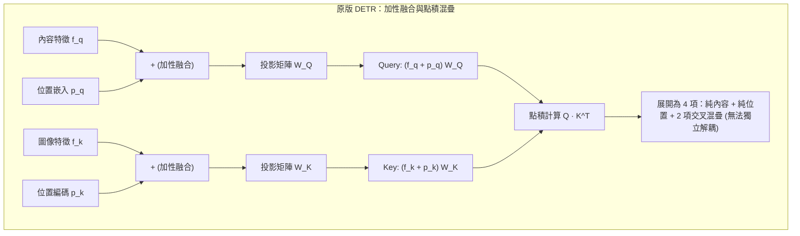
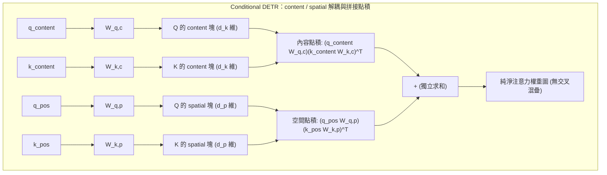
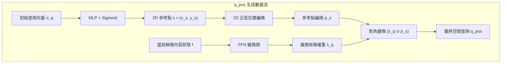
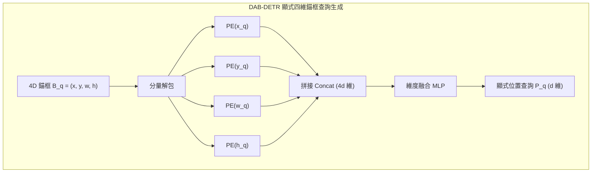
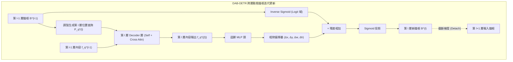

在 [3）Deformable DETR：稀疏採樣與多尺度注意力](./deformable-detr) 中我們梳理過，針對原版 DETR 慢收斂的瓶頸，學術界存在兩條平行的攻關路線。在第一條路線中，Deformable DETR 從底層的特徵讀取算子切入，通過局部稀疏採樣打破了計算與收斂壁壘。

本篇聚焦第二條路線——在保持**單尺度特徵與標準密集交叉注意力（Standard Dense Cross-Attention）** 的框架內，徹底消除 Object Query 本身的空間語義模糊：**目標查詢的空間化（Query Spatialization）**。

在這條演進線上，兩項標誌性工作構成了清晰嚴密的直接遞進關係：

1. **Conditional DETR（2021）：** 從注意力計算的代數形式切入，通過拼接解耦消除了內容與位置的交叉混疊，構建了受內容調製的 2D conditional spatial query；
2. **DAB-DETR（2022）：** 承接並深化了條件解耦思想，將無尺度的 2D 點先驗徹底升級為顯式的 4D 動態錨框（4D Anchor Box），並引入尺度歸一化温度調製與跨層級聯更新機制。

我們首先從原版查詢在代數與幾何層面的根本病灶談起。

## 原版 Object Query 的空間表示缺陷

### 加性融合導致的特徵混疊問題

在原版 DETR 解碼器的跨注意力（Cross-Attention）機制中，$Q$ 與 $K$ 均由 " 內容嵌入 " 與 " 位置嵌入 " 兩部分直接相加而成。

設解碼器第 $l$ 層的輸入內容特徵為 $f_q \in \mathbb{R}^d$，對應的可學習查詢位置嵌入為 $p_q \in \mathbb{R}^d$；編碼器輸出的圖像特徵為 $f_k \in \mathbb{R}^d$，圖像特徵對應的二維正弦位置編碼為 $p_k \in \mathbb{R}^d$。在跨注意力計算中，$Q$ 與 $K$ 分別由兩者相加後經線性投影矩陣 $W_Q, W_K \in \mathbb{R}^{d \times d}$ 映射得到：

$$
Q = (f_q + p_q) W_Q, \quad K = (f_k + p_k) W_K
$$

為了看清尋址過程中的計算本質，我們將未縮放的點積注意力項展開（略去線性投影矩陣以簡化推導）：

$$
Q K^T = (f_q + p_q)(f_k + p_k)^T = \underbrace{f_q f_k^T}_{\text{內容-內容}} + \underbrace{f_q p_k^T}_{\text{內容-位置}} + \underbrace{p_q f_k^T}_{\text{位置-內容}} + \underbrace{p_q p_k^T}_{\text{位置-位置}}
$$

展開式中的四項各自承擔了不同的相互作用：

1. **$f_q f_k^T$（內容—內容）：** 負責根據語義類別匹配目標，回答 " 待檢測目標屬於什麼類別 "。
2. **$p_q p_k^T$（位置—位置）：** 負責根據空間位置定位目標，回答 " 待檢測目標在圖像的什麼幾何區域 "。
3. **$f_q p_k^T$ 與 $p_q f_k^T$（交叉混疊項）：** 這一對交叉項將語義特徵與座標編碼直接相乘。

在物理意義上，圖像像素的絕對座標與物體的語義類別之間不存在普適的線性點積對應關係。交叉項在訓練中既無法提供純粹的幾何約束，也無法提供明確的語義匹配信號，反而導致了**尋址混疊（Matching Ambiguity）**：反向傳播計算梯度時，誤差信號無法清晰區分究竟是分類預測錯誤還是空間定位偏差，模型必須依靠大量訓練迭代才能逐步抑制交叉項帶來的干擾。



:::info[問題]
為什麼 NLP 中 Transformer 的 Token 嵌入與位置編碼直接相加工作良好，而在 DETR 中相加卻導致了嚴重混疊？

在自然語言處理（NLP）中，詞嵌入表示的是離散符號語義，而一維絕對位置編碼表示的是離散序列順序。句子的語法結構通常允許 " 詞義 " 與 " 位置 " 產生複雜的交互（例如某些介詞只出現在特定語序位置）。

但在目標檢測這一連續二維視覺任務中，**空間幾何與語義類別具有強烈的正交性**：一隻 " 貓 " 可以出現在圖像的左上角、正中央或右下角，其類別語義與它所在的絕對像素座標 $(x, y)$ 在幾何本質上是獨立的。加性融合強行令 $f_q$ 與 $p_k$ 在同一個向量空間做點積，強迫網絡去擬合 " 貓的語義特徵與座標 $(120, 300)$ 的內積 "，這破壞了空間幾何變換的平移不變性，放大了優化搜索空間。
:::

### 查詢向量缺乏幾何物理基準的問題

由於原版 DETR 的位置查詢 $p_q$ 是一組在訓練初期隨機初始化的連續向量，並不對應具體的幾何座標，模型在最初階段無法通過 $p_q p_k^T$ 形成局部的空間關注。同時，內容嵌入 $f_q$ 在初期也尚未匯聚具體的實例特徵。

兩個條件疊加，導致解碼器各層在訓練初期的注意力權重呈現近乎均勻的全局彌散分佈。每個查詢槽位不得不掃描全圖的全部像素，再在反向傳播中依靠二分圖匹配的監督信號，非常緩慢地將關注範圍收斂到特定的圖像局部。

Conditional DETR 的實驗對比表明，原版 DETR 需要經過大約 40 個 Epoch 的訓練，交叉注意力的權重分佈才開始在前景目標的邊緣和極端點區域出現明顯的空間聚焦。這種漫長的尋址收縮過程，是原版模型在密集註意力下收斂緩慢的關鍵誘因。

## Conditional DETR

### 條件交叉注意力機制

針對加性融合中的點積混疊，Conditional DETR（Meng 等人，2021）從代數結構上對跨注意力進行了重構。論文作者提出，與其將內容和位置向量相加後映射，不如將兩者在通道維度進行**拼接（Concatenation）**，從而徹底剝離交叉混疊項。

設 content query 為 $q_{\text{content}} \in \mathbb{R}^d$，conditional spatial query 為 $q_{\text{pos}} \in \mathbb{R}^d$；編碼器輸出的 $K$ 在每個圖像位置各有一個，其中 content embedding 為 $k_{\text{content}} \in \mathbb{R}^d$，空間位置編碼為 $k_{\text{pos}} \in \mathbb{R}^d$。跨注意力的 $Q$ 與 $K$ 構建為分塊拼接形式：

$$
Q = \begin{bmatrix} q_{\text{content}} W_{q,c} \\ q_{\text{pos}} W_{q,p} \end{bmatrix}, \quad K = \begin{bmatrix} k_{\text{content}} W_{k,c} \\ k_{\text{pos}} W_{k,p} \end{bmatrix}
$$

其中 $W_{q,c}, W_{k,c} \in \mathbb{R}^{d \times d_k}$ 為內容投影矩陣，$W_{q,p}, W_{k,p} \in \mathbb{R}^{d \times d_p}$ 為空間位置投影矩陣。

未縮放的點積計算由此被嚴格拆解為兩項獨立內積之和：

$$
Q K^T = \underbrace{(q_{\text{content}} W_{q,c})(k_{\text{content}} W_{k,c})^T}_{\text{content 分支：語義匹配}} + \underbrace{(q_{\text{pos}} W_{q,p})(k_{\text{pos}} W_{k,p})^T}_{\text{spatial 分支：幾何定位}}
$$



根據向量分塊點積的可加性，解耦後的計算式天然排除了 $q_{\text{content}} k_{\text{pos}}^T$ 與 $q_{\text{pos}} k_{\text{content}}^T$ 兩項無意義的混疊干擾。內容分支專職計算類別與語義相似度，空間分支專職計算幾何鄰近程度，兩路梯度回傳時互不干擾。

### 空間查詢的構造方式

解耦之後的關鍵問題是：**$q_{\text{pos}}$ 應當如何構造？**

在動手構造之前，先確認這個符號的物理身份。$q_{\text{pos}}$ 是每個查詢槽位各持有的一個 $d$ 維向量，其只在一處被使用了——與圖像位置編碼 $k_{\text{pos}}$ 的內積，即上一節解耦式中的空間尋址項。因此，其不是一個座標，而是**一個由內積曲面定義形狀的空間探針**：這個內積在畫布上掃出的響應在哪裏隆起、隆起多寬、向哪個方向拖尾，就是該查詢的空間視場。探針本身不攜帶可讀的座標，它的全部幾何意義都寄生在它與 $K$ 端固定基底 $\text{PE}(p)$ 的相互作用裏。

一個抽象的 $d$ 維向量要憑空在畫布上定義出這樣一個曲面，唯一的途徑是讓它與 $K$ 端共享代數結構。這決定了 Conditional DETR 的構造可以被壓縮成兩句話：參考點 $s$ 決定曲面的中心，縮放因子 $\lambda_q$ 決定曲面的形狀。下面的兩步構造，就是把這兩句話落實成可計算的形式。

在原版 DETR 中，$p_q$ 是一組不依賴圖像內容、全局固定的可學習向量（代碼中的 `nn.Embedding`）。Conditional DETR 認為，一個 $q_{\text{pos}}$ 不應是孤立的靜態座標，而必須在目標參考點的幾何約束下，結合當前圖像解碼出的實例特徵動態生成，論文稱之為 **conditional spatial query**。

整個生成過程分為兩步：

1. **生成參考點正弦基底：** 利用查詢槽位未結合圖像前的未處理特徵，預測出目標在畫布上的 2D 中心參考點，並轉化為正弦位置編碼，作為基礎幾何基底；
2. **內容驅動的自適應形變：** 解碼器結合當前已抽取的實例內容，預測一組頻域縮放因子，通過逐元素相乘對基底進行調製，將原本對稱的中心響應拉伸、平移到物體的各個邊緣極值點，輸出最終的 $q_{\text{pos}}$。

#### 參考點的生成與正弦編碼

在原版 DETR 中，解碼器第 $l$ 層的輸入位置查詢直接沿用靜態參數向量 $p_q \in \mathbb{R}^d$，網絡無法顯式得知這個向量到底對應畫布上的哪一個具體像素點。

Conditional DETR 改變了這一設定：每個查詢槽位包含一個未綁定圖像的初始可學習向量 $o_q \in \mathbb{R}^d$（即 Object Query 原始特徵）。在進入解碼器之前，網絡首先通過一個小型前饋網絡將 $o_q$ 投影為二維未歸一化座標，並通過 Sigmoid 限制在圖像畫布內：

$$
s = (x_s, y_s) = \text{sigmoid}\big(\text{MLP}(o_q)\big) \in [0, 1]^2
$$

這個二維座標 $s = (x_s, y_s)$ 即為該查詢所綁定的**參考點（Reference Point）**。隨後，網絡對其計算標準的二維正弦位置編碼，得到參考點的基礎幾何嵌入：

$$
p_s = \text{PE}(s) = \left[ \text{PE}(x_s) \,\|\, \text{PE}(y_s) \right] \in \mathbb{R}^d
$$

$p_s$ 是參考點在頻域的基礎幾何基底。它並不直接作為最終的 $q_{\text{pos}}$ 參與跨注意力點積，而是作為未調製的幾何模板，在下一步與當前層解碼出的實例內容特徵相結合。

#### 基於內容特徵的自適應座標變換

有了以參考點為中心的空間分佈還不夠。在目標檢測任務中，邊界框的定位由物體的上下左右四條邊界所界定，注意力機制不僅需要關注物體中心，更需要各個注意力頭分別定位到物體的**極值點（Extremum Points，即物體的上、下、左、右邊緣）**。

中心參考點 $s=(x_s, y_s)$ 只是一個零階的二維座標，它只有位置，完全沒有尺度（scale）與長寬比（aspect ratio）信息。網絡無法單憑 $s$ 得知目標到底是細高的人體還是扁長的車輛。要讓注意力從中心延伸到物體的真實邊界，必須依賴當前已經解碼出的物體特徵。

因此，**最終進入跨注意力空間分支的 $q_{\text{pos}}$ 並非靜態向量，而是以內容隱狀態 $f$ 為條件、對參考點基底 $p_s$ 進行動態變換後的產物**：

$$
q_{\text{pos}} = T p_s = \lambda_q \odot p_s, \quad \text{其中 } T = \text{diag}(\lambda_q), \; \lambda_q = \text{FFN}(f) \in \mathbb{R}^d
$$

在這一變換中，內容特徵 $f$ 充當條件生成器，通過小型前饋網絡輸出對角變換權重 $\lambda_q$，再通過 Hadamard 積 $\odot$ 逐元素調製正弦基底 $p_s$，輸出最終的 $q_{\text{pos}}$。



為什麼通過對角變換輸出 $q_{\text{pos}}$，而不是直接用全連接稠密網絡映射？

- **保持頻率正交性：** 正弦編碼的幾何信息分佈在固定的頻率基底上。對角矩陣僅對每個頻率通道的振幅進行縮放，不跨通道混合不同的頻率，完整保留了頻域基底的正交性。
- **輸出具有多頭幾何分工的 $q_{\text{pos}}$：** 參考點編碼 $p_s$ 在所有頭之間完全共享，鎖定物體的大致中心。但各注意力頭需要定位不同的邊界，因此在實際實現中，網絡為第 $i$ 個注意力頭輸出專屬的空間查詢分量：
  $$
  q_{\text{pos}}^{(i)} = \lambda_q^{(i)} \odot p_s, \quad i = 1, \dots, h
  $$
  三角恆等式表明，對不同頻率通道賦予各異的振幅權重，在數學上等價於對頻域響應曲線進行重塑。通過這一變換，輸出的 $q_{\text{pos}}$ 在各個 head 上不再是對稱凝聚在 $(x_s, y_s)$ 的單峯，而是發生了定向平移與拉伸，分別成為精準指向物體上、下、左、右邊緣極值點的空間探針。

### 空間注意力的定位性質

構造出 $q_{\text{pos}}$ 並在跨注意力中與圖像位置編碼 $k_{\text{pos}}$ 進行點積後，空間分支為什麼能比原版 DETR 收斂更快？這主要歸功於正弦基底提供的局部高斯衰減先驗，以及多頭注意力對邊界極值點的解耦定位。

#### 正弦位置編碼內積的衰減特性

為什麼正弦位置編碼能夠充當空間尋址的局部基準？我們可以對比原版 DETR 與 Conditional DETR 在空間內積項上的代數差異。

回顧原版 DETR，其空間位置的未縮放點積項為：

$$
\text{Attn}_{\text{pos}}^{\text{DETR}} = p_q p_k^T = p_q \cdot \text{PE}(x, y)^T
$$

這裏存在本質的**基底失配**：圖像位置編碼 $p_k = \text{PE}(x, y)$ 是確定性的正餘弦連續基底，而查詢端 $p_q$ 卻是沒有任何代數結構的自由參數。在訓練初期，$p_q$ 的權重是隨機高斯分佈，它與正弦向量的點積無法形成任何具有幾何規律的響應峯，只能在全圖產生近乎均勻的雜亂響應，導致注意力在全圖盲目漫遊。

而在 Conditional DETR 中，網絡強行讓查詢端的位置編碼也建立在正餘弦基底之上。對於圖像中座標為 $p = (x, y)$ 的像素與參考點 $s = (x_s, y_s)$，以橫座標 $x$ 分量為例，兩者正餘弦編碼在各個不同頻率通道上的逐項內積滿足三角恆等式：

$$
\text{Attn}_{\text{pos}}^{\text{Cond}} = \text{PE}(x) \cdot \text{PE}(x_s) = \sum_{i=0}^{d/4 - 1} \left[ \sin\left(\frac{x}{\tau_i}\right)\sin\left(\frac{x_s}{\tau_i}\right) + \cos\left(\frac{x}{\tau_i}\right)\cos\left(\frac{x_s}{\tau_i}\right) \right] = \sum_{i=0}^{d/4 - 1} \cos\left(\frac{x - x_s}{\tau_i}\right)
$$

其中 $\tau_i = T^{4i/d}$ 為不同通道預設的波長基底（$T=10000$）。

根據三角函數的疊加性質：

1. **參考點中心（$\Delta x = x - x_s = 0$）：** 所有連續頻率分量的餘弦項均為 $\cos(0) = 1$，相位發生同相相長干涉，點積取得全局最大值；
2. **遠離參考點（$|\Delta x| > 0$）：** 隨着空間位移 $|\Delta x|$ 增大，不同波長基底 $\tau_i$ 對應的相位差迅速拉開，餘弦項在正負之間交替振盪，產生相消干涉，內積總和迅速跌落至 0 附近。

這一代數性質使得正弦編碼內積在幾何空間中天然呈現出**單峯帶通濾波（Band-pass / Gaussian-like Peak）**形態。只要 $Q$ 端採用了與 $K$ 端相同的正弦基底，注意力機制在初始狀態下就能自動獲得以參考點為中心的局部幾何先驗，無需經歷原版 DETR 那種長達數十個 Epoch 的全圖搜索收縮。

#### 多頭注意力的幾何聚焦效果

$q_{\text{pos}}$ 從根本上改變了空間分支的響應形態。

當 $q_{\text{pos}}$ 與圖像中各像素的位置編碼 $k_{\text{pos}}$ 進行點積時，經過對角變換調製的各注意力頭會在參考點周圍形成具有明確幾何指向性的高響應帶：

- 負責左邊界的 head 會在 $x < x_s$ 處形成一條縱向的高響應帶；
- 負責右邊界的 head 會在 $x > x_s$ 處形成縱向高響應帶；
- 負責上/下邊界的 head 分別在 $y < y_s$ 與 $y > y_s$ 處形成橫向高響應帶；
- 負責內容分類的 head 則保持在中心區域附近響應。


至此，Conditional DETR 完成了單個解碼器層內的特徵提取閉環：

```text
Query 輸入 (內容 f + 參考點 s)
  ├── 內容分支: f 與圖像內容 k_content 計算語義相似度 (回答"是什麼")
  ├── 空間分支: f 驅動生成 λ_q 調製參考點 p_s，與圖像位置 k_pos 計算幾何對齊 (回答"在哪裏與邊界何在")
  └── 拼接求和: 生成純淨交叉注意力權重，聚合 Value 特徵並輸出更新後的內容向量
```

實驗數據表明，僅需訓練 50 個 Epoch，Conditional DETR 的空間分支就已經能清晰定位目標的四條邊緣；而原版 DETR 在 50 個 Epoch 時仍有多個邊界處於未聚焦狀態，需要 500 個 Epoch 才能達到類似效果。代數解耦與條件變換大幅壓縮了尋址搜索空間，這是收斂速度顯著提升的根本原因。

### 2D 參考點的侷限性

Conditional DETR 證明了“消除交叉混疊 + 引入局部空間先驗”是加速收斂的正確方向。但在物理建模的嚴謹性上，它依然留下了兩個深層瓶頸，構成了向下一步演進的直接動機：

1. **尺度失明（Scale-Ignorant）與視場失配：**
   二維參考點 $s = (x_s, y_s)$ 僅能表徵物體在畫布上的中心位置，完全缺失了物體的尺寸先驗（寬度 $w$ 與高度 $h$）。然而，正弦編碼內積所形成的帶通濾波器，其理論衰減帶寬是由固定的預設温度基底 $T = 10000$ 決定的。
   面對一隻佔據半張圖像的大卡車或遠處僅佔數個像素的小鳥，2D 參考點給出的初始空間注意力的衰減速度是完全相同的。雖然 Conditional DETR 試圖讓內容特徵通過 FFN 預測對角因子 $\lambda_q$ 來微調有效帶寬，但這是一種參數空間的隱式彌補，極難穩定控制空間視場的大小。其直接後果是：解碼器淺層的注意力權重極易因為視場與真實目標尺寸不匹配，而發散至遠離目標的背景區域（後文可視化將印證這一現象）。
2. **空間狀態未顯式沉澱與跨層更新斷裂：**
   在原版 DETR 和 Conditional DETR 中，層與層之間傳遞的僅僅是抽象的內容隱向量 $f_q$。雖然每一層解碼器的預測頭都會基於當前特徵輸出一個邊界框並計算輔助損失，但這組幾何預測值並不會作為顯式狀態傳給下一層。
   下一層解碼器在生成 $q_{\text{pos}}$ 時，依然必須基於上一層的內容向量“從零推算”新的幾何調製，前一層已經定位到的位置與邊界信息無法在幾何物理層面直接累加與繼承。

這兩個侷限清晰地指明瞭演進方向：**如果 Object Query 不僅攜帶中心座標，還顯式攜帶寬度與高度；不僅在單層內部調製帶寬，還在跨層傳遞中作為物理狀態逐級精修，尋址收縮會不會進一步加快？**

這正是 DAB-DETR 的核心問題意識。

## DAB-DETR

### 4D 動態錨框設計

DAB-DETR（Liu 等人，2022）完全繼承了 Conditional DETR 建立的“拼接點積解耦”與“基於空間先驗生成條件查詢”的理論框架，但在底層將 Object Query 的物理狀態從二維點先驗推進到了**顯式四維動態錨框（Dynamic Anchor Box）**：

徹底廢棄抽象的可學習位置向量，將每個 Object Query 顯式重塑為一個具有明確幾何尺寸的四元組：

$$
B_q = (x_q, y_q, w_q, h_q) \in [0, 1]^4
$$

其中 $(x_q, y_q)$ 代表目標的歸一化中心座標，$(w_q, h_q)$ 代表目標的歸一化寬度與高度。

這一步的必要性可以從初始化的散點分佈上直接讀出。若查詢僅由二維中心座標 $(x_q, y_q)$ 承載，300 個查詢在初始化時退化為 300 個無尺寸信息的孤立點，在平面上近似均勻散佈，彼此無從區分"誰負責大目標、誰負責小目標"。而一旦將查詢重述為四維錨框，同樣的 300 個查詢便在初始化階段就攜帶了各不相同的寬高尺寸，天然鋪開成一層覆蓋不同尺度目標的候選框集合。


四維錨框 $B_q$ 雖然在物理空間中具備直觀的幾何意義，但 Transformer 的自注意力與交叉注意力算子只能在連續的通道特徵空間（$\mathbb{R}^d$）中完成點積與線性變換。因此，設計上的核心工程問題是：**如何將這組人類可讀的物理幾何四元組，無損接入到解碼器的計算圖中？**

DAB-DETR 繼承並深化了 Conditional DETR 的雙軌思想，但對 Object Query 的底層表示做出了根本性重塑，徹底剝離了原版 DETR 中將內容與位置雜糅在一起的黑盒隱向量：

- **content query（內容查詢）：** $C_q \in \mathbb{R}^d$，初始化為全 0 向量。它不再承載任何未解耦的位置或類別偏置，而是作為純淨的特徵匯聚容器，在解碼層間專職吸收來自圖像的實例語義（回答“是什麼”）；
- **positional query（位置查詢）：** $P_q \in \mathbb{R}^d$，不再引入任何自由的可學習向量參數，其唯一的數學源頭就是顯式幾何錨框 $B_q$（回答“在哪裏與尺寸多大”）。

為了將四維幾何座標映射為能夠與圖像特徵內積的高頻位置探針，DAB-DETR 分別對 $x_q, y_q, w_q, h_q$ 四個連續標量計算正弦位置編碼，在通道維度拼接後經過一個小型 MLP 投影為通道維度 $d$：

$$
P_q = \text{MLP}\left(\left[ \text{PE}(x_q) \,\|\, \text{PE}(y_q) \,\|\, \text{PE}(w_q) \,\|\, \text{PE}(h_q) \right]\right) \in \mathbb{R}^d
$$



### 尺度調製機制：引入寬高几何先驗

在 Conditional DETR 中，作者已經意識到“不同尺寸的目標需要不同寬度的注意力視場”。但當時採取的做法是：讓內容隱向量 $f_q$ 經過一個黑盒前饋網絡來預測對角變換因子 $\lambda_q = \text{FFN}(f_q)$。

這種設計存在致命的邏輯缺陷：**它把尺度當成了內容特徵的隱式估計值（Latent Estimation）**。在解碼器淺層，內容特徵 $f_q$ 尚未聚集足夠的前景語義，由它反推出來的縮放因子極不穩定。一旦 FFN 預測失準，注意力權重的空間帶寬就會嚴重漂移，甚至導致淺層注意力權重直接發散到遠離目標的背景區域。

DAB-DETR 的關鍵修正，在於**確立了尺度 $(w_q, h_q)$ 的顯式參數地位**：目標物體的寬高與中心點一樣，屬於天然的幾何屬性，應當作為顯式幾何參數（Explicit Parameters）直接進入注意力計算，而不應依賴黑盒網絡去二次猜測。

擁有了顯式的寬和高之後，DAB-DETR 摒棄了複雜的 FFN 映射，直接通過**對正弦位置編碼進行温度調製（Temperature Modulation）**，以確定性的代數形式控制注意力的空間衰減帶寬。

#### 尺度調製的數學推導

回顧一維標準正弦編碼公式：

$$
\text{PE}(x, 2i) = \sin\left(\frac{x}{T^{2i/d}}\right), \quad \text{PE}(x, 2i+1) = \cos\left(\frac{x}{T^{2i/d}}\right)
$$

其中 $T$ 為基底温度參數（默認 $T = 10000$）。若直接使用固定温度 $T$，位置點積的高斯衰減帶寬是恆定的。

為了讓注意力帶寬與物體尺寸自適應匹配，DAB-DETR 將目標的寬度 $w_q$ 與高度 $h_q$ 作為縮放因子，引入位置編碼的温度調製計算中：

$$
\begin{aligned}
\text{PE}_{\text{modulated}}(x_q, 2i) &= \sin\left(\frac{x_q}{(T / \sigma_x)^{2i/d}}\right), \quad \text{其中 } \sigma_x = \frac{w_{\text{ref}}}{w_q} \\
\text{PE}_{\text{modulated}}(y_q, 2i) &= \sin\left(\frac{y_q}{(T / \sigma_y)^{2i/d}}\right), \quad \text{其中 } \sigma_y = \frac{h_{\text{ref}}}{h_q}
\end{aligned}
$$

其中 $w_{\text{ref}}, h_{\text{ref}}$ 為參考尺度常數（通常設為 1）。

我們將調製後的位置查詢與圖像像素位置 $x_k$ 的點積展開：

$$
\text{PE}_{\text{modulated}}(x_q) \cdot \text{PE}_{\text{modulated}}(x_k) = \sum_{i=0}^{d/2 - 1} \cos\left(\frac{x_k - x_q}{(T / \sigma_x)^{2i/d}}\right) = \sum_{i=0}^{d/2 - 1} \cos\left( \frac{x_k - x_q}{w_q} \cdot \frac{w_{\text{ref}}}{T^{2i/d}} \right)
$$

從推導中可以看出，温度除以 $\sigma_x$ 在數學上嚴格等價於**將空間座標的相對位移按物體寬度 $w_q$ 進行了歸一化**：

$$
\Delta x_{\text{effective}} = \frac{x_k - x_q}{w_q}, \quad \Delta y_{\text{effective}} = \frac{y_k - y_q}{h_q}
$$

這種歸一化直接改變了空間注意力的幾何衰減形態：

當錨框尺度較小（$w_q, h_q$) 較小時，分母壓縮使得有效相對位移隨像素距離急劇放大，空間點積隨距離拉開而迅速衰減，注意力權重在中心周圍形成陡峭的高鋭度尖峯，能夠精準鎖定微小目標並抑制周圍背景噪聲；反之，當錨框尺度較大時，平緩變化的相對位移減慢了點積衰減速度，注意力權重在較大範圍內平滑鋪開，從而充分覆蓋大尺寸目標的整體輪廓與上下文。

這一機制賦予瞭解碼器物理層面的“變焦”能力：在小目標上收緊視場聚焦細節，在大目標上放寬視場容納全局。

### 4D 錨框的逐層迭代更新機制

前兩節的設計中，錨框始終是一個靜態輸入：它在進入解碼器前初始化完畢，此後逐層保持不變，每一層都用同一組數值生成位置查詢、調製注意力帶寬。這意味着，尋址的中心與變焦的尺度都依賴同一個前提——初始錨框已經大致對準目標。而初始錨框只是一組與輸入圖像無關的可學習偏置，訓練早期與目標的真實位置往往相去甚遠；若幾何狀態在層間凍結，第 1 層的定位偏差會被後續每一層原樣繼承，變焦能力再強，對準的也只是一塊錯誤的區域。

這一問題的根源可以追溯到原版 DETR 的層間數據流。原版 DETR 在每個解碼器層後都會接入共享的預測頭來計算輔助損失，但層與層之間傳遞的僅有內容隱向量 $f_q$。上一層預測頭輸出的邊界框只參與該層損失的計算，並不會作為幾何先驗傳給下一層。DAB-DETR 雖然把查詢重塑為顯式錨框，但若止步於前兩節的設計，錨框在層間的地位與原版的位置向量並無區別——由於缺乏跨層的幾何狀態更新，後續解碼層的位置查詢始終停留在初始狀態，無法利用上一層已經學到的位置和尺寸信息來調整本層的尋址區域。

DAB-DETR 引入了**錨框逐層迭代更新（Iterative Box Update）** 機制，將錨框自身作為跨層傳遞的顯式幾何狀態。每一層解碼器利用上一層修正後的錨框重新生成位置查詢，實現由粗到精（Coarse-to-fine）的漸進式空間尋址。


在幾何更新的數值實現上，DAB-DETR 吸收了 Deformable DETR 提出的 **Logit 空間殘差累加機制**：利用 $\text{InverseSigmoid}$ 將歸一化座標映射至無界實數空間 $\mathbb{R}$，疊加當前層迴歸頭預測的無約束偏移量 $(\Delta x, \Delta y, \Delta w, \Delta h) = \text{MLP}(f_q^{(l)})$ 後，再經 $\text{Sigmoid}$ 映射回 $(0, 1)$。這種映射消除了直接加法帶來的越界風險，並在整個實數域內保留了平滑梯度。

同時，第 $l$ 層計算得到的新錨框 $B_q^{(l)}$ 在傳給第 $l+1$ 層用於生成位置查詢時，必須執行**梯度截斷（Gradient Detach）** 操作。這保證了第 $l$ 層的迴歸頭僅負責估計當前幾何框與真值之間的單步相對殘差，避免深層與淺層損失在同一個迴歸分支上發生多跳梯度競爭。

逐層更新帶來的幾何改善可以直接從預測框的演化過程讀出。同一只棕熊在第 1 層解碼時，預測框只套住臉部，寬度和高度都明顯偏小。經過 6 層解碼器的逐級修正，同一個查詢的預測框已經緊貼目標邊界。


DAB-DETR 的這種逐層收斂特性，相較於 Conditional DETR 的單次定位還有一個額外收益：顯式的框狀態讓每個解碼層的注意力都能讀到自己當前的預測誤差，從而把採樣與注意力範圍自動收縮到尚未對齊的那部分邊界上。




:::info[問題]
DETR 重新拾起 Anchor Box，是對傳統檢測器（如 YOLO）的妥協或倒退嗎？

表面上看，DAB-DETR 將 Query 重塑為四元組 $(x, y, w, h)$ 並學習相對偏移量，與經典檢測器（如 Faster R-CNN、YOLOv2~v5）的 Anchor Box 高度相似。但深入其底層機制，兩者在幾何屬性、特徵提取與優化邏輯上存在本質差異：

1. **稠密窮舉 vs 稀疏全局：** YOLO 在各尺度特徵圖的每一個網格（grid cell）上稠密鋪設數萬個預設尺寸的候選框；DAB-DETR 全圖僅保留極少數（如 300 個）可學習錨框，不依賴空間平鋪。
2. **網格綁定 vs 自由流動：** YOLO 的 Anchor 幾何中心嚴格綁定在特定的空間網格上，各檢測頭獨立預測局部偏移；DAB-DETR 的錨框是完全脱離像素網格的獨立物理實體，在 Transformer 解碼層間通過殘差累加自由平移、縮放，實現由粗到精的跨層迭代。
3. **硬性裁剪 vs 軟性變焦：** YOLO 依靠卷積在網格附近的局部感受野獲取特徵，或通過 RoIAlign 硬性截取框內特徵；DAB-DETR 的錨框僅作為參數輸入，通過尺度歸一化温度調製直接控制全圖注意力的衰減帶寬（大框視場寬、小框視場窄），依然是全局軟性尋址。
4. **空間重疊分配 + NMS vs 匈牙利二分圖匹配：** YOLO 依靠先驗 IoU 規則匹配樣本，存在多對一冗餘，必須依賴啓發式 NMS 濾除重疊框；DAB-DETR 依然嚴格貫徹集合預測範式，依靠一對一匈牙利匹配實現端到端訓練，完全不需要 NMS。

原版 DETR 反對的從來不是“邊界框包含中心與寬高”的客觀幾何事實，而是反對“密集手工超參”與“啓發式 NMS”。原版試圖將幾何偏置隱式塞進黑盒向量，帶來了 500 個 Epoch 的收斂代價；DAB-DETR 將幾何歸納偏置顯式參數化，同時完整保留了端到端直接集合預測的純粹性。這不是歷史倒退，而是在更高維度上的螺旋式上升。
:::

## 與稀疏採樣的正交結合及演進譜系

### 性能對比：空間化對收斂與精度的提升

空間化改動對網絡優化的提升主要體現在收斂速度與精度上限兩個維度（詳細跨架構實測數據見文末附錄）：

1. **單尺度體系下的純空間化加速：** 在同樣僅使用 C5 單尺度特徵的約束下，Conditional DETR 與 DAB-DETR 僅用 50 個 Epoch 便追平甚至超越了原版 DETR 500 個 Epoch 的精度（42.2 vs 42.0 AP），將訓練開銷縮短了整整 10 倍。
2. **正交結合的協同效應：** 當 DAB-DETR 的 4D 錨框與 Deformable DETR 的多尺度稀疏採樣結合時（DAB-Deformable-DETR），模型在 50 Epoch 下達到了 46.9 AP，小目標指標 $\text{AP}_{\text{s}}$ 從原版的 20.5 提升至 30.1。

### 4D 錨框與可變形注意力的結合

從系統架構層面審視，DAB-DETR 與 Deformable DETR 解決的是完全不同維度的瓶頸：

- **Deformable DETR 改變的是特徵讀取的算子：** 將計算複雜度為 $\mathcal{O}(L^2)$ 的全局密集交叉注意力，替換為局部連續採樣的可變形注意力算子，解決了多尺度特徵的計算吞吐問題；
- **DAB-DETR 改變的是 Object Query 的狀態表示：** 將無物理意義的抽象隱向量，重塑為攜帶明確幾何尺寸的顯式 4D 動態錨框 $(x, y, w, h)$，解決了空間尋址的冷啓動與尺度失明問題。

由於算子實現與查詢表示相互獨立，兩者在工程上具有完全的正交性。將顯式 4D 錨框與多尺度可變形注意力結合（即 DAB-Deformable-DETR），具體通過三個幾何接口完成耦合：

1. **採樣基準點對齊：** 錨框的中心歸一化座標 $(x_q, y_q)$ 直接作為可變形注意力算子在多尺度特徵圖上的採樣參考點（Reference Point），無需解碼器額外從隱向量預測參考點；
2. **採樣偏移量的尺度自適應縮放：** 在原版 Deformable DETR 中，線性頭預測出的採樣點空間偏移量 $\Delta p$ 是尺度無偏的。而在 DAB-Deformable-DETR 中，預測出的偏移量會與當前錨框的寬高 $(w_q, h_q)$ 進行逐元素相乘：

$$
p_{\text{sample}} = (x_q, y_q) + \Delta p \odot (w_q, h_q)
$$

   這一縮放使得大尺寸錨框自動在更大感受野內採集多尺度上下文，而小尺寸錨框則把有限的採樣預算高度聚焦在目標局部，在局部稀疏算子層面還原了尺度自適應的“變焦”能力；
3. **跨層級聯的 Logit 殘差累加：** 每一層解碼頭預測的相對幾何偏移量，在 Logit 空間直接累加更新 4D 錨框。更新後的框不僅作為下一層更精準的採樣參考點與縮放基準，還在跨層傳遞時阻斷梯度，維持單步優化的穩定性。

這種結合消除了可變形注意力原先“參考點與內容特徵無顯式框約束”的缺陷，使模型在 COCO 上的檢測精度直接躍升至 46.9 AP（小目標指標提升尤其顯著），為後續頂級端到端架構（如 DINO、RT-DETR）奠定了標準範式。

### 查詢空間化的演進譜系與總結

回顧原版 DETR、Conditional DETR 與 DAB-DETR 的演進，改動分別落在了不同的系統層級上：

| 維度           | 原版 DETR (2020)                | Conditional DETR (2021)          | DAB-DETR (2022)                      |
| :----------- | :---------------------------- | :------------------------------- | :----------------------------------- |
| **查詢的數學形式**  | 隱式連續向量 $p_q \in \mathbb{R}^d$ | 隱式向量 $o_q$ + 動態 $q_{\text{pos}}$ | 顯式 4D 錨框 $(x, y, w, h)$ + 內容向量 $C_q$ |
| **空間幾何先驗**   | 無（隨機初始化、全圖漫遊）                 | 2D 點先驗 $(x, y)$                  | 4D 幾何區域先驗 $(x, y, w, h)$             |
| **交叉注意力計算**  | 加性融合點積（含交叉混疊項）                | 拼接式點積（內容與空間解耦）                   | 尺度調製正弦點積                             |
| **尺度感知能力**   | 無                             | 無（點先驗無尺度信息）                      | 顯式尺度歸一化温度調製                          |
| **空間信息留存方式** | 隱式可學習參數                       | 逐層單次計算的條件向量                      | 作為顯式幾何狀態逐層更新與傳遞                      |

- **Conditional DETR** 改動的是**單次注意力的計算結構**。它通過代數重構消除了混疊項，使空間信息作為條件約束介入尋址。
- **DAB-DETR** 改動的是**查詢的根本狀態表示**。它將 Object Query 從一個黑盒向量重述為可解釋、可觀測、帶尺度的物理實體。

從技術演化視角審視，目標查詢的空間化經歷了一條清晰嚴密的物理具象化路徑，並最終與稀疏讀取算子合流：

```text
原版 DETR (2020)                   Conditional DETR (2021)              DAB-DETR (2022)
[ 隱式連續向量 p_q ]         ──►   [ 2D 參考點 (x, y) ]          ──►   [ 4D 動態錨框 (x, y, w, h) ]
加性混疊、無偏全局漫遊             拼接解耦、單峯帶通極值點定位          尺度歸一化温度調製 + 跨層級聯精修
                                                                         │
                                                                         ▼ 正交結合稀疏採樣
                                                                 DAB-Deformable-DETR (2022)
                                                                 [ 4D 錨框 + 多尺度可變形注意力 ]
```

這一條線索將 Object Query 從缺乏物理意義的抽象向量逐步推進為具備四維幾何尺度的實體，為後續整個體系補齊了最關鍵的基建：

1. **為去噪訓練提供實體載體：** 只有當查詢變成了真實的四維幾何框 $(x, y, w, h)$，訓練階段才能對其施加顯式的高斯位移與尺度擾動，進而誕生了 DN-DETR 的去噪任務；
2. **打通二階段方案的幾何接口：** 在後續的 DINO 中，編碼器篩選出的高置信度候選框可以直接無縫賦值給解碼器作為初始 4D 錨框，完成了端到端二階段初始化的閉環；
3. **完成兩路演進的合流：** DAB-DETR 驗證了查詢空間化與 Deformable DETR 稀疏採樣算子的完全正交性，二者的結合（DAB-Deformable-DETR）直接成為了後續 DINO、RT-DETR 等現代檢測器的標準形態。

### 遺留問題：二分圖匹配的離散震盪

經過 Conditional DETR 與 DAB-DETR 的改造，解碼器在第一輪迭代中就擁有了高度集中的空間感知能力，模型在 COCO 數據集上的收斂速度從原版的 500 個 Epoch 顯著縮短到了 50 個 Epoch 左右。

然而，我們必須清醒地看到空間化留下的**未解矛盾**：雖然查詢的尋址搜索範圍從全圖縮小到了特定錨框周圍，但 **" 哪一個查詢槽位去負責匹配圖像中的哪一個真值物體 "** ，依然完全交由匈牙利二分圖匹配算法在每個訓練 Step 動態決定。因此，在網絡權重尚未充分收斂的早期階段，預測分數的微小擾動會導致二分圖匹配結果劇烈震盪（同一個真值目標在第 $t$ 步被分配給槽位 $i$，在第 $t+1$ 步突然被改派給槽位 $j$）。由於匹配目標在離散空間中持續跳變，即便查詢已經擁有了明確的空間錨框，其梯度更新方向依然會反覆對抗。

如何消除二分圖匹配在訓練早期的離散跳變？下一篇我們將深入剖析 [5）DN-DETR：查詢去噪與早期匹配穩定化](./dn-detr)。

## 小結

本篇系統拆解了目標查詢空間化的演進邏輯與數學機理：

1. **混疊根源：** 原版 DETR 的加性位置編碼導致內容與位置在點積中產生交叉混疊項，破壞了平移不變性，引發漫長的全局注意力漫遊；
2. **Conditional DETR 的代數解耦：** 通過拼接式點積將內容與空間尋址徹底分離，並利用上一層解碼特徵預測對角變換因子，使不同注意力頭自適應鎖死目標邊界極值點；
3. **DAB-DETR 的 4D 動態錨框：** 將 Query 形式化為顯式的幾何四元組 $(x, y, w, h)$，利用寬高調節正弦編碼温度，在數學上嚴格實現了空間位移的尺度歸一化；
4. **級聯幾何更新：** 通過 Logit 空間中的可微殘差累加與層間梯度截斷，實現了由粗到精的逐層幾何精修；
5. **承前啓後：** 4D 錨框完成了 Query 的物理具象化，但匈牙利匹配在離散空間的早期震盪仍未解決，去噪訓練（DN-DETR）應運而生。

## 附錄：空間化與基準模型對比數據

下表彙總了原版 DETR、Conditional DETR、DAB-DETR 與 Deformable DETR 在 COCO 2017 驗證集上的性能對比（均基於 ResNet-50 骨幹網絡）：

| 模型架構 | 特徵層級 | 空間先驗形式 | 訓練週期 (Epochs) | AP | $\text{AP}_{50}$ | $\text{AP}_{\text{s}}$ | $\text{AP}_{\text{l}}$ |
| :--- | :--- | :--- | :--- | :--- | :--- | :--- | :--- |
| **DETR (原版)** | C5 (單尺度) | 隱式參數向量 | 500 | 42.0 | 62.4 | 20.5 | 61.1 |
| **DETR (原版短訓)** | C5 (單尺度) | 隱式參數向量 | 50 | 34.9 | 55.4 | 14.4 | 52.6 |
| **Conditional DETR** | C5 (單尺度) | 2D 條件參考點 | 50 | 40.9 | 61.8 | 20.8 | 61.8 |
| **DAB-DETR** | C5 (單尺度) | 4D 動態錨框 | 50 | 42.2 | 63.1 | 21.5 | 62.6 |
| **Deformable DETR** | C3~C6 (多尺度) | 2D 稀疏採樣點 | 50 | 43.8 | 62.6 | 26.4 | 58.0 |
| **DAB-Deformable-DETR** | C3~C6 (多尺度) | 4D 動態錨框 + 稀疏採樣 | 50 | 46.9 | 66.0 | 30.1 | 64.3 |
