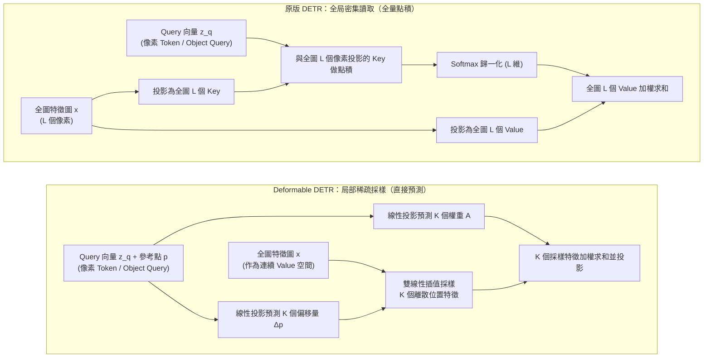
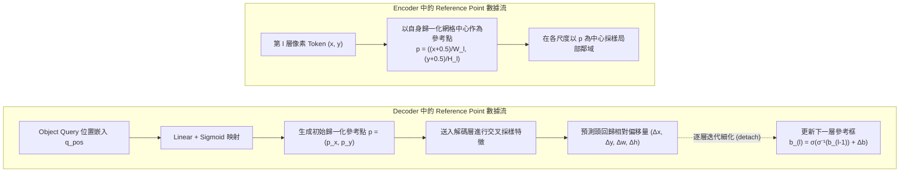

# Deformable DETR：稀疏採樣與多尺度注意力

在前面兩篇中，我們拆解了原版 DETR 的兩大核心支柱：[原版 DETR：網絡架構與前向流程](./detr-v1-architecture-forward-pass) 建立了基於 Object Queries 與 Transformer 編解碼器的定長容器預測架構；[原版 DETR：二分圖匹配與集合損失](./detr-v1-bipartite-matching-set-loss) 通過匈牙利算法與集合損失消除了傳統檢測器對 NMS 的依賴。

然而，原版 DETR 留下了兩個讓其實際應用受限的嚴重瓶頸：**高分辨率多尺度特徵無法計算（$\mathcal{O}(L^2)$ 複雜度導致小目標檢測極差）**，以及**訓練收斂極其緩慢（COCO 上需 500 epochs）**。

面對收斂緩慢與特徵讀取的困境，學術界隨後演化出了兩條截然不同的破局路線：

- **特徵讀取算子的稀疏化重構（本篇）：** 認為全局密集點積過於沉重且缺乏局部幾何偏置，主張將稠密注意力替換為圍繞參考點的局部**稀疏採樣算子**，在降低計算複雜度的同時直接打通多尺度特徵；
- **目標查詢的幾何空間化（下一篇）：** 則堅持在標準密集註意力的框架內，認為瓶頸在於 Object Query 缺乏物理幾何含義且內容/位置加性混疊，主張將隱向量**顯式具象化為空間幾何實體**。

很多解讀將 Deformable DETR（Zhu 等人，2020）簡單概括為“把可變形卷積的思想搬到了 Transformer 裏以加快訓練速度”。這種理解忽略了其在檢測 Transformer 體系中的真正定位：**Deformable DETR 第一次系統重構了 query 讀取圖像 token 的方式**——將原先每個 query 對全圖所有像素的密集全局點積，轉變為圍繞**參考點（Reference Point）** 在有限鄰域內的多尺度稀疏採樣。

本篇聚焦第一條路線，深入剖析可變形注意力模塊（Deformable Attention Module）的數學構建、多尺度特徵讀取機制、參考點在 Encoder 與 Decoder 中的雙重實現，以及它如何成為後續 DINO、RT-DETR 等主流模型的通用底層基礎設施。

## 原版密集註意力的計算瓶頸

要理解特徵讀取機制為何必須重構，我們需要回顧原版 DETR 中全局注意力帶來的計算與優化困境。

### 密集註意力的計算複雜度缺陷

在圖像編碼器中，序列長度為 $L$。計算所有 token 兩兩之間的注意力矩陣，時間與顯存複雜度均為 $\mathcal{O}(L^2 \cdot d)$。

這種二次方複雜度在圖像分類或 NLP 任務中尚可承受（例如 ViT-Base 處理 $224 \times 224$ 圖像僅產生 196 個 patch token），但在目標檢測中遇到了不可調和的矛盾：**目標檢測天然依賴高分辨率特徵圖來捕捉微小目標**。以經典分辨率 $800 \times 1333$ 的圖像為例：

- 下采樣 32 倍的 C5 特徵圖尺寸約為 $25 \times 42$，token 數量 $L \approx 1050$；
- 下采樣 16 倍的 C4 特徵圖尺寸約為 $50 \times 84$，$L \approx 4200$；
- 下采樣 8 倍的 C3 特徵圖尺寸約為 $100 \times 168$，$L \approx 16800$。

在物理圖像中，一個 $16 \times 16$ 像素的小目標映射到 C5 特徵圖上甚至不足半個像素，其空間細節與語義在骨幹網絡的逐級下采樣中已基本丟失。若想有效檢測小目標，接入 C3 和 C4 特徵是必然要求。

然而，若將包含 C3、C4、C5 的多尺度特徵圖（總 token 數 $N_{\text{pix}} > 22000$）直接送入標準自注意力，單張圖像單層的注意力矩陣大小為 $22000 \times 22000$。單就這一張 float32 注意力圖，顯存佔用就接近 2 GB；算上 8 個注意力頭與 6 層編碼器堆疊，在反向傳播時僅暫存用於計算梯度的注意力權重激活值（Activation Memory），顯存需求就高達近百 GB，徹底超出了主流硬件的承受極限。正因如此，原版 DETR 被迫做出了**只使用 C5 單尺度特徵**的妥協。

### 缺乏局部空間先驗導致的慢收斂

許多解讀將原版 DETR 訓練慢（COCO 上需要 500 個 epoch）簡單歸咎於“初始化時注意力分散在全圖”。但這只是表面現象：原版 DETR 建立在充分預訓練的 ResNet 骨幹之上，Backbone 輸出的特徵本就具備局部語義，接入 6 層 Transformer 後收斂依然極其遲緩。其深層根源在於**顯式空間幾何先驗的丟失**以及隨之引發的優化動力學困境：

1. **Encoder 端的局部歸納偏置缺失與梯度稀釋：**
   傳統 CNN 的卷積核天然鎖定了局部的網格拓撲；而標準自注意力將 2D 圖像拉平成一維無序序列，拋棄了像素間的空間幾何鄰近先驗。在訓練初期，線性投影層隨機初始化，注意力均勻散落在上千個 token 上，單位置分配的權重僅約 $\mathcal{O}(1/L)$。真正包含目標語義的有效區域往往只有幾十個像素，其餘絕大多數為背景。在全圖 Softmax 的反向傳播中，海量背景 token 產生的雜散梯度嚴重稀釋了前景信號，導致梯度的信噪比極低，優化長期在平坦的高維鞍點區域徘徊。編碼器必須經歷漫長的數據驅動迭代，才能把丟掉的空間幾何鄰近關係重新學出來。
2. **Decoder 端的全局盲搜與二分圖匹配震盪：**
   更致命的瓶頸發生在解碼器的交叉注意力中。由於初始的 Object Query 是沒有物理座標錨點的抽象向量，它們在整張圖像的全部空間中進行無偏的全局搜索。在優化的前中期，同一 Query 在前後不同訓練步所預測出的邊界框存在劇烈的位置漂移。而 DETR 的監督信號嚴格依賴匈牙利算法的全局一對一二分圖匹配：Query 輸出的微小抖動，會導致它在當前步被匹配給目標 A，下一步被匹配給目標 B，隨後又被指派為背景（即匹配震盪 / Label Bouncing）。匹配目標的反覆跳變，導致反向傳播給 Query 權重的梯度方向不斷互相沖突、打架，使注意力權重難以穩定收攏。

原版 DETR 將檢測任務置於全圖無偏搜索的極致自由度之下，代價便是必須消耗漫長的迭代週期讓網絡自行摸索出物理世界局部連續性的規律。密集計算逼退了多尺度特徵，全局盲搜又引發了優化震盪，這兩者的交織，構成了原版 DETR 收斂緩慢且小目標性能欠佳的底層根源。

## 單尺度可變形注意力

針對上述矛盾，Deformable DETR 設計了一個通用的**可變形注意力算子（Deformable Attention）**，同時替換了編碼器的多頭自注意力與解碼器的交叉注意力。它做出的核心改動是：**徹底拋棄把特徵圖像素投影為 Key 並進行全圖成對點積的尋址方式，改為讓 Query 向量圍繞指定的參考點，直接預測若干個關鍵採樣點的相對座標偏移量與聚合權重。**

具體而言，原版 DETR 中由注意力矩陣（$Q K^T$）驅動的全局檢索被徹底重構，特徵圖被直接視為一個可連續採樣的特徵畫布。此時，算子在編碼器與解碼器中承載着不同的實體角色：

- **在編碼器端（替代自注意力）：** 這裏的 Query 是特徵圖上的**各個像素 Token**，參考點直接綁定為該像素自身的網格中心座標。像素不再與全圖其他所有像素（原先的 Key）逐一計算點積相似度，而是僅以自身為錨，向有限鄰域發射採樣探針提取多尺度特徵。
- **在解碼器端（替代交叉注意力）：** 這裏的 Query 才是檢測任務中的 **Object Query**，參考點是由 Query 位置嵌入預測出的目標幾何中心座標。Object Query 不再對全圖所有圖像像素（原先的 Key）進行全局無偏點積掃描，而是僅聚焦在自身參考點附近提取目標局部的關鍵特徵。
*(注：解碼器內部 300 個 Object Query 之間的自注意力依然保留標準點積，因為 Query 數量較小，且需要全局協商以消除重複預測。)*




### 單尺度可變形注意力的算子定義

在形式化定義可變形注意力之前，我們需要明確該算子的輸入三元組 $(z_q, p, x)$ 在架構兩端的具體代入：

- **Query 向量 $z_q \in \mathbb{R}^d$：** 在編碼器中代入的是某個像素自身的內容特徵；在解碼器中代入的則是當前 Object Query 經自注意力交互後的內容特徵。
- **二維連續參考點 $p = (p_x, p_y) \in [0, 1]^2$：** 在編碼器中直接取該像素自身的歸一化網格中心座標；在解碼器中則由 Object Query 的位置嵌入預測得到。
- **輸入特徵圖 $x \in \mathbb{R}^{C \times H \times W}$：** 它在算子中直接扮演了連續的 **Value 來源**。網絡不再為其生成 Key 矩陣，也不再進行 $Q K^T$ 點積，而是通過座標採樣直接讀取特徵。

值得注意的是，參考點並不是由注意力計算產生的，而是在注意力之外作為輸入直接給定。也就是説，" 看哪裏 " 這件事被拆成了兩層：錨定在哪裏，由參考點在算子之外確定；在錨附近具體伸向哪裏，才由 query 內容去預測。參考點從哪裏來、為什麼這樣安排，我們留到後文討論編碼器與解碼器的數據流差異時專門拆解。

對於包含 $M$ 個注意力頭的可變形注意力模塊，每個 head 僅在參考點周圍採樣固定數量 $K$ 個點（通常默認 $K = 4$）。其數學表達式為：

$$
\text{DeformAttn}(z_q, p, x) = \sum_{m=1}^M W_m \left[ \sum_{k=1}^K A_{m, q, k} \cdot W'_m \, x\big(\phi(p) + \Delta p_{m, q, k}\big) \right]
$$

這個公式描述了一條從 "確定位置" 到 "提取特徵"、再到 "多頭聚合" 的完整數據流，各部分的計算機制與物理含義如下：

1. **確定採樣座標（$\phi(p) + \Delta p_{m, q, k}$）：**
   - $p \in [0, 1]^2$ 是 Query 綁定的歸一化參考點座標，映射函數 $\phi(p) = (p_x W, p_y H)$ 將其還原為特徵圖上的絕對像素位置，作為局部搜索的基準錨點。
   - $\Delta p_{m, q, k} \in \mathbb{R}^2$ 是 Query 特徵 $z_q$ 經線性投影直接預測的二維偏移量。兩者相加後，Query 就在參考點周圍精準定出了第 $m$ 個 head 下第 $k$ 個採樣的具體落點。
2. **連續特徵採樣（$x(\dots)$）：**
   - 由於預測出的偏移量是連續實數，採樣座標通常落在離散像素之間。網絡通過雙線性插值從特徵圖 $x$ 中採樣出連續位置的特徵向量。
   - 這一步扮演了注意力機制中提取 Value 的角色，雙線性插值的可導性確保了梯度能反向傳播，直接優化採樣偏移量。
3. **單頭稀疏聚合（$\sum_{k=1}^K A_{m, q, k} \cdot W'_m (\dots)$）：**
   - $W'_m \in \mathbb{R}^{d_v \times d}$（$d_v = d / M$）將採樣特徵投影到當前注意力頭的通道子空間。
   - $A_{m, q, k} \in [0, 1]$ 是 Query 經由線性層和 Softmax 預測出的注意力權重（滿足 $\sum_{k=1}^K A_{m, q, k} = 1$），它替代了傳統的點積注意力圖，由 Query 自主決定給這 $K$ 個採樣點分配多少關注度，過濾背景並聚焦關鍵結構。
4. **多頭通道融合（$\sum_{m=1}^M W_m [\dots]$）：**
   - 不同的 head $m$ 各自預測獨立的偏移量與權重，分別捕捉目標的不同局部邊緣與部件。
   - 輸出投影矩陣 $W_m \in \mathbb{R}^{d \times d_v}$ 將所有 head 匯聚出的局部特徵投影併疊加回 $d$ 維空間，完成最終的特徵融合。

在這套全新的機制裏，注意力的範式發生了一次根本性的翻轉。在標準注意力中，" 看哪裏 " 是由 Query 和所有 Key 點積算出來的，這是一個被動的全局匹配過程。但在可變形注意力中，網絡乾脆拋棄了 Key，也不再做任何點積。" 看哪裏 "（採樣座標）和 " 看多少 "（聚合權重），完全由 Query 自己直接預測。具體而言，Query 會先以參考點 $p$ 為錨，通過一次線性投影直接回歸出 $K$ 個二維偏移量，從而在特徵圖上撒下 $K$ 個具體的採樣座標；接着再經過第二次線性投影和 Softmax，算出這 $K$ 個點的聚合權重。由於預測出的座標通常是浮點數，網絡會順手調用雙線性插值，在連續空間中精準提取特徵值，最後按權重混合輸出。整個過程一氣呵成：輸入一個 Query，輸出幾個座標和權重，然後直接去特徵圖上 " 抓取 " 數據，完全不需要在全圖像素中進行相似度比對。

這種 "指哪打哪" 的機制背後，隱含了一個極其重要的物理假設：**視覺目標在空間上是局部連續的實體**。既然要檢測的是一隻貓或一輛車，它的特徵必然聚集在某個局部區域，而不是散落在全圖。因此，網絡只需要在參考點附近的小範圍內搜索就夠了。通過訓練，生成偏移量的線性層會逐步學會 " 什麼樣的 Query 應該關注參考點周圍的哪些特定結構 "。作為這種局部性假設的回報，可變形注意力徹底切斷了計算量與特徵圖全局分辨率 $L$ 的綁定。尋址範圍從全局的 $L$ 個像素，收縮到了固定的 $K$ 個採樣點。無論輸入圖像的分辨率怎麼翻倍，特徵圖變得多大，每個 Query 讀取特徵的計算成本都被死死釘在了 $O(K)$ 上。

:::info[問題]

**拋棄了全局的 Key，連點積都不做了，這還能叫 " 注意力 " 嗎？**

算。因為注意力的本質從來不是 "Q 和 K 做點積 " 這個具體操作，而是**由 Query 主導的、可微的信息檢索**——給定一個查詢，決定去哪裏讀、讀多少，然後把讀到的 Value 加權混合。標準注意力通過全局點積，來計算相關性，是因為其假設 Q 和 K 中任何兩個元素都可能存在關聯，是一種 " 無先驗 " 的極致自由。而可變形注意力把 " 視覺目標具有空間局部連續性 " 這個物理常識，當作先驗注入了網絡：它預設了有意義的信息必然聚集在參考點附近。**它用物理先驗為注意力戴上了 " 鐐銬 "，但依然保留了動態尋址的靈魂。**

不過注入了物理先驗，並不意味着它變成了死板的卷積。卷積的先驗是剛性的（比如死死盯着 $3 \times 3$ 的固定網格），而可變形注意力的先驗是彈性的。它雖然劃定了 " 只在參考點附近找 " 的大方向，但具體伸出哪 $K$ 根 " 觸手 "（採樣座標），每根觸手分配多少注意力（聚合權重），依然是由 Query 根據上下文**動態預測**出來的。

:::

## 多尺度可變形注意力

單尺度採樣解決了單個特徵圖的開銷，但目標檢測還需要跨越不同尺度。Deformable DETR 將這一機制自然推廣到了多尺度特徵圖集合 $\{x^l\}_{l=1}^L$（$L$ 為尺度層數，與前文表示 token 總數的 $L$ 含義不同），包含下采樣 8 倍、16 倍、32 倍和 64 倍的 4 層特徵圖。

值得注意的是這組特徵圖的來源：Deformable DETR 直接從 backbone 引出 C3、C4、C5 三層，用 $1 \times 1$ 卷積把通道統一到 256 維，再在 C5 上追加一個額外的 stride-2 卷積得到第 4 層（stride 64）。整個過程沒有 FPN 式的自頂向下融合，也沒有橫向連接——各層在進入編碼器之前完全獨立，每個 token 額外附加一個可學習的層級嵌入（Level Embedding），用來標記 " 我屬於哪一層 "，讓聚合時能感知特徵的尺度來源。

在空間幾何方面，雖然採樣的浮點座標本身顯式攜帶了局部的幾何結構，但在實際實現中，**Query 向量依然保留了絕對位置編碼（Sine-Cosine PE）**。Query 的內容特徵與位置編碼相加後，才送入線性投影層預測偏移量與權重。這是因為線性層需要結合絕對空間位置與局部語義，才能對目標邊界的走向做出合理的偏移預測。

在多尺度可變形注意力中，每個 query 在每一層特徵圖上的每個注意力頭均採樣 $K$ 個點。輸入的多尺度特徵圖集合 $\{x^l\}_{l=1}^L$ 充當連續的多尺度 Value 場。其核心公式為：

$$
\text{MSDeformAttn}(z_q, \hat{p}, \{x^l\}_{l=1}^L) = \sum_{m=1}^M W_m \left[ \sum_{l=1}^L \sum_{k=1}^K A_{m, l, q, k} \cdot W'_m \, x^l\big(\phi_l(\hat{p}) + \Delta p_{m, l, q, k}\big) \right]
$$

這裏有兩處關鍵的機制設計：

### 跨尺度注意力權重的歸一化方式

注意力權重張量的大小為 $M \times L \times K$。Softmax 歸一化是在所有層級 $L$ 和所有采樣點 $K$ 的聯合維度上進行的：

$$
\sum_{l=1}^L \sum_{k=1}^K A_{m, l, q, k} = 1, \quad \forall m \in \{1, \dots, M\}
$$

這意味着網絡不僅在學習同一個尺度內應該關注哪個空間位置，還在**動態學習當前 query 應當主要從哪個尺度層級提取特徵**。如果一個目標尺寸較小，分配在低層高分辨率特徵圖（如 C3）上的權重就會自然佔主導。

這份聯合歸一化約束可以看成一份 " 注意力預算 "：每個 head 恰好持有 1.0 的總權重，必須在 $L \times K$ 個（層級，採樣點）槽位之間分完。層級與層級之間是零和競爭——粗層多拿一分，細層就少一分，網絡被迫做出取捨。反過來設想：如果 Softmax 在每層內部各自歸一化，那麼無論 query 追蹤的是 $8 \times 8$ 像素的小目標還是鋪滿畫面的背景，stride-64 的最粗層都會無條件拿到一份固定權重，強行混入聚合結果。聯合歸一化把 " 看哪一層 " 從寫死在架構裏的隱式行為，變成了可以被梯度直接優化的顯式決策。

### 多尺度特徵圖的座標對齊機制

輸入的參考點座標 $\hat{p} \in [0, 1]^2$ 是全圖尺度的歸一化座標。映射到第 $l$ 層特徵圖時，乘以該層具體的高寬：

$$
\phi_l(\hat{p}) = (\hat{p}_x \cdot W_l, \; \hat{p}_y \cdot H_l)
$$

偏移量的語義需要留意公式中的層級下標。$\Delta p_{m, l, q, k}$​ 由同一個線性層一次性輸出所有層級的偏移（輸出維度 $M \times L \times K \times 2$），但每一層拿到的偏移量以該層自身的像素座標為單位，直接加在 $\phi_l(\hat{p})$ 上。這意味着 " 偏移 3 個像素 " 在 stride-8 層上只對應原圖 24 像素的物理距離，而在 stride-64 層上對應 192 像素——同一個數值，在不同層級天然覆蓋不同大小的物理範圍，恰好與各層負責的目標尺度相匹配。

### 複雜度對比

設多尺度特徵圖的總像素 token 數量為 $N_{\text{pix}} = \sum_{l=1}^L H_l W_l$，解碼器 Object Query 數量為 $N_q$（通常 $N_q = 300 \ll N_{\text{pix}}$）。由於多尺度可變形注意力的通用複雜度為 $\mathcal{O}(N_{\text{query}} \cdot M \cdot L \cdot K \cdot d)$，在兩端代入具體實體後，計算開銷發生質的改變：

| 模塊位置與計算範式 | 時間複雜度 | 激活值顯存佔用 | 是否可直接承載 C3~C5 多尺度 |
| :--- | :--- | :--- | :--- |
| **原版 DETR 編碼器（標準自注意力）** | $\mathcal{O}(N_{\text{pix}}^2 \cdot d)$ | $\mathcal{O}(N_{\text{pix}}^2)$ | 否（22000+ 像素全量點積導致顯存耗盡） |
| **Deformable 編碼器（代入 $N_{\text{query}} = N_{\text{pix}}$）** | $\mathcal{O}(N_{\text{pix}} \cdot M \cdot L \cdot K \cdot d)$ | $\mathcal{O}(N_{\text{pix}} \cdot M \cdot L \cdot K)$ | **是（開銷與特徵圖總分辨率嚴格呈線性關係）** |
| **原版 DETR 解碼器（標準交叉注意力）** | $\mathcal{O}(N_q \cdot N_{\text{pix}} \cdot d)$ | $\mathcal{O}(N_q \cdot N_{\text{pix}})$ | 勉強支持，但隨特徵圖分辨率線性激增 |
| **Deformable 解碼器（代入 $N_{\text{query}} = N_q$）** | $\mathcal{O}(N_q \cdot M \cdot L \cdot K \cdot d)$ | $\mathcal{O}(N_q \cdot M \cdot L \cdot K)$ | **是（計算開銷徹底與特徵圖總分辨率 $N_{\text{pix}}$ 解耦）** |

在實際配置中，超參數通常設為 $M = 8, L = 4, K = 4$，則每個 query 每次交互僅需採樣 $8 \times 4 \times 4 = 128$ 個點。在編碼器中，計算複雜度從特徵圖大小的二次方 $\mathcal{O}(N_{\text{pix}}^2)$ 驟降為線性相關的 $\mathcal{O}(N_{\text{pix}})$；而在解碼器中，特徵採樣的計算開銷更是直接與圖像大小脱鈎，僅取決於 Query 自身數量 $N_q$。

### 採樣點數量設置與張量流轉

為了在工程實現中精確追蹤可變形注意力的計算通路，下表以**解碼器交互**的標準參數（Batch Size = $B$, Query 數量 $N_q = 300$, 隱藏維度 $d = 256$, 頭數 $M = 8$, 多尺度層數 $L = 4$, 每層每頭採樣點數 $K = 4$）梳理核心張量的維度流轉（若在編碼器中，張量流轉邏輯完全一致，僅需將 $N_q$ 替換為特徵圖總 Token 數 $N_{\text{pix}} \approx 22000$）：

| 變量名稱 | 物理語義 | 張量形狀 (Tensor Shape) | 形狀説明 |
| :--- | :--- | :--- | :--- |
| $z_q$ | 輸入 Query 特徵 | `[B, N_q, 256]` | 待執行特徵採樣的 Query 槽位 |
| $\hat{p}$ | 歸一化參考點座標 | `[B, N_q, 2]` | 中心點座標 $(p_x, p_y) \in [0, 1]^2$ |
| $\Delta p$ | 預測的連續採樣偏移量 | `[B, N_q, 8, 4, 4, 2]` | 經線性層直接輸出：`[B, N_q, M, L, K, 2]` |
| $A$ | 預測的聯合聚合權重 | `[B, N_q, 8, 16]` | 經線性層輸出並在聯合維度 $L \times K = 16$ 上做 Softmax |
| $x_{\text{sampled}}$ | 雙線性插值採樣出的特徵 | `[B, N_q, 8, 16, 32]` | 每頭通道 $d_v = 256 / 8 = 32$，從 4 層特徵圖提取 |
| $z_{\text{out}}$ | 多頭加權求和並輸出投影 | `[B, N_q, 256]` | 沿 16 個採樣點加權求和，拼回 8 頭再經 Linear 映射 |

每一個 Query 不論圖像特徵圖有多大，都只通過輕量級的線性層預測 $8 \times 4 \times 4 \times 2 = 256$ 個偏移標量與 $8 \times 16 = 128$ 個權重標量，隨後在 GPU 上調用高效的 CUDA 雙線性採樣算子直接拉取張量。這徹底打破了傳統注意力需要物化 $N_q \times N_{\text{pix}}$ 巨大矩陣的顯存壁壘。

## 參考點（Reference Point）機制

很多技術解讀習慣將 Encoder 和 Decoder 中的可變形注意力一概而論為 " 在參考點附近採樣 "，這會掩蓋兩者在數據流和幾何語義上的本質差異。

在 Deformable DETR 中，**編碼器中的參考點是靜態網格座標，而解碼器中的參考點是動態幾何狀態**。



### 編碼器中的參考點處理

在編碼器中，每一個輸入 token 既是 query，也是自身所在空間位置的承載者。

- **參考點的來源：** 對於第 $l$ 層特徵圖上座標為 $(x, y)$ 的像素 token，其參考點就是其自身的物理歸一化中心：

  $$p = \left(\frac{x + 0.5}{W_l}, \; \frac{y + 0.5}{H_l}\right)$$
- **作用機制：** 該像素作為 query，以自身座標為基準，向所有尺度特徵圖的局部鄰域發射採樣探針，吸納周圍特徵。
- **編碼器層內無須交叉點積：** 編碼器純粹由多尺度可變形自注意力層堆疊而成，替代了原版 DETR 中沉重的密集自注意力，在多尺度特徵之間完成了快速的空間與語義特徵融合。

### 解碼器中的初始參考點生成

在解碼器中，Object Queries 是變長目標的預測容器，初始狀態下並不對應圖像中的具體物理像素。

- **參考點的來源：** 解碼器的參考點是由 query 的位置嵌入（Query Position Embedding）經過一個線性變換和 Sigmoid 激活函數直接預測得到的：

  $$p = \sigma(\text{Linear}(Q_{\text{pos}})) \in [0, 1]^2$$
- **作用機制：** 初始階段，各 Object Query 的參考點由隨機初始化的位置嵌入迴歸得到，大體分佈在圖像中心附近（迴歸層的 bias 初始化為零，而 Sigmoid 在零點的輸出 0.5 正對應圖像中心）；在交叉注意力子層中，Query 根據自身的 $p$ 探查圖像中該位置附近的局部特徵；
- **自注意力子層仍然保持密集：** 解碼器內部的 Self-Attention 依然採用標準注意力機制（因為 Query 數量 $N = 300$ 較小，複雜度僅為 $\mathcal{O}(N^2)$），用於槽位之間互相感知、協商分工以消除重複預測。

### 參考點來源的設計取捨

前兩個小節説明了參考點在編碼器和解碼器中分別是怎麼產生的，但沒有回答一個更根本的問題：為什麼偏偏這樣安排？而這也不是僅有的兩種來源——兩階段變體（Two-Stage，先讓 encoder 特徵自行生成候選框、再交給 decoder 精修的擴展版本，後文詳述）提供了第三種。把三種來源放在一起比較，會發現它們其實都在回答同一個問題：query 的 " 看哪裏 "，究竟由誰來決定。

先看編碼器。參考點取自身座標，不是設計者的偏好，而是由編碼器的職責決定的：編碼器要做的是把多尺度特徵圖 " 原位 " 精修一遍——進來多少 token，就出去多少 token，輸出的每個位置都對應輸入的同一個位置。在這樣的約束下，參考點取在自身中心幾乎是唯一自然的選擇。可變形注意力由此成為一個以自身為錨、偏移量由內容預測的動態局部濾波算子，結構上與可變形卷積一脈相承。反過來設想，如果參考點改由內容預測，輸入與輸出的位置對應關係就會被破壞，編碼器也就無法輸出與輸入同構的稠密特徵圖。論文也指出，當 $L = 1$、$K = 1$ 且 $W'_m$ 取單位矩陣時，多尺度可變形注意力就退化為可變形卷積。

解碼器的情況則不同，決定權交給了可學習的嵌入。一個自然的疑問是：為什麼不學 anchor-based 檢測器，直接給 300 個 query 鋪一張均勻的初始錨點網格？這是因為 DETR 的核心思想是集合預測。在這套設計裏，query 是一組彼此對稱、可交換的容器，" 哪個 query 負責圖像的哪片區域 " 應當由訓練和二分圖匹配逐步確定，而不是預先寫死在架構裏。固定網格恰恰等於提前劃定了每個 query 的管轄範圍，等於退回了 anchor-based 範式。讓 query 從自身的位置嵌入迴歸座標，既保留了容器的對稱性，也讓 " 看哪裏 " 和 " 預測什麼 " 在同一個可學習的空間裏被聯合優化，Sigmoid 則保證座標始終落在 $[0, 1]$ 內。

兩階段變體則更進一步，把決定權交給圖像內容本身：encoder 輸出的每個像素 token 直接預測一個邊界框並給出得分，取得分最高的若干候選框被用作解碼器的初始參考點。三種來源放到一起，差別就很清楚：編碼器依賴架構給定的空間位置，解碼器依賴訓練學到的、與具體圖像無關的先驗，兩階段依賴當前圖像的特徵。決定 " 看哪裏 " 的信息，從位置到先驗再到內容，一步步變得更具體。

### 跨層候選框的迭代精修機制

既然解碼器中的每個 Query 都關聯了一個明確的參考點，那麼這個參考點能否隨着解碼層數的加深而逐步校準？Deformable DETR 由此提出了**候選框迭代細化（Iterative Bounding Box Refinement）** 機制。

在原版 DETR 中，每一層解碼器的預測頭都是從絕對座標開始做獨立預測。而在 Deformable DETR 中，預測頭輸出的是**相對於當前層參考框的相對偏移量**。

設第 $l$ 層解碼器輸入的參考框為 $\hat{b}^{(l-1)} = (\hat{x}, \hat{y}, \hat{w}, \hat{h})$（對於第一層，中心點 $(\hat{x}, \hat{y})$ 即為初始參考點 $p$，寬高初始化為先驗默認值）。第 $l$ 層的預測分支輸出相對修正量 $(\Delta x, \Delta y, \Delta w, \Delta h) = \text{MLP}(h^{(l)})$，下一層解碼器使用的參考框更新為：
$$

\begin{aligned}
\hat{x}^{(l)} = \sigma\left(\sigma^{-1}(\hat{x}^{(l-1)}) + \Delta x\right) \\
\hat{y}^{(l)} = \sigma\left(\sigma^{-1}(\hat{y}^{(l-1)}) + \Delta y\right) \\
\hat{w}^{(l)} = \sigma\left(\sigma^{-1}(\hat{w}^{(l-1)}) + \Delta w\right) \\
\hat{h}^{(l)} = \sigma\left(\sigma^{-1}(\hat{h}^{(l-1)}) + \Delta h\right)
\end{aligned}

$$

其中 $\sigma^{-1}(\cdot)$ 為 Logit 函數（反 Sigmoid）。

通過反 Sigmoid 與 Sigmoid 變換，網絡保證了邊界框座標在任意層更新後始終嚴格約束在 $[0, 1]$ 物理區間內。這裏需要釐清其在數據流中的本質：**這裏的邊界框不是網絡參數，而是前向計算中由當前隱藏特徵 $h^{(l)}$ 投影生成的中間激活值（Activation）。它既作為當前層針對該目標的階段性檢測輸出，又被複用為下一層可變形注意力的空間採樣錨點。**

官方實現裏還有一個容易被忽略的細節：每層計算出的參考框，是先經過 `detach()`（切斷梯度）才交給下一層作為採樣錨點與累加底座的。由於邊界框本身只是中間張量，反向傳播優化的終點始終是網絡參數（Decoder 注意力權重與迴歸頭 MLP 權重）；`detach()` 的真正影響在於**切斷了後一層檢測損失向前一層網絡參數回傳的求導鏈條**。在這一設定下，每一層預測頭的權重參數只受本層檢測損失驅動，只負責當前單步殘差的擬合，後面的層無法把監督信號跨層回傳給前面的迴歸頭。這種逐層隔離的做法，在後續基於參考幾何逐層細化的設計中被普遍沿用，直到 DINO 提出 Look Forward Twice 才重新打通了這套跨層參數監督通路，本系列第六篇展開。

### 與特徵金字塔（FPN）的機制對比

在經典卷積檢測器（如 Faster R-CNN、RetinaNet）中，多尺度特徵處理是通過**特徵金字塔網絡（FPN）** 完成的。很多人直覺上會把 Deformable DETR 的多尺度處理等同於某種 Transformer 版的 FPN。而如前文所述，它的多尺度特徵在進入編碼器之前沒有經過任何金字塔式的融合——C3 到 C6 只是並列送入，所有跨層交互全部發生在可變形注意力算子內部，所以這種理解混淆了兩種範式的數據交互方式。

FPN 與 Deformable DETR 的本質區別在於特徵聚合的控制流：

| 維度       | 傳統 FPN / PANet                                         | Deformable DETR 多尺度機制                      |
| :------- | :----------------------------------------------------- | :----------------------------------------- |
| **拓撲結構** | 固定的網格式自頂向下（Top-Down）或自底向上（Bottom-Up）金字塔連接              | 無固定拓撲的**全連通注意力匯聚**                         |
| **特徵對齊** | 剛性的 $2 \times$ 雙線性上採樣 + $1 \times 1$ 卷積逐通道相加           | 連續浮點偏移量的雙線性插值採樣                            |
| **層間交互** | 只能按相鄰分辨率逐級傳遞信息（如 P5 $\rightarrow$ P4 $\rightarrow$ P3） | 任意 token 或 query 可以**單步同時跨越 C3 到 C6** 提取特徵 |
| **權重選擇** | 固定的求和或拼接操作，所有通道與空間位置共享相同的融合邏輯                          | **由 Softmax 歸一化注意力權重自適應分配**跨尺度與跨空間的關注比重    |

換言之，FPN 是一種**固定的宏觀特徵路由架構**，而多尺度可變形注意力是一種**由數據驅動的微觀特徵讀取算子**。它不僅融合了多尺度信息，而且在每一次特徵讀取時，都由 query 自身決定 " 看哪一層 " 和 " 看哪個點 "。

## 計算複雜度與收斂表現評估

Deformable DETR 在 COCO 數據集上僅用 50 個 Epoch 即可達到並超越原版 DETR 500 個 Epoch 的性能，收斂速度提升了整整 10 倍。

這一突破並非單純依賴算力節省，而是**計算複雜度的降低**與**優化搜索空間的收縮**共同作用的結果：

1. **計算通路的高效化帶來高分辨率紅利：**
   $\mathcal{O}(N_{\text{pix}})$ 的線性複雜度使得模型可以輕鬆接入包含 C3（Stride 8）的高分辨率特徵。在原版 DETR 中，小目標特徵在 C5 單尺度下采樣中幾乎丟失殆盡；多尺度特徵的引入直接彌補了這一短板，使小目標指標 $\text{AP}_{\text{s}}$ 獲得了質的躍升。
2. **局部先驗大大縮小了初始尋址空間：**
   原版 DETR 必須通過梯度回傳，在全圖 $L \times L$ 的點積空間中從零摸索出目標的局部邊界。Deformable DETR 通過引入 " 參考點 + 局部偏移量 " 的顯式先驗，強迫注意力的初始搜索範圍限制在參考點的鄰近區域。這相當於為網絡預設了 " 物體在空間上是連續局部實體 " 的強歸納偏置（Inductive Bias），避免了前期在全圖無關背景區域做無意義的梯度震盪。
3. **兩階段機制（Two-Stage Deformable DETR）的進一步延伸：**
   在擴展版本中，Deformable DETR 還可以利用 Encoder 輸出的高質量特徵圖直接生成初步的 Region Proposals（候選框），並將這些候選框的座標直接作為 Decoder Query 的初始參考點與位置嵌入。這進一步將隨機初始化的 Object Queries 替換為了具有真實前景概率的候選目標，極大緩解了初始匹配的不確定性。

## 機制總結：可變形注意力與參考點體系

回顧整個 DETR 演進史，Deformable DETR 的深遠意義不僅在於其自身的性能提升，更在於它奠定了後續高性能目標檢測 Transformer 的通用底層基礎設施：

- **多尺度稀疏採樣算子：** 成為 DINO、RT-DETR、D-FINE 等後續主流檢測模型在特徵聚合時的標準底層實現；
- **顯式幾何參考機制：** 將無偏漫遊的隱式容器拉回到具備明確物理意義的參考點與參考框上，為後續結合幾何先驗與去噪訓練提供了基礎協議；
- **層間相對偏移更新：** 引入的反 Sigmoid 域相對座標迴歸與逐層梯度截斷機制，成為了後續多層漸進式框細化的通用工程範式。

Deformable DETR 成功將目標檢測 Transformer 從 " 黑盒式的全圖全局關聯 " 拉回到了 " 兼具局部幾何先驗與多尺度高效建模 " 的成熟軌道上。

## 小結

本篇剖析了 Deformable DETR 如何通過重構特徵讀取機制解決原版 DETR 的固有矛盾：

1. **矛盾根源：** 原版 DETR 的全局自注意力具有 $\mathcal{O}(L^2)$ 複雜度，迫使其只能使用單尺度 C5 特徵；同時無偏全局尋址導致訓練初期收斂緩慢；
2. **稀疏可變形注意力：** 放棄全圖 Key 點積，改由 Query 自身直接預測參考點周圍有限 $K$ 個採樣點的連續偏移量與歸一化聚合權重；
3. **多尺度跨層讀取：** 在單步操作中聯合完成跨層與跨空間的加權採樣，突破傳統 FPN 的固定拓撲限制；
4. **Encoder 與 Decoder 的參考點分治：** Encoder 像素以網格自身座標為參考點完成多尺度自適應傳播，Decoder Query 通過可學習嵌入生成參考點並藉助逐層候選框細化實現迭代定位，加上兩階段變體的圖像內容提議，參考點的來源由空間位置、可學習先驗到圖像內容逐級遞進；
5. **基礎設施演進：** 稀疏採樣與參考點機制不僅帶來 10 倍的訓練加速與顯著的小目標提升，更為後續實時化與高精度檢測器確立了高效的特徵讀取底座。

Deformable DETR 通過改寫“特徵讀取算子”克服了計算瓶頸並提升了局部聚焦效率。但在原版 DETR 收斂緩慢的另一端——**Object Query 內部的內容與位置混疊、以及查詢本身缺乏顯式物理語義**的問題，則是由另一批研究者在標準密集註意力的框架下獨立推進解決的。

在下一篇《[Conditional 與 DAB-DETR：查詢空間化](./conditional-dab-detr)》中，我們將轉向這條平行的探索線索，看研究者們如何沿着“條件空間解耦”到“4D 動態錨框”的遞進脈絡，徹底重構 Object Query 的幾何表徵。

## 附錄：官方實現的代碼拆解

正文講清機制之後，本附錄落到官方倉庫 fundamentalvision/Deformable-DETR 的代碼上，只挑影響理解與復現的重點：算子 `MSDeformAttn` 的構造與前向張量流、雙線性採樣的兩種實現、參考點的生成位置，以及迭代細化與兩階段提議在 Transformer 主體裏的代碼形態。

代碼分兩層：`models/ops/` 是純算子層（Python 模塊加手寫 CUDA kernel），不含任何檢測邏輯，後續工作直接複用的就是這一層；`models/deformable_transformer.py` 與 `models/deformable_detr.py` 是模型層，負責參考點生成、逐層細化與損失組織。backbone 的 C3–C5 在 `deformable_detr.py` 裏經 `input_proj` 的 $1 \times 1$ 卷積加 GroupNorm(32) 統一到 256 維，第 4 層則由一個 stride-2 的 $3 \times 3$ 卷積從最深層特徵再下采樣得到，padding mask 同步用 `F.interpolate` 縮放到對應尺寸——與正文的描述一致。

### 算子模塊 MSDeformAttn：兩條線性層與扇形初始化

`MSDeformAttn` 的全部參數就是四個 `nn.Linear`：

```python
self.sampling_offsets = nn.Linear(d_model, n_heads * n_levels * n_points * 2)  # 256 -> 8*4*4*2 = 256
self.attention_weights = nn.Linear(d_model, n_heads * n_levels * n_points)     # 256 -> 8*4*4 = 128
self.value_proj = nn.Linear(d_model, d_model)
self.output_proj = nn.Linear(d_model, d_model)
```

對照標準注意力的 Q/K/V 三套投影，這裏 query 側沒有任何投影：$z_q$ 原樣進入上面兩條線性層，直接產出 $\Delta p$ 與 $A$；value 側才有 `value_proj`，末尾再接 `output_proj`。

初始化是這個倉庫被複現和引用最多的代碼段：

```python
def _reset_parameters(self):
    constant_(self.sampling_offsets.weight.data, 0.)   # 偏移量的權重置零，輸出只剩 bias
    thetas = torch.arange(self.n_heads) * (2.0 * math.pi / self.n_heads)
    grid_init = torch.stack([thetas.cos(), thetas.sin()], -1)      # 8 個頭指向圓周均勻的 8 個方向
    grid_init = (grid_init / grid_init.abs().max(-1, keepdim=True)[0]) \
                    .view(n_heads, 1, 1, 2).repeat(1, n_levels, n_points, 1)   # 歸一化後恰為 (±1,0),(0,±1),(±1,±1)
    for i in range(self.n_points):
        grid_init[:, :, i, :] *= i + 1                  # 第 i 個採樣點的初始距離 ×(i+1)
    with torch.no_grad():
        self.sampling_offsets.bias = nn.Parameter(grid_init.view(-1))
    constant_(self.attention_weights.weight.data, 0.)   # 注意力權重全零
    constant_(self.attention_weights.bias.data, 0.)
```

偏移量權重置零後，線性層輸出就是 bias 本身；注意力權重全零，Softmax 給出均勻的 $1/(L \cdot K)$。於是初始化狀態下的算子是一個對稱的局部平滑器：每個頭沿一個固定方向、按 $1,2,3,4$ 逐點變遠的間距採樣，8 個方向合起來近似參考點周圍的均勻平均。這正是正文提到的退化關係在工程上的用法——訓練起點就落在“可變形卷積式局部聚合”附近，梯度只需要學習在這個基礎上的偏移修正，而不是從隨機採樣的噪聲裏收斂。由於運行時偏移還要除以各層的 $(W_l, H_l)$，同一份 bias 在越粗的層覆蓋越大的物理範圍，初始採樣天然形成由細到粗的間距梯度。另外模塊構造時有一條 warning：要求每頭維度 $d/M = 32$ 取 2 的冪，這與後文 CUDA backward 的歸約 kernel 特化有關。

### 前向張量流：全程保持歸一化座標

forward 的主幹如下（省略 docstring）：

```python
value = self.value_proj(input_flatten)                    # [B, ΣH_l·W_l, 256]
value = value.view(N, Len_in, self.n_heads, self.d_model // self.n_heads)   # [B, ΣH_l·W_l, 8, 32]
if input_padding_mask is not None:
    value = value.masked_fill(input_padding_mask[..., None], float(0))
sampling_offsets = self.sampling_offsets(query).view(N, Len_q, 8, 4, 4, 2)
attention_weights = self.attention_weights(query).view(N, Len_q, 8, 4 * 4)
attention_weights = F.softmax(attention_weights, -1).view(N, Len_q, 8, 4, 4)
offset_normalizer = torch.stack([input_spatial_shapes[..., 1], input_spatial_shapes[..., 0]], -1)  # (W_l, H_l)
sampling_locations = reference_points[:, :, None, :, None, :] \
                     + sampling_offsets / offset_normalizer[None, None, None, :, None, :]
output = MSDeformAttnFunction.apply(value, input_spatial_shapes, input_level_start_index,
                                    sampling_locations, attention_weights, self.im2col_step)
output = self.output_proj(output)
```

有三個點值得停留。

第一，正文的“聯合歸一化”在代碼裏就是一句 `F.softmax(attention_weights, -1)`：線性層輸出在拆成 $[B, N_q, M, L, K]$ 之前是 $[B, N_q, M, L \times K]$，Softmax 恰好作用在展平的 $L \times K$ 維上。層級之間零和競爭這件事，代碼形態上只是“先展平、再歸一化、後拆維”。

第二，座標運算的等價變形。公式寫的是“參考點乘回該層像素座標，再加像素單位的偏移”（$\phi_l(\hat p) + \Delta p$）；代碼反過來，讓參考點停留在 $[0,1]$ 域，把偏移除以該層的 $(W_l, H_l)$ 折算成歸一化單位，兩者通分後完全等價，偏移的有效單位仍是各層自身的像素。這樣寫的原因是 CUDA kernel 接收的就是歸一化座標，換算被放進了 kernel 內部，Python 側免去了一遍大張量的逐層乘法。

第三，`offset_normalizer` 裏 `stack([..., 1], [..., 0])` 的分量交換不是筆誤：`input_spatial_shapes` 存儲的是 $(H_l, W_l)$，而座標分量的順序是 $(x, y)$。復現時若直接拿 $(H_l, W_l)$ 去除，全部採樣點會整體轉置——這是這段代碼最經典的踩坑點。

padding 的處理也在上面幾行裏：被 mask 標記的位置在 `value` 中置零，採樣落到那裏時插值結果自然為零，無需額外分支。進入算子的 `reference_points` 形狀是 $[B, N_q, L, 2]$，即每個 query 在每個尺度層各有一份座標（由 Transformer 主體生成，見下文），在 `[:, :, None, :, None, :]` 處廣播成 $[B, N_q, 1, L, 1, 2]$，與偏移張量對齊。

### 雙線性採樣：PyTorch 參考版與 CUDA kernel

`MSDeformAttnFunction` 是自定義 autograd Function：forward 調 CUDA 擴展，backward 一次返回 value、偏移、權重三份梯度，並用 `@once_differentiable` 聲明不支持高階導。倉庫另附一份純 PyTorch 參考實現 `ms_deform_attn_core_pytorch`（註釋寫明僅供 debug 與測試），它把雙線性採樣還原成 PyTorch 原語：

```python
sampling_grids = 2 * sampling_locations - 1          # [0,1] 映射到 grid_sample 的 [-1,1] 約定
for lid_, (H_, W_) in enumerate(value_spatial_shapes):
    value_l_ = value_list[lid_].flatten(2).transpose(1, 2).reshape(N_*M_, D_, H_, W_)
    sampling_grid_l_ = sampling_grids[:, :, :, lid_].transpose(1, 2).flatten(0, 1)
    sampling_value_l_ = F.grid_sample(value_l_, sampling_grid_l_,
                                      mode='bilinear', padding_mode='zeros', align_corners=False)
    sampling_value_list.append(sampling_value_l_)
output = (torch.stack(sampling_value_list, dim=-2).flatten(-2) * attention_weights).sum(-1)  # (略去 reshape)
```

`2 * loc - 1` 加 `align_corners=False` 的組合值得記住：grid_sample 在該約定下歸一化座標 $\pm 1$ 指首末像素的邊界，像素中心落在半整數位置，官方的 $[0,1]$ 座標恰好線性映射過去。實現按層 split 後逐層 grid_sample，最後在 $L \times K$ 維上與權重相乘求和。這份版本邏輯直觀，但每層都要物化中間張量，倉庫只用它作為 CUDA 版的正確性基準。

CUDA 版把整條採樣流水線融進一個 kernel。`ms_deformable_im2col_gpu_kernel` 啓動 $B \times N_q \times M \times d/M$ 個線程，線程 index 從低位到高位解包出 `(b, q, m, c)`，每個線程負責輸出張量裏的一個標量。核心循環很短：

```cpp
const scalar_t h_im = loc_h * spatial_h - 0.5;      // 歸一化座標 -> 像素中心座標（同一把 align_corners=False 標尺）
const scalar_t w_im = loc_w * spatial_w - 0.5;
if (h_im > -1 && w_im > -1 && h_im < spatial_h && w_im < spatial_w) {
  col += ms_deform_attn_im2col_bilinear(data_value_ptr, spatial_h, spatial_w,
                                        num_heads, channels, h_im, w_im, m_col, c_col) * weight;
}
```

`ms_deform_attn_im2col_bilinear` 就是標準雙線性：由落點取整得到左上整點，四個鄰域值按 $(1{-}lh)(1{-}lw)$ 這類面積權重混合，越界鄰域取零；落點整體在圖外時整個點跳過。每個線程把 $L \times K$ 次採樣各自乘上注意力權重後累加成一個標量寫回。採樣、加權、求和三步完全融合，顯存裏自始至終不存在 $N_q \times N_{\text{pix}}$ 的中間矩陣——複雜度對比表裏“線性”“與 $N_{\text{pix}}$ 解耦”兩行，落到代碼上就是這個 kernel 的線程分工。

backward（col2im）在同一套座標上反向走一遍：對 `grad_value`，把 $A_{m,q,k} \cdot \nabla$ 按同樣的四個面積權重用 `atomicAdd` 散射回四個鄰域像素，因為不同 query 的採樣落點會重疊，必須原子加；對偏移量，雙線性權重對 $(h, w)$ 的偏導在同一個函數里順手算出，再乘上鍊式法則裏的 $W_l$、$H_l$（來自 `loc * W - 0.5` 的求導）；注意力權重的梯度等於上游梯度乘該點採樣值。這些逐線程的局部偏導先在每個 block 的共享內存裏歸約再寫回，backward 因此按每頭通道數 $1 \sim 512$ 模板特化出多個歸約 kernel 變體，前文“2 的冪”的 warning 對應的就是這條特化路徑。`im2col_step = 64` 只是把 batch 分塊啓動 kernel 的工程參數，不參與數學。

### 參考點的生成代碼

編碼器的參考點在 `DeformableTransformerEncoder.get_reference_points` 裏生成，循環外算一次，6 層共享同一個張量：

```python
ref_y, ref_x = torch.meshgrid(torch.linspace(0.5, H_ - 0.5, H_),
                              torch.linspace(0.5, W_ - 0.5, W_))
ref_y = ref_y.reshape(-1)[None] / (valid_ratios[:, None, lvl, 1] * H_)
ref_x = ref_x.reshape(-1)[None] / (valid_ratios[:, None, lvl, 0] * W_)
...
reference_points = reference_points[:, :, None] * valid_ratios[:, None]   # [B, N_pix, L, 2]
```

`linspace(0.5, H - 0.5)` 就是正文 $(x + 0.5)/H$ 的代碼形態：端點取半格，落點恰是每個像素的中心。除以 `valid_ratios` 再乘回來的兩步容易看漏，它解決的是 batch 內圖像尺寸不一的問題：padding 之後各層特徵圖尺寸相同，但真實內容只佔畫布的一塊，`valid_ratios` 記錄真實高寬佔畫布的比例。座標先以有效區域為分母歸一化，再乘回比例，落點始終被壓回真實圖像範圍內，採樣不會落進 padding 區域。解碼器每層入口處的 `reference_points_input = reference_points[:, :, None] * src_valid_ratios[:, None]` 做的是同一件事。

解碼器的初始參考點只有一行：

```python
self.reference_points = nn.Linear(d_model, 2)          # __init__
reference_points = self.reference_points(query_embed).sigmoid()   # forward
```

權重 xavier 初始化、bias 置零，所以 300 個參考點初始都落在 $\sigma(0) = 0.5$，與正文“大體分佈在圖像中心附近”的説法一致。

位置編碼的相加位置也在代碼裏有了着落。層級嵌入在特徵展平階段就加進了位置流：`lvl_pos_embed = pos_embed + self.level_embed[lvl].view(1, 1, -1)`，其中 `level_embed` 是 $[4, 256]$ 的可學習參數。而注意力層的 query 一律經 `with_pos_embed` 包裝：

```python
# encoder：query = 內容 + 位置（含層級嵌入），value = 純內容
src2 = self.self_attn(self.with_pos_embed(src, pos), reference_points, src, ...)
# decoder 自注意力：標準 nn.MultiheadAttention，且 V 側不帶位置
q = k = self.with_pos_embed(tgt, query_pos)
tgt2 = self.self_attn(q.transpose(0, 1), k.transpose(0, 1), tgt.transpose(0, 1))
# decoder 交叉注意力：query = 內容 + 位置
tgt2 = self.cross_attn(self.with_pos_embed(tgt, query_pos), reference_points, src, ...)
```

正文説“Query 的內容特徵與位置編碼相加後才送入線性投影層預測偏移量”，對應的就是這幾處：位置信息只進 query 側，value 側永遠是純內容特徵。解碼器內部的 300 路自注意力用的是 PyTorch 原生 `nn.MultiheadAttention`，正文“自注意力子層保持標準點積”在代碼裏只是一個類選擇。

### 迭代細化與逐層監督的代碼形態

解碼器循環裏的細化只有幾行：

```python
if self.bbox_embed is not None:                       # 僅 with_box_refine / two_stage 時非空
    tmp = self.bbox_embed[lid](output)                # 每層獨立的 MLP 頭
    if reference_points.shape[-1] == 4:
        new_reference_points = tmp + inverse_sigmoid(reference_points)
        new_reference_points = new_reference_points.sigmoid()
    else:                                             # 第一層：參考還是 2 維中心，只有中心參與細化
        new_reference_points = tmp
        new_reference_points[..., :2] = tmp[..., :2] + inverse_sigmoid(reference_points)
        new_reference_points = new_reference_points.sigmoid()
    reference_points = new_reference_points.detach()  # 切斷跨層梯度
```

`inverse_sigmoid` 是帶數值保護的小工具：clamp 到 $[\varepsilon, 1-\varepsilon]$ 後取 $\log(x / (1-x))$，正文的 $\sigma^{-1}$ 就是它。第一層的參考是 2 維中心，細化後升為 4 維框，從第二層起全程在 logit 域做殘差累加。寬高的初始先驗寫在 `deformable_detr.py` 的構造函數裏：`nn.init.constant_(self.bbox_embed[0].layers[-1].bias.data[2:], -2.0)`，即 $\sigma(-2) \approx 0.12$，初始框默認是一張全圖約 $12\%$ 見方的框；two-stage 變體下這個 bias 被重置為零，因為 proposal 已經自帶尺寸。

輸出端的監督與正文“每層只對本層損失負責”嚴格對應。`DeformableDETR.forward` 把每層的隱藏狀態分別送進對應的頭：

```python
for lvl in range(hs.shape[0]):
    reference = init_reference if lvl == 0 else inter_references[lvl - 1]
    tmp = self.bbox_embed[lvl](hs[lvl])
    tmp += inverse_sigmoid(reference)          # reference 已 detach，梯度只流向本層的頭
    outputs_coord = tmp.sigmoid()
```

每層輸出的框與解碼循環內部的細化是同一份計算，只是這裏不 detach——本層損失要回傳到本層的頭與注意力參數。`SetCriterion` 對 `aux_outputs`（除最後一層外的每層輸出）逐一重新做匈牙利匹配再算損失，配合上面的 `detach()`，每層頭的梯度只來自本層的匹配結果。另外只有 `with_box_refine=True` 時 `bbox_embed` 才被 `deepcopy` 成每層獨立的 ModuleList，否則 ModuleList 裏放的是同一個實例，各層共享一套迴歸頭。

### 兩階段變體的提議生成

`gen_encoder_output_proposals` 為 encoder 輸出的每個像素 token 造一個初始框：網格中心取 `linspace(0, H-1)` 加半格再除以有效高寬；寬高是固定的尺度錨 `0.05 × 2^lvl`——越粗的層錨框越大，與各層的語義粒度對應。座標落在 $(0.01, 0.99)$ 之外的貼邊框被有效性過濾剔除，padding 位置另用 `inf` 填充，隨後對剩餘框取 logit，供後續在 logit 域上直接加偏移。挑選與初始化的代碼是：

```python
enc_outputs_class = self.decoder.class_embed[self.decoder.num_layers](output_memory)   # 為 proposal 額外附加的頭
enc_outputs_coord_unact = self.decoder.bbox_embed[self.decoder.num_layers](output_memory) + output_proposals
topk_proposals = torch.topk(enc_outputs_class[..., 0], topk, dim=1)[1]      # 取第 0 類 logit 當 objectness（官方註釋：hack）
topk_coords_unact = torch.gather(enc_outputs_coord_unact, 1, topk_proposals.unsqueeze(-1).repeat(1, 1, 4)).detach()
reference_points = topk_coords_unact.sigmoid()
pos_trans_out = self.pos_trans_norm(self.pos_trans(self.get_proposal_pos_embed(topk_coords_unact)))
query_embed, tgt = torch.split(pos_trans_out, c, dim=2)     # 同一份輸出拆成 query_pos 與內容向量
```

正文所説參考點的第三種來源——“由圖像內容提議”——就是這幾行：得分最高的 300 個 proposal 經 sigmoid 成為初始參考點；同時框的 4 個分量先過 sine 位置編碼（`get_proposal_pos_embed`，每個分量生成 128 維），再經一個 $\text{Linear}(2d, 2d)$ 變換，拆成解碼器的 `query_pos` 與內容向量 `tgt`。初始 query 的位置嵌入不再來自可學習參數，而是由當前圖像的候選框生成。

這套代碼的各個部件——算子的初始化、歸一化座標約定、參考點生成、`detach()` 細化——在 DINO、RT-DETR 等後續實現裏大多被原樣繼承，這也從工程側印證了正文“通用底層基礎設施”的判斷。
