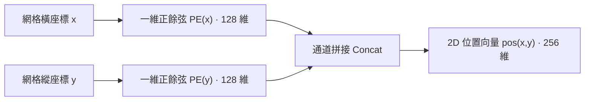

# 原版 DETR：網絡架構與前向流程

在傳統目標檢測框架中，從輸入圖像到生成最終邊界框的流程充滿了人工設定的幾何先驗：在特徵圖上鋪設成千上萬個錨框（Anchors）或採樣點、根據 IoU 閾值做啓發式正負樣本分配、通過 RoI Align 截取局部特徵，最後依賴非極大值抑制（NMS）在外部消除冗餘框。

DETR（Carion 等人，2020）徹底重構了這一範式。它將目標檢測形式化為**直接集合預測（Direct Set Prediction）** 問題：輸入一張圖像，直接通過神經網絡前向計算，一步輸出一個包含 $N$ 個預測目標的集合。

本篇聚焦 DETR 的**前向架構與預測機制**。我們將從數據結構與幾何對稱性的第一性原理出發，拆解圖像張量如何一步步轉化為目標預測集合，並探究位置編碼、編解碼器雙重注意力以及 Object Query 的底層機理與計算代價。

## 整體前向數據流

目標檢測任務在數據結構上面臨一個內在矛盾：

- **物理世界的真值是變長的無序集合：** 一張圖像中可能存在 0 個、3 個或數十個目標，且目標之間沒有天然的先後順序；
- **標準神經網絡計算圖要求定長張量：** 深度學習框架的靜態計算圖與矩陣並行運算，要求網絡每一層的輸出張量具有確定的維度形狀。

為了在定長計算圖中承載變長集合，DETR 在解碼器中預設了 $N$ 個並行槽位（Slot），無論輸入圖像包含多少真實目標，模型始終固定輸出 $N$ 個預測結果（COCO 數據集上默認 $N = 100$）。當圖像中目標不足 $N$ 個時，空餘槽位將預測為特殊的背景類別 $\varnothing$（No Object）。

:::info[問題]

**為什麼非要用預設的固定槽位，而不能像自然語言生成那樣逐個吐出目標？**

語言生成具有天然的時序單向依賴（前一個詞決定後一個詞），所以適合用自迴歸（Autoregressive）循環生成；而圖像中的物理實體在二維空間上是**並列共存**的。一隻飛鳥和一棵樹之間沒有誰先誰後的因果語法。如果硬套自迴歸，不僅推理必須一步步串行執行、速度極慢，還會強行給原本並列的目標強加一個人工規定的先後順序（比如從左到右），破壞了對稱性。預設 $N$ 個並行槽位，就是為了讓所有可能的目標在一次前向傳播中**同時且獨立**地被提取出來。

:::

整個前向推理的數據流向如下：

1. **骨幹特徵提取：** 原始圖像 $x \in \mathbb{R}^{3 \times H_0 \times W_0}$ 經過標準 ResNet 提取第 5 階段（C5）特徵，空間分辨率下采樣 32 倍至 $H = \lfloor H_0 / 32 \rfloor, W = \lfloor W_0 / 32 \rfloor$，通道數為 2048；
2. **通道降維：** 採用 $1 \times 1$ 卷積將通道數由 2048 壓縮到 Transformer 的隱藏維度 $d = 256$，得到緊湊的二維特徵圖 $z_0 \in \mathbb{R}^{d \times H \times W}$；
3. **特徵展平與編碼：** 將二維特徵圖的空間維度轉置後展平為序列 $Z \in \mathbb{R}^{L \times d}$，其中 $L = H \times W$。二維正餘弦位置編碼不與特徵拼接，而是在 6 層標準 Transformer 編碼器的每層自注意力內部，注入到 $Q$ 與 $K$ 的投影之前。編碼器的輸出是富含全局上下文與實例解耦信息的特徵記憶體 $\text{Memory} \in \mathbb{R}^{L \times d}$；
4. **解碼器並行探測：** $N$ 個可學習的 Object Queries 作為位置探針，配合初始化為 0 的內容嵌入，輸入 6 層 Transformer 解碼器。在每一層中，Queries 之間先通過自注意力協商分工，再通過交叉注意力從 $\text{Memory}$ 中提取具體物體的視覺表徵；
5. **共享預測頭輸出：** 解碼器輸出的 $N$ 個特徵向量分別獨立通過參數共享的分類頭（Linear）與迴歸頭（3-layer MLP），直接映射出 $N$ 個預測項：包含類別概率分佈 $\hat{p}_i \in \mathbb{R}^{K+1}$ 與歸一化邊界框座標 $\hat{b}_i \in [0, 1]^4$。

## CNN 骨幹網絡：單尺度特徵提取

在常規多尺度檢測器（如帶 FPN 的 Faster R-CNN 或 YOLO）中，網絡會同時利用下采樣 8 倍（C3）、16 倍（C4）和 32 倍（C5）的多層特徵來覆蓋不同尺度的物體。但原版 DETR **僅使用了單尺度 C5 特徵圖**。

這一選擇不是為了追求極簡，而是受限於標準自注意力算子的計算複雜度。

標準自注意力機制需要計算全序列所有 Token 兩兩之間的點積權重，其時間與顯存複雜度與輸入序列長度 $L$ 的平方成正比：

$$\mathcal{O}_{\text{Attention}} = \mathcal{O}(L^2 \cdot d) = \mathcal{O}((H \cdot W)^2 \cdot d)$$

以輸入圖像分辨率 $800 \times 1333$ 為例，不同下采樣率下的序列長度與注意力矩陣開銷如下：

| 特徵層級 | 空間步長 (Stride) | 特徵圖尺寸 ($H \times W$) | 序列長度 $L$ | 自注意力矩陣元素量 ($L^2$) | 顯存與計算開銷相對倍數 |
| :--- | :--- | :--- | :--- | :--- | :--- |
| **C5 (DETR 採用)** | 32 | $25 \times 42$ | **1,050** | **$\approx 1.10 \times 10^6$** | **$1 \times$ (基準)** |
| C4 | 16 | $50 \times 84$ | 4,200 | $\approx 1.76 \times 10^7$ | $\approx 16 \times$ |
| C3 | 8 | $100 \times 168$ | 16,800 | $\approx 2.82 \times 10^8$ | $\approx 256 \times$ |

如果直接將高分辨率特徵（如 C3）送入全局自注意力，單張圖像的單層注意力矩陣就需要計算接近 3 億次點積，顯存將瞬間耗盡。

因此，原版 DETR 必須在空間分辨率上做出妥協，僅保留感受野最大但分辨率最低的 C5 特徵。這一計算瓶頸直接帶來了性能代價：**小目標檢測能力的先天不足**。在 $800 \times 1333$ 的圖像中，一個 $32 \times 32$ 像素的小物體在 C5 特徵圖上只佔據不到 $1 \times 1$ 的網格像素，高層語義抽象後空間幾何細節嚴重丟失，這是原版 DETR 在小目標指標 $\text{AP}_{\text{s}}$ 上顯著弱於傳統 FPN 檢測器的根本原因。

## 二維正弦位置編碼

### 位置編碼的動機：恢復空間位置信息

卷積神經網絡通過滑動窗口的局部連通性天然保留了平移等變性與空間鄰域結構。而標準 Transformer 內部的自注意力操作是**置換等變（Permutation Equivariant）** 的：

$$\text{Attention}(P X, P X, P X) = P \, \text{Attention}(X, X, X)$$

其中 $P$ 是任意的置換矩陣。這意味着如果將展平後的特徵序列任意打亂順序輸入 Transformer，輸出的特徵除了順序跟着被打亂之外，計算出的數值完全不變。對於目標檢測而言，物體在圖像中的絕對座標與相對距離至關重要，模型若無法感知網格空間排列，就根本無法預測邊界框。

### 二維正弦位置編碼的公式定義

在自然語言處理中，句子是一維時序，位置可以用單一標量 $pos$ 編碼。而圖像特徵分佈在二維離散網格上，每個特徵點由座標 $(x, y)$ 唯一定位（$x \in [1, W], y \in [1, H]$）。

DETR 採用了二維獨立正餘弦位置編碼。將隱藏維度 $d = 256$ 均分為兩半，前 128 維對水平座標 $x$ 進行正餘弦波長調製，後 128 維對垂直座標 $y$ 調製：

$$\begin{aligned} \text{PE}_{(x, 2i)} = \sin\left(\frac{x}{10000^{2i / (d/2)}}\right), \quad \text{PE}_{(x, 2i+1)} = \cos\left(\frac{x}{10000^{2i / (d/2)}}\right), \quad i \in \left[0, \frac{d}{4} - 1\right] \\ \text{PE}_{(y, 2i)} = \sin\left(\frac{y}{10000^{2i / (d/2)}}\right), \quad \text{PE}_{(y, 2i+1)} = \cos\left(\frac{y}{10000^{2i / (d/2)}}\right), \quad i \in \left[0, \frac{d}{4} - 1\right] \end{aligned}$$

最後將橫縱兩路的 128 維編碼在通道維度拼接，構成每個像素點 $(x, y)$ 專屬的 256 維位置向量：

$$\text{pos}(x, y) = \left[ \text{PE}(x) \,\|\, \text{PE}(y) \right] \in \mathbb{R}^d$$

> 二維正餘弦位置編碼構造

### 位置編碼在注意力層中的注入位置

原始 Vaswani Transformer 是在輸入層將詞向量與位置編碼直接相加（$x + pos$），隨後送入各層。而 DETR 在編解碼器的每一層注意力子層中，顯式地將位置編碼加在 $Q$ 和 $K$ 的投影前，而 $V$ 保持純粹的特徵內容：

$$Q = (z + \text{pos}) W_Q, \quad K = (z + \text{pos}) W_K, \quad V = z W_V$$

這種設計的深層邏輯在於 Q、K、V 在注意力機制中的分工不同：

1. **$Q$ 與 $K$ 負責尋址（Addressing）：** 點積 $Q K^T$ 計算的是 " 去哪裏尋找相關信息 "。判斷兩個特徵點是否相關，既取決於它們的語義相似性（如都是狗的毛髮），也取決於它們在空間上的幾何相對距離。因此，位置編碼必須參與 $Q$ 和 $K$ 的運算。
2. **$V$ 負責搬運內容（Content Transport）：** 一旦尋址權重計算完成，注意力層通過加權平均 $\text{Softmax}(Q K^T / \sqrt{d_k}) V$ 從選中的區域匯聚語義特徵。匯聚的內容應當是圖像本身的視覺表徵，如果 $V$ 中混入了絕對座標偏移量，會導致深層特徵表示被空間座標污染，破壞純粹的語義提取。
3. **逐層顯式注入的原因：** 特徵在穿過每一層的多頭注意力和前饋網絡（FFN）後，非線性變換會逐步稀釋底層的空間位置信息。每一層顯式重新注入原始的位置編碼，能夠確保深層網絡在進行長距離尋址時，幾何空間線索始終保持清晰。

:::info[問題]

**把位置編碼加到 Value 裏，到底會產生什麼副作用？**

可以做一個直觀的思想實驗：假設圖像左上角有一個橙子，右下角也有一個完全相同的橙子。它們的語義內容（顏色、紋理、輪廓）理應是高度一致的。在特徵聚合時，我們希望網絡提取出的 " 橙子表徵 " 能夠脱離具體座標、在分類器看來保持純淨。

如果把位置編碼加進 $V$，那麼左上角的橙子吐出的 $V$ 永遠帶着 `(0, 0)` 的座標偏置，右下角的橙子帶着 `(H, W)` 的座標偏置。這會導致同一個物體在不同位置匯聚出的特徵產生人為的數值漂移，白白破壞了卷積和視覺識別賴以生存的**平移不變性**。所以，位置信息應該用來指導 " 視線看到哪裏 "，而不是污染 " 看到的東西本身 "。

:::

## Transformer 編碼器

將特徵圖 $z_0 \in \mathbb{R}^{d \times H \times W}$ 轉置為 $H \times W \times d$ 後展平為 $Z \in \mathbb{R}^{L \times d}$，與位置編碼張量一同傳入 6 層標準 Transformer 編碼器；位置編碼不在入口處與特徵合併，而是在每層自注意力內部單獨注入到 $Q$ 與 $K$ 的投影前。

編碼器每層採用 8 頭注意力機制（$h = 8, d = 256$，每個注意力頭 $d_k = 32$）。多頭注意力允許模型在不同的低維投影子空間中同時捕捉多種關聯模式（例如某幾個頭依據空間局部相鄰聚合，另一些頭依據全局同類語義聚合）。

### 編碼器的作用：特徵增強與上下文聚合

在傳統卷積網絡中，神經元的感受野依賴卷積核層級堆疊逐步擴大，深層特徵雖然感受野大，但在大尺度目標內部或存在遮擋的目標之間，特徵往往粘連混淆。

Transformer 編碼器在第一層就建立了全特徵圖任意兩個像素之間的直接關聯。這種全局交互帶來兩個決定性的能力：

1. **全局實例解耦：** 編碼器自注意力能夠將屬於同一個實體的分散像素在特徵層面強行聚合，同時將前景實體與複雜的背景紋理清晰剝離。
2. **克服遮擋與斷裂：** 當一個物體被前景障礙物切分為兩半時，由於兩部分具有高度一致的全局語義與上下文關聯，編碼器能夠直接將斷裂區域的特徵拉緊在一起。

## Transformer 解碼器

解碼器是 DETR 實現直接集合預測的核心模塊。如果説編碼器的任務是對整張圖像做全局上下文建模與實例分離，那麼解碼器的任務，就是派出一組並行探測器，把圖像中的實體逐一認領並提取為具體的結構化表徵。

### 非自迴歸預測與槽位機制

#### 解碼機制：非自迴歸並行預測

在自然語言處理的 Seq2Seq 任務中，標準 Transformer 解碼器採用**自迴歸（Autoregressive）** 模式：生成第 $t$ 個詞時，必須依賴前 $t-1$ 個詞作為輸入，計算步步串行，時間複雜度隨輸出長度線性增長。

然而，目標檢測在本質上是空間並列的任務，不是時序生成任務。一幅圖像中的汽車、行人與交通信號燈同時存在於空間二維畫布上，彼此之間沒有語法先後次序。如果強行引入自迴歸生成，不僅推理延遲會成倍增加，還會人為破壞目標的幾何對稱性（例如強迫模型先預測左邊的物體再預測右邊的物體）。

DETR 採用了**完全非自迴歸**的設計：所有預測在所有解碼層中全併發推進。網絡設定了一個固定的預測規模 $N$（在 COCO 數據集上通常為 $N = 100$），在前向傳播時，$N$ 個預測項是一步到位同時吐出的。

#### 槽位機制概念：Slot

文獻中常把 DETR 的輸出通道稱為"槽位（Slot）"。這個概念聽起來有些抽象，但在工程與張量實現層面，它有着非常具體的物理含義。

在計算圖中，所謂槽位，實質上就是解碼器特徵張量 $H \in \mathbb{R}^{N \times B \times d}$ 在第一維度上的切片：第 $i$ 個槽位就是切片 $H[i, :, :]$。我們可以把這 $N$ 個槽位理解為網絡派出的 $N$ 個並行的**目標捕獲通道（Worker）**。

在每一次前向計算中：

1. 每個槽位負責在圖像中搜尋至多一個獨立的物理實體；
2. 如果某幅圖像裏只有 3 個物體，那麼其中 3 個槽位會分別捕獲這 3 個物體的類別與座標，其餘 97 個槽位則輸出表示"此處沒有物體"的背景類 $\varnothing$；
3. 解碼器的職責，就是讓這 $N$ 個槽位在互不衝突的前提下，儘可能完整地覆蓋整張圖像中所有顯著的目標。

那麼，這 $N$ 個原本空白的槽位，依靠什麼來區分彼此、又是在哪一步把圖像特徵裝載進去的？這就涉及 Object Query 與內容嵌入的雙軌設計。

### Object Query 的雙軌輸入結構

進入 DETR 解碼器的張量狀態並不是單一變量，而是嚴格分離的"雙軌制"：**內容嵌入（Content Embeddings）** 與 **Object Query**。

#### 內容查詢與位置查詢的分工

每個槽位內部維護兩組向量：

- **內容嵌入（快變量）$h \in \mathbb{R}^{N \times B \times d}$：** 它用來承載當前圖像中具體目標的視覺信息（如物體的顏色、紋理、輪廓以及最終由其提煉出的語義類別與邊界框）。在輸入第 1 層解碼器時，我們對圖像中到底有什麼物體一無所知，因此它被完全初始化為**全零張量**（在代碼中為 `torch.zeros(N, B, d)`）。隨着網絡穿過一層層解碼器，它不斷吸收來自圖像的特徵，數值隨具體輸入動態劇烈變化；
- **Object Query（慢變量）$Q_{\text{obj}} \in \mathbb{R}^{N \times d}$：** 它是網絡的一組**可學習參數**（在代碼中聲明為 `nn.Embedding(N, d)`）。它的權值與具體的輸入圖像無關，而是在訓練全週期由優化器緩慢更新，凝聚了整個數據集的目標幾何空間先驗（例如"左上方小目標"、"畫面正中心大目標"）。

從角色劃分來看，$Q_{\text{obj}}$ 扮演的是**解碼器端的位置編碼（Decoder Positional Encoding）**：它不攜帶任何語義類別信息，只提供幾何先驗。後續工作會把這一個張量拆成位置與語義兩職——在後續關於 DINO 的文章中討論 positional query 與 content query 的二分時，$Q_{\text{obj}}$ 就是那條分界線上 content query 一側的載體。

#### 查詢向量在各解碼層的注入方式

在傳統自然語言 Transformer 中，位置編碼通常只在輸入層與詞向量相加一次，便不再單獨干預深層計算。但 DETR 的解碼器不同，為了確保深層特徵在不斷非線性演化的過程中不丟失初始的空間尋址偏置，$Q_{\text{obj}}$ 會在**全部 6 層解碼器的每一個注意力子層中顯式重新注入**。

具體到每一層解碼器內部，注入發生在投影矩陣之前：

1. **自注意力子層（Self-Attention）中的注入：**
   槽位的內容特徵 $h^{(l-1)}$ 加上 $Q_{\text{obj}}$ 後，共同投影生成自注意力的 $Q$ 與 $K$；而 $V$ 則保持純淨的內容特徵，不包含位置偏置：

   $$Q_{\text{self}} = (h^{(l-1)} + Q_{\text{obj}}) W_Q, \quad K_{\text{self}} = (h^{(l-1)} + Q_{\text{obj}}) W_K, \quad V_{\text{self}} = h^{(l-1)} W_V$$

2. **交叉注意力子層（Cross-Attention）中的注入：**
   自注意力子層輸出的新內容特徵 $h_{\text{self}}^{(l)}$ 再次與 $Q_{\text{obj}}$ 相加，作為探針向圖像特徵發起尋址；圖像端輸入的 $\text{Memory}$ 則疊加圖像位置編碼 $\text{pos}$ 作為 $K$，以圖像純特徵作為 $V$：

   $$Q_{\text{cross}} = (h_{\text{self}}^{(l)} + Q_{\text{obj}}) W_Q, \quad K_{\text{cross}} = (\text{Memory} + \text{pos}) W_K, \quad V_{\text{cross}} = \text{Memory} \, W_V$$

這種逐層顯式相加的設計邏輯與編碼器如出一轍：位置編碼負責引導尋址過程（指導注意力權重矩陣應該聚焦在何處），而搬運與聚合的語義載荷（$V$）始終保持乾淨的視覺內容，防止絕對座標偏置污染特徵語義。

### 解碼器單層中的注意力機制

梳理瞭解碼器的雙軌狀態與注入方式後，我們便能清晰追蹤單個解碼層內部的兩個核心注意力子層各自在解決什麼問題。

#### 自注意力層：查詢向量之間的交互

自注意力子層在計算 $N$ 個槽位相互之間的注意力權重，其計算矩陣維度為 $N \times N$。

它的核心作用是槽位間的通信與**去重協商**。因為所有 $N$ 個槽位是並行獨立工作的，如果缺少槽位之間的直接對話，完全有可能出現兩個偏好相近的槽位同時看中了畫面中的同一只斑馬，並各自輸出一個高置信度的檢測框，這就會退化出傳統檢測器中成堆的冗餘預測。

在自注意力中，每個槽位將自身目前攜帶的內容狀態與空間偏好暴露給其他所有槽位。配合訓練階段二分圖匹配的"一對一排他懲罰"，槽位之間可以在內部完成動態協商：如果兩個槽位發現彼此瞄準了同一個目標，其中一個槽位會依據競爭優勢保留該目標，另一個槽位則主動避開，轉而退守為背景或者去尋找其他邊緣目標。正是這種自注意力交互，讓 DETR 得以在完全拋棄外部 NMS 的前提下實現乾淨的單實例單預測。

#### 交叉注意力層：查詢與圖像特徵的交互

交叉注意力子層把 $N$ 個槽位作為查詢探針，向編碼器吐出的整幅圖像記憶體 $\text{Memory} \in \mathbb{R}^{L \times d}$ 發起尋址，其計算出的注意力矩陣形狀為 $N \times L$（其中 $L = H \times W$）。**它的核心作用是定向內容汲取與邊界對齊。**

經過 Softmax 歸一化後的注意力矩陣，表示第 $i$ 個槽位對圖像中每一個網格點的關注程度。每個槽位依據各自計算出的權重，把全圖屬於該目標區域的特徵向量加權求和，匯聚到自己的內容嵌入中：

$$h^{(l)} = \text{Softmax}\left( \frac{Q_{\text{cross}} K_{\text{cross}}^T}{\sqrt{d}} \right) V_{\text{cross}}$$

在實際訓練收斂後，交叉注意力的行為呈現出高度符合幾何規律的特徵：

注意力並不是機械地均勻灑在物體內部，而是自動集中在物體的外邊緣、四肢、頭尾等極值邊界點上。因為決定一個矩形邊界框精度的，正是物體的最左、最右、最上、最下四個極值點。交叉注意力讓槽位主動去測量物體的幾何極值，為後續預測頭直接回歸邊界框提供了充分的局部特徵支持。

### Object Query 的參數本質與空間分工

建立了宏觀數據流與單層注意力的清晰圖景之後，我們可以從數學與優化理論的視角，進一步解答三個關於 Object Query 的關鍵問題（Know-why）。

#### 查詢向量的可學習參數本質

一個自然的疑問是：為什麼必須為每個槽位單獨分配一組可學習向量 $Q_{\text{obj}, i}$？如果直接像編碼器那樣，把輸入初始化為一組純內容特徵，或者乾脆讓所有槽位共享同一個查詢向量行不行？

答案是：**必須引入互不相同的參數來打破置換對稱性（Permutation Symmetry）。**

Transformer 算子是嚴格置換等變（Permutation Equivariant）的。在第 1 層解碼器入口處，內容嵌入全為 0。如果此時不提供相互獨立的 $Q_{\text{obj}}$（例如讓所有槽位使用相同的向量，或者全部置零），那麼在第一層計算中：

1. 自注意力的輸入處處相同，輸出恆為 0；
2. 交叉注意力的 Query 向量在所有 $N$ 個槽位上完全一致，導致每個槽位從圖像特徵中聚合出的向量毫無分別。

一旦對稱性沒有在入口處打破，由於多層網絡所有權重都是共享的，後續層將永遠保持完全相同的狀態，$N$ 個槽位最終只能輸出 $N$ 份一模一樣的邊界框與類別。因此，**這組參數是賦予各個並行槽位獨立身份、破壞系統初始對稱性的唯一支點**。

#### 查詢向量的先驗空間分佈

在數據剛剛進入第 1 層解碼器時，內容嵌入 $h^{(0)}$ 毫無信息（全為 0），這意味着在此時的交叉注意力計算中：

$$A_i = \text{Softmax}\left( \frac{(Q_{\text{obj}, i} W_Q)(\text{Memory} + \text{pos})^T W_K^T}{\sqrt{d}} \right) \in \mathbb{R}^{1 \times L}$$

注意觀察這個公式：注意力權重 $A_i$ 完全由 $Q_{\text{obj}, i}$ 與帶有位置編碼的圖像記憶體點積決定。

這揭示了一個極為重要的物理事實：**每個學習出來的 $Q_{\text{obj}, i}$，在第一層實質上定義了一個預設的空間尋址分佈圖。**

這與傳統檢測器中的**錨框（Anchor Box）** 在概念上是等價的：

- Faster R-CNN 是在空間網格上鋪設一組剛性、離散的幾何方框作為先驗候選，預測頭在此基礎上回歸偏移；
- DETR 則是用 $N$ 個連續向量生成了 $N$ 個連續、軟性、允許互相重疊的**概率尋址熱力圖**。

原論文在 COCO 驗證集上的統計散點圖（Figure 7）強力印證了這一機制：不同的 Query 槽位自發學會了關注不同的空間區域和長寬比模式。有些槽位專職負責檢測圖像左下角的小目標，有些槽位專職捕捉橫跨全圖的大物體。

#### 不同槽位的統計分工與多樣性

這組參數在所有圖像中是靜態固定的，它為何能夠穩定分工而不全部坍縮到圖像中央？

這是**二分圖匹配的排他機制與優化梯度相互博弈**的結果：

1. **隨機破缺：** 初始階段，正態分佈初始化讓每個 Query 的初始方向略有偏差；
2. **贏家通吃強化：** 訓練中的二分圖匹配要求每個真實目標只能由一個代價最小的槽位認領。一旦 Query $A$ 碰巧更靠近某個邊緣目標並贏得了正樣本匹配，它的參數就會受到向該目標靠近的梯度更新，從而強化了對該區域的特異性；
3. **空間覆蓋的防坍縮回復力：** 如果大量 Query 盲目聚集在中心大目標區域，邊緣的真實目標就會無人認領，從而對整個模型產生巨大的未檢出損失；此時，任何稍微偏向邊緣區域的 Query 都會立刻以極小的競爭阻力認領到這些孤立目標，並獲得巨大的正向更新反饋。正是這種動態拉扯，迫使 $N$ 個 Query 的空間分佈最終收斂為對整個數據集先驗空間分佈的均勻覆蓋。

#### 原版查詢機制的侷限性

儘管原版 DETR 的 Object Query 展現了優雅的數學性質，但它存在一個嚴重的工程短板：**這組空間先驗是高度隱式的**。

每個 Query 向量只是一串 256 維的抽象浮點數，它並沒有像傳統 Anchor 那樣明確規定"我代表 $(x=0.2, y=0.3, w=0.1, h=0.1)$"。網絡必須耗費長達 500 個 Epoch 的反覆二分匹配迭代，才能艱難地讓這 100 個向量把各自的空間分工摸索清楚。

正是這一隱式表示的遲鈍性，直接成為了後來一系列 DETR 演進工作的改進突破口：

- **Conditional DETR** 嘗試將 Query 顯式解耦為內容部分與具有物理座標投影的參考點位置部分；
- **DAB-DETR** 則更徹底地把 Object Query 直接建模為明確的 4 維邊界框先驗 $(x, y, w, h)$，從而將訓練收斂速度提升了數倍。

我們將在後續的演進篇章中，深入探討這些對 Query 進行顯式幾何約束的重構思路。

## 預測輸出頭（FFN）

經過 6 層解碼器的級聯提煉，最終輸出形狀為 $H_{\text{dec}} \in \mathbb{R}^{N \times d}$ 的特徵矩陣。DETR 將這 $N$ 個特徵向量獨立送入兩個並行的預測分支。

**特別需要明確：這兩個預測頭在所有 $N$ 個槽位之間是嚴格參數共享（Parameter-Shared）的。**
儘管各個 Query 具有不同的空間偏好，但物體特徵到類別屬性以及幾何邊界框的映射規律在物理世界中是通用的。參數共享保證了檢測器的泛化能力。

### 分類分支

由一個單層線性變換構成，將隱藏維度 $d$ 映射到類別數 $K + 1$：

$$\hat{p}_i = \text{softmax}(W_{\text{cls}} h_i + b_{\text{cls}}) \in \mathbb{R}^{K + 1}, \quad i \in \{1, \dots, N\}$$

其中 $K$ 為目標數據集的具體類別數（如 COCO 數據集 $K = 80$），額外的第 $K+1$ 類表示 " 無目標 " 背景類 $\varnothing$。

### 邊界框迴歸分支

由一個包含 3 層全連接層與 ReLU 激活函數的 MLP 構成，輸出 4 維歸一化座標：

$$\hat{b}_i = \sigma(\text{MLP}(h_i)) \in [0, 1]^4, \quad i \in \{1, \dots, N\}$$

末端經過 Sigmoid 函數 $\sigma(\cdot)$ 將數值嚴格約束在 $[0, 1]$ 之間。輸出格式為歸一化的中心座標與寬高：

$$\hat{b}_i = (\hat{c}_x, \hat{c}_y, \hat{w}, \hat{h})$$

與傳統檢測器預測相對於預設 Anchor 的空間偏移量 $(\Delta x, \Delta y, \Delta w, \Delta h)$ 不同，DETR **直接回歸真實框的絕對歸一化座標**。這徹底摒棄了人為設定的 Anchor 寬高比與尺寸超參數。

## 端到端張量追蹤

為了把上述公式與工程實現精確對應起來，下表展示了單批次（Batch Size = $B$）輸入下，張量在 DETR 前向網絡各模塊間的完整維度流轉過程（以標準配置 $d = 256, N = 100, K = 80$ 為例）：

| 計算階段 | 模塊 / 算子 | 輸入張量及形狀 | 輸出張量及形狀 | 關鍵操作與參數説明 |
| :--- | :--- | :--- | :--- | :--- |
| **圖像輸入** | 原始圖像 Batch | 圖像數據 | `[B, 3, H_0, W_0]` | 典型分辨率 $800 \times 1333$ |
| **骨幹特徵** | ResNet-50 (C5) | `[B, 3, H_0, W_0]` | `[B, 2048, H, W]` | 下采樣 32 倍，$H \approx 25, W \approx 42$ |
| **通道對齊** | $1 \times 1$ Conv | `[B, 2048, H, W]` | `[B, 256, H, W]` | 將 2048 通道壓縮至 $d = 256$ |
| **位置編碼** | 2D Sine/Cos PE | 網格座標 $(H, W)$ | `[B, 256, H, W]` | 橫縱各 128 維正餘弦拼接 |
| **序列展平** | Flatten & Permute | `[B, 256, H, W]` | `[HW, B, 256]` | 序列長度 $L = H \times W \approx 1050$ |
| **編碼器交互** | 6 層 Transformer Encoder | 特徵與位置 `[L, B, 256]` | **Memory** `[L, B, 256]` | $L \times L$ 全局自注意力，提取上下文 |
| **查詢輸入** | Object Queries / Output Emb | 學習參數 $Q_{\text{obj}}$ | `[N, B, 256]` | $N = 100$ 個探針；Content 初始全 0 |
| **解碼自注意** | Decoder Self-Attention | Query 特徵 `[N, B, 256]` | `[N, B, 256]` | $N \times N$ 槽位間通信，協商去重 |
| **解碼交叉注意** | Decoder Cross-Attention | Query `[N]` + Memory `[L]` | `[N, B, 256]` | $N \times L$ 注意力尋址，從圖像匯聚特徵 |
| **解碼器輸出** | 6 層堆疊輸出 | 解碼特徵 | **$H_{\text{dec}}$** `[B, N, 256]` | 每個槽位匯聚出 $d$ 維目標表徵向量 |
| **類別預測** | Linear Head (共享) | `[B, N, 256]` | **$\hat{P}$** `[B, N, 81]` | 輸出 80 類 + 1 個背景類 $\varnothing$ 的概率分佈 |
| **邊界框預測** | 3-layer MLP (共享) | `[B, N, 256]` | **$\hat{B}$** `[B, N, 4]` | Sigmoid 約束輸出歸一化 $(\hat{c}_x, \hat{c}_y, \hat{w}, \hat{h})$ |

## 小結

本篇剖析了 DETR 前向推導流水線的設計邏輯：

1. **任務約束與集合容器：** 引入固定容量為 $N$ 的 Object Queries，在定長計算圖中承載變長的物理目標集合；
2. **算力瓶頸與單尺度取捨：** 自注意力 $\mathcal{O}(L^2)$ 複雜度迫使原版 DETR 只能使用下采樣 32 倍的 C5 特徵，埋下了小目標檢測偏弱的隱患；
3. **幾何信息注入：** 利用 2D 正餘弦位置編碼打破置換等變性，且僅作用於 Q 與 K 尋址通道，保持 V 內容通道的純淨；
4. **編碼器全局解耦：** 通過全局自注意力建立任意像素對的直接連接，實現實例邊界分離與遮擋特徵聚合；
5. **解碼器雙重注意力：** 交叉注意力完成 " 圖到槽位 " 的特徵抓取，自注意力建立 " 槽位到槽位 " 的通信通道以避免重複預測；
6. **參數共享預測頭：** $N$ 個槽位共享分類線性頭與 3 層 MLP 迴歸頭，直接回歸絕對歸一化座標。

在前向計算生成了這固定大小為 $N$ 的預測集合後，接下來的核心問題是：**在模型訓練階段，如何將無序的預測集合 $\hat{Y}$ 與真實目標集合 $Y$ 進行無歧義的最優配對，並構建損失函數驅動網絡收斂？** 我們將在下一篇《[原版 DETR：二分圖匹配與集合損失](./detr-v1-bipartite-matching-set-loss)》中展開數學拆解。

---

下一篇：[原版 DETR：二分圖匹配與集合損失](./detr-v1-bipartite-matching-set-loss)
