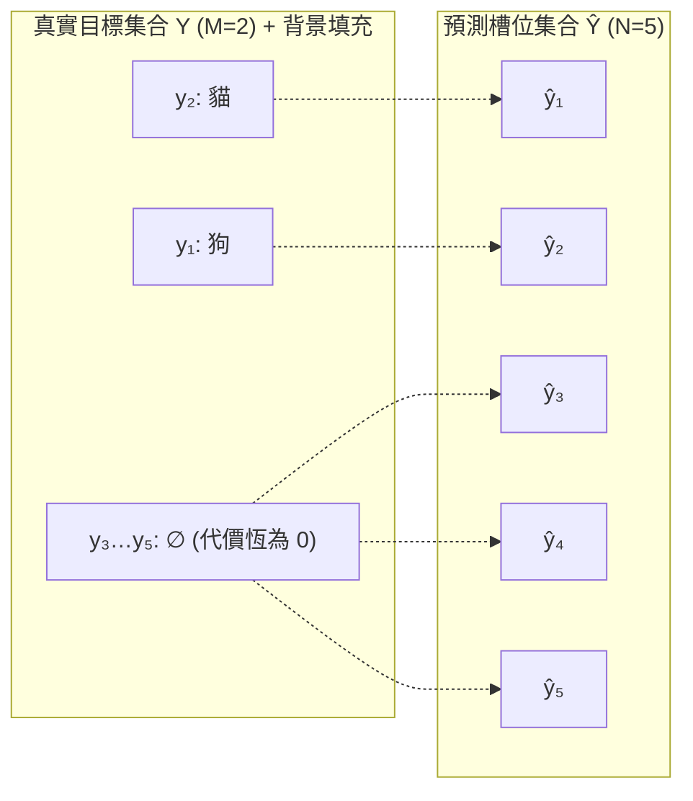

# 原版 DETR：二分圖匹配與集合損失

在上一篇《[1）原版 DETR：網絡架構與前向流程](./detr-v1-architecture-forward-pass)》中，我們剖析了 DETR 的前向架構：主幹網絡提取 C5 特徵，編碼器建立全局像素關聯，解碼器通過 $N$ 個 Object Queries 並行探測，最終由共享預測頭輸出一個大小固定為 $N$ 的預測集合 $\hat{Y} = \{\hat{y}_i\}_{i=1}^N$。

然而，目標檢測的監督信號本質是一個**無序且數量可變的真實目標集合** $Y = \{y_i\}_{i=1}^M$（其中 $M$ 為該圖像中的真實目標數量，通常 $M < N$）。在模型輸出的 $N$ 個預測中，到底哪一個預測槽位應當負責哪一個真實目標？對於未命中真實目標的剩餘 $N - M$ 個槽位，又該如何實施懲罰？

傳統檢測器依賴預設的空間重疊先驗（如 Anchor 與真實框的 IoU 閾值）進行啓發式的一對多標籤分配。DETR 拋棄了一對多標籤分配的思路，變成一對一分配，因此也就不再需要 NMS。不過，我們還是需要一個分配的算法，將網絡的輸出，和實際的標籤一一對應。恰好，匈牙利算法，就是一種用來在兩組元素之間求解最小總代價雙射配對的經典組合優化算法，正好可以承擔起為預測槽位與真實目標建立一一對應關係的任務。

本篇系統拆解集合監督的數學定義、兩階段訓練機制、匹配代價設計的量級約束、集合損失的構造，以及一對一匹配如何自發內化去重機制（消除 NMS），並深入分析該範式帶來的正樣本稀疏與匹配震盪代價。

## 集合預測的排列不變性

在設計損失函數之前，必須先明確目標檢測任務中的兩組對稱性：

1. **真實目標集合的排列不變性（Permutation Invariance of Ground Truth）：**
   真實標註是一個集合，對下標的任意重排都不改變它自身：

   $$
   \{y_{\pi(1)}, y_{\pi(2)}, \dots, y_{\pi(M)}\} = \{y_1, y_2, \dots, y_M\}, \quad \forall \pi \in \mathfrak{S}_M
   $$

   這裏的下標只是為了書寫標註列表而臨時賦予的編號。例如一張圖像中有一隻貓和一個蘋果，標註列表寫成 `[貓, 蘋果]` 還是 `[蘋果, 貓]`，只是編號順序不同，其所表達的物理世界真值完全相同。列表的先後次序來自標註文件的存儲格式，不屬於物理真值。
2. **預測集合的槽位無序對應：**
   DETR 解碼器輸出 $N$ 個預測向量 $\hat{Y} = \{\hat{y}_1, \dots, \hat{y}_N\}$。雖然在張量實現中它們佔據數組索引 $1, \dots, N$，但這些槽位在語義上並沒有先驗的固定順序（例如並沒有規定 " 槽位 1 必須預測貓 " 或 " 槽位 2 必須預測左上角物體 "）。

因此，評估預測集合 $\hat{Y}$ 與真實集合 $Y$ 之間的差異，不能直接使用按張量索引對齊的逐元素損失，而必須在**所有可能的對應關係中，找到一組全局最優的排列**。

## 匈牙利二分圖匹配

為了在數學上統一預測集合與真實集合的基數（Cardinality），DETR 首先將真實目標集合 $Y$ 用特殊的 " 無目標 " 背景類別 $\varnothing$ 填充（Pad）至大小 $N$：

$$
Y = \{y_1, y_2, \dots, y_M, \underbrace{\varnothing, \varnothing, \dots, \varnothing}_{N - M \text{ 個}}\}
$$

每個真實的物理目標 $y_i = (c_i, b_i)$ 由類別標籤 $c_i \in \{1, \dots, K\}$ 和歸一化真實框座標 $b_i = (x_i, y_i, w_i, h_i) \in [0, 1]^4$ 構成；而背景目標 $y_i = \varnothing$ 則表示無類別且不含邊界框座標。

引入填充項的目的，只是把左右兩側湊成相同大小、湊出 $N \times N$ 的方陣，從而直接套用標準的雙射匹配框架。由於填充項的匹配代價恆為 0，它們不與前景目標爭奪任何槽位。優化真正需要決定的，只有 $M$ 個真實目標各自落在哪個槽位；填充項最終落到的槽位，就是被前景挑剩下的那些，具體落到哪一個無關緊要。

現在，問題轉化為一個經典的賦權二分圖最大權匹配（或最小費用流）問題：在對稱羣 $\mathfrak{S}_N$（即 $N$ 個元素的所有全排列集合，共有 $N!$ 種排列方式）中，尋找一個最優的雙射排列 $\hat{\sigma} \in \mathfrak{S}_N$，使得真實目標與第 $\sigma(i)$ 個預測之間的**總配對代價（Matching Cost）最小**：

$$
\hat{\sigma} = \arg\min_{\sigma \in \mathfrak{S}_N} \sum_{i=1}^N \mathcal{L}_{\text{match}}(y_i, \hat{y}_{\sigma(i)})
$$

其中 $\sigma(i)$ 表示在排列 $\sigma$ 下，與第 $i$ 個真實目標配對的預測槽位索引。

> 虛線表示一次匹配的輸出。注意前景的兩條箭頭是交叉的：狗被派到 ŷ₂，貓被派到 ŷ₁，指派結果與下標順序無關。三條背景箭頭則沒有信息——填充項的代價恆為 0，它們指向哪個槽位由優化器任意決定，不構成約束。

## 離散匹配與梯度反傳的解耦

理解 DETR 訓練機制的一個核心是：**匈牙利匹配（Hungarian Matching）本身是不可微的組合優化操作，梯度絕不穿透匹配算子。**

DETR 的訓練本質上是一個兩階段交替過程（類似於 Expectation-Maximization 算法的邏輯）：

1. **第一階段：離散決策（Matching / Assignment）**
   固定當前網絡參數的前向輸出 $\hat{Y}$，計算真實目標與預測槽位之間的代價矩陣，調用匈牙利算法求解出一個離散的全局最優單射索引映射 $\hat{\sigma}$。這一步只負責**定責（責任分配）**，屬於不可微的離散決策。
2. **第二階段：連續優化（Loss Backpropagation）**
   固定第一階段求解出的配對關係 $\hat{\sigma}$，將配對的 $(y_i, \hat{y}_{\hat{\sigma}(i)})$ 送入標準的分類與迴歸損失函數中計算數值，通過反向傳播將梯度更新回主幹網絡、Transformer 編解碼器與預測頭參數。

## 匹配代價矩陣設計

配對代價 $\mathcal{L}_{\text{match}}(y_i, \hat{y}_j)$ 用於衡量第 $i$ 個真實目標 $y_i$ 與第 $j$ 個預測結果 $\hat{y}_j$ 之間的不契合程度。

對於填充項 $y_i = \varnothing$，它與任何預測的匹配代價均定義為 0（即背景分配不產生主動匹配代價）。對於實際存在的物理目標 $y_i = (c_i, b_i)$，其與預測 $\hat{y}_j = (\hat{p}_j, \hat{b}_j)$ 的匹配代價綜合了**類別概率**與**空間幾何契合度**：

$$
\mathcal{L}_{\text{match}}(y_i, \hat{y}_j) = -\mathbb{I}_{\{c_i \neq \varnothing\}} \, \hat{p}_j(c_i) + \mathbb{I}_{\{c_i \neq \varnothing\}} \, \mathcal{L}_{\text{box}}(b_i, \hat{b}_j)
$$

其中：

- $\hat{p}_j(c_i)$ 是預測槽位 $j$ 屬於真實類別 $c_i$ 的**預測概率值**（通過 Softmax 歸一化後的概率標量）。預測出的類別概率越高，匹配代價越低（因此前面加負號）。
- $\mathcal{L}_{\text{box}}(b_i, \hat{b}_j)$ 是幾何匹配代價。

### 匹配代價設計：分類損失項

這是一個非常關鍵的設計取捨。為什麼匹配時不直接採用反向傳播使用的負對數似然（Negative Log-Likelihood）$-\log \hat{p}$？

答案在於**多任務代價的數值尺度平衡（Magnitude Scale Balance）**。在訓練初期，網絡對正確類別的預測概率 $\hat{p}_j(c_i)$ 往往很小：隨機初始化時約為 $1/(K+1) \approx 0.012$，$-\log(0.012) \approx 4.4$；概率進一步降到 0.001 時，$-\log(0.001) \approx 6.91$。而幾何項 $\mathcal{L}_{\text{box}}$ 的數值處於 $[0, 2]$ 量級（這裏指不帶權重的原始損失）。兩相對照，分類項會主導總代價，一個在空間幾何上與目標高度貼合、但類別概率偏低的預測框，就很容易被一個分類更自信、幾何更差的預測搶走本該屬於它的目標。改用直接概率項 $-\hat{p}_j(c_i) \in [-1, 0]$ 後，分類代價被約束在一個有界且平緩的區間內，幾何相似度得以在匹配中保有實際影響，兩類先驗也就能在同一架天平上共同指導匹配。

而在第二階段計算參數優化損失時，必須恢復使用 $-\log \hat{p}_j(c_i)$，因為只有對數似然函數才能在預測錯誤時提供足夠陡峭的梯度，驅動概率向 1.0 快速收斂。

:::info[問題]

**為什麼二分圖匹配不能帶梯度反向傳播，必須分兩階段？**

匈牙利算法的本質是離散組合優化：它在 $N!$ 個排列裏挑出一個最優排列 $\hat{\sigma}$。$\hat{\sigma}$ 隨代價矩陣的變化而跳變，是一個分段常值函數，不可導，所以當然也就無法優化。但 " 不能帶梯度 " 不等於 " 與優化無關 "。匹配的實際定位是**梯度路由（Gradient Routing）**：它自身不接收梯度，卻決定每個真實目標落在哪個預測槽位，從而決定損失 $\ell(y_i, \hat{y}_{\hat{\sigma}(i)})$ 把梯度送往哪一條預測分支。路由本身不被優化，卻持續改變梯度流向。

這兩個角色無法合進同一個可微的計算圖：路由一旦被放進反傳路徑，就要對離散選擇求導，而它處處不可導。因此實現上必須把路由從梯度路徑中摘除（stop-gradient），先用當前預測定出 $\hat{\sigma}$，再在固定路由下反向傳播。這裏的 " 兩階段 " 指的是這種結構性解耦，而不是一個可微步驟被硬拆成兩次可微步驟。DETR 訓練早期的匹配震盪，正是路由隨預測漂移而跳變的表現。

:::

### 匹配代價設計：邊界框迴歸項

邊界框幾何代價由加權的 L1 距離與 GIoU 損失組合而成：

$$
\mathcal{L}_{\text{box}}(b_i, \hat{b}_j) = \lambda_{\text{L1}} \, \|b_i - \hat{b}_j\|_1 + \lambda_{\text{giou}} \, \mathcal{L}_{\text{giou}}(b_i, \hat{b}_j)
$$

在原版 DETR 中，超參數默認設置為 $\lambda_{\text{L1}} = 5, \lambda_{\text{giou}} = 2$。

這兩項損失構成了幾何度量的互補組合：

1. **L1 距離損失（$\|b_i - \hat{b}_j\|_1$）：**
   衡量框中心及寬高的絕對數值偏差。L1 損失的優勢在於無論兩個框相距多遠（即使完全不重疊），其導數恆為 $\pm 1$，能夠持續提供穩定的絕對拉近力。但 L1 存在**尺度敏感性**：雖然座標歸一化到 $[0, 1]$，但大目標產生的絕對座標誤差在數值上天然大於小目標。
2. **廣義交併比損失（GIoU Loss）：**
   針對重疊區域優化且具備**尺度不變性（Scale Invariance）**：

   $$
   \mathcal{L}_{\text{giou}}(b_i, \hat{b}_j) = 1 - \left( \frac{|b_i \cap \hat{b}_j|}{|b_i \cup \hat{b}_j|} - \frac{|C(b_i, \hat{b}_j) \setminus (b_i \cup \hat{b}_j)|}{|C(b_i, \hat{b}_j)|} \right)
   $$

   其中 $C(b_i, \hat{b}_j)$ 為包圍兩框的最小外接矩形面積。GIoU 既對大物體和小物體一視同仁，又解決了標準 IoU 在兩框不相交時梯度歸零的問題。

兩者缺一不可：單獨使用 L1，模型對大物體偏好過度且難以精細優化交併比；單獨使用 GIoU，在兩框相距甚遠時外包凸包主導的梯度推力較為微弱。

### 求解算法：基於匈牙利算法的指派實現

在論文的數學形式化中，為了在對稱羣 $\mathfrak{S}_N$ 上定義雙射，真實目標集合被填充至大小 $N$，將匹配表述成一個 $N \times N$ 的方陣問題。但在官方代碼 `models/matcher.py` 的 `HungarianMatcher` 中，並沒有真正構造這個方陣。其核心註釋直接寫明瞭：

> For efficiency reasons, the targets don't include the no_object. Because of this, in general, there are more predictions than targets. In this case, we do a 1-to-1 matching of the best predictions, while the others are un-matched (and thus treated as non-objects).

在工程實現中，代碼只為當前圖像實際存在的 $M$ 個真實目標與 $N$ 個預測槽位計算代價，構建一個行對應預測槽位、列對應真實目標的 $[N, M]$ 代價矩陣，直接調用 `scipy.optimize.linear_sum_assignment` 求解矩形指派，只匹配出 $\min(M, N)$ 對。那些沒有進入配對的預測槽位，天然就是無目標（no-object）。下面的例子為了書寫方便，把矩陣轉置寫成行對應真實目標、列對應預測槽位，指派結果不受影響。

這種簡化與理論上的方陣匹配是完全等價的。因為填充項 $\varnothing$ 與任何預測槽位的匹配代價恆為 0，是一個與指派方案無關的常數，不參與任何槽位競爭。把這些代價恆為 0 的填充項去掉，絲毫不影響真實前景目標之間的最優指派。被前景挑剩下的槽位，就是那些未匹配的預測。構建 $N \times N$ 方陣只是為了數學寫法的完備，工程上直接求解矩形指派既節省了計算開銷，又得到了完全一致的分配結果。

既然只需為 $M$ 個真實目標挑選槽位，為什麼不能直接在代價矩陣上逐行挑選最小值進行貪心分配，而必須依賴匈牙利算法求解全局最優？原因在於獨立貪心無法處理衝突：不同真實目標的最優預測槽位往往會重疊。

設一張圖像中有 $M = 2$ 個真實目標與 $N = 5$ 個預測槽位。框座標採用歸一化中心格式 $b = (c_x, c_y, w, h)$；類別下標 0 為狗、1 為貓，$\hat{p}_j(c)$ 記第 $j$ 個預測槽位屬於類別 $c$ 的 Softmax 概率。真實目標為

$$
y_1 = \bigl(c_1 = 0,\ b_1 = (0.25, 0.50, 0.30, 0.25)\bigr), \qquad y_2 = \bigl(c_2 = 1,\ b_2 = (0.20, 0.35, 0.35, 0.30)\bigr)
$$

五個預測槽位為

$$
\begin{array}{c|ccc}
 & \hat{b}_j & \hat{p}_j(0) & \hat{p}_j(1) \\\hline
\hat{y}_1 & (0.60, 0.55, 0.25, 0.10) & 0.05 & 0.05 \\
\hat{y}_2 & (0.70, 0.50, 0.20, 0.20) & 0.20 & 0.08 \\
\hat{y}_3 & (0.20, 0.35, 0.35, 0.30) & 0.03 & 0.50 \\
\hat{y}_4 & (0.80, 0.20, 0.15, 0.15) & 0.03 & 0.03 \\
\hat{y}_5 & (0.35, 0.80, 0.25, 0.20) & 0.04 & 0.04
\end{array}
$$

逐項計算匹配代價，得到代價矩陣 $C$

$$
C = \begin{array}{c|ccccc}
 & \hat{y}_1 & \hat{y}_2 & \hat{y}_3 & \hat{y}_4 & \hat{y}_5 \\\hline
y_1 & 5.670 & 5.486 & 3.170 & 8.967 & 5.190 \\
y_2 & 7.521 & 7.485 & -0.500 & 8.670 & 6.976
\end{array}
$$

觀察該矩陣可知，狗 $y_1$ 與貓 $y_2$ 各自的行最小值均落在槽位 $\hat{y}_3$ 上（狗的代價為 3.170，貓為 −0.500）。若採取逐行貪心，兩個目標將爭奪同一個槽位 $\hat{y}_3$，產生非法的非單射分配。

匈牙利算法給出的全局最優指派是：貓 $\to \hat{y}_3$（代價 −0.500），狗 $\to \hat{y}_5$（代價 5.190），總代價為 4.690，未匹配槽位為 $\hat{y}_1, \hat{y}_2, \hat{y}_4$。

這種調配方向取決於兩者的機會成本（Opportunity Cost）：貓若失去 $\hat{y}_3$ 被迫退選次優的 $\hat{y}_5$，匹配代價將從 −0.500 升至 6.976，落差約為 7.476；而狗若失去 $\hat{y}_3$ 退選次優的 $\hat{y}_5$，代價僅從 3.170 變為 5.190，落差約為 2.020。如果讓狗霸佔 $\hat{y}_3$ 而貓退至 $\hat{y}_5$，總代價將變為 10.146，比全局最優多出 5.456。全局組合優化正是在面對槽位衝突時，迫使失去代價更小的一方讓出槽位，從而實現系統總代價最小化。

## 小結

DETR 以一對一分配取代啓發式的一對多標籤分配：真實目標集合用代價恆為 0 的無目標類別填充，由匈牙利二分圖匹配求解預測槽位與真實目標之間全局最優的雙射排列。匹配是不可微的組合決策，充當梯度路由而非被優化的算子——先定責，再在固定指派下反向傳播。匹配代價刻意使用原始概率 $-\hat{p}$ 而非 $-\log \hat{p}$，以平衡與幾何項 L1 + GIoU 的數值量級，並在損失階段恢復對數似然。一對一匹配內化了去重機制、消除了 NMS 依賴，代價是正樣本稀疏與訓練早期的匹配震盪。

---

下一篇：[Deformable DETR](./deformable-detr)
