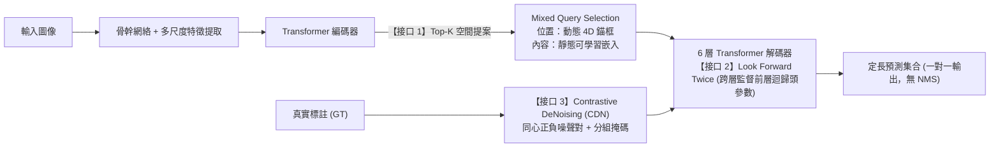
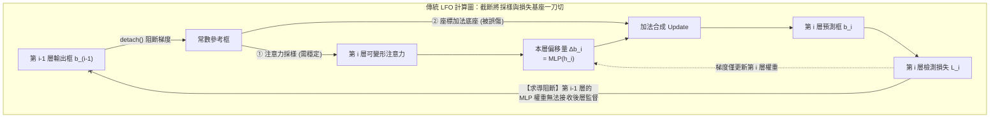
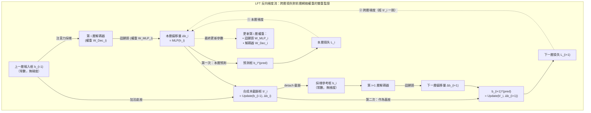
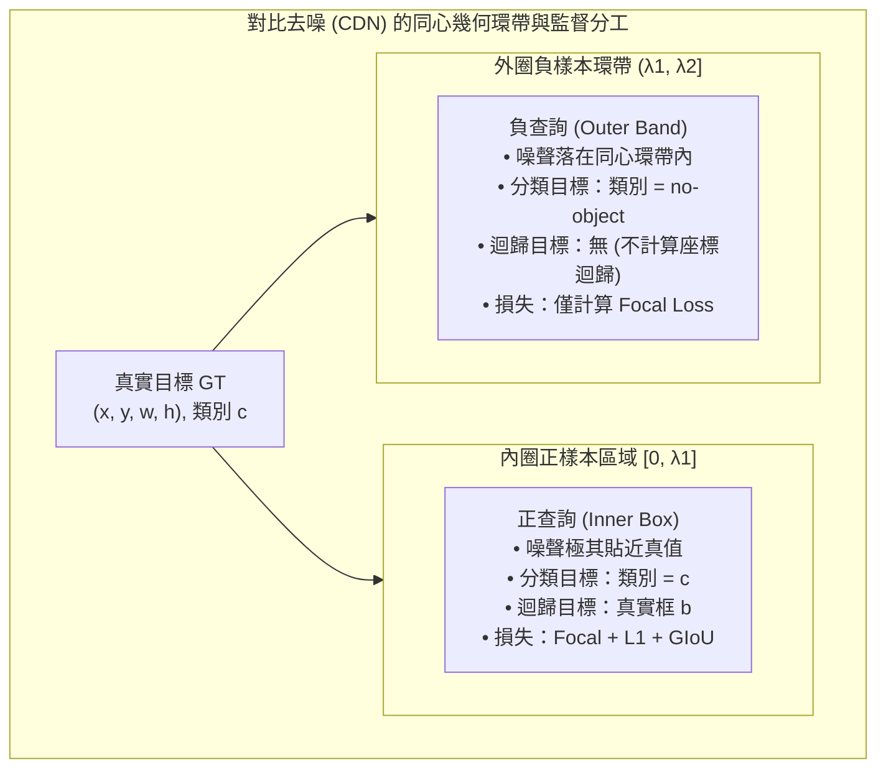
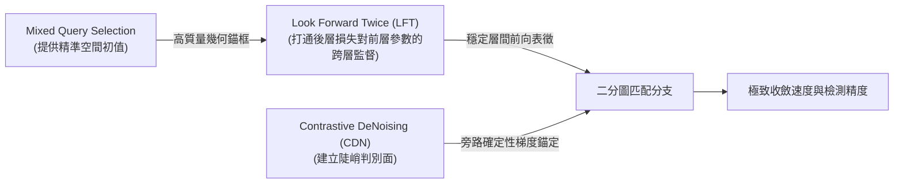
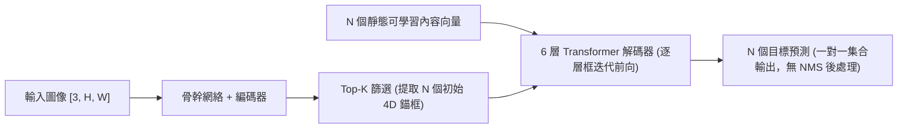

# DINO：三處接口的聯合設計

在前面的討論中，我們系統梳理了 DETR 架構演進的三條核心線索：Deformable DETR 重構了特徵讀取路徑，利用可變形注意力將全圖密集計算收縮為圍繞參考點的局部稀疏採樣，首次以較低計算開銷引入了高分辨率多尺度特徵；Conditional 與 DAB-DETR 將查詢解耦並顯式參數化為四維動態錨框 $(x, y, w, h)$，解決了特徵尋址中的定位冷啓動難題；而 DN-DETR 則通過在訓練期引入繞過匈牙利匹配的真值去噪旁路，消除了二分圖離散分配在訓練早期的劇烈震盪。

這三項工作各自攻克了一個明確的底層瓶頸。然而，它們最初是在各自獨立的語境下分別提出的。當研究者嘗試將多尺度可變形注意力、四維動態錨框與查詢去噪技術拼裝成一個統一的檢測器時，卻發現不同模塊在連接接口處依然存在着結構性斷裂與設計矛盾。

本篇聚焦於 **DINO（DETR with Improved deNoising anchOr boxes for End-to-End Object Detection）**，剖析研究者如何通過在**查詢初始化**、**幾何框層間更新**與**去噪訓練監督**三處核心接口上的聯合重構，將原本分散的加速機制整合成一套緊密協同的高性能端到端檢測體系。

:::warning[檢測 DINO 與自監督 DINO 的區別]
在計算機視覺文獻中存在兩個名稱相同的 DINO 工作，兩者面向的研究問題與技術譜系完全不同，不能混淆：

1. **自監督 DINO（Caron 等人，2021）及其後續演進（DINOv2、DINOv3）：** 屬於**自監督視覺表徵學習（Self-Supervised Representation Learning）**範疇，其核心機制是利用自蒸餾（Knowledge Distillation）在無標註的大規模圖像集上預訓練視覺骨幹網絡（如 Vision Transformer），不涉及目標檢測中的集合匹配與座標迴歸；
2. **檢測 DINO（Zhang 等人，2022）：** 即本篇所解析的端到端目標檢測器。其命名來自於技術血統的縮寫。它與自監督 DINO 之間不存在任何譜系繼承關係，既不依賴自監督預訓練權重，也不是自監督表徵的下游適配；
3. **Grounding DINO：** 是後續將檢測 DINO 與文本特徵進行跨模態對齊的開放詞表檢測器，屬於多模態檢測衍生任務。
:::

## DINO 的主要貢獻

### 現有方案的三處接口缺陷

在構建 DINO 之前，領域內將 Deformable DETR、DAB-DETR 與 DN-DETR 進行工程融合後的強基線（論文中記為 Optimized DN-DETR，配合多尺度特徵在 12-epoch 下達到 44.9 AP），在系統的前向與監督數據流中依然遺留了三處接口層面的核心缺陷：

1. **查詢初始化接口（輸入端）：初始查詢與圖像實例特徵脱節**
   在 DAB-DETR 中，解碼器的初始位置查詢由一組在整個訓練集上聯合優化的靜態 4D 錨框提供。雖然錨框具備具體的中心座標與寬高尺寸，但在推理任意不同輸入圖像時，這組初始錨框的空間分佈是完全固定的，缺乏對當前輸入場景的內容感知。
   Deformable DETR 曾提出過雙階段查詢選擇（Two-Stage Query Selection）方案，嘗試直接從編碼器最後一層選出 Top-$K$ 個高置信度特徵，並用線性變換同時初始化 content query 與 positional query。然而，編碼器輸出的密集 token 屬於未經實例級精煉的初步內容特徵（Preliminary Content Features），容易同時覆蓋多個物體或僅表徵物體的局部部件。將這類粗粒度特徵直接注入 content query，會引入嚴重的語義混疊，破壞解碼器內部槽位協商的穩定性。
2. **層間幾何更新接口（解碼器內部）：後層損失向前層迴歸頭參數的梯度阻斷**
   在 Deformable DETR 與 DAB-DETR 的逐層框迭代（Iterative Box Update）機制中，第 $i$ 層解碼器基於前一層輸出的預測框 $b_{i-1}$ 預測幾何偏移量 $\Delta b_i$。為了避免多層級聯求導導致反向傳播不穩定，傳統做法在將 $b_{i-1}$ 傳給第 $i$ 層之前對其執行了 `detach()` 梯度截斷操作（這一模式被 DINO 概括為 **Look Forward Once, LFO**）。
   這裏需要明確：前向計算中邊界框只是隨特徵生成的中間激活值，反向傳播優化的物理終點始終是網絡權重參數。解碼器的隱藏狀態特徵在層間從未被 `detach()`，後一層的檢測損失本來就能沿着特徵主幹回傳。LFO 所截斷的是**後一層檢測損失經由加法幾何鏈條回傳給前一層迴歸頭 MLP 權重的通道**。在 LFO 機制下，第 $i-1$ 層的迴歸頭參數只受本層檢測損失驅動，它在優化時完全無法感知自己輸出的這個框作為加法底座時是否便於下一層繼續微調。
3. **訓練期去噪接口（監督端）：去噪任務缺少對假陽性樣本的判別監督**
   我們在第五篇中推導過，DN-DETR 的去噪組內全部是由真實目標添加微小擾動構造的**正樣本**（中心偏移限制在真值框內部）。模型被施加的監督目標恆為對應的真值類別與真實框座標，去噪組內完全沒有引入背景（`no-object`）目標。
   這種純正樣本的設計意味着去噪分支只訓練了網絡“在真實物體附近如何拉回座標”，但從未教會網絡“當候選錨框偏離真實目標到一定距離後，應當將其判定為背景並果斷放棄”。在推理過程中，當多個錨框落在真實目標緊鄰的外圍背景區域時，模型缺乏清晰的抑制邊界，極易產生密集的近景重複假陽性（False Positives）。

### DINO 的三項改進

針對這三處結構性缺陷，DINO 在數據流的三個關鍵節點上進行了協同重構：

| 接口位置      | 強基線遺留問題                   | DINO 重構機制                       | 核心作用原理                                                                    |
| :-------- | :------------------------ | :------------------------------ | :------------------------------------------------------------------------ |
| **查詢初始化** | 靜態錨框缺乏圖像特異性；全盤動態初始化引入特徵混疊 | **Mixed Query Selection**       | **位置動態化，內容靜態化**：用編碼器頂層 Top-$K$ 提案提供精準 4D 初始錨框，content query 保留為可學習通用探測向量。 |
| **層間框更新** | LFO 切斷了後層損失對前層迴歸頭的跨層梯度，前層參數無法感知基座質量 | **Look Forward Twice (LFT)**    | **參數受雙重監督**：既保留注意力特徵採樣的阻斷以維持訓練穩定，又讓後層預測框基於前層未截斷的座標合成，打通後層損失監督前層迴歸頭參數的通道。 |
| **訓練期去噪** | 純正樣本去噪缺乏背景負反饋，邊緣假陽性密集     | **Contrastive DeNoising (CDN)** | **同心正負樣本對**：在內圈構造正樣本回歸真值，在外圈環帶構造負樣本強行判為 `no-object`，顯式建立背景拒絕邊界。           |

## 改進一：混合查詢選擇-Mixed Query Selection

### 空間位置與語義內容的分離設計

在 DETR 類檢測器中，解碼器的輸入由兩部分向量共同構成：**positional query** 與 **content query**。原版 DETR 中的 $Q_{\text{obj}}$ 兼着 positional query 一職，而 DAB-DETR 起位置職責被剝離出來獨立成 4D 錨框，$Q_{\text{obj}}$ 剩餘的那部分專職充當 content query。

回顧歷史方案，模型在查詢初始化策略上存在兩種極端：

1. **純靜態初始化（DETR / DAB-DETR / DN-DETR）：** 兩者均採用與具體圖像無關的可學習參數。positional query 在訓練集上聯合優化為靜態錨框，content query 初始化為全零或可學習隱向量（Figure 5(a)）；
2. **純動態初始化（Deformable DETR Two-Stage / Efficient DETR）：** 從編碼器最後一層挑選分類得分最高的 Top-$K$ 個特徵 token，經過同一組線性變換同時生成 positional query（初始參考框）與 content query 向量（Figure 5(b)）。

DINO 的**混合查詢選擇（Mixed Query Selection）**做法很直接：把 (b) 中通往 content query 的那條支路去掉，只留下 positional query（Figure 5(c)），對空間位置與特徵內容採取非對稱的初始化策略：

- **positional query（4D 錨框）：** 完全由編碼器最後一層特徵經過輔助分類與迴歸頭篩選出的 Top-$K$ 提案框 $(x, y, w, h)$ 進行動態初始化；
- **content query（語義向量）：** 依然保持為**與具體輸入圖像無關的靜態可學習參數（Learnable Embeddings）**。

:::info[問題]

**為什麼 positional query 應當使用動態圖像特徵，而 content query 必須保持靜態可學習？**

這一非對稱設計的底層邏輯在於目標檢測任務中“空間幾何”與“特徵聚合”的不同物理屬性：

1. **空間位置是實例特異的（Instance-Specific）：** 圖像中目標出現在何處完全取決於當前輸入圖像。編碼器通過密集自注意力交互，已經能夠以較高置信度給出目標的粗略空間範圍。直接將這些區域提取為 4D 錨框，能夠為解碼器提供極高質量的空間尋址起點，避免瞭解碼器在全圖盲目搜索的定位開銷；
2. **content query 是通用探測算子（Feature Pooling Operators）：** content query 的本質不是“當前圖像局部特徵的切片”，而是“用於從編碼器輸出的圖像特徵中匯聚完整實例語義的解耦容器”。編碼器輸出的密集特徵屬於未經深層精煉的初步特徵，單個 token 往往混雜了背景紋理、局部肢體部件或重疊物體的特徵。如果強行用這些初步特徵初始化 content query，會將局部噪聲帶入解碼器各層，破壞槽位之間的注意力協商；而保持靜態可學習的內容嵌入在整個訓練集上聯合優化，能夠穩定地學習到針對不同物體形態與尺度的特徵聚合模式。

:::

### 解碼器淺層特徵對收斂的影響

Mixed Query Selection 的有效性不僅體現為最終檢測精度的提升，更體現在它顯著降低了模型對深層解碼器逐層精修的依賴。

在未引入高質量空間先驗的基線模型中，淺層解碼器（如第 1~2 層）輸出的定位框精度極低，模型嚴重依賴 4~6 層解碼器的逐層遞進修正。而在 DINO 中，得益於編碼器提供的精準初始錨框，淺層解碼器在第一層就已經具備了良好的特徵尋址基準。

論文在附錄 0.C（Table 6）中給出了在 ResNet-50 骨幹網絡、12-epoch 訓練設置下，縮減編碼器與解碼器層數時的性能演變（編碼器固定為 6 層）：

| 編碼器 / 解碼器配置 | 6 層編碼器 / 6 層解碼器 | 6 層編碼器 / 4 層解碼器 | 6 層編碼器 / 2 層解碼器 |
| :--- | :--- | :--- | :--- |
| **DINO AP** | **47.4** | **46.0** | **44.4**（下降 **3.0 AP**） |
| **Dynamic DETR AP** | **42.9** | **40.3** | **29.2**（下降 **13.7 AP**） |
| **AP 差距（DINO − Dynamic）** | +4.5 | +5.7 | **+15.2** |

這一對比實證表明：**Mixed Query Selection 使查詢在進入解碼器前就完成了高質量的幾何定位初始化，擺脱了對深層網絡逐層精化過程的過度依賴。**

## 改進二：跨層幾何監督 - Look Forward Twice（LFT）

在剖析 LFT 之前，必須先澄清一個容易產生認知混淆的前提：**在前向傳播中，邊界框 $b = (x, y, w, h)$ 根本不是網絡權重參數（不是 `nn.Parameter`），而是隨輸入圖像和當前隱藏特徵 $h$ 實時計算出的中間激活值張量（Activation Tensor）。** 它是由第 $i$ 層 Decoder 算出的特徵向量 $h_i$ 經由邊界框迴歸頭 MLP 投影出的幾何結果：$\Delta b_i = \mathrm{MLP}(h_i)$。

在解碼器每一層的前向計算中，該階段生成的框承擔着雙重任務：

1. **本階段輸出：** 作為當前層針對目標的階段性預測框，接入輔助檢測損失 $\mathcal{L}_{\mathrm{det}}^{(i)}$；
2. **下階段輸入：** 傳遞給下一層，作為第 $i+1$ 層可變形注意力採樣的空間基準錨點，指導注意力在特徵圖的何處提取局部特徵。

DINO 的前向計算公式與 Deformable DETR 完全一致，依然是逐層殘差累加：

1. 第 $i$ 層解碼器拿到上一層給出的基準框 $b_{i-1}$；
2. 基於該框在圖像特徵圖上進行注意力局部採樣與特徵聚合，生成當前層的隱藏特徵 $h_i$，再由迴歸頭預測出座標殘差 $\Delta b_i = \mathrm{MLP}(h_i)$；
3. 將偏移量疊加到基準框上，生成當前層的新框：$b_i = \mathrm{Update}(b_{i-1}, \Delta b_i)$，並交給下一層作為下一輪迭代的基準。

所謂的 LFT 與 LFO，在前向計算中產生的張量數值分毫不差。兩者的全部差異，純粹在於**反向傳播時，後一層的檢測損失能否通過加法鏈條回傳並直接監督前一層的網絡權重參數**。

### LFO 的真正侷限：採樣穩定與損失反饋的綁定

反向傳播優化的物理終點，永遠且只能是神經網絡的可學習權重參數（第 $i$ 層的迴歸頭 MLP 權重 $\mathbf{W}_{\mathrm{MLP}_i}$ 以及 Decoder 特徵提取權重 $\mathbf{W}_{\mathrm{Decoder}_i}$）。

在 Deformable DETR 與 DAB-DETR 等前作中，參考框在解碼器內部同時承擔着兩項截然不同的職責：

1. **注意力尋址職責：** 作為空間幾何參考點，決定當前層可變形注意力的採樣位置，並生成位置查詢嵌入（Query Pos Sine Embeddings）；
2. **座標基座職責：** 作為本層座標迴歸的加法底座，與當前層預測的偏移量 $\Delta b_i$ 相加，合成用於計算輔助檢測損失的最終預測框。

在傳統的 **Look Forward Once（LFO）** 設定下，為了防止深層注意力採樣位置在反向傳播中跨層擾動導致訓練發散，實現中對輸入框直接執行了 `detach()` 截斷：

$$
b_i = \text{Sigmoid}\left( \text{InverseSigmoid}(\mathrm{Detach}(b_{i-1})) + \Delta b_i \right)
$$

這種處理保護了注意力採樣的數值穩定性（職責 1），卻誤傷了後一層損失向前一層網絡參數的反傳通道（職責 2）：第 $i$ 層的檢測損失 $\mathcal{L}_{\text{det}}^{(i)}$ 作用在 $b_i$ 上時，由於底座 $b_{i-1}$ 被強行變成了無梯度的常數，梯度在到達底座後瞬間斷流，只能全部流向本層的偏移量 $\Delta b_i$。

這就造成了**層間網絡參數優化的孤立**：第 $i-1$ 層的迴歸頭參數在優化時，唯一的目標是讓自己輸出的框在當前層儘量貼近真值；它完全無法得知自己輸出的這個框作為下一層迴歸頭的加法底座時，究竟是“方便下一層微調”還是“把下一層逼入死角”。

需要順帶澄清的是：解碼器的隱藏狀態特徵在層間從來沒有被 `detach()`，後一層的損失本來就能通過隱藏狀態回傳到前一層。LFO 截斷的僅僅是**後一層損失經由幾何加法底座流向上一層迴歸頭 MLP 權重的求導通路**。

### LFT 的底層實現：一框兩路，分流採樣與損失基座

既然矛盾的根源在於“注意力採樣害怕梯度擾動，而座標基座渴望損失反饋”，DINO 的做法非常樸素：**不要將這兩項職責綁死在同一個帶阻斷的張量上，而是在計算圖上將它們明確分流。**

論文中的式 (1) 並不是什麼新的前向算法，它只是為了在反向求導計算圖上把同一個幾何框掛載到不同的求導分支上：

$$
\begin{aligned}
\Delta b_i &= \mathrm{Layer}_i(b_{i-1}), & b'_i &= \mathrm{Update}(b_{i-1}, \Delta b_i) \\
b_i &= \mathrm{Detach}(b'_i), & b_i^{(\mathrm{pred})} &= \mathrm{Update}(b'_{i-1}, \Delta b_i)
\end{aligned} \tag{1}
$$

其中 $\mathrm{Update}(b, \Delta b) = \text{Sigmoid}\left( \text{InverseSigmoid}(b) + \Delta b \right)$ 為逆 Sigmoid 空間下的標準殘差累加。這四個變量在前向數值上沒有任何差別（都代表第 $i$ 層的預測框座標），但在 autograd 計算圖中的分工截然不同：

| 變量符號 | 浮點數值 | 在反向計算圖中的角色 | 對應職責 |
| :--- | :--- | :--- | :--- |
| **$b_i$** | 當前層更新後的框 | **切斷梯度**（執行了 `Detach`） | **職責 1（採樣）：** 餵給第 $i+1$ 層做注意力採樣和位置編碼，守住訓練穩定性 |
| **$b'_i$** | 當前層更新後的框 | **保留梯度**（未 `Detach`） | **中間變量：** 保留對本層迴歸頭 $\Delta b_i$ 的求導通路，準備交給下一層當底座 |
| **$b'_{i-1}$** | 前一層更新後的框 | **保留梯度**（上一層傳來的 $b'_{i-1}$） | **職責 2（基座）：** 作為本層預測框的加法底座，將當前層的損失梯度渡運回上一層的網絡參數 |
| **$b_i^{(\mathrm{pred})}$** | 當前層更新後的框 | **保留梯度** | **損失目標：** 接入第 $i$ 層的輔助檢測損失 $\mathcal{L}_{\text{det}}^{(i)}$ |

對照原論文 Figure 6(b) 讀這個結構：

原論文 Figure 6 畫的是前向計算圖，梯度怎麼流需要讀者自行推斷。把 LFT 的反向梯度單獨補畫出來，就是下面這張圖——兩條虛線梯度邊（① 與 ②）匯入偏移量 $\Delta b_i$，並最終注入第 $i$ 層的網絡權重中：

與前一節 LFO 的梯度圖對照着看：LFO 裏只有 ① 這一條梯度邊，② 不存在，且偏移量的上游全是常數；LFT 補上的正是 ② 這一條跨層虛線，以及通往 $b_{i+1}^{(\mathrm{pred})}$ 的那條未截斷基座路。

在 Figure 6(b) 中，第 $i$ 層計算出的預測框數值分成了兩路流出：

- **一路向下走虛線箭頭（採樣路）：** 經過 `detach` 截斷變成 $b_i$，進入第 $i+1$ 層的 $\text{Layer}_{i+1}$ 作為注意力採樣的參考點，阻止採樣座標跨層反傳；
- **一路向右上方走實線（基座路）：** 繞過 `detach`，以 $b'_i$ 的身份作為加法底座，直接與第 $i+1$ 層預測的偏移量 $\Delta b_{i+1}$ 相加，合成第 $i+1$ 層的最終預測框 $b_{i+1}^{(\mathrm{pred})}$。

由此，論文名字裏的 **"Twice"** 的物理含義也就一清二楚了：它指的不是前向算兩次框，而是**第 $i$ 層的迴歸頭權重 $\mathbf{W}_{\mathrm{MLP}_i}$ 與解碼器參數 $\mathbf{W}_{\mathrm{Dec}_i}$，在反向傳播中被賦予了雙重使命（承受兩次損失的監督）**：

1. **第一次監督：** 參數計算出的 $\Delta b_i$ 參與本層預測框 $b_i^{(\mathrm{pred})}$ 的生成，接受本層損失 $\mathcal{L}_{\text{det}}^{(i)}$ 的監督，確保本層定位準確；
2. **第二次監督：** 合成中間基座 $b'_i$，作為底座參與下一層預測框 $b_{i+1}^{(\mathrm{pred})}$ 的生成，接受下一層損失 $\mathcal{L}_{\text{det}}^{(i+1)}$ 的跨層監督。

求導鏈式法則直接反映了這一針對網絡權重的雙重約束：

$$
\frac{\partial \mathcal{L}_{\text{total}}}{\partial \Delta b_i} = \underbrace{\frac{\partial \mathcal{L}_{\text{det}}^{(i)}}{\partial b_i^{(\mathrm{pred})}} \cdot \frac{\partial b_i^{(\mathrm{pred})}}{\partial \Delta b_i}}_{\text{第一次監督：本層自身擬合}} \;+\; \underbrace{\frac{\partial \mathcal{L}_{\text{det}}^{(i+1)}}{\partial b_{i+1}^{(\mathrm{pred})}} \cdot \frac{\partial b_{i+1}^{(\mathrm{pred})}}{\partial b'_i} \cdot \frac{\partial b'_i}{\partial \Delta b_i}}_{\text{第二次監督：後一層輔助微調}}
$$

而因為 $\Delta b_i = \mathrm{MLP}_i(h_i)$，梯度最終直接傳導至網絡權重：

$$
\nabla \mathbf{W}_{\mathrm{MLP}_i} \propto \frac{\partial \mathcal{L}_{\text{total}}}{\partial \Delta b_i} \cdot \frac{\partial \Delta b_i}{\partial \mathbf{W}_{\mathrm{MLP}_i}}
$$

有了第二項梯度，第 $i$ 層的迴歸頭在調整自身權重時，不僅要把框預測準，還必須讓生成的框能夠作為一個良好的起點，讓下一層在上面做殘差修正時更容易把損失降下去。

### 傳導邊界與工程等價性

這裏需要特別澄清兩點容易被誇大或誤解的事實：

1. **梯度傳導範圍僅限相鄰兩層：**
   LFT 建立的是相鄰層（第 $i+1$ 層向第 $i$ 層網絡參數）之間的單步幾何反饋，並非把整整 6 層的框迴歸頭串成了一條貫穿前後的超長梯度鏈。因為在第 $i+1$ 層把框交給第 $i+2$ 層做採樣時，依然會執行 $b_{i+1} = \mathrm{Detach}(b'_{i+1})$，所以第 $i+2$ 層的幾何損失絕對無法跨越兩層逆流回第 $i$ 層。
2. **前向與推理的絕對零開銷：**
   由於 PyTorch 中張量的 `detach()` 操作僅切斷 autograd 計算圖，不改變底層的張量數值，前向運算中 $b_i^{(\mathrm{pred})}$ 的四個座標分量與 $b'_i$ 分毫不差。在模型完成訓練進入測試推理時，模型直接執行標準的逐層殘差更新，沒有任何雙路分支開銷，也不增加任何模型參數。其具體的源碼實現與計算圖構建方式可見附錄 3。

## 改進三：對比去噪訓練 - Contrastive De-noising（CDN）

### 負樣本去噪的構造方式

DN-DETR 建立了一套利用加噪真值繞過匈牙利匹配的訓練機制。然而在 DN-DETR 中，去噪組內部**全部是由真實目標添加微小擾動構造的正樣本**：

在真實目標 $y = (c, b)$ 的中心座標上施加的噪聲尺度被超參數 $\lambda$ 嚴格約束（滿足 $|\Delta x| < \frac{\lambda w}{2}, |\Delta y| < \frac{\lambda h}{2}$）。由於擾動後的中心點依然嚴格落在真值框內部，DN-DETR 將所有去噪查詢的分類目標均設為真值類別 $c$，並對全部去噪框計算向真實框 $b$ 的座標迴歸損失。

這種純正樣本的設計存在一個內在缺陷：**模型被持續訓練去對目標附近的任意錨框進行激進的前景激活與迴歸拉伸，但系統從未顯式學習如何在偏離目標時輸出 "no object"（背景）並終止迴歸。**

在推理階段，多個落在目標邊緣、局部陰影或緊鄰背景處的預測槽位，由於缺乏背景抑制約束，極易產生密集的重複檢測框（Figure 8 左圖）。

為了教會檢測器在偏離目標時果斷放棄，DINO 提出了**對比去噪訓練（Contrastive DeNoising, CDN）**。

在 CDN 中，針對圖像中的每一個真實目標，算法在同一個去噪組內構造一對**同心對比查詢（Contrastive Query Pair）**：一個**正查詢（Positive Query）** 與一個**負查詢（Negative Query）**。

兩類查詢的幾何擾動範圍由內、外兩個同心超參數 $\lambda_1 < \lambda_2$ 嚴格劃分（Figure 3）：

1. **正查詢（Inner Box，內圈區域）：** 噪聲擾動尺度小於 $\lambda_1$。其監督目標是重建真實目標框 $b$，類別標籤為真值類別 $c$，計算 $\ell_1$ 損失、GIoU 損失與分類 Focal Loss；
2. **負查詢（Outer Band，外圈同心環帶）：** 噪聲擾動尺度位於區間 $(\lambda_1, \lambda_2]$ 之內。其監督目標被**強制設定為 `no-object`（背景）**，僅計算分類 Focal Loss，**完全不參與任何邊界框迴歸損失計算**。

:::info[問題]

**為什麼負查詢必須僅計算分類損失，且嚴禁參與座標迴歸？**

負查詢在語義層面的唯一定位是“應當被系統拒絕的背景”。如果對負查詢施加向真值框 $b$ 的座標迴歸損失，等同於在梯度層面指示網絡“把這個偏離的錨框拉向真實目標”，這會直接摧毀對比學習所期望建立的決策邊界。

DINO 在損失函數的設計上極其嚴格：將負樣本分類為背景的損失採用 Focal Loss 進行優化。這意味着負查詢產生的所有反向傳播梯度全部匯聚於分類頭，其唯一使命就是在特徵空間中建立一條陡峭的判別曲面——**只要候選框的偏離程度超過閾值 $\lambda_1$，模型必須輸出極低的分類置信度並將其判定為背景**。

:::

論文在實際超參數配置中採用較小的 $\lambda_2$（默認設置 $\lambda_1 = 1.0, \lambda_2 = 2.0$），其核心考量在於**緊鄰真實目標的困難負樣本（Hard Negative Samples）具備最高的判別價值**。全圖隨機採樣的背景區域特徵響應極低，屬於平凡負樣本；只有落在目標邊緣過渡區域的負樣本，才能有效迫使網絡學會區分目標本體與緊鄰背景。

### 分組注意力掩碼隔離

在引入 CDN 後，解碼器內部同時存在多個對比去噪組與常規匹配查詢。為了防止信息在非預期路徑上泄漏，自注意力掩碼必須維持嚴格的分組隔離準則：

1. **去噪分支與匹配分支完全隔離：** 任何去噪查詢在自注意力中絕對不能感知匹配查詢的狀態，反之亦然，確保匹配分支的端到端學習特性不受干擾；
2. **去噪組之間完全隔離：** 第 $k$ 個去噪組與第 $j$ 個去噪組（$j \neq k$）互不可見，保證每個組獨立完成針對當前圖像真值集合的去噪任務；
3. **同組內正負查詢完全互見：** 在同一個 CDN 組內部，正查詢與負查詢之間允許進行完整的自注意力交互，使模型能夠在同一個局部上下文表徵下對比前景目標與背景干擾的細微特徵差異。

### 重複預測現象的抑制與評估

為了定量評估 CDN 對重複預測與錨框混淆的抑制能力，DINO 提出了 **Average Top-K Distance（$\text{ATD}(k)$）** 指標。

設驗證集中包含 $N$ 個真實目標 $b_0, b_1, \dots, b_{N-1}$。對於每一個真值 $b_i$，在匈牙利匹配中找到與其匹配成功的那個預測槽位所對應的**解碼器初始錨框** $a_i$。$\text{ATD}(k)$ 定義為所有匹配對中 $\ell_1$ 距離最大的前 $k$ 個樣本的平均距離：

$$
\text{ATD}(k) = \frac{1}{k} \sum \mathrm{topK}\left( \left\{ \lVert b_0 - a_0 \rVert_1, \lVert b_1 - a_1 \rVert_1, \dots, \lVert b_{N-1} - a_{N-1} \rVert_1 \right\}, \, k \right)
$$

指標採用 $\mathrm{topK}$ 取極大值而非全局平均，其物理意義在於：**在目標檢測中，真正的匹配混淆往往發生在那些被分配給較遠錨框的尾部困難樣本上**。全局平均容易被大量近距離的簡單樣本稀釋，而 $\text{ATD}(k)$ 能夠直接反映系統在最惡劣匹配條件下的錨框選擇質量（$\text{ATD}$ 值越低，表明匹配系統選取的初始錨框越貼近真實目標）。

實驗表明，在全尺度目標上，DN 與 CDN 的 $\text{ATD}$ 表現相近；但在小目標場景下（Figure 4(b)），CDN 的 $\text{ATD}(100)$ 顯著低於傳統 DN，表明 CDN 能夠有效防止小目標被錯誤指派給遠處的無關錨框。這一機制直接推動了 DINO 在 12-epoch 設置下小目標檢測精度 $\text{AP}_s$ 獲得 $+1.3\text{ AP}$ 的顯著提升（Figure 4(c)）。

## 三項機制的協同邏輯與消融驗證

### 三接口歸因體系

DINO 的三項機制分別作用於檢測系統數據流的不同階段，三者在功能上高度互補：

| 機制名稱 | 作用數據流階段 | 改造對象 | 解決的核心矛盾 | 訓練期計算開銷 | 推理期計算開銷 |
| :--- | :--- | :--- | :--- | :--- | :--- |
| **Mixed Query Selection** | 查詢初始化階段 | 解碼器初始內容與位置輸入 | 靜態錨框缺乏圖像特異性；全盤動態初始化引發表徵混疊 | 極低（僅增加輕量編碼器預測頭） | 極低（僅執行 Top-$K$ 索引） |
| **Look Forward Twice (LFT)** | 解碼器層間反向求導階段 | 殘差座標底座的反向求導通路 | LFO 阻斷了後層損失向前層迴歸頭的梯度，前層網絡參數無法感知基座對後續修正的影響 | 略微增加訓練顯存與反向計算（保存未截斷框重算損失，反向圖增加相鄰層跨層邊） | 零額外開銷（前向數值與 LFO 完全一致，推理拓撲相同） |
| **Contrastive DeNoising (CDN)** | 訓練期損失監督階段 | 旁路去噪查詢構造與損失函數 | DN-DETR 純正樣本缺乏背景負反饋，容易產生近景重複預測 | 增加顯存佔用（按去噪組數縮放） | **零開銷**（推理期徹底移除該分支） |

### 三機制協同的消融歸因

在 ResNet-50 骨幹網絡與標準 12-epoch 訓練預算下，原論文受控消融實驗清晰地還原出了各項機制的獨立收益（完整消融指標見附錄 Table 4）：

1. **強基線建立（+3.1 AP）：** 從原始 DN-DETR（43.4 AP）到引入 Pure QS 與流程優化的強基線（46.5 AP），主要得益於兩階段查詢選擇機制與工程調優的複用；
2. **三大機制的逐步累加（+1.4 AP）：** 從強基線到 DINO 最終模型（47.9 AP），Mixed Query Selection 貢獻 $+0.5\text{ AP}$，Look Forward Twice 貢獻 $+0.4\text{ AP}$，Contrastive DeNoising 貢獻 $+0.5\text{ AP}$。值得注意的是，LFT 的收益主要集中在中大目標和高 IoU 閾值上（$\text{AP}_m$ 從 50.1 升至 50.8，$\text{AP}_l$ 從 61.5 升至 61.9，$\text{AP}_{75}$ 從 51.0 升至 51.6），而在微小目標上卻出現了回退（$\text{AP}_s$ 從 31.1 跌落至 29.9，下跌 $-1.2\text{ AP}$），論文並未展開討論這一尺度權衡；這一微小目標的性能損失直到最後引入 CDN（第 6 行）才被重新拉回至 31.2；
3. **小目標表徵的定向改善：** Mixed QS 機制帶來的增益高度集中於微小目標，其 $\text{AP}_s$ 從 29.6 躍升至 31.1（單項提升達 $+1.5\text{ AP}$，遠超整體指標的 +0.5 漲幅），直接印證瞭解耦空間先驗與內容向量對保護弱小目標特徵的關鍵作用。

## 推理開銷分析與後續演進線索

### 推理階段的結構簡化

DINO 嚴格遵循了現代端到端檢測器的設計準則：**在訓練期利用複雜的輔助任務注入強監督信號，在推理期將其徹底剝離以保持極簡的前向拓撲**。

在推理階段：

1. **對比去噪（CDN）分支徹底剝離：** 全部正負去噪查詢及對應的注意力掩碼不參與前向計算，推理延遲與去噪組數完全解耦；
2. **Mixed Query Selection 開銷極低：** 僅包含編碼器頂層的一個輕量線性分類頭打分與 Top-$K$ 排序操作；
3. **LFT 機制零額外推理成本：** LFT 純屬訓練期反向圖拓撲的重構，不包含任何額外權重參數，前向計算公式與 LFO 完全一致，推理時保持標準逐層框精化即可；
4. **單步訓練耗時保持平穩：** 論文在附錄 0.B（Table 5）中報告了在 8 張 A100 GPU 上的實測開銷——DINO 在單卡 Batch Size 為 2 時，單 Epoch 訓練耗時約為 55 分鐘，顯存佔用為 16 GB，與原始 Deformable DETR 的單步開銷完全持平。DINO 的高效性完全建立在將總訓練輪次從 50 輪壓縮至 12 輪的收斂加速之上。

## Summary

### 本章總結與後續技術演進方向

儘管 DINO 確立了端到端 DETR 檢測器在收斂速度與檢測精度上的新基準，但從體系演進的視角審視，它依然遺留了若干深層次的矛盾：

1. **二分圖匹配分支的正樣本稀疏矛盾依然存在：** 雖然 CDN 通過旁路注入了密集的確定性梯度，但在核心的**預測匹配分支**中，每個真實目標在訓練中依然只能與唯一一個預測槽位建立正樣本匹配。正樣本在空間維度上的稀疏性依然限制了深層特徵的學習速率。這一矛盾直接催生了後續通過訓練期分組增加正樣本密度的 **Group DETR** 以及密集一對一匹配架構 **DEIM**；
2. **連續座標迴歸的精度天花板：** DINO 依然採用直接回歸四維連續浮點座標 $(x, y, w, h)$ 的點估計方式，在嚴苛的高 IoU 閾值區間（如 $\text{AP}_{75}, \text{AP}_{90}$）下定位精度提升放緩。這一幾何表徵問題將在後續的 **D-FINE** 中通過邊界距離分佈細化得到系統解決；
3. **高計算開銷制約實時部署：** DINO 12-epoch、4-scale 配置在 A100 上的計算量為 279 GFLOPs（FPS 為 24），而 5-scale 配置的計算量高達 860 GFLOPs（FPS 降至 10）。其對重型編碼器多尺度注意力與 6 層解碼器的依賴，使得它難以在算力受限的邊緣端實現實時檢測。這一算力預算矛盾將由系列收尾處的 **RT-DETR** 系列通過混合編碼器與架構重構全面攻克。

---

Next: [Group DETR](./group-detr)
