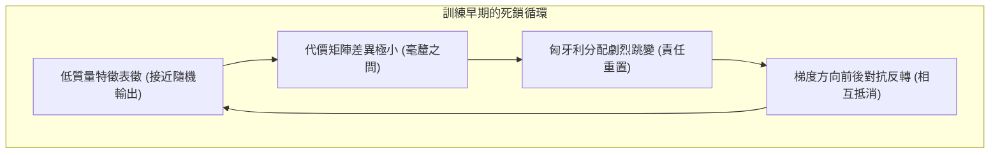
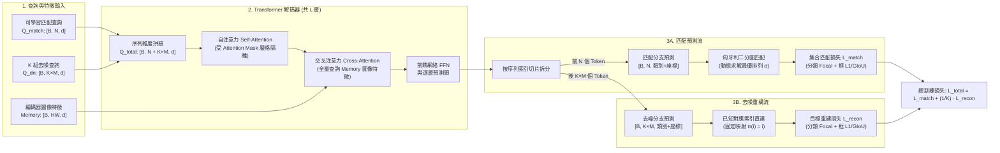
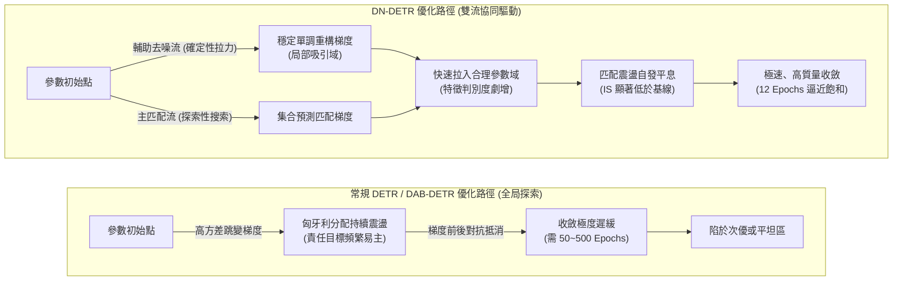

在 [4）Conditional 與 DAB-DETR：查詢空間化](./conditional-dab-detr) 中，DAB-DETR 通過將查詢顯式解耦並參數化為四維動態錨框 $(x, y, w, h)$，消除了原版 Object Query 空間語義模糊與定位冷啓動的難題，使解碼器的交叉注意力從第 1 層起就能快速聚焦於局部幾何區域。

然而，查詢在空間上"知道往哪裏看"，並不等同於它"知道該向哪個目標學習"。即使消除了注意力在全圖的漫遊收縮，DAB-DETR 依然需要約 50 個 Epoch 才能充分收斂。這一現象表明，在特徵尋址的空間收縮之外，系統中還存在另一個阻礙優化的深層瓶頸——**二分圖匹配在離散分配上的早期震盪**。

本篇聚焦於 **DN-DETR（Query DeNoising DETR，2022）**。它直接承接 DAB-DETR 的 4D 錨框表徵，首次將慢收斂的根本矛盾定位為二分圖匹配在離散解空間中的重算不穩定性，並通過在訓練期引入無須匹配的旁路去噪任務，為網絡注入穩定、局部的確定性梯度。

讓我們首先從空間化未能觸碰的機制分離談起。

## 背景與問題：二分圖匹配的不穩定性

在 DETR 的訓練迴路中，實際上並存着兩個截然不同的核心機制：

1. **特徵尋址（連續運算）：** 查詢通過交叉注意力從圖像特徵圖中提取上下文。這是連續、可微的神經網絡計算，決定了注意力集中在圖像的哪個局部區域；
2. **責任分配（離散決策）：** 匈牙利算法根據代價矩陣，為每個預測槽位指定具體的真值目標。這是非參數、離散的組合決策，決定了當前訓練步由誰來提供監督梯度。

我們在第二篇中分析過，**匈牙利匹配本身不包含可學習參數，也不直接傳導反向傳播梯度**。它在整個訓練迴路中的唯一角色，就是在前向計算結束後，為每個預測槽位**指定監督責任**（誰算作正樣本回歸真值，誰算作背景被抑制）。這意味着，模型的參數更新方向完全受制於匈牙利算法在離散決策空間中的分配結果：

$$
\theta \leftarrow \theta - \eta \, \nabla_\theta \mathcal{L}_{\text{det}}\left(\theta; \, \hat{\sigma}^*(\theta)\right)
$$

其中 $\hat{\sigma}^*(\theta)$ 是匈牙利算法在當前參數狀態下求得的最優排列：

$$
\hat{\sigma}^*(\theta) = \arg\min_{\sigma \in \mathfrak{S}_N} \sum_{i=1}^N \mathcal{L}_{\text{match}}\left(y_i, \, \hat{y}_{\sigma(i)}(\theta)\right)
$$

由於內層的排列決策 $\hat{\sigma}^*$ 是不可微的離散判定，當預測代價稍有波動時，最優排列 $\hat{\sigma}^*$ 就會發生階躍式的切換。

因此，空間化改造（如 Conditional DETR 與 DAB-DETR）本質上只重構了**特徵尋址機制**，使注意力在幾何空間中收縮得更快；但它完全沒有觸及**離散責任分配機制**。只要匈牙利匹配在訓練初期頻繁推翻分配結果，每個查詢槽位接收到的梯度方向就依然會在正向拉伸與反向抑制之間劇烈擺動。

這意味着，即使錨框已經具備了明確的物理幾何含義，模型在訓練初期仍舊會陷入由分配跳變帶來的優化泥潭。要理解這一瓶頸並構建針對性的解決方案，我們需要深入剖析這種離散分配在訓練早期引發的具體病態現象。

## 匹配震盪的來源與度量

在傳統基於網格或密集 Anchor 的檢測器（如 Faster R-CNN、RetinaNet）中，候選區域與真實目標的匹配通常基於空間重合度（如 IoU 閾值）等靜態先驗，正負樣本的分配在訓練全週期保持相對穩定。但在 DETR 類模型中，匈牙利算法將分配完全交給了網絡當前的預測輸出。

DN-DETR 的研究者指出，正是這種將“動態離散決策”作為監督分配唯一依據的設計，在訓練早期引發了系統的**匹配震盪（Bipartite Matching Oscillation）**。為了從機理上理解並驗證這一現象，我們需要從它的動力學成因、數學度量指標以及幾何空間表現三個維度展開拆解。

### 匹配震盪的成因：離散二分圖匹配的跳變

在原版 DETR 與 DAB-DETR 的訓練框架中，存在着一個根本性的雙向循環依賴：

- **匹配依賴表徵：** 匈牙利算法要想給出合理、連貫的責任分配，前提是解碼器輸出的分類置信度和幾何邊界框具備足夠的判別度；
- **表徵依賴匹配：** 解碼器和主幹網絡要想學出高質量的特徵表徵，前提是每個查詢槽位必須接收到方向穩定、前後一致的梯度監督。



在訓練早期，網絡參數接近隨機初始化，表徵能力極其微弱。此時代價矩陣中不同槽位與某個真值之間的匹配代價相差無幾。參數在梯度作用下的微小更新，就足以打破原有的微弱平衡，讓匈牙利算法在離散解空間中選出完全不同的分配排列。

我們以一個最小系統為例：假設圖像中只有 1 個真值目標 $y_1$，解碼器中有兩個空間位置相近的查詢槽位 $q_1$ 和 $q_2$。

```text
Step t:   Cost(q1, y1) = 0.501,  Cost(q2, y1) = 0.499  -->  y1 分配給 q2 (q1 判為背景)
          q2 接收正樣本拉向 y1 的梯度；q1 接收背景抑制梯度。

Step t+1: 由於參數微調，預測值微變:
          Cost(q1, y1) = 0.498,  Cost(q2, y1) = 0.502  -->  y1 突然改派給 q1 (q2 判為背景)
          q1 突然轉為學習前景；剛剛朝 y1 移動的 q2 突然被作為背景向外推開。
```

在連續的訓練迭代中，$y_1$ 的監督信號在 $q_1$ 與 $q_2$ 之間來回倒手。前一步累積的幾何更新方向在後一步被直接判定為負樣本懲罰，梯度在離散跳變中反覆自我抵消。這種**匹配震盪（Bipartite Matching Oscillation）** 是導致 DETR 類模型早期收斂遲緩的底層數學原因。

:::note[匹配震盪與正樣本稀疏的差異]
在分析收斂問題時，需要注意區分兩個獨立概念，**正樣本稀疏（Sparsity）** 和 **匹配震盪（Oscillation）** 。
前者指的是每一輪前向傳播中，參與計算迴歸損失的正樣本槽位數量極少（每張圖僅等於真值個數 $M$，遠少於總槽位數 $N$）。這屬於監督信號在空間維度上的**密度問題**；後者指的是同一個真值在相鄰迭代步被分配給不同的查詢槽位，導致特定槽位的監督目標來回跳躍。這屬於監督信號在時間維度上的**一致性問題**。即使人為增加槽位數量，如果離散重算的震盪依然存在，優化的不穩定性就無法緩解。
:::

### 不穩定性的度量

為了定量證明匹配震盪的客觀存在並評估其嚴重程度，DN-DETR 原文提出了**不穩定狀態指標（Instability Score, IS）**。

設在第 $i$ 輪（Epoch）和第 $i-1$ 輪訓練中，針對同一張圖像中的 $M$ 個真實目標 $\mathbf{T} = \{T_0, T_1, \dots, T_{M-1}\}$ 以及解碼器輸出的 $N$ 個預測槽位 $\mathbf{O}^i = \{O_0^i, O_1^i, \dots, O_{N-1}^i\}$，匈牙利算法求解出的分配結果用一個長為 $N$ 的匹配索引向量 $\mathbf{V}^i = [V_0^i, V_1^i, \dots, V_{N-1}^i]^T$ 記錄：

$$
V_n^i = \begin{cases}
m, & \text{若預測槽位 } O_n^i \text{ 匹配到真實目標 } T_m \\
-1, & \text{若預測槽位 } O_n^i \text{ 未匹配到任何真值（被判定為背景）}
\end{cases}
$$

第 $i$ 輪訓練相對於前一輪的不穩定度 $\text{IS}^i$ 定義為兩個匹配狀態向量之間的漢明距離（即分配發生變化的槽位數）：

$$
\text{IS}^i = \sum_{n=0}^{N-1} \mathbb{I}\left(V_n^i \neq V_n^{i-1}\right)
$$

其中 $\mathbb{I}(\cdot)$ 為指示函數。全數據集上的不穩定度則取所有圖像 $\text{IS}^i$ 的平均值。

該指標的物理意義如下：

- 若某張圖像平均包含 $\bar{M}$ 個真值，在最極端的震盪情況下（即上一輪匹配的 $\bar{M}$ 個槽位全部丟失變為背景，同時另外 $\bar{M}$ 個原本為背景的槽位被重新分配為目標），單張圖像的理論最大震盪上限為 $2\bar{M}$；
- 在 COCO 2017 驗證集上，圖像平均目標數 $\bar{M} \approx 7.36$，因此 $\text{IS}$ 的理論最大變化量約為 $7.36 \times 2 = 14.72$。

原論文將這一統計繪成了隨訓練輪次演變的曲線（12-epoch 訓練日程，在 COCO 2017 驗證集上逐輪統計）：


這條曲線給出了三個信息。首先，所有模型的 $\text{IS}$ 都隨訓練進程整體下降，説明離散重算的震盪會隨着表徵判別度的提升而自然緩解；其次，DN-DETR 的曲線全程位於 DAB-DETR 之下，且差距隨訓練逐漸拉開；最後，兩條曲線在訓練初期幾乎重合，説明去噪並沒有在前幾輪就直接消除震盪，而是加快了匹配分配穩定下來的速度。原論文沒有為這條曲線給出具體數值，只以 $7.36 \times 2 = 14.72$ 的理論上限作為參照。

把不穩定性放到整個 DETR 家族的收斂結果上看，去噪帶來的收益更加直觀。


在同為多尺度架構、訓練預算相同的直接對比中，去噪的貢獻可以被更乾淨地分離出來：


需要明確的是，$\text{IS}$ 指標僅用於離線統計與機制驗證，其本身包含不可微的離散判定，**不參與任何訓練損失的反向傳播**。

### 預測框與真實框的幾何距離變化

除了分配震盪之外，未穩定化的二分圖匹配還導致了另一個幾何層面的病態現象：**初始錨框到目標之間的平均幾何距離（Anchor-Target Distance）過大**。

在原版 DETR 和 DAB-DETR 中，由於全局匈牙利算法允許將畫面左上角的查詢匹配給畫面右下角的目標，查詢在訓練早期常常要跨越大半個圖像區域去迴歸目標（在可視化中表現為一條長長的跨區域拉扯箭頭）。這種長程拉扯帶來了兩個嚴重的副作用：

1. **優化搜索空間呈二次方膨脹：** 解碼器不僅要微調物體輪廓，還必須學習大範圍的平移遷移；
2. **多查詢預測衝突（Prediction Conflicts）：** 多個查詢在遠距離拉扯過程中會跨越同一中間區域，互相爭奪注意力權重，導致特徵表示的模式混亂。

```text
DAB-DETR 的長程搜索 (高衝突):
[ Query 槽位 A ] ───────────────────────────────────────────> [ 目標 1 (遠端) ]
                            ╲           ╱
                              [ 衝突交疊區 ]
                            ╱           ╲
[ Query 槽位 B ] ───────────────────────────────────────────> [ 目標 2 (遠端) ]

DN-DETR 的局域化重構 (零衝突):
[ 帶噪查詢 A ] ──(短距離殘差微調)──> [ 目標 1 ] (局部吸引域)
[ 帶噪查詢 B ] ──(短距離殘差微調)──> [ 目標 2 ] (局部吸引域)
```

原文統計瞭解碼器最終匹配目標與初始錨框之間的平均 $\ell_1$ 距離。需要説明的是，這組分析出自期刊擴展版新增的小節，會議版正文並無此項統計。擴展版的數據顯示，DN-DETR 的平均距離在訓練全程都低於 DAB-DETR 基線（約 0.082–0.110 對約 0.097–0.147），原文對此的表述是"初始錨框與目標之間的平均距離小得多"，並未給出具體縮減百分比。


去噪訓練將每個去噪查詢限制在其真值目標的鄰域內，強迫網絡學習以局部為中心的單峯響應函數，消除了跨區域的槽位衝突。

## 去噪訓練的基本構造

### 去噪訓練任務的構造方式

解決離散分配震盪最直接的思路，是**繞過求解二分圖匹配的組合優化過程**。

DN-DETR 提出了一種基於查詢去噪（Query DeNoising）的輔助訓練路徑：在訓練階段，算法不再將查詢初始化為空白的隱向量或固定網格，而是直接從當前圖像的真實標註集合（Ground Truth）出發。算法對真值的幾何邊界框注入適度空間噪聲，對類別標籤注入適度類別翻轉噪聲，將得到的**帶噪查詢（Noisy Queries）** 送入解碼器，並要求解碼器將其精確恢復為原本的無噪真實目標。


從幾何優化的視角來看，去噪任務將原本全局無序的"探索性搜索"，轉化為已知起點的"局部殘差重構"：

- 輸入的帶噪框本身就已經落在真實目標的近鄰空間域內；
- 網絡的優化目標是將帶噪框拉回真實框的位置，輸出具有極其明確的局部單調梯度，不會發生跨區域的多目標競爭。

### 固定指派機制：規避二分圖匹配

去噪分支能夠保持絕對穩定的核心機理，在於其**監督分配關係的先驗確定性**。

在原版的匹配分支中，查詢槽位 $q_j$ 與真值 $y_i$ 的對應關係是通過代價矩陣動態搜索出來的：

$$
\sigma = \arg\min_{\sigma \in \mathfrak{S}_N} \sum_{i=1}^N \mathcal{L}_{\text{match}}\left(y_i, \hat{y}_{\sigma(i)}\right)
$$

而在去噪分支中，每個去噪查詢 $q_i^{\text{noise}}$ 在構造時就是由第 $i$ 個真實目標 $y_i$ 經過加噪生成的。因此，輸出槽位 $\hat{y}_i^{\text{noise}}$ 與監督目標 $y_i$ 之間的對齊映射 $\pi(i) = i$ 是一對一固化在輸入端的常量：

$$
\mathcal{L}_{\text{recon}} = \sum_{i=1}^M \mathcal{L}_{\text{step}}\left(\hat{y}_i^{\text{noise}}, y_i\right)
$$

由於徹底剔除了組合搜索步驟，無論網絡當前的前向預測輸出是什麼，反向傳播的梯度歸屬永遠不會改變。這種穩定的監督流為特徵提取網絡提供了可靠的更新基準。

去噪分支是純粹的**訓練期輔助分支**，與原有的匹配分支在解碼器內部並行計算。它並不替換原有的匹配分支，而是作為穩定器存在。

### 去噪分支的內容嵌入設計

在 DAB-DETR 中，查詢的內容嵌入部分（Content Query）是一個無分類語義的連續向量。為了使去噪分支能夠同時執行類別去噪（Label DeNoising），DN-DETR 對解碼器的內容輸入進行了結構性重構。

DN-DETR 引入了一個**可學習的類別嵌入表（Label Embedding Table）** $\mathbf{E} \in \mathbb{R}^{(C + 1) \times d}$，其中包含 $C$ 個前景類別嵌入向量和一個特殊的 `unknown` 類別嵌入向量（索引為 $C$）。同時，為了讓網絡區分當前查詢究竟來自去噪分支還是匹配分支，向量末尾拼接了一個 1 維的**指示位（Indicator）**：

$$
\text{Content Query} = \big[\mathbf{E}[c], \; \text{indicator}\big] \in \mathbb{R}^{d + 1}
$$

兩類分支的輸入配置完全正交且對稱：

1. **去噪查詢（DN Query）：** 傳入帶噪的類別索引 $c^{\text{noise}} \in \{0, \dots, C-1\}$，指示位設為 1。網絡通過內容向量接收到了帶有先驗提示的類別信息；
2. **匹配查詢（Matching Query）：** 傳入 `unknown` 類別索引 $C$，指示位設為 0。網絡無法獲得任何關於具體類別的先驗提示，必須完全依靠圖像交叉注意力自主判別。

```text
去噪查詢內容輸入: [ E[c_noise] (類別語義先驗)  |  indicator = 1 ]
匹配查詢內容輸入: [ E[unknown] (無先驗隱向量)  |  indicator = 0 ]
```

這種重構使去噪任務與檢測任務在解碼器內部實現了特徵維度的嚴格對齊。

## 噪聲的形式與多組複製

在具體實現中，DN-DETR 的噪聲直接施加在目標級的查詢表徵（4D 空間錨框與類別標籤）上，而不是在圖像像素層面做數據增強。

### 噪聲類型：座標擾動與類別翻轉

加噪過程對空間幾何與類別語義獨立實施：

- **邊界框幾何擾動：** 對真實框 $b=(x, y, w, h)$，在中心點與寬高尺度上分別施加受控均勻噪聲。中心偏移量被嚴格限制在框尺寸的一定比例內（默認 $\lambda=0.4$），確保加噪後的錨框中心點依然落在真實目標內部；寬高擾動則模擬尺度估計誤差。
- **類別標籤隨機翻轉：** 以預設概率 $\gamma$（默認 0.2）將真實類別隨機替換為其他類別。這一設計極為關鍵：若 $\gamma=0$（不翻轉），網絡會退化為直接透傳輸入類別而忽略圖像特徵；若 $\gamma=1.0$（全翻轉），先驗完全淪為純噪聲；保持低概率翻轉強迫網絡結合交叉注意力中的視覺特徵來糾正潛在錯誤。

```text
真實目標: 
  Box: [0.50, 0.50, 0.20, 0.20],  Label: "Cat" (ID: 3)
                      ↓ 注入噪聲 (λ=0.4, γ=0.2)
帶噪查詢: 
  Box: [0.53, 0.48, 0.24, 0.18],  Label: "Dog" (ID: 7)  <-- 類別發生翻轉
                      ↓ 送入解碼器重構
監督目標 (固定對齊):
  迴歸目標: [0.50, 0.50, 0.20, 0.20],  分類目標: "Cat" (ID: 3)
```

噪聲強度 $\lambda$ 並非越大越好。DN-DETR 原文對中心噪聲與尺度噪聲分別做了消融，AP 隨噪聲尺度呈單峯分佈：過小的噪聲使去噪任務退化為平凡的恆等映射，模型無需真正調用圖像特徵；過大的噪聲則讓帶噪框偏離目標過遠，重構任務失去意義。


### 多組複製

自然圖像中單張圖片的真值數通常較少（COCO 平均每張約 7 個）。為了讓去噪分支提供足夠密度的梯度，DN-DETR 引入了**多組複製機制**：將每張圖的 $M$ 個真實目標複製 $K$ 份（通常 $K=5$），每組**獨立採樣**隨機幾何與類別噪聲，產生 $K \times M$ 個去噪查詢。

多組複製成倍增加了正樣本的監督密度，且不破壞原本一對一匹配的結構。這裏有一處邊界值得記下：DN-DETR 的去噪查詢全部是正樣本，無論噪聲取多大，監督目標始終是它自己對應的那一個真值，去噪分支裏沒有被判為 `no-object` 的查詢。也就是説，這一階段訓練只教模型怎麼把帶噪框找回來，沒有教它什麼時候應該放棄。具體加噪公式見附錄。

## 匹配分支與去噪分支的並行

### 匹配分支與去噪分支的輸入與損失劃分

在訓練過程中，整個模型同時接收兩組完全不同的查詢集合：

1. **匹配查詢（Matching Queries / Learnable Queries）：** 數量為 $N$（如 300 個）。其空間錨框與內容嵌入均來自模型內部可學習的參數張量，用於正常的端到端檢測探索。
2. **去噪查詢（DeNoising Queries）：** 數量為 $K \times M_{\max}$（其中 $M_{\max}$ 為當前 Batch 中單張圖像包含的最大真值數，不足部分用佔位符填充並配合掩碼處理）。其輸入直接由真實真值加噪產生。

兩類查詢在前向傳播與損失計算中的數據流轉關係如下表所示：

| 屬性 | 匹配分支 (Matching Branch) | 去噪分支 (DeNoising Branch) |
| :--- | :--- | :--- |
| **查詢數量** | 固定數量 $N$（如 300） | 動態數量 $K \times M_{\max}$（如 $5 \times 7 = 35$） |
| **輸入來源** | 可學習的先驗參數嵌入 | 由真實真值加噪生成的錨框與類別嵌入 |
| **匹配機制** | 動態匈牙利二分圖匹配求解 $\sigma$ | 輸入時預先綁定的靜態硬對齊 $\pi(i) = i$ |
| **損失函數** | 集合預測損失 $\mathcal{L}_{\text{match}}$（含 Hungarian 排序） | 目標重建損失 $\mathcal{L}_{\text{recon}}$（直接對應項求和） |
| **反向傳播性質** | 離散震盪、梯度方差大（早期） | 局部單調、梯度方向高度穩定 |
| **推理期保留狀態** | **保留**（唯一的實際預測輸出） | **完全捨棄**（不引入任何計算與參數負擔） |

### 解碼器內的雙流計算與張量流轉

為了避免分別運行兩次解碼器帶來的額外計算開銷，DN-DETR 將匹配查詢與所有去噪組的查詢在序列長度維度（Sequence Dimension）直接**拼接（Concatenate）** 為一個統一的大張量：

$$
Q_{\text{total}} = \big[\underbrace{q_1^{\text{match}}, \dots, q_N^{\text{match}}}_{\text{匹配分支: } N \text{ 個}}, \; \underbrace{q_1^{\text{dn}, 1}, \dots, q_M^{\text{dn}, 1}}_{\text{去噪第 } 1 \text{ 組: } M \text{ 個}}, \; \dots, \; \underbrace{q_1^{\text{dn}, K}, \dots, q_M^{\text{dn}, K}}_{\text{去噪第 } K \text{ 組: } M \text{ 個}}\big] \in \mathbb{R}^{(N + K \cdot M) \times d}
$$

整個訓練過程中的前向計算與損失歸屬數據流如下圖所示：



前向傳播的完整計算步驟與張量流轉如下：

1. **輸入拼接：** 將可學習匹配查詢與 $K$ 組帶噪查詢拼接為長度為 $N + K \cdot M$ 的單一序列，批大小為 $B$；
2. **掩碼自注意力：** $Q_{\text{total}}$ 輸入解碼器自注意力層，利用注意力掩碼使兩類查詢在同一次計算中並行且彼此隔離；
3. **全量跨注意力：** 自注意力的輸出統一作為 $Q$，以編碼器輸出的圖像特徵張量 $\text{Memory} \in \mathbb{R}^{B \times HW \times d}$ 作為 $K$ 和 $V$，全量讀取視覺特徵；
4. **輸出拆分與損失分流：** 解碼器最後一層（以及各輔助解碼層）的輸出張量被按序列前 $N$ 與後 $K \cdot M$ 拆開：
   - 前 $N$ 個輸出送入匈牙利算法，根據預測代價動態匹配真值，計算集合預測損失 $\mathcal{L}_{\text{match}}$；
   - 後 $K \cdot M$ 個輸出直接與其加噪前對應的真實真值計算重建損失 $\mathcal{L}_{\text{recon}}$，無需任何匹配計算；
5. **反向傳播：** 兩部分損失加權求和，梯度同時回傳至解碼器和主幹網絡。

## 注意力掩碼與信息隔離

將去噪查詢與匹配查詢拼入同一個解碼器計算時，系統面臨着嚴重的信息泄漏風險。設計嚴密的**注意力掩碼（Attention Mask）** 是保證去噪訓練正確性的數學基礎。

### 注意力掩碼的隔離必要性

在 Transformer 自注意力中，如果允許全量查詢自由交互，會引發兩類致命的信息泄漏：

1. **阻斷去噪向匹配泄漏：** 去噪查詢的座標高度貼近真值。若允許匹配查詢關注去噪查詢，匹配查詢在自注意力層只需直接抄襲去噪特徵，就能在預測頭輸出完美結果。這會導致二分圖匹配學習徹底崩潰，模型退化為依賴"作弊"而失去從圖像提取特徵的能力。一旦推理期丟棄去噪分支，匹配分支將完全癱瘓。
2. **阻斷不同去噪組之間的交互：** 同一個真值在不同去噪組中被施加了獨立的隨機噪聲。若允許不同組互相交互，網絡只需對多組噪聲做簡單的平均或互校即可恢復原始真值，去噪任務退化為多視圖濾波，喪失了迫使網絡結合圖像特徵完成幾何重構的初衷。

原論文消融實驗表明：**若移除掩碼（允許全量交互），AP 將從 43.4 跌至 24.0**（1 個去噪組、ResNet-50、50-epoch 設定），不僅遠低於帶掩碼的完整模型，甚至比不使用去噪的 42.2 基線還低——去噪分支從穩定器變成了信息泄漏源，反向印證了信息隔離對訓練正確性的決定性作用。

### 掩碼矩陣的分塊實現

為實現完全隔離，自注意力掩碼矩陣呈現出嚴格的**對角分塊（Block-diagonal）** 結構：

- **匹配查詢（前 $N$ 個）：** 只能關注匹配查詢內部，對所有去噪組填入 $-\infty$（屏蔽）；
- **第 $k$ 組去噪查詢（中間 $M$ 個）：** 只能在本組內部交互，對匹配查詢以及所有其他去噪組全部填入 $-\infty$。

這種設計讓 1 個匹配分支和 $K$ 個去噪組在單個自注意力算子中完全並行計算，既無特徵穿透風險，又兼顧了計算效率。具體的掩碼張量數學形式與矩陣表格見附錄。

## 動力學分析：去噪訓練對收斂過程的影響

在釐清了數據流與掩碼構造後，我們可以站在損失曲面與參數優化的宏觀視角，審視 DN-DETR 為何能夠顯著改變 Transformer 檢測器的訓練軌跡。



1. **從全局組合搜索到局部幾何重構：**
   原版的端到端集合預測本質上是一個極其困難的非凸聯合優化問題：網絡既要學習如何提取實例特徵，又要學習如何在無序的槽位空間中自組織完成組合分配。在二分圖匹配頻繁震盪的早期階段，參數更新的方差極大。
   去噪分支實質上將一部分優化壓力轉化為確定性的局部迴歸問題。網絡接收到的帶噪查詢位於真值的局部吸引域（Basin of Attraction）內，梯度更新方向呈現出良好的局部凸性與確定性。
2. **兩階段效應與特徵牽引：**
   在訓練的最早期，去噪分支產生的穩定梯度佔據主導地位，迅速將共享的主幹網絡（Backbone）和解碼器交叉注意力參數牽引至能夠有效提取物體幾何特徵的狀態；
   隨着特徵提取質量的快速上升，代價矩陣中不同候選槽位的可區分度大幅提高，此時主匹配分支面臨的二分圖跳變現象自發消失，系統平滑過渡到以端到端匹配為主導的微調階段。

原論文在 MS-COCO 2017 驗證集上的對比實驗（基於 ResNet-50 骨幹，詳細指標見附錄 C）直接佐證了這一優化路徑改變帶來的加速效果：

- 在 12-epoch 的短日程（1×）訓練下，DN-DETR-DC5 取得了 41.7 AP，已經極其接近未加去噪的 DAB-DETR 訓練 50-epoch 的飽和性能（44.5 AP）；
- 當去噪訓練與多尺度可變形注意力（Deformable Attention）結合時（DN-Deformable-DETR），在僅訓練 12 個 Epoch 時就取得了 43.4 AP，相比原始 Deformable DETR 提升了 6.2 AP，幾乎完全消除了傳統 DETR 架構在 1× 短週期訓練下性能斷崖式落後的短板。

:::info[問題]
**去噪分支在推理時被直接丟棄，為什麼留存下來的匹配分支在測試時性能會大幅提升？**

核心原因在於**主幹網絡、特徵投影層、解碼器交叉注意力以及預測頭參數是完全共享的**。
去噪任務在前向傳播中同樣強迫解碼器利用交叉注意力去檢索真實目標的邊緣特徵。去噪分支回傳的穩定梯度，在訓練初期幫助這套共享權重完成了高質量的特徵模式沉澱；因此，當測試期只有匹配查詢輸入時，共享的特徵提取網絡已經具備了極強的目標判別與邊界迴歸能力。
:::

## 推理保留與遺留問題

### 推理階段的處理與計算開銷

去噪訓練機制在工程落地上的一個顯著優勢在於其**推理期零成本（Zero-overhead Inference）**。

去噪分支的所有組件——包括帶噪真值的生成邏輯、標籤翻轉模塊、$K$ 組去噪查詢的顯式嵌入、以及自注意力中的掩碼防火牆——其生命週期均嚴格侷限在 `train()` 模式下。

當模型切換至 `eval()` 模式進行推理時：

- 模型直接丟棄所有去噪查詢輸入，僅輸入原本的 $N$ 個可學習匹配查詢；
- 自注意力掩碼矩陣退化為常規的全零（全連接）矩陣；
- 解碼器僅執行標準的前向計算，輸出維度與原版 DETR 完全一致。

網絡沒有增加任何額外的推理參數，沒有引入任何特殊的硬件定製算子，亦沒有增加哪怕 1 FLOPs 的推理計算延遲。去噪機制完全是一種純粹的**訓練期腳手架（Training-time Scaffold）**。

### 遺留問題：負樣本缺失與重複預測

儘管 DN-DETR 極為漂亮地解決了二分圖匹配的早期震盪問題，但站在整個 DETR 架構演進的角度審視，它依然留下了若干尚未解決的深層次瓶頸：

1. **查詢初始化依然依賴靜態先驗：**
   去噪分支雖然加速了訓練，但負責最終推理的 $N$ 個匹配查詢，其初始空間錨框 $(x, y, w, h)$ 和內容嵌入在面對不同輸入圖像時依然是完全固定的可學習偏置，未能做到依據輸入圖像的內容動態生成（Content-aware Initialization）。
2. **正樣本利用率在推理分支依然受限：**
   多組複製機制雖然增加了去噪分支的正樣本密度，但負責最終檢測的匹配分支依然固守着嚴格的"一對一"單目標匹配拓撲。一對一分配所帶來的正樣本稀疏性，依然制約着特徵表示的學習效率。

這兩個遺留問題，直接開啓了後續兩大學術演進脈絡：

- 第一個問題（如何將去噪機制、內容感知初始化與多尺度形變架構徹底融合）將在 [DINO](./dino) 中得到集大成的解答；
- 第二個問題（如何在匹配分支本身打破一對一監督稀疏瓶頸）則引出了 [Group DETR](./group-detr) 等一系列基於正樣本擴增的創新設計。

## 小結

本篇系統拆解了 DN-DETR 穩定離散匹配震盪的底層機理與實現細節：

1. **震盪根源：** 空間化解決了連續尋址收縮，但未能消除匈牙利匹配在離散分配空間的重算震盪；訓練早期的微小預測擾動會導致監督目標來回跳變，引發梯度對抗抵消；
2. **去噪構造：** 通過對真實真值施加受控的幾何擾動與類別翻轉，構建了監督對齊關係完全固定的輔助去噪分支，將全局組合搜索轉化為穩定的局部幾何重構；
3. **隔離掩碼：** 自注意力掩碼在矩陣層面嚴格阻斷了去噪向匹配的信息泄漏以及不同去噪組之間的特徵互通，確保了端到端檢測任務的訓練正確性；
4. **技術邊界：** 去噪是推理期零負擔的訓練腳手架；它平抑了早期震盪，但匹配查詢的動態初始化與一對一監督稀疏問題仍有待後續篇章進一步攻克。

## 附錄：實現與公式細節

### A. 加噪公式的形式化定義

每個去噪查詢由 4D 空間錨框 $b=(x, y, w, h)$ 與類別嵌入兩部分構成。

#### 邊界框幾何擾動

設圖像中真實目標為 $b = (x, y, w, h) \in (0, 1)^4$，中心點與寬高尺度上施加的均勻分佈噪聲為：

$$
\begin{aligned}
\Delta x &\sim \mathcal{U}\left(-\frac{\lambda_1 w}{2}, \frac{\lambda_1 w}{2}\right), \quad &\Delta y &\sim \mathcal{U}\left(-\frac{\lambda_1 h}{2}, \frac{\lambda_1 h}{2}\right) \\
\Delta w &\sim \mathcal{U}\left(-\lambda_2 w, \lambda_2 w\right), \quad &\Delta h &\sim \mathcal{U}\left(-\lambda_2 h, \lambda_2 h\right)
\end{aligned}
$$

加噪後的帶噪錨框 $b^{\text{noise}} = (x', y', w', h')$ 計算為：

$$
\begin{aligned}
x' &= x + \Delta x, \quad &y' &= y + \Delta y \\
w' &= w + \Delta w, \quad &h' &= h + \Delta h
\end{aligned}
$$

中心偏移量因 $|\Delta x| < \frac{\lambda_1 w}{2} < \frac{w}{2}$ 而保證加噪中心必落在原框內；尺度擾動使 $w' \in [(1-\lambda_2)w, (1+\lambda_2)w]$。默認取 $\lambda_1 = \lambda_2 = 0.4$。

#### 類別標籤隨機翻轉

設真實類別索引為 $c \in \{0, 1, \dots, C-1\}$，以翻轉概率 $\gamma$（默認 0.2）將其替換為其他類別：

$$
c^{\text{noise}} = \begin{cases}
c_{\text{rand}} \sim \mathcal{U}(\{0, \dots, C-1\} \setminus \{c\}), & \text{以概率 } \gamma \\
c, & \text{以概率 } 1 - \gamma
\end{cases}
$$

### B. 自注意力掩碼矩陣結構

自注意力掩碼矩陣 $\mathbf{M} \in \mathbb{R}^{(N + K \cdot M) \times (N + K \cdot M)}$ 呈現出嚴格的對角分塊（Block-diagonal）結構：

$$
\mathbf{M} = \begin{bmatrix}
\mathbf{0}_{N \times N} & -\boldsymbol{\infty} & -\boldsymbol{\infty} & \cdots & -\boldsymbol{\infty} \\
-\boldsymbol{\infty} & \mathbf{0}_{M \times M} & -\boldsymbol{\infty} & \cdots & -\boldsymbol{\infty} \\
-\boldsymbol{\infty} & -\boldsymbol{\infty} & \mathbf{0}_{M \times M} & \cdots & -\boldsymbol{\infty} \\
\vdots & \vdots & \vdots & \ddots & \vdots \\
-\boldsymbol{\infty} & -\boldsymbol{\infty} & -\boldsymbol{\infty} & \cdots & \mathbf{0}_{M \times M}
\end{bmatrix}
$$

各分塊可見性規則如下（以 $N$ 個匹配查詢和 $K=2$ 組去噪查詢為例）：

| 行：Query（查詢方） \ 列：Key（被查方） | Key: 匹配槽位（$N$ 個） | Key: 去噪組 1（$M$ 個） | Key: 去噪組 2（$M$ 個） |
| :--- | :--- | :--- | :--- |
| **Query: 匹配槽位（$N$ 個）** | $\mathbf{0}_{N \times N}$（自由交互） | $-\boldsymbol{\infty}_{N \times M}$（屏蔽） | $-\boldsymbol{\infty}_{N \times M}$（屏蔽） |
| **Query: 去噪組 1（$M$ 個）** | $-\boldsymbol{\infty}_{M \times N}$（屏蔽） | $\mathbf{0}_{M \times M}$（組內交互） | $-\boldsymbol{\infty}_{M \times M}$（屏蔽） |
| **Query: 去噪組 2（$M$ 個）** | $-\boldsymbol{\infty}_{M \times N}$（屏蔽） | $-\boldsymbol{\infty}_{M \times M}$（屏蔽） | $\mathbf{0}_{M \times M}$（組內交互） |

在批處理中，填充補齊的佔位查詢（Padding Queries）所在的整行整列額外全量置為 $-\infty$。

### C. 去噪訓練基準指標對比

下表彙總了 DAB-DETR 與 Deformable DETR 在引入去噪訓練前後於 COCO 2017 驗證集上的性能對比（ResNet-50 骨幹網絡）：

| 模型架構 | 訓練輪次 (Epochs) | AP | $\text{AP}_{50}$ | $\text{AP}_{75}$ | $\text{AP}_{\text{S}}$ | $\text{AP}_{\text{M}}$ | $\text{AP}_{\text{L}}$ | 相對基線提升 |
| :--- | :--- | :--- | :--- | :--- | :--- | :--- | :--- | :--- |
| **DAB-DETR-DC5** | 12 (1×) | 38.0 | 60.3 | 39.8 | 19.2 | 40.9 | 55.4 | 基線 |
| **DN-DETR-DC5** | 12 (1×) | **41.7** | 61.4 | 44.1 | 21.2 | 45.0 | 60.2 | **+3.7 AP** |
| **DAB-DETR-DC5** | 50 | 44.5 | 65.1 | 47.7 | 25.3 | 48.2 | 62.3 | 基線 |
| **DN-DETR-DC5** | 50 | **46.3** | 66.4 | 49.7 | 26.7 | 50.0 | 64.3 | **+1.8 AP** |
| **Deformable DETR** | 12 (1×) | 37.2 | 55.5 | 40.5 | 21.1 | 40.7 | 50.5 | 基線 |
| **DN-Deformable-DETR** | 12 (1×) | **43.4** | 61.9 | 47.2 | 24.8 | 46.8 | 59.4 | **+6.2 AP** |

下一篇：[DINO](./dino)。
