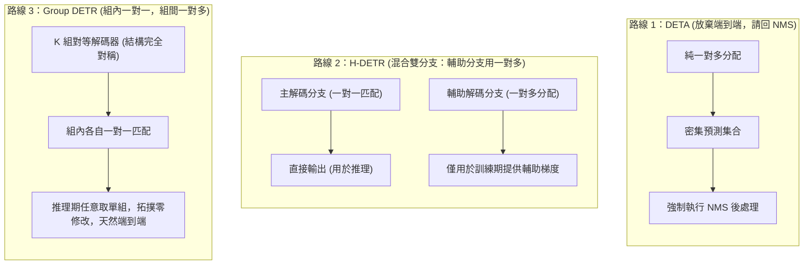

# Group DETR：訓練期查詢分組

在前面六篇的演進脈絡中，研究者針對 DETR 的架構缺陷推進了三條主線：[3）Deformable DETR：稀疏採樣與多尺度注意力](./deformable-detr) 重構了特徵讀取拓撲，利用稀疏局部採樣化解了密集全局計算開銷；[4）Conditional 與 DAB-DETR：查詢空間化](./conditional-dab-detr) 為查詢槽位賦予了四維動態錨框 $(x, y, w, h)$，解決了定位冷啓動；[5）DN-DETR：查詢去噪與早期匹配穩定化](./dn-detr) 與 [6）DINO：三處接口的聯合設計](./dino) 則通過引入加噪真值錨框的旁路任務與三處核心接口重構，消除了訓練早期的離散二分圖匹配劇烈震盪。

這些工作極大地加快了訓練收斂，並將 COCO 上的檢測精度推向了新的高度。然而，當我們退後一步審視整套系統的**損失計算與梯度流**時，會發現一個貫穿始終且從未被正面觸碰的底層結構性矛盾：**正樣本監督信號在空間維度上極度稀疏**。

儘管 DN-DETR 和 DINO 通過旁路去噪分支注入了密集的確定性梯度，但作為目標檢測核心的**真實二分圖匹配分支**，其正樣本分配邏輯自原版 DETR 確立以來從未改變——每一個真實目標有且僅能分配給唯一一個預測槽位（即**一對一匹配，One-to-One Assignment**）。

本篇聚焦於 **Group DETR（Chen 等人，ICCV 2023）**，剖析研究者如何通過**組間解耦的一對多匹配**與**分組自注意力隔離**，在完全保留端到端一對一推理架構的前提下，系統性解決訓練期正樣本監督極度稀疏的瓶頸。

## 問題背景

### 正樣本監督稀缺問題

在傳統卷積目標檢測器（如 Faster R-CNN、RetinaNet 或 FCOS）中，訓練期普遍採用**一對多分配（One-to-Many Assignment）**策略：對於圖像中的每一個真實目標（Ground Truth, GT），算法會根據空間交併比（IoU）或中心採樣區域，將數十個甚至上百個候選錨框或特徵圖像素標記為正樣本。

以單階段無錨框檢測器 FCOS 為例，一個真實目標框內部往往有數十個空間特徵點同時被賦予前景分類標籤與中心度連續迴歸目標。在反向傳播時，這幾十個空間位置同時向骨幹網絡與特徵金字塔回傳邊界框幾何殘差梯度與分類梯度。

而端到端 DETR 的分配拓撲則完全相反。在標準的 COCO 訓練集上，單張圖像中平均僅包含約 7 個真實目標。在配備 $N = 300$ 個查詢槽位的解碼器中：

- 僅有 7 個查詢槽位能與真實目標成功匹配，接收到分類交叉熵（或 Focal Loss）以及邊界框 $\ell_1$ 和 GIoU 的正樣本回歸梯度；
- 其餘 293 個查詢槽位（佔比超過 97%）全部被強制指派給虛擬的背景類別（`no-object`），且完全不產生任何幾何迴歸損失。

這就引出了一個常常被混淆的概念界定：**樣本不平衡（Imbalance）** 與 **正樣本稀缺（Scarcity）** 的本質區別。

在原版 DETR 中，作者通過調小背景類別的損失權重（如 $\text{no-object weight} = 0.1$）或者改用 Focal Loss，能夠有效緩解由於背景負樣本數量過多而導致的梯度淹沒。但**負樣本降權僅僅是在優化層面對已有梯度進行重新平衡（Re-weighting），它無法憑空變出新的正樣本幾何監督信號**。整個特徵提取器與解碼器在絕大部分計算路徑上，接收到的全是“這裏不是物體”的抑制性負反饋，真正用於指引“物體幾何邊界應當如何擬合”的正向定位梯度，在空間覆蓋度與信息量上都比傳統檢測器低了一到兩個數量級。

:::info[問題]

**為什麼不能將 DN-DETR 和 DINO 的去噪分支等同於正樣本增密？**

在第五篇與第六篇中，去噪分支確實引入了額外的正樣本查詢。但去噪查詢具有明確的特殊性：

1. **幾何起點錨定在真值附近：** 去噪查詢是由真值框添加微小噪聲合成而來，它們的座標天生落在目標周圍，屬於無須搜索的局部擬合任務；
2. **完全繞過匈牙利匹配：** 去噪分支的歸屬關係由人工顯式指定，不需要網絡在全圖範圍內進行槽位競逐與二分圖分配；
3. **核心預測槽位並未受益：** 在真實的匹配分支中，模型依然只能依靠極度稀疏的 7 個正樣本去從全局特徵圖裏探索目標分佈。

換句話説，去噪任務是在外圍給模型“搭梯子”，但並沒有改變核心匹配分支“單木難支”的正樣本稀疏物理現實。

:::

### 樸素一對多的失效機理

既然傳統檢測器的一對多分配能夠提供充沛的正樣本梯度，一個最符合直覺的設想便是：**我們能否直接廢除匈牙利一對一匹配，強行讓 DETR 的多個查詢槽位去匹配同一個真實目標？**

例如，選擇與真實目標代價最低的前 $k$ 個預測槽位，或者採用動態閾值將多個候選框都設為該目標的匹配項。

原論文通過受控實驗（Table 7(b)，拓撲對應 Figure 2(c)）直接宣判了這一樸素嘗試的破產：將基線模型（Conditional DETR）的 300 個查詢擴展至 3300 個，並直接施加樸素一對多匹配進行訓練與推理，模型的檢測精度從基線的 **32.6 AP 斷崖式暴跌至 8.4 AP**。

這並不是收斂快慢的問題，而是網絡輸出的預測結果在物理上徹底不可用。這一崩潰的底層機理在於：**一對一匹配是 DETR 消除非極大值抑制（NMS）後處理的唯一數學前提。**

我們在 [2）原版 DETR：二分圖匹配與集合損失](./detr-v1-bipartite-matching-set-loss) 中深入剖析過，DETR 之所以能實現端到端直接預測集合，是因為二分圖匹配在數學上構築了一個排他性的競爭博弈（Figure 2(c)）：

$$
\mathcal{L}_{\text{match}}(y, \hat{y}) = \sum_{i=1}^M \ell(y_i, \hat{y}_{\sigma(i)}) + \sum_{j \notin \{\sigma(i)\}} \ell_{\text{cls}}(\varnothing, \hat{y}_j)
$$

在同一個預測集合內部，對於某個真實目標，系統**只獎勵那個擬合得最好的唯一樣本，而將所有緊鄰的、重疊度極高但稍遜一籌的冗餘預測槽位全部判為背景並強力壓制**。配合解碼器內部的自注意力機制，不同槽位在層間不斷交換信息，達成“你負責這個目標，我負責背景”的槽位協商，從而將“去重”內化成了模型的前向推理能力。

而一旦施加樸素一對多分配：

1. **競爭機制蕩然無存：** 緊鄰真實目標的多個查詢槽位同時被賦予正樣本身份，損失函數同時鼓勵它們輸出高置信度與貼近真值的座標；
2. **訓練目標與推理需求直接衝突：** 模型在訓練期被明確教導去針對同一個目標生成多個重合的冗餘高分框；
3. **推理期無法自洽：** 在推理階段，由於缺乏一對一競爭懲罰，解碼器會輸出密集的重複假陽性，必須強行把手工設計的 NMS 掛回後處理流程，這直接摧毀了 DETR 架構端到端預測的核心價值。

因此，DETR 面臨的真正技術兩難是：**訓練期迫切需要一對多的充沛監督信號來加快收斂，但推理期必須嚴格保持一對一的排他性競爭以剔除冗餘。**

## Group DETR 的核心機制

### 查詢組的定義與概念界定

在深入具體算法之前，必須首先廓清“**查詢分組（Group DETR）**”在概念上最容易引發的一處直覺誤解：**這裏並不存在任何“把已有查詢進行聚類或動態切分（Partition / Clustering）”的操作**。事實上，“分組”在 Group DETR 中不是一個對既有張量做後驗劃分的**動詞**，而是指系統在訓練期以“組（Group）”為邊界單位去組織 **多套** **完整** 的查詢空間。

| 架構形態 | 查詢總數與組織形式 | 匈牙利匹配域 | 最終端到端輸出 |
| :--- | :--- | :--- | :--- |
| **標準 DETR** | 單組，共 $N = 300$ 個槽位 | 在全量 300 個槽位內做全局一對一匹配 | 300 個候選預測 |
| **樸素一對多** | 單組，共 $M = 3300$ 個槽位 | 在全量 3300 個槽位內讓 1 個 GT 認領多個槽位 | 3300 個預測（嚴重重複，需 NMS） |
| **Group DETR** | **$K$ 組獨立的查詢**，每組包含完整的 $N = 300$ 個槽位（共 $K \times N = 3300$ 個） | **以組為封閉邊界**，每組各自獨立做內部一對一匹配 | 推理期僅取第 1 組（300 個），天然無冗餘 |

換句話説，Group DETR 的“分組”，實質上是**在原本 1 組完整查詢的基礎上，在訓練期橫向複製並實例化了 $K-1$ 組完全平行的查詢集合（Multi-Group Queries）**。

### 查詢生成機制：單階段與兩階段的物理初始化

那麼，這 $K$ 組相互獨立的查詢在網絡實現中究竟是如何生成的？原論文根據底層檢測器是單階段還是兩階段，給出了兩種清晰的生成機制：

1. **單階段固定查詢架構（如 Conditional DETR、DAB-DETR、DN-DETR）：**
   在這些模型中，查詢是全局可學習的靜態嵌入向量。原版模型僅需定義單套參數表：

   ```python
   # 標準 DETR：單組 300 個查詢
   self.query_embed = nn.Embedding(300, hidden_dim)
   ```

   而在 Group DETR 中，代碼直接將參數表擴充 $K$ 倍：

   ```python
   # Group DETR (設 K=11)：直接實例化 11 組獨立的查詢向量
   self.query_embed = nn.Embedding(11 * 300, hidden_dim)
   ```

   這 $K \times N$ 個參數在網絡構建時**各自獨立隨機初始化**，沒有任何跨組的數值綁定或共享約束；在訓練期間，它們沿着各自接收到的梯度自由探索、獨立演化。

2. **兩階段特徵先驗架構（如 DINO、Deformable DETR Two-Stage）：**
   在兩階段模型中，解碼器的初始錨框與內容特徵不再由靜態 Embedding 決定，而是根據第一階段（Encoder 之後）的特徵分數動態挑出 Top-$N$ 個先驗框。此時無法直接通過定義靜態 Embedding 來擴充組數。
   原論文在附錄 A.2 中給出了對應的適配方案：**在第一階段構建 $K$ 對平行的分類與迴歸預測頭（Predictor Heads）**。在 Encoder 輸出特徵圖後，這 $K$ 對預測頭分別打分並各自挑選出屬於該組的一套 Top-$N$ 提議框，分別作為解碼器第 1 組、第 2 組直至第 $K$ 組的輸入錨框。而在推理階段，模型直接丟棄其餘 $K-1$ 對頭，僅保留第 1 對頭輸出的 Top-$N$ 框，與基線推理拓撲保持百分之百的一致。

### 組內與組間匹配規則

在明確了 $K$ 組完整查詢的來源之後，Group DETR 解決前述結構矛盾的切入點便水到渠成：**它沒有在單個預測集合內部去修改一對一的匹配規則，而是在訓練期構造了多個完全平行的預測空間**。

具體而言，Group DETR 在訓練階段引入 $K$ 組完全獨立的目標查詢（Object Queries）：

$$
\mathbf{Q} = \left\{ \mathbf{Q}_1, \mathbf{Q}_2, \dots, \mathbf{Q}_K \right\}, \quad \text{其中每組 } \mathbf{Q}_k \in \mathbb{R}^{N \times C}
$$

解碼器隨之輸出 $K$ 組預測集合 $\left\{ \mathbf{Y}_1, \mathbf{Y}_2, \dots, \mathbf{Y}_K \right\}$。在計算匹配與監督損失時，算法執行**組內一對一（Group-Wise One-to-One）**分配：

$$
\sigma_k = \arg\min_{\sigma \in \mathfrak{S}_N} \sum_{n=1}^N \mathcal{L}_{\text{cost}}(y_n, \hat{y}_{\sigma(n)}^{(k)}), \quad k = 1, 2, \dots, K
$$


整個訓練損失是 $K$ 個組損失的算術平均：

$$
\mathcal{L}_{\text{total}} = \frac{1}{K} \sum_{k=1}^K \mathcal{L}_{\text{det}}\left( \mathbf{Y}_k, \bar{\mathbf{Y}}, \sigma_k \right) = \frac{1}{K} \sum_{k=1}^K \sum_{n=1}^N \ell\left( \mathbf{y}_{\sigma_k(n)}^{(k)}, \bar{\mathbf{y}}_n \right)
$$

從宏觀視角看，這套設計實現了雙重視角下的完美統一：

| 觀察視角 | 結構狀態 | 產生的數學與物理效果 |
| :--- | :--- | :--- |
| **組內微觀視角** | **嚴格的一對一分配** | 每一組內部，一個 GT 只能被唯一一個槽位認領，其餘槽位被作為負樣本壓制。**排他性競爭機制完整保留，去重能力在組內被嚴格訓練**。 |
| **全圖宏觀視角** | **顯式的一對多監督** | 由於每個真實目標在 $K$ 個組中各被分配了一次，**每個 GT 實際上被指派給了 $K$ 個不同的預測槽位**，模型回傳的正樣本梯度數量直接放大了 $K$ 倍。 |

這就是所謂的“組間一對多（Group-Wise One-to-Many Assignment）”：**一對多並不發生在競爭槽位之間，而是發生在平行的獨立觀測域之間**。

### 分組自注意力機制

然而，僅僅把查詢分成 $K$ 組跑 $K$ 次匹配還不夠。原論文實驗（Table 7(c)）給出了一個極為關鍵的消融現象：

如果僅僅採用分組一對一匹配，但在解碼器內部依然讓所有 $K \times N$ 個查詢進行全局自注意力交互，模型的性能提升非常微弱（從 32.6 AP 僅提升至 34.8 AP）；只有當對自注意力施加**嚴格的分組隔離（Separate Self-Attention）**後，性能才進一步躍升至 **37.6 AP**（淨提升 2.8 AP）。

:::info[問題]

**為什麼不同查詢組之間必須完全切斷自注意力，嚴禁任何信息交互？**

這一設計的本質在於維護**訓練與推理在特徵協商空間上的一致性**：

1. **競爭域與感知域的範圍對齊：** 在 Group DETR 中，一對一競爭只在“組內”被定義，組與組之間並無優劣競爭。如果允許組與組之間發生自注意力交互，組 1 的查詢就會在特徵層面上感知到組 2 的查詢已經擬合了該目標，從而在特徵空間產生退縮、讓步或語義混疊，破壞了組內獨立去重的協商前提；
2. **消除推理期的分佈偏移：** 在推理階段，為了保持極簡拓撲，我們只會輸入單一組查詢（$N$ 個槽位）。如果在訓練期間，單個查詢的表徵演變依賴了來自其他 $K-1$ 個組的上下文支撐，那麼在推理期切除其餘各組時，剩餘的單組查詢就會遭遇嚴重的表徵缺失與注意力分佈偏移；
3. **計算圖的正交分解：** 阻斷組間交互後，整個前向計算在數學上等價於 $K$ 個完全獨立的解碼器並行運算，各組的表徵軌跡彼此獨立，單組的推理表現不再依賴其他組的存在。

:::

在具體的注意力掩碼矩陣實現上，設全局查詢張量長度為 $K \cdot N$。自注意力掩碼 $\mathbf{M} \in \mathbb{R}^{(KN) \times (KN)}$ 被構造成一個塊對角矩陣（Block Diagonal Matrix）：

$$
\mathbf{M}_{i, j} = \begin{cases} 0, & \text{當且僅當 } \lfloor i / N \rfloor = \lfloor j / N \rfloor \\ -\infty, & \text{其他情況} \end{cases}
$$

任何跨組的注意力權重全部被強制置為負無窮，確保各組查詢在解碼器深層完全“感知不到”外部其他組的存在。

## 原理解析

### 權重共享網絡視角

從計算拓撲的代數結構審視，分組自注意力加上獨立的組內匹配，使得 Group DETR 在物理上**完全等價於同時訓練 $K$ 個架構完全相同、共享全部參數的獨立檢測網絡**：

$$
\begin{aligned}
\mathbf{Y}_1 &= \mathrm{Detector}(\mathbf{X}, \mathbf{Q}_1; \, \boldsymbol{\theta}), & \mathcal{L}_1 &= \mathrm{HungarianLoss}(\mathbf{Y}_1, \bar{\mathbf{Y}}) \\
\mathbf{Y}_2 &= \mathrm{Detector}(\mathbf{X}, \mathbf{Q}_2; \, \boldsymbol{\theta}), & \mathcal{L}_2 &= \mathrm{HungarianLoss}(\mathbf{Y}_2, \bar{\mathbf{Y}}) \\
&\;\;\vdots & &\;\;\vdots \\
\mathbf{Y}_K &= \mathrm{Detector}(\mathbf{X}, \mathbf{Q}_K; \, \boldsymbol{\theta}), & \mathcal{L}_K &= \mathrm{HungarianLoss}(\mathbf{Y}_K, \bar{\mathbf{Y}})
\end{aligned}
$$

其中 $\boldsymbol{\theta}$ 代表檢測器的全部參數（包括骨幹網絡、編碼器、解碼器各層投影矩陣以及最後的分類與迴歸預測頭）。這組共享權重在一次反向傳播中所接收到的梯度為：

$$
\nabla_{\boldsymbol{\theta}} \mathcal{L}_{\text{total}} = \frac{1}{K} \sum_{k=1}^K \nabla_{\boldsymbol{\theta}} \mathcal{L}_k
$$

在單次前向中，**骨幹網絡與解碼器參數**同時受到 $K$ 個不同預測集合的監督拉動。雖然梯度的標量前綴被平均化了，但其**有效梯度的信噪比（Signal-to-Noise Ratio, SNR）獲得了質的躍升**：每一個真實目標的幾何信息，以 $K$ 種不同的初始條件與特徵路徑同時反向灌入網絡，極大地平滑了參數空間的損失曲面。

### 查詢增強與對稱性視角

這 $K$ 個並行網絡唯一的不同之處，僅僅在於它們輸入的初始查詢嵌入（Object Queries）不同。

在計算機視覺中，常規的數據增強（Data Augmentation）通過對輸入圖像施加隨機縮放、裁剪或色彩抖動，在輸入空間製造擾動以提升模型的泛化能力與收斂速率。Group DETR 的多組查詢機制，在數學本質上恰恰是在**查詢空間（Query Space）執行的自動化“查詢增強（Query Augmentation）”**。

在訓練過程中，$K$ 組可學習查詢在整個數據集上聯合演化。原論文通過可視化證明（Figure 3）：在收斂後，不同組中匹配到同一個真實目標的查詢向量，其對應的預測幾何框與注意力參考點在空間上高度貼近，但存在微小的空間位移與尺度擾動。


這種空間貼近但互有擾動的特性，意味着在每一次迭代中，解碼器都必須學會在略微不同的空間初值下穩定收斂到同一個真實幾何目標，這極大地增強了解碼器對查詢初始分佈的容錯能力。

更為關鍵的是原論文展示的**各組性能等價性驗證（Figure 4）**：在訓練完成後，研究者分別獨立抽取第 1 組、第 2 組直至第 $K$ 組查詢單獨進行 COCO 驗證集評測，所有 $K$ 個組的最終檢測精度呈現出驚人的一致性（全部穩定在 $37.5 \pm 0.1\text{ AP}$ 的極窄公差帶內）。

這一實驗現象直接證明：**沒有任何一組查詢演化為了邊緣副產物，由於完全對等的對稱結構與平等的損失監督，$K$ 個組的參數演化高度一致，每一組都是一個成熟完備、可獨立運行的高性能檢測器。**

## 工程實現

### 訓練期實現：Batch 維度摺疊

很多讀者初見 Group DETR 時，往往會擔憂引入 $K$ 個組會導致顯存佔用翻 $K$ 倍、訓練大幅變慢。然而在工程實現上，Group DETR 採用了一套極為精妙的張量變換技巧。

回顧 Transformer 解碼器的內部運算流：

1. **交叉注意力（Cross-Attention）：** 每個查詢獨立地去從編碼器圖像特徵 $\mathbf{X}$ 中檢索信息，查詢與查詢之間**沒有任何橫向交互**；
2. **前饋網絡（FFN）：** 純粹按 token 逐點計算，各查詢槽位完全獨立；
3. **自注意力（Self-Attention）：** 全流程中**唯一定義了查詢橫向交互的算子**。

既然組間交互必須被切斷，那麼我們根本不需要在計算圖中構建 $K$ 個獨立的解碼器對象，甚至不需要構造巨大的塊對角掩碼矩陣。利用 PyTorch 的張量重排（Reshape），我們可以直接**將查詢組維度摺疊進 Batch 維度**（原論文 Algorithm 1）：

```python
# Q: 形狀為 (K * N, B, C)，其中 K 為組數，N 為單組查詢數，B 為批大小，C 為特徵通道
if self.training:
    # 1. 拆分成 K 個張量，每個形狀為 (N, B, C)
    Q_list = Q.split(N, dim=0)
    
    # 2. 核心巧思：沿 Batch 維度拼接，張量形狀變為 (N, K * B, C)
    parallel_Q = torch.cat(Q_list, dim=1)
    
    # 3. 執行標準自注意力運算 (在 K*B 的大 Batch 上並行執行，組間天然物理隔離)
    out = self.self_attn(parallel_Q)  # 輸出形狀仍為 (N, K * B, C)
    
    # 4. 還原張量結構，沿序列長度拼接回 (K * N, B, C)
    out = torch.cat(out.split(B, dim=1), dim=0)
    
    # 5. 跨注意力與 FFN 正常計算 (直接並行處理 K*N 個查詢)
    out = self.ffn(self.cross_attn(out, memory))
else:
    # 推理階段：直接物理截斷，只保留第 1 組查詢！
    Q_single = Q[:N]  # (N, B, C)
    out = self.ffn(self.cross_attn(self.self_attn(Q_single), memory))
```


這種實現帶來了三大決定性的工程優勢：

1. **天然的組間隔離：** 任何多頭自注意力算子都絕不會在不同 Batch 樣本之間進行注意力計算。將 $K$ 個組重排進 Batch 維，**在物理層面上直接徹底封死了任何跨組信息泄漏的可能**，根本不需要消耗額外的顯存去存儲和計算巨大稀疏的注意力掩碼；
2. **算子加速的無縫適配：** 現代高效注意力算子（如 FlashAttention）對長序列的稀疏掩碼支持較為複雜，但對 Batch 維度的併發有着極致的原生優化。這一重排使 Group DETR 能夠直接吞吐 FlashAttention 算子紅利；
3. **開銷平穩受控：** 原論文在 8 卡 A100 上的實測顯示（Figure 7 與 Table 2），在 ResNet-50 骨幹下，採用 11 組查詢的 Group DETR 相比基線模型，單張 GPU 顯存僅僅增加了約 **1.2 GB ~ 1.7 GB**，單 Epoch 的訓練耗時僅增加約 **5 分鐘**（從 23 分鐘微增至 28 分鐘），完全沒有傳統一對多模型顯存爆炸的負擔。

### 推理期實現：單組前向裁剪

在進入模型推理（Inference）或驗證階段時，Group DETR 嚴格展現了其作為端到端檢測器的剋制：

$$
\text{推理期輸入：} \quad \mathbf{Q}_{\text{infer}} = \mathbf{Q}_{1} \in \mathbb{R}^{N \times C}
$$

模型直接丟棄其餘 $K-1$ 個查詢組及其對應的預測頭分支，僅保留單一組 $N$ 個查詢送入標準解碼器。

這意味着：

- **推理期計算量與基線完全相同：** FLOPs、顯存佔用與前向延遲（Latency）與未經 Group 改造的原始基線模型 **100% 完全一致**；
- **零結構依賴：** 推理代碼不需要包含任何分組邏輯、張量切分或額外的合併算子；
- **完全免除 NMS 後處理：** 因為保留下來的第 1 組查詢在訓練全週期內始終是在嚴格的一對一競爭懲罰下被塑造的，它自身輸出的定長集合天然具備排他性，直接取高分輸出即可，無須掛載任何啓發式去重組件。

## 實驗評估

### 各基線架構的性能增益

Group DETR 並不是針對某種特定注意力變體的專有技巧，而是一種通用、即插即用的訓練期分配範式。原論文在 COCO 2017 驗證集上全面覆蓋了從經典基線到強基線的全系列架構（Table 3 與 Table 4）：

| 模型架構 (ResNet-50) | 訓練輪次 (Epochs) | 基線 AP | Group DETR AP | 絕對增益 ($\Delta\text{AP}$) | 小目標增益 ($\Delta\text{AP}_s$) |
| :--- | :---: | :---: | :---: | :---: | :---: |
| **Conditional DETR** | 12 e | 32.6 | **37.6** | **+5.0** | **+3.5** |
| **Conditional DETR-DC55** | 12 e | 36.4 | **41.2** | **+4.8** | **+3.4** |
| **DAB-DETR** | 12 e | 35.2 | **39.1** | **+3.9** | **+3.0** |
| **DAB-DETR-DC55** | 12 e | 37.5 | **41.9** | **+4.4** | **+3.9** |
| **DN-DETR** | 12 e | 38.6 | **40.6** | **+2.0** | **+1.9** |
| **DN-DETR-DC55** | 12 e | 41.9 | **44.5** | **+2.6** | **+3.7** |
| **DAB-Deformable-DETR** | 12 e | 44.2 | **45.7** | **+1.5** | **+0.6** |
| **DINO (4-scale)** | 12 e | 49.4 | **50.1** | **+0.7** | **+0.1** |
| **Conditional DETR** | 50 e | 40.9 | **43.4** | **+2.5** | **+2.5** |
| **DAB-DETR** | 50 e | 42.2 | **44.5** | **+2.3** | **+2.7** |
| **DAB-Deformable-DETR** | 50 e | 48.1 | **49.7** | **+1.6** | 0.0 |
| **DINO (4-scale)** | 36 e | 50.9 | **51.3** | **+0.4** | **+0.1** |
| **DINO (4-scale, Swin-L)** | 36 e | 58.0 | **58.4** | **+0.4** | -0.3 |

從上表的數據演變規律中，我們可以提煉出兩點深刻的技術結論：

1. **對基礎基線的巨大解放（+3.9 ~ +5.0 AP）：** 在缺乏多尺度密集特徵與去噪旁路的模型（如 Conditional DETR 與 DAB-DETR）上，正樣本極度稀疏是制約其收斂的頭號瓶頸。一旦引入 11 組查詢增密，模型在 12 個 epoch 內性能直接飆升 4~5 個點，以極短週期達到了過去需要 50 個 epoch 才能達到的精度；
2. **邊際效益遞減與增益收斂：** 隨着基線本身集成的加速技巧越來越完備（從普通的 DN-DETR 演進到融合了對比去噪與混合查詢選擇的超強基線 DINO），Group DETR 的增益幅度從 $+5.0$ 逐步平穩收縮至 $+0.7$ 與 $+0.4\text{ AP}$。這清晰地表明：**當特徵讀取、幾何初值與去噪訓練均被高度優化後，純粹的正樣本數量增密帶來的提升空間會逐步逼近性能天花板**。

### 等耗時對照實驗

由於 Group DETR 在訓練期引入了額外的前向與反向計算，一個不可避免的質疑是：**這一性能躍升會不會僅僅是因為單步計算開銷略微增大、相當於變相延長了網絡在數據上的訓練時間？**

為了排除這一變量干擾，原論文進行了嚴格的**等耗時對照實驗（Equal Training Time Comparison, Table 2）**：將基線模型的訓練日程從 12 輪拉長至 15 輪，從 50 輪拉長至 60 輪，使基線模型的全流程 GPU 牆鍾時間（Wall-clock Hours）與 Group DETR 嚴格對齊：

| 實驗對比模型 | 訓練配置 | 8 卡 A100 實測總耗時 | COCO val mAP |
| :--- | :---: | :---: | :---: |
| **Conditional DETR 基線** | 12 epochs | 4.6 小時 | 32.6 |
| **Conditional DETR 加長訓練** | **15 epochs** | **5.8 小時** | 34.4 |
| **Conditional DETR + Group** | **12 epochs** | **5.6 小時** | **37.6**（高出 **+3.2 AP**） |
| **Conditional DETR 基線** | 50 epochs | 19.2 小時 | 40.9 |
| **Conditional DETR 加長訓練** | **60 epochs** | **23.0 小時** | 41.6 |
| **Conditional DETR + Group** | **50 epochs** | **23.3 小時** | **43.4**（高出 **+1.8 AP**） |

實測數據徹底擊碎了“等價於多訓練一會兒”的假説：在耗時完全相同甚至基線耗時更長的前提下，Group DETR 依然能夠建立起近 2~3 個點的巨大絕對優勢。這充分證實其收益來自**反向傳播梯度流的高效拓撲重組，而非算力累加的暴力驅動**。

### 編碼器反向收益與匹配穩定性評估

Group DETR 雖然直接作用於解碼器的輸入與匹配，但其反向傳播的梯度流穿透了解碼器與交叉注意力，直接回流進入了 Transformer 編碼器與骨幹網絡。

論文在附錄 3.2 節中設計了一組極富洞見的解耦驗證實驗（Table 1），考察 Group DETR 究竟是僅僅訓練了一個更好的解碼器，還是連同編碼器一起重塑了：

- **方案 A（固定編碼器，普通訓練解碼器）：** 得到 40.6 AP；
- **方案 B（固定編碼器，Group DETR 訓練解碼器）：** 提升至 41.5 AP（解碼器自身改進貢獻 $+0.9\text{ AP}$）；
- **方案 C（編碼器與解碼器同時接受 Group DETR 聯合訓練）：** 躍升至 **42.9 AP**（相比方案 B 再次大幅跨越 **+1.4 AP**）。

這一實驗清晰地表明：**由 $K$ 組正樣本聚合而成的豐沛迴歸與分類梯度，在沿注意力權重回傳至編碼器時，極大地促進了圖像密集 token 特徵表徵的精細化**。編碼器學到了辨識度更高的實例特徵，反過來又為解碼器的交叉注意力尋址提供了更高質量的上下文支撐。

更具啓發性的是原論文在 Figure 5 中展示的**匹配不穩定度評分（Instability Score）演化**：

在第五篇中，DN-DETR 曾系統定義過匹配震盪指標，並證明去噪任務能夠穩定匹配。而原論文實測表明：**Group DETR 的匹配穩定度不僅大幅超越未加去噪的 DAB-DETR，甚至顯著優於專門針對匹配穩定性設計的 DN-DETR！**

這一現象的底層邏輯在於因果關係的倒置：DN-DETR 是通過在外圍添加確定性先驗去"強行維穩"；而 Group DETR 通過大幅增加正樣本監督，在訓練極早期就讓網絡權重學到了更魯棒、更準的幾何預測能力。**網絡自身預測質量的迅速提高，使得匈牙利匹配在離散指派時自然而然地減少了反覆橫跳與目標跳變，從而在沒有引入任何加噪真值的情況下，達成了比去噪分支更強的分配穩定性。**


## 方案對比

### 與去噪訓練（DN-DETR）的機制對比

在 DETR 演進譜系中，Group DETR 與 DN-DETR（及 DINO 中的 CDN）常被並列討論，因為它們都在訓練期構造了多組附加查詢。然而，深入剖析兩者的數學機制，會發現它們在功能定位與監督維度上是**完全正交且互補的**：

| 對比維度 | **DN-DETR / CDN 去噪路線** | **Group DETR 分組匹配路線** |
| :--- | :--- | :--- |
| **核心解決矛盾** | 早期二分圖匹配的離散不穩定與目標跳變 | 二分圖匹配分支正樣本監督信號在空間上的絕對稀缺 |
| **查詢生成機制** | 圍繞真實目標（GT）人工施加座標與類別噪聲合成 | 由模型自動學習的 $K$ 組通用可學習槽位（在整個訓練集上聯合優化） |
| **單組查詢容量** | 查詢數量**嚴格等於當前圖中的 GT 目標數**（無背景槽位） | 每組包含完整的 $N$ 個槽位（如 300 個，包含前景與絕大多數背景槽位） |
| **匹配與損失機制** | 完全繞過匈牙利匹配，強行指派給對應的真實目標 | **在每組內部完整執行匈牙利二分圖匹配**，嚴格計算匹配代價 |
| **負樣本與去重能力** | 純正樣本（DN）或同心環帶負樣本（CDN），不訓練組內排他去重 | **每組內部同時訓練前景識別與絕大多數背景壓制，原生訓練端到端去重能力** |

原論文通過消融實驗（Figure 8）印證了這種正交互補性：在 DAB-DETR 基線上（35.2 AP），單獨引入 DN-DETR 達到 38.8 AP，單獨引入 Group DETR 達到 39.1 AP；而**將兩者疊加融合後，性能進一步跨越至 40.6 AP**。這表明兩者的收益來源完全不同：去噪分支消除了初期的搜索震盪，而分組匹配為收斂注入了充沛的正樣本推進動力。


### 與同期一對多方案（DETA、$\mathcal{H}$-DETR）的路線對比

在 2022 年前後，將一對多引入端到端檢測器以加速收斂成為了領域內的共同焦點，其中湧現出了三種不同的技術探索路線：



1. **DETA（Finest One-to-Many）：** 徹底放棄 DETR 的集合預測承諾，直接將傳統的 IoU 一對多分配移植進 Transformer，在推理期重新掛載 NMS 後處理。這種方案雖然收斂極快，但背離了端到端無後處理的技術初衷；
2. **$\mathcal{H}$-DETR（Hybrid DETR）：** 採用非對稱的雙分支設計。主分支維持標準的一對一匹配以用於推理；額外構建一個並行的輔助分支採用傳統一對多分配（為每個 GT 匹配多個查詢），輔助分支僅在訓練期用於向編碼器回傳密集梯度，推理時徹底切除。這種方案雖然保住了端到端推理，但引入了主輔兩個異構分支的超參數調優（如輔助查詢的數量、一對多的指派閾值等）；
3. **Group DETR：** 採用**完全對稱、對等的分組拓撲**。模型不需要區分哪個是“主分支”哪個是“輔助分支”，$K$ 個組的地位完全平等，全部遵循端到端的一對一匹配規則。這不僅使算法極其純粹（全流程僅引入一個超參數 $K$），而且確保了每一個查詢槽位學到的都是端到端排他性的最優表徵。

## 侷限性

### 組數超參數的飽和效應

原論文在 Figure 9 中深入研究了查詢組數 $K$ 對檢測性能的影響演變（以 Conditional DETR 為基準）：

隨着組數從 $K = 1$（基線，32.6 AP）逐步遞增至 $K = 3$（35.3 AP）、$K = 5$（36.7 AP）直至 $K = 11$（37.6 AP），模型的檢測性能呈現出清晰的單調上升趨勢。正樣本監督密度的持續增加，使得收斂速度呈線性倍數放大。


然而，當組數進一步超越 11 達到 $K = 13$ 甚至更多時，性能曲線進入了平緩的平台期（保持在 37.6 AP），邊際增益徹底飽和。

這一飽和現象表明：**在單一尺度的特徵圖與常規批量下，11 個正樣本的梯度注水已經足以滿足深層注意力的幾何表徵學習需求**。繼續堆疊更多的組，不僅無法提供新的信息增量，反而會線性增加單步反向傳播的算力預算。因此，論文將 $K = 11$ 確立為整套架構的默認黃金折中點。

### 遺留瓶頸與後續演進方向

Group DETR 以極具巧思的“組內一對一、組間一對多”拓撲，在完全不破壞端到端競爭機制的前提下，攻克了長期困擾 DETR 演進的正樣本監督稀疏問題。它證明了一對多所帶來的訓練紅利，完全可以通過平行維度的對等複製在集合預測框架內被完整吸收。

然而，沿着技術演進的邏輯主線繼續推演，Group DETR 依然留下了兩個深層次的待解難題，它們直接成為了後續工作的突破口：

1. **正樣本數量增密後的“低質量匹配”隱患：** Group DETR 僅僅保證了每個真實目標在各個組中能分別匹配到一個“組內相對最優”的槽位，**但它無法保證這個被強行指派的正樣本在幾何與語義上是真正高質量的**。當模型在訓練早期或者在密集小目標場景下，某些組內被挑出的正樣本其自身預測框與真實目標的重合度極低，強行對其計算高權重的迴歸損失往往會帶偏特徵優化。這一針對“匹配質量”而非單純“匹配數量”的治理矛盾，將在隨後兩篇中繼續展開：**[D-FINE](./d-fine)** 先把逐層的點估計換成邊界距離的分佈，使每個預測框自帶質量信息；**[DEIM](./deim)** 再正式揭開增密之後的低質量匹配問題；
2. **計算預算重心的錯配與邊緣部署延遲：** Group DETR 的重點在於壓榨**訓練期收斂速率**，它沒有改變檢測器本身的推理前向延遲。在面對工業級邊緣部署時，檢測器在端到端實時性上的瓶頸集中在多尺度 Transformer 編碼器的計算開銷與深層解碼器的延遲上。這一架構效率矛盾，將由系列收尾處的 **[RT-DETR](./rt-detr)** 系列通過混合編碼器解耦與算力重分配進行系統攻克。
